<!--
  THE SPECIMEN LAB · notebook of Dexter Juevesano (@Llenoxinn)

  This README tends itself. The blocks between the START and END marker
  comments are rewritten by the scripts in lab/ (see lab/README.md), nightly by
  .github/workflows/lab-rounds.yml. Edit anything outside the markers freely.
-->

<p align="center">
<picture><source media="(prefers-color-scheme: dark)" srcset="assets/banner-dark.svg"></picture>
</p>

<p align="center"><sub><b>Fig. 1</b> Specimen 000. The read decodes to the handle, two bits a base.</sub></p>


<picture><source media="(prefers-color-scheme: dark)" srcset="assets/record-dark.svg"></picture>


<sub>Pull a drawer.</sub>

<details>
<summary><picture><source media="(prefers-color-scheme: dark)" srcset="assets/drawers/front-1-dark.svg"></picture></summary>

<a href="https://github.com/Llenoxinn/Protein-Structure-Viewer-Lite-"><picture><source media="(prefers-color-scheme: dark)" srcset="assets/drawers/tray-1-dark.svg"></picture></a>

<sub>Specimen L-001 · <a href="https://github.com/Llenoxinn/Protein-Structure-Viewer-Lite-">Protein-Structure-Viewer-Lite</a> · JavaScript, Three.js</sub>
</details>

<details>
<summary><picture><source media="(prefers-color-scheme: dark)" srcset="assets/drawers/front-2-dark.svg">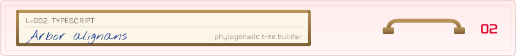</picture></summary>

<a href="https://github.com/Llenoxinn/PHY-TREE---Phylogenetic-Tree-Builder"><picture><source media="(prefers-color-scheme: dark)" srcset="assets/drawers/tray-2-dark.svg"></picture></a>

<sub>Specimen L-002 · <a href="https://github.com/Llenoxinn/PHY-TREE---Phylogenetic-Tree-Builder">PHY-TREE</a> · TypeScript</sub>
</details>

<details>
<summary><picture><source media="(prefers-color-scheme: dark)" srcset="assets/drawers/front-3-dark.svg">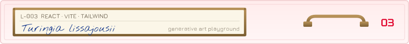</picture></summary>

<a href="https://github.com/Llenoxinn/viscal"><picture><source media="(prefers-color-scheme: dark)" srcset="assets/drawers/tray-3-dark.svg"></picture></a>

<sub>Specimen L-003 · <a href="https://github.com/Llenoxinn/viscal">viscal</a> · React, Vite, Tailwind</sub>
</details>

<details>
<summary><picture><source media="(prefers-color-scheme: dark)" srcset="assets/drawers/front-4-dark.svg">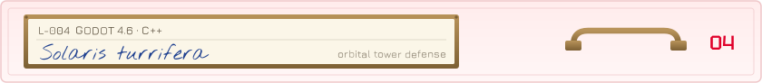</picture></summary>

<a href="https://github.com/GeoCeff/perk-the-star"><picture><source media="(prefers-color-scheme: dark)" srcset="assets/drawers/tray-4-dark.svg"></picture></a>

<sub>Specimen L-004 · <a href="https://github.com/GeoCeff/perk-the-star">perk-the-star</a> · Godot 4.6, C++ · collected on expedition with GeoCeff</sub>
</details>

<sub>More in the <a href="https://github.com/Llenoxinn?tab=repositories">full collection</a>.</sub>

<picture><source media="(prefers-color-scheme: dark)" srcset="assets/stream-1-dark.svg"></picture>


<!-- SPECIMEN:START -->
<a href="https://www.rcsb.org/structure/8OP4"><picture><source media="(prefers-color-scheme: dark)" srcset="assets/specimen-dark.webp?v=2026-10-20"></picture></a>

<a href="https://www.rcsb.org/structure/8OP4"><picture><source media="(prefers-color-scheme: dark)" srcset="assets/specimen-dark.svg?v=2026-10-20"></picture></a>

<sub>Grab it and turn it:</sub>

```stl
solid specimen_cartoon
facet normal -0.9 0.1 -0.4
outer loop
vertex 241 -124 -65
vertex 246 -126 -74
vertex 233 -208 -66
endloop
endfacet
facet normal -0.9 0.1 -0.4
outer loop
vertex 241 -124 -65
vertex 233 -208 -66
vertex 228 -204 -54
endloop
endfacet
facet normal 0.4 -0.2 -0.9
outer loop
vertex 246 -126 -74
vertex 255 -127 -70
vertex 245 -208 -61
endloop
endfacet
facet normal 0.4 -0.2 -0.9
outer loop
vertex 246 -126 -74
vertex 245 -208 -61
vertex 233 -208 -66
endloop
endfacet
facet normal 0.9 -0.1 0.4
outer loop
vertex 255 -127 -70
vertex 251 -125 -60
vertex 240 -204 -49
endloop
endfacet
facet normal 0.9 -0.1 0.4
outer loop
vertex 255 -127 -70
vertex 240 -204 -49
vertex 245 -208 -61
endloop
endfacet
facet normal -0.4 0.2 0.9
outer loop
vertex 251 -125 -60
vertex 241 -124 -65
vertex 228 -204 -54
endloop
endfacet
facet normal -0.4 0.2 0.9
outer loop
vertex 251 -125 -60
vertex 228 -204 -54
vertex 240 -204 -49
endloop
endfacet
facet normal -0.9 -0.1 -0.4
outer loop
vertex 228 -204 -54
vertex 233 -208 -66
vertex 223 -306 -29
endloop
endfacet
facet normal -0.9 -0.1 -0.4
outer loop
vertex 228 -204 -54
vertex 223 -306 -29
vertex 215 -295 -16
endloop
endfacet
facet normal 0.4 -0.4 -0.9
outer loop
vertex 233 -208 -66
vertex 245 -208 -61
vertex 240 -301 -24
endloop
endfacet
facet normal 0.4 -0.4 -0.9
outer loop
vertex 233 -208 -66
vertex 240 -301 -24
vertex 223 -306 -29
endloop
endfacet
facet normal 0.9 0.1 0.4
outer loop
vertex 245 -208 -61
vertex 240 -204 -49
vertex 233 -290 -11
endloop
endfacet
facet normal 0.9 0.1 0.4
outer loop
vertex 245 -208 -61
vertex 233 -290 -11
vertex 240 -301 -24
endloop
endfacet
facet normal -0.4 0.4 0.8
outer loop
vertex 240 -204 -49
vertex 228 -204 -54
vertex 215 -295 -16
endloop
endfacet
facet normal -0.4 0.4 0.8
outer loop
vertex 240 -204 -49
vertex 215 -295 -16
vertex 233 -290 -11
endloop
endfacet
facet normal -0.9 -0.4 -0.1
outer loop
vertex 215 -295 -16
vertex 223 -306 -29
vertex 234 -371 76
endloop
endfacet
facet normal -0.9 -0.4 -0.1
outer loop
vertex 215 -295 -16
vertex 234 -371 76
vertex 224 -352 86
endloop
endfacet
facet normal 0.4 -0.8 -0.5
outer loop
vertex 223 -306 -29
vertex 240 -301 -24
vertex 256 -361 78
endloop
endfacet
facet normal 0.4 -0.8 -0.5
outer loop
vertex 223 -306 -29
vertex 256 -361 78
vertex 234 -371 76
endloop
endfacet
facet normal 0.9 0.4 0.1
outer loop
vertex 240 -301 -24
vertex 233 -290 -11
vertex 246 -342 88
endloop
endfacet
facet normal 0.9 0.4 0.1
outer loop
vertex 240 -301 -24
vertex 246 -342 88
vertex 256 -361 78
endloop
endfacet
facet normal -0.4 0.8 0.5
outer loop
vertex 233 -290 -11
vertex 215 -295 -16
vertex 224 -352 86
endloop
endfacet
facet normal -0.4 0.8 0.5
outer loop
vertex 233 -290 -11
vertex 224 -352 86
vertex 246 -342 88
endloop
endfacet
facet normal -0.9 -0.4 -0.1
outer loop
vertex 224 -352 86
vertex 234 -371 76
vertex 249 -416 197
endloop
endfacet
facet normal -0.9 -0.4 -0.1
outer loop
vertex 224 -352 86
vertex 249 -416 197
vertex 236 -390 205
endloop
endfacet
facet normal 0.4 -0.8 -0.4
outer loop
vertex 234 -371 76
vertex 256 -361 78
vertex 275 -402 198
endloop
endfacet
facet normal 0.4 -0.8 -0.4
outer loop
vertex 234 -371 76
vertex 275 -402 198
vertex 249 -416 197
endloop
endfacet
facet normal 0.9 0.5 0
outer loop
vertex 256 -361 78
vertex 246 -342 88
vertex 262 -377 206
endloop
endfacet
facet normal 0.9 0.5 0
outer loop
vertex 256 -361 78
vertex 262 -377 206
vertex 275 -402 198
endloop
endfacet
facet normal -0.4 0.8 0.3
outer loop
vertex 246 -342 88
vertex 224 -352 86
vertex 236 -390 205
endloop
endfacet
facet normal -0.4 0.8 0.3
outer loop
vertex 246 -342 88
vertex 236 -390 205
vertex 262 -377 206
endloop
endfacet
facet normal -0.9 -0.4 0
outer loop
vertex 236 -390 205
vertex 249 -416 197
vertex 256 -437 309
endloop
endfacet
facet normal -0.9 -0.5 0
outer loop
vertex 236 -390 205
vertex 256 -437 309
vertex 244 -413 312
endloop
endfacet
facet normal 0.4 -0.9 -0.2
outer loop
vertex 249 -416 197
vertex 275 -402 198
vertex 280 -425 311
endloop
endfacet
facet normal 0.4 -0.9 -0.2
outer loop
vertex 249 -416 197
vertex 280 -425 311
vertex 256 -437 309
endloop
endfacet
facet normal 0.9 0.4 0
outer loop
vertex 275 -402 198
vertex 262 -377 206
vertex 268 -401 314
endloop
endfacet
facet normal 0.9 0.4 0
outer loop
vertex 275 -402 198
vertex 268 -401 314
vertex 280 -425 311
endloop
endfacet
facet normal -0.4 0.9 0.2
outer loop
vertex 262 -377 206
vertex 236 -390 205
vertex 244 -413 312
endloop
endfacet
facet normal -0.4 0.9 0.2
outer loop
vertex 262 -377 206
vertex 244 -413 312
vertex 268 -401 314
endloop
endfacet
facet normal -0.9 -0.5 0
outer loop
vertex 244 -413 312
vertex 256 -437 309
vertex 253 -428 386
endloop
endfacet
facet normal -0.8 -0.5 0
outer loop
vertex 244 -413 312
vertex 253 -428 386
vertex 248 -420 373
endloop
endfacet
facet normal 0.4 -0.9 0.2
outer loop
vertex 256 -437 309
vertex 280 -425 311
vertex 264 -417 389
endloop
endfacet
facet normal 0.7 -0.7 0.1
outer loop
vertex 256 -437 309
vertex 264 -417 389
vertex 253 -428 386
endloop
endfacet
facet normal 0.9 0.4 0.2
outer loop
vertex 280 -425 311
vertex 268 -401 314
vertex 259 -409 376
endloop
endfacet
facet normal 0.8 0.6 0.1
outer loop
vertex 280 -425 311
vertex 259 -409 376
vertex 264 -417 389
endloop
endfacet
facet normal -0.5 0.9 0.1
outer loop
vertex 268 -401 314
vertex 244 -413 312
vertex 248 -420 373
endloop
endfacet
facet normal -0.7 0.7 0
outer loop
vertex 268 -401 314
vertex 248 -420 373
vertex 259 -409 376
endloop
endfacet
facet normal -0.6 -0.7 -0.2
outer loop
vertex 248 -420 373
vertex 253 -428 386
vertex 209 -382 360
endloop
endfacet
facet normal -0.7 -0.6 0.4
outer loop
vertex 248 -420 373
vertex 209 -382 360
vertex 211 -394 349
endloop
endfacet
facet normal -0.5 0.2 0.9
outer loop
vertex 253 -428 386
vertex 264 -417 389
vertex 222 -375 355
endloop
endfacet
facet normal 0 0.5 0.9
outer loop
vertex 253 -428 386
vertex 222 -375 355
vertex 209 -382 360
endloop
endfacet
facet normal 0.1 0.8 0.5
outer loop
vertex 264 -417 389
vertex 259 -409 376
vertex 225 -386 344
endloop
endfacet
facet normal 0.8 0.5 -0.3
outer loop
vertex 264 -417 389
vertex 225 -386 344
vertex 222 -375 355
endloop
endfacet
facet normal 0.4 -0.2 -0.9
outer loop
vertex 259 -409 376
vertex 248 -420 373
vertex 211 -394 349
endloop
endfacet
facet normal 0.2 -0.7 -0.7
outer loop
vertex 259 -409 376
vertex 211 -394 349
vertex 225 -386 344
endloop
endfacet
facet normal -0.9 -0.4 0.3
outer loop
vertex 211 -394 349
vertex 209 -382 360
vertex 160 -328 288
endloop
endfacet
facet normal -0.9 -0.4 0.3
outer loop
vertex 211 -394 349
vertex 160 -328 288
vertex 165 -348 271
endloop
endfacet
facet normal -0.2 0.7 0.7
outer loop
vertex 209 -382 360
vertex 222 -375 355
vertex 185 -318 284
endloop
endfacet
facet normal -0.2 0.7 0.7
outer loop
vertex 209 -382 360
vertex 185 -318 284
vertex 160 -328 288
endloop
endfacet
facet normal 0.9 0.4 -0.2
outer loop
vertex 222 -375 355
vertex 225 -386 344
vertex 190 -339 267
endloop
endfacet
facet normal 0.9 0.4 -0.2
outer loop
vertex 222 -375 355
vertex 190 -339 267
vertex 185 -318 284
endloop
endfacet
facet normal 0.2 -0.8 -0.6
outer loop
vertex 225 -386 344
vertex 211 -394 349
vertex 165 -348 271
endloop
endfacet
facet normal 0.2 -0.8 -0.6
outer loop
vertex 225 -386 344
vertex 165 -348 271
vertex 190 -339 267
endloop
endfacet
facet normal -0.9 -0.3 0.1
outer loop
vertex 165 -348 271
vertex 160 -328 288
vertex 128 -257 197
endloop
endfacet
facet normal -0.9 -0.3 0.1
outer loop
vertex 165 -348 271
vertex 128 -257 197
vertex 136 -283 179
endloop
endfacet
facet normal -0.2 0.7 0.6
outer loop
vertex 160 -328 288
vertex 185 -318 284
vertex 160 -249 198
endloop
endfacet
facet normal -0.2 0.7 0.6
outer loop
vertex 160 -328 288
vertex 160 -249 198
vertex 128 -257 197
endloop
endfacet
facet normal 1 0.3 0
outer loop
vertex 185 -318 284
vertex 190 -339 267
vertex 167 -275 180
endloop
endfacet
facet normal 1 0.3 0
outer loop
vertex 185 -318 284
vertex 167 -275 180
vertex 160 -249 198
endloop
endfacet
facet normal 0.2 -0.8 -0.6
outer loop
vertex 190 -339 267
vertex 165 -348 271
vertex 136 -283 179
endloop
endfacet
facet normal 0.2 -0.8 -0.6
outer loop
vertex 190 -339 267
vertex 136 -283 179
vertex 167 -275 180
endloop
endfacet
facet normal -1 -0.2 -0.1
outer loop
vertex 136 -283 179
vertex 128 -257 197
vertex 132 -202 85
endloop
endfacet
facet normal -1 -0.1 -0.1
outer loop
vertex 136 -283 179
vertex 132 -202 85
vertex 136 -234 83
endloop
endfacet
facet normal -0.2 0.9 0.4
outer loop
vertex 128 -257 197
vertex 160 -249 198
vertex 162 -199 97
endloop
endfacet
facet normal -0.3 0.9 0.4
outer loop
vertex 128 -257 197
vertex 162 -199 97
vertex 132 -202 85
endloop
endfacet
facet normal 1 0.2 0.1
outer loop
vertex 160 -249 198
vertex 167 -275 180
vertex 166 -231 95
endloop
endfacet
facet normal 1 0.1 0.1
outer loop
vertex 160 -249 198
vertex 166 -231 95
vertex 162 -199 97
endloop
endfacet
facet normal 0.2 -0.9 -0.4
outer loop
vertex 167 -275 180
vertex 136 -283 179
vertex 136 -234 83
endloop
endfacet
facet normal 0.3 -0.9 -0.5
outer loop
vertex 167 -275 180
vertex 136 -234 83
vertex 166 -231 95
endloop
endfacet
facet normal -0.8 -0.1 -0.6
outer loop
vertex 136 -234 83
vertex 132 -202 85
vertex 221 -235 -29
endloop
endfacet
facet normal -0.8 -0.1 -0.6
outer loop
vertex 136 -234 83
vertex 221 -235 -29
vertex 219 -261 -22
endloop
endfacet
facet normal 0 1 -0.3
outer loop
vertex 132 -202 85
vertex 162 -199 97
vertex 242 -233 -12
endloop
endfacet
facet normal 0.1 1 -0.2
outer loop
vertex 132 -202 85
vertex 242 -233 -12
vertex 221 -235 -29
endloop
endfacet
facet normal 0.8 0.1 0.6
outer loop
vertex 162 -199 97
vertex 166 -231 95
vertex 240 -259 -6
endloop
endfacet
facet normal 0.8 0.1 0.6
outer loop
vertex 162 -199 97
vertex 240 -259 -6
vertex 242 -233 -12
endloop
endfacet
facet normal 0 -1 0.2
outer loop
vertex 166 -231 95
vertex 136 -234 83
vertex 219 -261 -22
endloop
endfacet
facet normal -0.1 -1 0.2
outer loop
vertex 166 -231 95
vertex 219 -261 -22
vertex 240 -259 -6
endloop
endfacet
facet normal -0.7 -0.1 -0.7
outer loop
vertex 219 -261 -22
vertex 221 -235 -29
vertex 286 -267 -82
endloop
endfacet
facet normal 0.3 -0.9 0.4
outer loop
vertex 219 -261 -22
vertex 284 -274 -96
vertex 286 -267 -82
endloop
endfacet
facet normal 0.1 0.9 -0.3
outer loop
vertex 221 -235 -29
vertex 242 -233 -12
vertex 302 -264 -85
endloop
endfacet
facet normal -0.2 0.7 -0.7
outer loop
vertex 221 -235 -29
vertex 302 -264 -85
vertex 286 -267 -82
endloop
endfacet
facet normal 0.8 0.1 0.5
outer loop
vertex 242 -233 -12
vertex 240 -259 -6
vertex 300 -272 -99
endloop
endfacet
facet normal -0.1 0.9 -0.4
outer loop
vertex 242 -233 -12
vertex 302 -264 -85
vertex 300 -272 -99
endloop
endfacet
facet normal 0 -1 0.2
outer loop
vertex 240 -259 -6
vertex 219 -261 -22
vertex 284 -274 -96
endloop
endfacet
facet normal 0.2 -0.9 0.3
outer loop
vertex 240 -259 -6
vertex 284 -274 -96
vertex 300 -272 -99
endloop
endfacet
facet normal -0.6 -0.7 0.4
outer loop
vertex 284 -274 -96
vertex 286 -267 -82
vertex 210 -175 -47
endloop
endfacet
facet normal -0.7 -0.7 0.2
outer loop
vertex 284 -274 -96
vertex 210 -175 -47
vertex 206 -174 -57
endloop
endfacet
facet normal 0.2 -0.2 1
outer loop
vertex 286 -267 -82
vertex 302 -264 -85
vertex 217 -167 -49
endloop
endfacet
facet normal 0.4 -0.1 0.9
outer loop
vertex 286 -267 -82
vertex 217 -167 -49
vertex 210 -175 -47
endloop
endfacet
facet normal 0.6 0.7 -0.4
outer loop
vertex 302 -264 -85
vertex 300 -272 -99
vertex 213 -166 -59
endloop
endfacet
facet normal 0.7 0.7 -0.2
outer loop
vertex 302 -264 -85
vertex 213 -166 -59
vertex 217 -167 -49
endloop
endfacet
facet normal -0.2 0.2 -1
outer loop
vertex 300 -272 -99
vertex 284 -274 -96
vertex 206 -174 -57
endloop
endfacet
facet normal -0.4 0.1 -0.9
outer loop
vertex 300 -272 -99
vertex 206 -174 -57
vertex 213 -166 -59
endloop
endfacet
facet normal -0.6 -0.8 0.2
outer loop
vertex 206 -174 -57
vertex 210 -175 -47
vertex 114 -88 0
endloop
endfacet
facet normal -0.7 -0.8 0.1
outer loop
vertex 206 -174 -57
vertex 114 -88 0
vertex 113 -89 -11
endloop
endfacet
facet normal 0.4 -0.1 0.9
outer loop
vertex 210 -175 -47
vertex 217 -167 -49
vertex 116 -78 -1
endloop
endfacet
facet normal 0.4 0 0.9
outer loop
vertex 210 -175 -47
vertex 116 -78 -1
vertex 114 -88 0
endloop
endfacet
facet normal 0.6 0.8 -0.2
outer loop
vertex 217 -167 -49
vertex 213 -166 -59
vertex 115 -78 -12
endloop
endfacet
facet normal 0.6 0.8 -0.1
outer loop
vertex 217 -167 -49
vertex 115 -78 -12
vertex 116 -78 -1
endloop
endfacet
facet normal -0.4 0.1 -0.9
outer loop
vertex 213 -166 -59
vertex 206 -174 -57
vertex 113 -89 -11
endloop
endfacet
facet normal -0.4 0 -0.9
outer loop
vertex 213 -166 -59
vertex 113 -89 -11
vertex 115 -78 -12
endloop
endfacet
facet normal 1 0 0
outer loop
vertex 113 -89 -11
vertex 114 -88 0
vertex 110 -143 -58
endloop
endfacet
facet normal -0.5 0.6 -0.7
outer loop
vertex 113 -89 -11
vertex 110 -143 -58
vertex 98 -147 -54
endloop
endfacet
facet normal 0.9 -0.2 0.3
outer loop
vertex 114 -88 0
vertex 116 -149 -48
vertex 116 -78 -1
endloop
endfacet
facet normal 0.9 0.3 -0.3
outer loop
vertex 114 -88 0
vertex 116 -149 -48
vertex 110 -143 -58
endloop
endfacet
facet normal -1 0.1 0
outer loop
vertex 116 -78 -1
vertex 115 -78 -12
vertex 104 -154 -44
endloop
endfacet
facet normal 0.4 -0.5 0.7
outer loop
vertex 116 -78 -1
vertex 104 -154 -44
vertex 116 -149 -48
endloop
endfacet
facet normal -1 0.2 0.1
outer loop
vertex 115 -78 -12
vertex 98 -147 -54
vertex 113 -89 -11
endloop
endfacet
facet normal -0.9 -0.1 0.5
outer loop
vertex 115 -78 -12
vertex 98 -147 -54
vertex 104 -154 -44
endloop
endfacet
facet normal -0.4 0.5 -0.8
outer loop
vertex 98 -147 -54
vertex 110 -143 -58
vertex 138 -220 -119
endloop
endfacet
facet normal -0.4 0.5 -0.8
outer loop
vertex 98 -147 -54
vertex 138 -220 -119
vertex 125 -233 -121
endloop
endfacet
facet normal 0.9 0.5 -0.2
outer loop
vertex 110 -143 -58
vertex 116 -149 -48
vertex 144 -228 -104
endloop
endfacet
facet normal 0.9 0.4 -0.1
outer loop
vertex 110 -143 -58
vertex 144 -228 -104
vertex 138 -220 -119
endloop
endfacet
facet normal 0.4 -0.4 0.8
outer loop
vertex 116 -149 -48
vertex 104 -154 -44
vertex 131 -241 -106
endloop
endfacet
facet normal 0.3 -0.5 0.8
outer loop
vertex 116 -149 -48
vertex 131 -241 -106
vertex 144 -228 -104
endloop
endfacet
facet normal -0.9 -0.4 0.2
outer loop
vertex 104 -154 -44
vertex 98 -147 -54
vertex 125 -233 -121
endloop
endfacet
facet normal -0.9 -0.4 0.1
outer loop
vertex 104 -154 -44
vertex 125 -233 -121
vertex 131 -241 -106
endloop
endfacet
facet normal -0.1 0.2 -1
outer loop
vertex 125 -233 -121
vertex 138 -220 -119
vertex 188 -210 -122
endloop
endfacet
facet normal -0.3 0.7 -0.6
outer loop
vertex 125 -233 -121
vertex 188 -210 -122
vertex 188 -223 -139
endloop
endfacet
facet normal 0 0.9 0.5
outer loop
vertex 138 -220 -119
vertex 144 -228 -104
vertex 199 -224 -111
endloop
endfacet
facet normal -0.1 0.6 0.8
outer loop
vertex 138 -220 -119
vertex 199 -224 -111
vertex 188 -210 -122
endloop
endfacet
facet normal 0.3 -0.4 0.9
outer loop
vertex 144 -228 -104
vertex 131 -241 -106
vertex 199 -237 -127
endloop
endfacet
facet normal 0.1 -0.8 0.6
outer loop
vertex 144 -228 -104
vertex 199 -237 -127
vertex 199 -224 -111
endloop
endfacet
facet normal 0 -0.9 -0.5
outer loop
vertex 131 -241 -106
vertex 125 -233 -121
vertex 188 -223 -139
endloop
endfacet
facet normal -0.2 -0.7 -0.7
outer loop
vertex 131 -241 -106
vertex 188 -223 -139
vertex 199 -237 -127
endloop
endfacet
facet normal -0.8 0.5 -0.4
outer loop
vertex 188 -223 -139
vertex 188 -210 -122
vertex 221 -178 -145
endloop
endfacet
facet normal -0.6 0.3 -0.7
outer loop
vertex 188 -223 -139
vertex 221 -178 -145
vertex 227 -193 -158
endloop
endfacet
facet normal -0.1 0.6 0.8
outer loop
vertex 188 -210 -122
vertex 199 -224 -111
vertex 241 -172 -142
endloop
endfacet
facet normal -0.3 0.7 0.6
outer loop
vertex 188 -210 -122
vertex 241 -172 -142
vertex 221 -178 -145
endloop
endfacet
facet normal 0.8 -0.5 0.4
outer loop
vertex 199 -224 -111
vertex 199 -237 -127
vertex 247 -188 -156
endloop
endfacet
facet normal 0.7 -0.2 0.6
outer loop
vertex 199 -224 -111
vertex 247 -188 -156
vertex 241 -172 -142
endloop
endfacet
facet normal 0.1 -0.6 -0.8
outer loop
vertex 199 -237 -127
vertex 188 -223 -139
vertex 227 -193 -158
endloop
endfacet
facet normal 0.3 -0.7 -0.7
outer loop
vertex 199 -237 -127
vertex 227 -193 -158
vertex 247 -188 -156
endloop
endfacet
facet normal -0.9 -0.5 0.1
outer loop
vertex 227 -193 -158
vertex 221 -178 -145
vertex 169 -105 -258
endloop
endfacet
facet normal -0.9 -0.5 0.1
outer loop
vertex 227 -193 -158
vertex 169 -105 -258
vertex 176 -119 -269
endloop
endfacet
facet normal -0.3 0.7 0.6
outer loop
vertex 221 -178 -145
vertex 241 -172 -142
vertex 184 -95 -261
endloop
endfacet
facet normal -0.3 0.7 0.6
outer loop
vertex 221 -178 -145
vertex 184 -95 -261
vertex 169 -105 -258
endloop
endfacet
facet normal 0.9 0.5 -0.1
outer loop
vertex 241 -172 -142
vertex 247 -188 -156
vertex 191 -108 -272
endloop
endfacet
facet normal 0.9 0.5 -0.1
outer loop
vertex 241 -172 -142
vertex 191 -108 -272
vertex 184 -95 -261
endloop
endfacet
facet normal 0.3 -0.7 -0.6
outer loop
vertex 247 -188 -156
vertex 227 -193 -158
vertex 176 -119 -269
endloop
endfacet
facet normal 0.3 -0.7 -0.6
outer loop
vertex 247 -188 -156
vertex 176 -119 -269
vertex 191 -108 -272
endloop
endfacet
facet normal -0.8 -0.6 0.3
outer loop
vertex 176 -119 -269
vertex 169 -105 -258
vertex 101 -64 -358
endloop
endfacet
facet normal -0.7 -0.8 0.1
outer loop
vertex 176 -119 -269
vertex 101 -64 -358
vertex 110 -73 -363
endloop
endfacet
facet normal -0.4 0.7 0.6
outer loop
vertex 169 -105 -258
vertex 184 -95 -261
vertex 105 -56 -368
endloop
endfacet
facet normal -0.4 0.8 0.5
outer loop
vertex 169 -105 -258
vertex 105 -56 -368
vertex 101 -64 -358
endloop
endfacet
facet normal 0.7 0.6 -0.3
outer loop
vertex 184 -95 -261
vertex 191 -108 -272
vertex 114 -64 -372
endloop
endfacet
facet normal 0.6 0.8 -0.2
outer loop
vertex 184 -95 -261
vertex 114 -64 -372
vertex 105 -56 -368
endloop
endfacet
facet normal 0.4 -0.7 -0.6
outer loop
vertex 191 -108 -272
vertex 176 -119 -269
vertex 110 -73 -363
endloop
endfacet
facet normal 0.3 -0.8 -0.6
outer loop
vertex 191 -108 -272
vertex 110 -73 -363
vertex 114 -64 -372
endloop
endfacet
facet normal 0.4 0 0.9
outer loop
vertex 110 -73 -363
vertex 101 -64 -358
vertex 82 -166 -344
endloop
endfacet
facet normal 0.7 -0.1 0.7
outer loop
vertex 110 -73 -363
vertex 82 -166 -344
vertex 92 -172 -355
endloop
endfacet
facet normal -1 0.3 -0.1
outer loop
vertex 101 -64 -358
vertex 105 -56 -368
vertex 70 -167 -355
endloop
endfacet
facet normal -0.7 0.2 0.7
outer loop
vertex 101 -64 -358
vertex 70 -167 -355
vertex 82 -166 -344
endloop
endfacet
facet normal -0.4 0.1 -0.9
outer loop
vertex 105 -56 -368
vertex 114 -64 -372
vertex 80 -173 -366
endloop
endfacet
facet normal -0.7 0.1 -0.7
outer loop
vertex 105 -56 -368
vertex 80 -173 -366
vertex 70 -167 -355
endloop
endfacet
facet normal 1 -0.2 0.2
outer loop
vertex 114 -64 -372
vertex 110 -73 -363
vertex 92 -172 -355
endloop
endfacet
facet normal 0.7 -0.2 -0.7
outer loop
vertex 114 -64 -372
vertex 92 -172 -355
vertex 80 -173 -366
endloop
endfacet
facet normal 0.8 0.3 0.6
outer loop
vertex 92 -172 -355
vertex 82 -166 -344
vertex 65 -264 -280
endloop
endfacet
facet normal 0.7 0.3 0.6
outer loop
vertex 92 -172 -355
vertex 65 -264 -280
vertex 79 -287 -286
endloop
endfacet
facet normal -0.6 0.5 0.6
outer loop
vertex 82 -166 -344
vertex 70 -167 -355
vertex 44 -275 -294
endloop
endfacet
facet normal -0.6 0.5 0.6
outer loop
vertex 82 -166 -344
vertex 44 -275 -294
vertex 65 -264 -280
endloop
endfacet
facet normal -0.8 -0.2 -0.6
outer loop
vertex 70 -167 -355
vertex 80 -173 -366
vertex 58 -297 -299
endloop
endfacet
facet normal -0.7 -0.2 -0.7
outer loop
vertex 70 -167 -355
vertex 58 -297 -299
vertex 44 -275 -294
endloop
endfacet
facet normal 0.6 -0.5 -0.6
outer loop
vertex 80 -173 -366
vertex 92 -172 -355
vertex 79 -287 -286
endloop
endfacet
facet normal 0.6 -0.5 -0.6
outer loop
vertex 80 -173 -366
vertex 79 -287 -286
vertex 58 -297 -299
endloop
endfacet
facet normal 0.8 0.5 0.2
outer loop
vertex 79 -287 -286
vertex 65 -264 -280
vertex 23 -237 -193
endloop
endfacet
facet normal 0.8 0.5 0.2
outer loop
vertex 79 -287 -286
vertex 23 -237 -193
vertex 34 -262 -180
endloop
endfacet
facet normal -0.2 0.9 -0.3
outer loop
vertex 65 -264 -280
vertex 44 -275 -294
vertex -3 -251 -197
endloop
endfacet
facet normal -0.4 0.8 -0.4
outer loop
vertex 65 -264 -280
vertex -3 -251 -197
vertex 23 -237 -193
endloop
endfacet
facet normal -0.8 -0.5 -0.3
outer loop
vertex 44 -275 -294
vertex 58 -297 -299
vertex 8 -275 -184
endloop
endfacet
facet normal -0.8 -0.5 -0.3
outer loop
vertex 44 -275 -294
vertex 8 -275 -184
vertex -3 -251 -197
endloop
endfacet
facet normal 0.2 -0.9 0.3
outer loop
vertex 58 -297 -299
vertex 79 -287 -286
vertex 34 -262 -180
endloop
endfacet
facet normal 0.4 -0.9 0.3
outer loop
vertex 58 -297 -299
vertex 34 -262 -180
vertex 8 -275 -184
endloop
endfacet
facet normal 0.9 0.4 0.1
outer loop
vertex 34 -262 -180
vertex 23 -237 -193
vertex -7 -190 -72
endloop
endfacet
facet normal 0.9 0.4 0.1
outer loop
vertex 34 -262 -180
vertex -7 -190 -72
vertex 3 -212 -68
endloop
endfacet
facet normal -0.4 0.8 -0.4
outer loop
vertex 23 -237 -193
vertex -3 -251 -197
vertex -29 -199 -69
endloop
endfacet
facet normal -0.4 0.8 -0.4
outer loop
vertex 23 -237 -193
vertex -29 -199 -69
vertex -7 -190 -72
endloop
endfacet
facet normal -0.9 -0.4 0
outer loop
vertex -3 -251 -197
vertex 8 -275 -184
vertex -19 -221 -64
endloop
endfacet
facet normal -0.9 -0.4 0
outer loop
vertex -3 -251 -197
vertex -19 -221 -64
vertex -29 -199 -69
endloop
endfacet
facet normal 0.4 -0.8 0.5
outer loop
vertex 8 -275 -184
vertex 34 -262 -180
vertex 3 -212 -68
endloop
endfacet
facet normal 0.4 -0.8 0.5
outer loop
vertex 8 -275 -184
vertex 3 -212 -68
vertex -19 -221 -64
endloop
endfacet
facet normal 0.9 0.3 -0.3
outer loop
vertex 3 -212 -68
vertex -7 -190 -72
vertex 35 -183 45
endloop
endfacet
facet normal 0.9 0.4 -0.3
outer loop
vertex 3 -212 -68
vertex 35 -183 45
vertex 44 -205 41
endloop
endfacet
facet normal -0.4 0.9 0.1
outer loop
vertex -7 -190 -72
vertex -29 -199 -69
vertex 14 -192 53
endloop
endfacet
facet normal -0.4 0.9 0.1
outer loop
vertex -7 -190 -72
vertex 14 -192 53
vertex 35 -183 45
endloop
endfacet
facet normal -0.9 -0.3 0.3
outer loop
vertex -29 -199 -69
vertex -19 -221 -64
vertex 23 -214 49
endloop
endfacet
facet normal -0.9 -0.4 0.3
outer loop
vertex -29 -199 -69
vertex 23 -214 49
vertex 14 -192 53
endloop
endfacet
facet normal 0.4 -0.9 -0.1
outer loop
vertex -19 -221 -64
vertex 3 -212 -68
vertex 44 -205 41
endloop
endfacet
facet normal 0.4 -0.9 -0.1
outer loop
vertex -19 -221 -64
vertex 44 -205 41
vertex 23 -214 49
endloop
endfacet
facet normal 0.9 0.4 -0.3
outer loop
vertex 44 -205 41
vertex 35 -183 45
vertex 85 -193 163
endloop
endfacet
facet normal 0.9 0.4 -0.3
outer loop
vertex 44 -205 41
vertex 85 -193 163
vertex 94 -220 155
endloop
endfacet
facet normal -0.3 0.9 0.2
outer loop
vertex 35 -183 45
vertex 14 -192 53
vertex 57 -202 165
endloop
endfacet
facet normal -0.3 0.9 0.2
outer loop
vertex 35 -183 45
vertex 57 -202 165
vertex 85 -193 163
endloop
endfacet
facet normal -0.9 -0.4 0.3
outer loop
vertex 14 -192 53
vertex 23 -214 49
vertex 66 -229 157
endloop
endfacet
facet normal -0.9 -0.4 0.3
outer loop
vertex 14 -192 53
vertex 66 -229 157
vertex 57 -202 165
endloop
endfacet
facet normal 0.3 -0.9 -0.3
outer loop
vertex 23 -214 49
vertex 44 -205 41
vertex 94 -220 155
endloop
endfacet
facet normal 0.3 -0.9 -0.3
outer loop
vertex 23 -214 49
vertex 94 -220 155
vertex 66 -229 157
endloop
endfacet
facet normal 1 0.3 0.1
outer loop
vertex 94 -220 155
vertex 85 -193 163
vertex 81 -240 294
endloop
endfacet
facet normal 1 0.2 0.1
outer loop
vertex 94 -220 155
vertex 81 -240 294
vertex 90 -269 283
endloop
endfacet
facet normal -0.3 0.9 0.3
outer loop
vertex 85 -193 163
vertex 57 -202 165
vertex 50 -246 286
endloop
endfacet
facet normal -0.3 0.9 0.3
outer loop
vertex 85 -193 163
vertex 50 -246 286
vertex 81 -240 294
endloop
endfacet
facet normal -1 -0.3 -0.2
outer loop
vertex 57 -202 165
vertex 66 -229 157
vertex 59 -276 276
endloop
endfacet
facet normal -1 -0.2 -0.1
outer loop
vertex 57 -202 165
vertex 59 -276 276
vertex 50 -246 286
endloop
endfacet
facet normal 0.3 -0.9 -0.3
outer loop
vertex 66 -229 157
vertex 94 -220 155
vertex 90 -269 283
endloop
endfacet
facet normal 0.3 -0.9 -0.3
outer loop
vertex 66 -229 157
vertex 90 -269 283
vertex 59 -276 276
endloop
endfacet
facet normal 0.9 0.1 0.4
outer loop
vertex 90 -269 283
vertex 81 -240 294
vertex 47 -286 382
endloop
endfacet
facet normal 0.9 -0.3 0.3
outer loop
vertex 90 -269 283
vertex 47 -286 382
vertex 44 -315 367
endloop
endfacet
facet normal -0.3 0.9 0.3
outer loop
vertex 81 -240 294
vertex 50 -246 286
vertex 39 -271 354
endloop
endfacet
facet normal 0 0.9 0.5
outer loop
vertex 81 -240 294
vertex 39 -271 354
vertex 47 -286 382
endloop
endfacet
facet normal -0.9 -0.1 -0.4
outer loop
vertex 50 -246 286
vertex 59 -276 276
vertex 36 -300 340
endloop
endfacet
facet normal -1 0.2 -0.1
outer loop
vertex 50 -246 286
vertex 36 -300 340
vertex 39 -271 354
endloop
endfacet
facet normal 0.3 -0.9 -0.3
outer loop
vertex 59 -276 276
vertex 90 -269 283
vertex 44 -315 367
endloop
endfacet
facet normal -0.2 -0.9 -0.4
outer loop
vertex 59 -276 276
vertex 44 -315 367
vertex 36 -300 340
endloop
endfacet
facet normal -0.7 -0.3 0.7
outer loop
vertex 44 -315 367
vertex 47 -286 382
vertex -25 -260 317
endloop
endfacet
facet normal -0.7 -0.7 0.2
outer loop
vertex 44 -315 367
vertex -25 -260 317
vertex -11 -282 298
endloop
endfacet
facet normal 0.3 0.9 0.4
outer loop
vertex 47 -286 382
vertex 39 -271 354
vertex 0 -240 313
endloop
endfacet
facet normal -0.4 0.6 0.7
outer loop
vertex 47 -286 382
vertex 0 -240 313
vertex -25 -260 317
endloop
endfacet
facet normal 0.9 0.1 -0.4
outer loop
vertex 39 -271 354
vertex 36 -300 340
vertex 14 -262 294
endloop
endfacet
facet normal 0.7 0.6 -0.2
outer loop
vertex 39 -271 354
vertex 14 -262 294
vertex 0 -240 313
endloop
endfacet
facet normal 0.1 -0.9 -0.5
outer loop
vertex 36 -300 340
vertex 44 -315 367
vertex -11 -282 298
endloop
endfacet
facet normal 0.4 -0.6 -0.7
outer loop
vertex 36 -300 340
vertex -11 -282 298
vertex 14 -262 294
endloop
endfacet
facet normal -0.8 -0.6 0.1
outer loop
vertex -11 -282 298
vertex -25 -260 317
vertex -72 -207 207
endloop
endfacet
facet normal -0.8 -0.6 0.1
outer loop
vertex -11 -282 298
vertex -72 -207 207
vertex -57 -230 191
endloop
endfacet
facet normal -0.5 0.7 0.5
outer loop
vertex -25 -260 317
vertex 0 -240 313
vertex -45 -189 207
endloop
endfacet
facet normal -0.5 0.7 0.5
outer loop
vertex -25 -260 317
vertex -45 -189 207
vertex -72 -207 207
endloop
endfacet
facet normal 0.8 0.6 -0.1
outer loop
vertex 0 -240 313
vertex 14 -262 294
vertex -29 -213 191
endloop
endfacet
facet normal 0.8 0.6 -0.1
outer loop
vertex 0 -240 313
vertex -29 -213 191
vertex -45 -189 207
endloop
endfacet
facet normal 0.5 -0.7 -0.5
outer loop
vertex 14 -262 294
vertex -11 -282 298
vertex -57 -230 191
endloop
endfacet
facet normal 0.5 -0.7 -0.5
outer loop
vertex 14 -262 294
vertex -57 -230 191
vertex -29 -213 191
endloop
endfacet
facet normal -0.9 -0.5 -0.1
outer loop
vertex -57 -230 191
vertex -72 -207 207
vertex -89 -162 106
endloop
endfacet
facet normal -0.9 -0.5 -0.1
outer loop
vertex -57 -230 191
vertex -89 -162 106
vertex -73 -188 96
endloop
endfacet
facet normal -0.5 0.8 0.4
outer loop
vertex -72 -207 207
vertex -45 -189 207
vertex -61 -146 109
endloop
endfacet
facet normal -0.5 0.8 0.4
outer loop
vertex -72 -207 207
vertex -61 -146 109
vertex -89 -162 106
endloop
endfacet
facet normal 0.9 0.5 0.1
outer loop
vertex -45 -189 207
vertex -29 -213 191
vertex -45 -172 99
endloop
endfacet
facet normal 0.9 0.5 0.1
outer loop
vertex -45 -189 207
vertex -45 -172 99
vertex -61 -146 109
endloop
endfacet
facet normal 0.5 -0.8 -0.4
outer loop
vertex -29 -213 191
vertex -57 -230 191
vertex -73 -188 96
endloop
endfacet
facet normal 0.5 -0.8 -0.4
outer loop
vertex -29 -213 191
vertex -73 -188 96
vertex -45 -172 99
endloop
endfacet
facet normal -0.9 -0.5 -0.1
outer loop
vertex -73 -188 96
vertex -89 -162 106
vertex -91 -137 -13
endloop
endfacet
facet normal -0.9 -0.5 -0.1
outer loop
vertex -73 -188 96
vertex -91 -137 -13
vertex -75 -166 -12
endloop
endfacet
facet normal -0.5 0.8 0.2
outer loop
vertex -89 -162 106
vertex -61 -146 109
vertex -63 -121 -14
endloop
endfacet
facet normal -0.5 0.9 0.2
outer loop
vertex -89 -162 106
vertex -63 -121 -14
vertex -91 -137 -13
endloop
endfacet
facet normal 0.9 0.5 0.1
outer loop
vertex -61 -146 109
vertex -45 -172 99
vertex -47 -149 -13
endloop
endfacet
facet normal 0.9 0.5 0.1
outer loop
vertex -61 -146 109
vertex -47 -149 -13
vertex -63 -121 -14
endloop
endfacet
facet normal 0.5 -0.8 -0.2
outer loop
vertex -45 -172 99
vertex -73 -188 96
vertex -75 -166 -12
endloop
endfacet
facet normal 0.5 -0.9 -0.2
outer loop
vertex -45 -172 99
vertex -75 -166 -12
vertex -47 -149 -13
endloop
endfacet
facet normal -0.9 -0.5 0.1
outer loop
vertex -75 -166 -12
vertex -91 -137 -13
vertex -86 -170 -191
endloop
endfacet
facet normal -0.9 -0.5 0.1
outer loop
vertex -75 -166 -12
vertex -86 -170 -191
vertex -72 -195 -185
endloop
endfacet
facet normal -0.5 0.9 -0.2
outer loop
vertex -91 -137 -13
vertex -63 -121 -14
vertex -60 -156 -193
endloop
endfacet
facet normal -0.5 0.9 -0.2
outer loop
vertex -91 -137 -13
vertex -60 -156 -193
vertex -86 -170 -191
endloop
endfacet
facet normal 0.9 0.5 -0.1
outer loop
vertex -63 -121 -14
vertex -47 -149 -13
vertex -46 -181 -186
endloop
endfacet
facet normal 0.9 0.5 -0.1
outer loop
vertex -63 -121 -14
vertex -46 -181 -186
vertex -60 -156 -193
endloop
endfacet
facet normal 0.5 -0.9 0.2
outer loop
vertex -47 -149 -13
vertex -75 -166 -12
vertex -72 -195 -185
endloop
endfacet
facet normal 0.5 -0.9 0.2
outer loop
vertex -47 -149 -13
vertex -72 -195 -185
vertex -46 -181 -186
endloop
endfacet
facet normal -0.9 -0.5 0
outer loop
vertex -72 -195 -185
vertex -86 -170 -191
vertex -64 -208 -338
endloop
endfacet
facet normal -0.9 -0.5 0
outer loop
vertex -72 -195 -185
vertex -64 -208 -338
vertex -53 -227 -329
endloop
endfacet
facet normal -0.5 0.8 -0.3
outer loop
vertex -86 -170 -191
vertex -60 -156 -193
vertex -46 -194 -331
endloop
endfacet
facet normal -0.5 0.8 -0.3
outer loop
vertex -86 -170 -191
vertex -46 -194 -331
vertex -64 -208 -338
endloop
endfacet
facet normal 0.9 0.5 0
outer loop
vertex -60 -156 -193
vertex -46 -181 -186
vertex -35 -213 -322
endloop
endfacet
facet normal 0.9 0.5 0
outer loop
vertex -60 -156 -193
vertex -35 -213 -322
vertex -46 -194 -331
endloop
endfacet
facet normal 0.5 -0.8 0.2
outer loop
vertex -46 -181 -186
vertex -72 -195 -185
vertex -53 -227 -329
endloop
endfacet
facet normal 0.5 -0.8 0.2
outer loop
vertex -46 -181 -186
vertex -53 -227 -329
vertex -35 -213 -322
endloop
endfacet
facet normal 0.1 -0.4 -0.9
outer loop
vertex -53 -227 -329
vertex -64 -208 -338
vertex 12 -199 -330
endloop
endfacet
facet normal 0.3 -0.8 -0.4
outer loop
vertex -53 -227 -329
vertex 12 -199 -330
vertex 5 -209 -316
endloop
endfacet
facet normal 0 0.4 -0.9
outer loop
vertex -64 -208 -338
vertex -46 -194 -331
vertex 1 -185 -325
endloop
endfacet
facet normal 0.1 0.4 -0.9
outer loop
vertex -64 -208 -338
vertex 1 -185 -325
vertex 12 -199 -330
endloop
endfacet
facet normal -0.4 0.2 0.9
outer loop
vertex -46 -194 -331
vertex -35 -213 -322
vertex -5 -195 -311
endloop
endfacet
facet normal -0.2 0.9 0.5
outer loop
vertex -46 -194 -331
vertex -5 -195 -311
vertex 1 -185 -325
endloop
endfacet
facet normal -0.1 -0.3 0.9
outer loop
vertex -35 -213 -322
vertex -53 -227 -329
vertex 5 -209 -316
endloop
endfacet
facet normal -0.1 -0.4 0.9
outer loop
vertex -35 -213 -322
vertex 5 -209 -316
vertex -5 -195 -311
endloop
endfacet
facet normal 0.8 -0.6 -0.1
outer loop
vertex 5 -209 -316
vertex 12 -199 -330
vertex 48 -166 -263
endloop
endfacet
facet normal 0.8 -0.6 -0.1
outer loop
vertex 5 -209 -316
vertex 48 -166 -263
vertex 40 -176 -258
endloop
endfacet
facet normal 0.5 0.6 -0.6
outer loop
vertex 12 -199 -330
vertex 1 -185 -325
vertex 38 -160 -268
endloop
endfacet
facet normal 0.6 0.5 -0.6
outer loop
vertex 12 -199 -330
vertex 38 -160 -268
vertex 48 -166 -263
endloop
endfacet
facet normal -0.7 0.7 0.2
outer loop
vertex 1 -185 -325
vertex -5 -195 -311
vertex 30 -170 -264
endloop
endfacet
facet normal -0.7 0.7 0.2
outer loop
vertex 1 -185 -325
vertex 30 -170 -264
vertex 38 -160 -268
endloop
endfacet
facet normal -0.5 -0.6 0.6
outer loop
vertex -5 -195 -311
vertex 5 -209 -316
vertex 40 -176 -258
endloop
endfacet
facet normal -0.6 -0.4 0.7
outer loop
vertex -5 -195 -311
vertex 40 -176 -258
vertex 30 -170 -264
endloop
endfacet
facet normal 0.5 -0.1 0.8
outer loop
vertex 40 -176 -258
vertex 48 -166 -263
vertex -10 -137 -223
endloop
endfacet
facet normal 0.4 -0.2 0.9
outer loop
vertex 40 -176 -258
vertex -10 -137 -223
vertex -15 -149 -223
endloop
endfacet
facet normal 0.5 0.9 0.1
outer loop
vertex 48 -166 -263
vertex 38 -160 -268
vertex -15 -134 -235
endloop
endfacet
facet normal 0.4 0.9 0
outer loop
vertex 48 -166 -263
vertex -15 -134 -235
vertex -10 -137 -223
endloop
endfacet
facet normal -0.5 0 -0.9
outer loop
vertex 38 -160 -268
vertex 30 -170 -264
vertex -21 -146 -235
endloop
endfacet
facet normal -0.4 0.2 -0.9
outer loop
vertex 38 -160 -268
vertex -21 -146 -235
vertex -15 -134 -235
endloop
endfacet
facet normal -0.5 -0.9 -0.1
outer loop
vertex 30 -170 -264
vertex 40 -176 -258
vertex -15 -149 -223
endloop
endfacet
facet normal -0.4 -0.9 0
outer loop
vertex 30 -170 -264
vertex -15 -149 -223
vertex -21 -146 -235
endloop
endfacet
facet normal 0.4 -0.2 0.9
outer loop
vertex -15 -149 -223
vertex -10 -137 -223
vertex -70 -103 -193
endloop
endfacet
facet normal 0.4 -0.1 0.9
outer loop
vertex -15 -149 -223
vertex -70 -103 -193
vertex -82 -116 -190
endloop
endfacet
facet normal 0.5 0.9 0
outer loop
vertex -10 -137 -223
vertex -15 -134 -235
vertex -78 -99 -210
endloop
endfacet
facet normal 0.5 0.9 0
outer loop
vertex -10 -137 -223
vertex -78 -99 -210
vertex -70 -103 -193
endloop
endfacet
facet normal -0.3 0.1 -0.9
outer loop
vertex -15 -134 -235
vertex -21 -146 -235
vertex -91 -113 -206
endloop
endfacet
facet normal -0.3 0.1 -0.9
outer loop
vertex -15 -134 -235
vertex -91 -113 -206
vertex -78 -99 -210
endloop
endfacet
facet normal -0.4 -0.9 0
outer loop
vertex -21 -146 -235
vertex -15 -149 -223
vertex -82 -116 -190
endloop
endfacet
facet normal -0.4 -0.9 0
outer loop
vertex -21 -146 -235
vertex -82 -116 -190
vertex -91 -113 -206
endloop
endfacet
facet normal 0.6 -0.3 0.7
outer loop
vertex -82 -116 -190
vertex -70 -103 -193
vertex -77 -52 -165
endloop
endfacet
facet normal 0.6 -0.3 0.7
outer loop
vertex -82 -116 -190
vertex -77 -52 -165
vertex -97 -57 -152
endloop
endfacet
facet normal 0.9 0.4 -0.4
outer loop
vertex -70 -103 -193
vertex -78 -99 -210
vertex -91 -47 -184
endloop
endfacet
facet normal 0.8 0.4 -0.5
outer loop
vertex -70 -103 -193
vertex -91 -47 -184
vertex -77 -52 -165
endloop
endfacet
facet normal -0.5 0.3 -0.8
outer loop
vertex -78 -99 -210
vertex -91 -113 -206
vertex -111 -51 -171
endloop
endfacet
facet normal -0.6 0.2 -0.8
outer loop
vertex -78 -99 -210
vertex -111 -51 -171
vertex -91 -47 -184
endloop
endfacet
facet normal -0.8 -0.4 0.3
outer loop
vertex -91 -113 -206
vertex -82 -116 -190
vertex -97 -57 -152
endloop
endfacet
facet normal -0.8 -0.5 0.4
outer loop
vertex -91 -113 -206
vertex -97 -57 -152
vertex -111 -51 -171
endloop
endfacet
facet normal 0.5 0.3 0.8
outer loop
vertex -97 -57 -152
vertex -77 -52 -165
vertex -78 -26 -174
endloop
endfacet
facet normal 0.8 -0.5 0
outer loop
vertex -97 -57 -152
vertex -78 -26 -174
vertex -63 -5 -159
endloop
endfacet
facet normal 0.8 0.3 -0.5
outer loop
vertex -77 -52 -165
vertex -91 -47 -184
vertex -100 -7 -179
endloop
endfacet
facet normal -0.1 -0.3 -0.9
outer loop
vertex -77 -52 -165
vertex -100 -7 -179
vertex -78 -26 -174
endloop
endfacet
facet normal -0.6 0.3 -0.8
outer loop
vertex -91 -47 -184
vertex -111 -51 -171
vertex -86 14 -164
endloop
endfacet
facet normal 0.5 0.2 -0.8
outer loop
vertex -91 -47 -184
vertex -100 -7 -179
vertex -86 14 -164
endloop
endfacet
facet normal -0.6 0.5 0.6
outer loop
vertex -111 -51 -171
vertex -97 -57 -152
vertex -63 -5 -159
endloop
endfacet
facet normal -0.2 0 1
outer loop
vertex -111 -51 -171
vertex -63 -5 -159
vertex -86 14 -164
endloop
endfacet
facet normal 0.7 -0.7 0.3
outer loop
vertex -63 -5 -159
vertex -78 -26 -174
vertex -41 -33 -267
endloop
endfacet
facet normal 0.7 -0.7 0.3
outer loop
vertex -63 -5 -159
vertex -41 -33 -267
vertex -23 -13 -262
endloop
endfacet
facet normal -0.6 -0.8 -0.2
outer loop
vertex -78 -26 -174
vertex -100 -7 -179
vertex -58 -15 -277
endloop
endfacet
facet normal -0.6 -0.7 -0.2
outer loop
vertex -78 -26 -174
vertex -58 -15 -277
vertex -41 -33 -267
endloop
endfacet
facet normal -0.7 0.7 -0.3
outer loop
vertex -100 -7 -179
vertex -86 14 -164
vertex -41 5 -272
endloop
endfacet
facet normal -0.7 0.7 -0.3
outer loop
vertex -100 -7 -179
vertex -41 5 -272
vertex -58 -15 -277
endloop
endfacet
facet normal 0.6 0.8 0.2
outer loop
vertex -86 14 -164
vertex -63 -5 -159
vertex -23 -13 -262
endloop
endfacet
facet normal 0.6 0.7 0.2
outer loop
vertex -86 14 -164
vertex -23 -13 -262
vertex -41 5 -272
endloop
endfacet
facet normal 0.7 -0.7 0.4
outer loop
vertex -23 -13 -262
vertex -41 -33 -267
vertex 5 -40 -367
endloop
endfacet
facet normal 0.7 -0.7 0.4
outer loop
vertex -23 -13 -262
vertex 5 -40 -367
vertex 12 -29 -359
endloop
endfacet
facet normal -0.6 -0.7 -0.2
outer loop
vertex -41 -33 -267
vertex -58 -15 -277
vertex -4 -29 -375
endloop
endfacet
facet normal -0.7 -0.7 -0.3
outer loop
vertex -41 -33 -267
vertex -4 -29 -375
vertex 5 -40 -367
endloop
endfacet
facet normal -0.6 0.7 -0.4
outer loop
vertex -58 -15 -277
vertex -41 5 -272
vertex 4 -18 -367
endloop
endfacet
facet normal -0.6 0.7 -0.4
outer loop
vertex -58 -15 -277
vertex 4 -18 -367
vertex -4 -29 -375
endloop
endfacet
facet normal 0.7 0.7 0.1
outer loop
vertex -41 5 -272
vertex -23 -13 -262
vertex 12 -29 -359
endloop
endfacet
facet normal 0.7 0.7 0.2
outer loop
vertex -41 5 -272
vertex 12 -29 -359
vertex 4 -18 -367
endloop
endfacet
facet normal 0.4 -0.7 0.6
outer loop
vertex 12 -29 -359
vertex 5 -40 -367
vertex 42 -6 -352
endloop
endfacet
facet normal 0.5 -0.5 -0.7
outer loop
vertex 12 -29 -359
vertex 42 -6 -352
vertex 42 -14 -347
endloop
endfacet
facet normal -0.6 0.1 0.8
outer loop
vertex 5 -40 -367
vertex 32 -3 -348
vertex -4 -29 -375
endloop
endfacet
facet normal 0.2 -0.6 0.8
outer loop
vertex 5 -40 -367
vertex 42 -6 -352
vertex 32 -3 -348
endloop
endfacet
facet normal -0.6 -0.1 0.8
outer loop
vertex -4 -29 -375
vertex 32 -12 -343
vertex 4 -18 -367
endloop
endfacet
facet normal -0.7 0.4 0.6
outer loop
vertex -4 -29 -375
vertex 32 -12 -343
vertex 32 -3 -348
endloop
endfacet
facet normal -0.5 0.2 0.8
outer loop
vertex 4 -18 -367
vertex 12 -29 -359
vertex 42 -14 -347
endloop
endfacet
facet normal 0.1 0.9 -0.3
outer loop
vertex 4 -18 -367
vertex 32 -12 -343
vertex 42 -14 -347
endloop
endfacet
facet normal 1 0 0
outer loop
vertex 42 -14 -347
vertex 42 -6 -352
vertex 39 12 -302
endloop
endfacet
facet normal 1 -0.2 0.2
outer loop
vertex 42 -14 -347
vertex 39 12 -302
vertex 38 2 -306
endloop
endfacet
facet normal 0 0.9 -0.5
outer loop
vertex 42 -6 -352
vertex 32 -3 -348
vertex 37 16 -311
endloop
endfacet
facet normal 0.9 0.3 -0.1
outer loop
vertex 42 -6 -352
vertex 37 16 -311
vertex 39 12 -302
endloop
endfacet
facet normal -1 0 0.1
outer loop
vertex 32 -3 -348
vertex 32 -12 -343
vertex 35 6 -315
endloop
endfacet
facet normal -1 0.1 0.1
outer loop
vertex 32 -3 -348
vertex 35 6 -315
vertex 37 16 -311
endloop
endfacet
facet normal -0.1 -0.9 0.4
outer loop
vertex 32 -12 -343
vertex 42 -14 -347
vertex 38 2 -306
endloop
endfacet
facet normal -1 -0.1 0.2
outer loop
vertex 32 -12 -343
vertex 38 2 -306
vertex 35 6 -315
endloop
endfacet
facet normal -0.1 -0.4 0.9
outer loop
vertex 38 2 -306
vertex 39 12 -302
vertex -55 -2 -318
endloop
endfacet
facet normal -0.1 -0.4 0.9
outer loop
vertex 38 2 -306
vertex -55 -2 -318
vertex -52 -11 -322
endloop
endfacet
facet normal -0.2 0.9 0.4
outer loop
vertex 39 12 -302
vertex 37 16 -311
vertex -54 2 -328
endloop
endfacet
facet normal -0.2 0.9 0.4
outer loop
vertex 39 12 -302
vertex -54 2 -328
vertex -55 -2 -318
endloop
endfacet
facet normal 0.1 0.4 -0.9
outer loop
vertex 37 16 -311
vertex 35 6 -315
vertex -51 -7 -332
endloop
endfacet
facet normal 0.1 0.4 -0.9
outer loop
vertex 37 16 -311
vertex -51 -7 -332
vertex -54 2 -328
endloop
endfacet
facet normal 0.2 -0.9 -0.4
outer loop
vertex 35 6 -315
vertex 38 2 -306
vertex -52 -11 -322
endloop
endfacet
facet normal 0.2 -0.9 -0.4
outer loop
vertex 35 6 -315
vertex -52 -11 -322
vertex -51 -7 -332
endloop
endfacet
facet normal -0.1 -0.4 0.9
outer loop
vertex -52 -11 -322
vertex -55 -2 -318
vertex -143 -30 -341
endloop
endfacet
facet normal -0.1 -0.3 0.9
outer loop
vertex -52 -11 -322
vertex -143 -30 -341
vertex -135 -37 -343
endloop
endfacet
facet normal -0.4 0.9 0.4
outer loop
vertex -55 -2 -318
vertex -54 2 -328
vertex -142 -26 -351
endloop
endfacet
facet normal -0.4 0.9 0.3
outer loop
vertex -55 -2 -318
vertex -142 -26 -351
vertex -143 -30 -341
endloop
endfacet
facet normal 0.1 0.4 -0.9
outer loop
vertex -54 2 -328
vertex -51 -7 -332
vertex -134 -33 -353
endloop
endfacet
facet normal 0.1 0.3 -0.9
outer loop
vertex -54 2 -328
vertex -134 -33 -353
vertex -142 -26 -351
endloop
endfacet
facet normal 0.4 -0.9 -0.4
outer loop
vertex -51 -7 -332
vertex -52 -11 -322
vertex -135 -37 -343
endloop
endfacet
facet normal 0.4 -0.9 -0.3
outer loop
vertex -51 -7 -332
vertex -135 -37 -343
vertex -134 -33 -353
endloop
endfacet
facet normal -0.3 -0.5 0.8
outer loop
vertex -135 -37 -343
vertex -143 -30 -341
vertex -122 -76 -361
endloop
endfacet
facet normal -0.9 -0.4 0.2
outer loop
vertex -135 -37 -343
vertex -122 -76 -361
vertex -120 -72 -349
endloop
endfacet
facet normal 0.8 0.5 0.3
outer loop
vertex -143 -30 -341
vertex -113 -67 -365
vertex -142 -26 -351
endloop
endfacet
facet normal -0.5 0.1 -0.8
outer loop
vertex -143 -30 -341
vertex -113 -67 -365
vertex -122 -76 -361
endloop
endfacet
facet normal 0.5 0.3 0.8
outer loop
vertex -142 -26 -351
vertex -111 -63 -353
vertex -134 -33 -353
endloop
endfacet
facet normal 0.7 0.6 -0.3
outer loop
vertex -142 -26 -351
vertex -111 -63 -353
vertex -113 -67 -365
endloop
endfacet
facet normal 0.9 0.3 0.2
outer loop
vertex -134 -33 -353
vertex -135 -37 -343
vertex -120 -72 -349
endloop
endfacet
facet normal 0.2 0.2 1
outer loop
vertex -134 -33 -353
vertex -120 -72 -349
vertex -111 -63 -353
endloop
endfacet
facet normal -0.6 -0.7 0.3
outer loop
vertex -120 -72 -349
vertex -122 -76 -361
vertex -62 -114 -336
endloop
endfacet
facet normal -0.6 -0.8 0.2
outer loop
vertex -120 -72 -349
vertex -62 -114 -336
vertex -72 -103 -325
endloop
endfacet
facet normal 0.1 -0.5 -0.9
outer loop
vertex -122 -76 -361
vertex -113 -67 -365
vertex -51 -99 -340
endloop
endfacet
facet normal 0.2 -0.4 -0.9
outer loop
vertex -122 -76 -361
vertex -51 -99 -340
vertex -62 -114 -336
endloop
endfacet
facet normal 0.6 0.8 -0.3
outer loop
vertex -113 -67 -365
vertex -111 -63 -353
vertex -62 -88 -329
endloop
endfacet
facet normal 0.5 0.8 -0.3
outer loop
vertex -113 -67 -365
vertex -62 -88 -329
vertex -51 -99 -340
endloop
endfacet
facet normal -0.1 0.5 0.9
outer loop
vertex -111 -63 -353
vertex -120 -72 -349
vertex -72 -103 -325
endloop
endfacet
facet normal -0.2 0.4 0.9
outer loop
vertex -111 -63 -353
vertex -72 -103 -325
vertex -62 -88 -329
endloop
endfacet
facet normal -0.6 -0.8 0.2
outer loop
vertex -72 -103 -325
vertex -62 -114 -336
vertex -15 -120 -229
endloop
endfacet
facet normal -0.5 -0.8 0.2
outer loop
vertex -72 -103 -325
vertex -15 -120 -229
vertex -34 -106 -223
endloop
endfacet
facet normal 0.7 -0.6 -0.3
outer loop
vertex -62 -114 -336
vertex -51 -99 -340
vertex -2 -100 -235
endloop
endfacet
facet normal 0.7 -0.6 -0.4
outer loop
vertex -62 -114 -336
vertex -2 -100 -235
vertex -15 -120 -229
endloop
endfacet
facet normal 0.5 0.8 -0.2
outer loop
vertex -51 -99 -340
vertex -62 -88 -329
vertex -21 -87 -228
endloop
endfacet
facet normal 0.5 0.8 -0.2
outer loop
vertex -51 -99 -340
vertex -21 -87 -228
vertex -2 -100 -235
endloop
endfacet
facet normal -0.7 0.6 0.3
outer loop
vertex -62 -88 -329
vertex -72 -103 -325
vertex -34 -106 -223
endloop
endfacet
facet normal -0.8 0.6 0.3
outer loop
vertex -62 -88 -329
vertex -34 -106 -223
vertex -21 -87 -228
endloop
endfacet
facet normal -0.5 -0.8 0.2
outer loop
vertex -34 -106 -223
vertex -15 -120 -229
vertex 32 -114 -95
endloop
endfacet
facet normal -0.5 -0.8 0.2
outer loop
vertex -34 -106 -223
vertex 32 -114 -95
vertex 8 -97 -88
endloop
endfacet
facet normal 0.8 -0.6 -0.2
outer loop
vertex -15 -120 -229
vertex -2 -100 -235
vertex 46 -89 -103
endloop
endfacet
facet normal 0.8 -0.6 -0.2
outer loop
vertex -15 -120 -229
vertex 46 -89 -103
vertex 32 -114 -95
endloop
endfacet
facet normal 0.5 0.8 -0.3
outer loop
vertex -2 -100 -235
vertex -21 -87 -228
vertex 23 -73 -96
endloop
endfacet
facet normal 0.5 0.8 -0.3
outer loop
vertex -2 -100 -235
vertex 23 -73 -96
vertex 46 -89 -103
endloop
endfacet
facet normal -0.8 0.6 0.2
outer loop
vertex -21 -87 -228
vertex -34 -106 -223
vertex 8 -97 -88
endloop
endfacet
facet normal -0.8 0.6 0.2
outer loop
vertex -21 -87 -228
vertex 8 -97 -88
vertex 23 -73 -96
endloop
endfacet
facet normal -0.5 -0.8 0.3
outer loop
vertex 8 -97 -88
vertex 32 -114 -95
vertex 80 -98 29
endloop
endfacet
facet normal -0.5 -0.8 0.3
outer loop
vertex 8 -97 -88
vertex 80 -98 29
vertex 54 -80 37
endloop
endfacet
facet normal 0.8 -0.6 -0.2
outer loop
vertex 32 -114 -95
vertex 46 -89 -103
vertex 96 -71 20
endloop
endfacet
facet normal 0.8 -0.6 -0.2
outer loop
vertex 32 -114 -95
vertex 96 -71 20
vertex 80 -98 29
endloop
endfacet
facet normal 0.5 0.8 -0.3
outer loop
vertex 46 -89 -103
vertex 23 -73 -96
vertex 70 -53 28
endloop
endfacet
facet normal 0.5 0.8 -0.3
outer loop
vertex 46 -89 -103
vertex 70 -53 28
vertex 96 -71 20
endloop
endfacet
facet normal -0.8 0.6 0.2
outer loop
vertex 23 -73 -96
vertex 8 -97 -88
vertex 54 -80 37
endloop
endfacet
facet normal -0.8 0.6 0.2
outer loop
vertex 23 -73 -96
vertex 54 -80 37
vertex 70 -53 28
endloop
endfacet
facet normal -0.5 -0.8 0.2
outer loop
vertex 54 -80 37
vertex 80 -98 29
vertex 120 -87 148
endloop
endfacet
facet normal -0.5 -0.8 0.3
outer loop
vertex 54 -80 37
vertex 120 -87 148
vertex 94 -68 156
endloop
endfacet
facet normal 0.8 -0.6 -0.2
outer loop
vertex 80 -98 29
vertex 96 -71 20
vertex 138 -60 143
endloop
endfacet
facet normal 0.8 -0.6 -0.2
outer loop
vertex 80 -98 29
vertex 138 -60 143
vertex 120 -87 148
endloop
endfacet
facet normal 0.5 0.8 -0.2
outer loop
vertex 96 -71 20
vertex 70 -53 28
vertex 112 -41 151
endloop
endfacet
facet normal 0.5 0.8 -0.2
outer loop
vertex 96 -71 20
vertex 112 -41 151
vertex 138 -60 143
endloop
endfacet
facet normal -0.8 0.6 0.2
outer loop
vertex 70 -53 28
vertex 54 -80 37
vertex 94 -68 156
endloop
endfacet
facet normal -0.8 0.6 0.2
outer loop
vertex 70 -53 28
vertex 94 -68 156
vertex 112 -41 151
endloop
endfacet
facet normal -0.6 -0.8 0
outer loop
vertex 94 -68 156
vertex 120 -87 148
vertex 144 -98 258
endloop
endfacet
facet normal -0.6 -0.8 0
outer loop
vertex 94 -68 156
vertex 144 -98 258
vertex 118 -80 267
endloop
endfacet
facet normal 0.8 -0.6 -0.2
outer loop
vertex 120 -87 148
vertex 138 -60 143
vertex 163 -72 260
endloop
endfacet
facet normal 0.8 -0.6 -0.2
outer loop
vertex 120 -87 148
vertex 163 -72 260
vertex 144 -98 258
endloop
endfacet
facet normal 0.6 0.8 0
outer loop
vertex 138 -60 143
vertex 112 -41 151
vertex 138 -54 269
endloop
endfacet
facet normal 0.6 0.8 0
outer loop
vertex 138 -60 143
vertex 138 -54 269
vertex 163 -72 260
endloop
endfacet
facet normal -0.8 0.6 0.2
outer loop
vertex 112 -41 151
vertex 94 -68 156
vertex 118 -80 267
endloop
endfacet
facet normal -0.8 0.6 0.2
outer loop
vertex 112 -41 151
vertex 118 -80 267
vertex 138 -54 269
endloop
endfacet
facet normal -0.6 -0.8 -0.2
outer loop
vertex 118 -80 267
vertex 144 -98 258
vertex 158 -129 348
endloop
endfacet
facet normal -0.6 -0.8 -0.2
outer loop
vertex 118 -80 267
vertex 158 -129 348
vertex 134 -114 364
endloop
endfacet
facet normal 0.8 -0.6 -0.3
outer loop
vertex 144 -98 258
vertex 163 -72 260
vertex 179 -107 359
endloop
endfacet
facet normal 0.7 -0.6 -0.3
outer loop
vertex 144 -98 258
vertex 179 -107 359
vertex 158 -129 348
endloop
endfacet
facet normal 0.6 0.8 0.2
outer loop
vertex 163 -72 260
vertex 138 -54 269
vertex 156 -92 374
endloop
endfacet
facet normal 0.6 0.8 0.2
outer loop
vertex 163 -72 260
vertex 156 -92 374
vertex 179 -107 359
endloop
endfacet
facet normal -0.8 0.6 0.3
outer loop
vertex 138 -54 269
vertex 118 -80 267
vertex 134 -114 364
endloop
endfacet
facet normal -0.7 0.6 0.3
outer loop
vertex 138 -54 269
vertex 134 -114 364
vertex 156 -92 374
endloop
endfacet
facet normal -0.7 -0.6 -0.5
outer loop
vertex 134 -114 364
vertex 158 -129 348
vertex 176 -210 421
endloop
endfacet
facet normal -0.7 -0.6 -0.5
outer loop
vertex 134 -114 364
vertex 176 -210 421
vertex 153 -199 441
endloop
endfacet
facet normal 0.7 -0.4 -0.6
outer loop
vertex 158 -129 348
vertex 179 -107 359
vertex 199 -195 438
endloop
endfacet
facet normal 0.7 -0.4 -0.6
outer loop
vertex 158 -129 348
vertex 199 -195 438
vertex 176 -210 421
endloop
endfacet
facet normal 0.7 0.6 0.5
outer loop
vertex 179 -107 359
vertex 156 -92 374
vertex 176 -183 458
endloop
endfacet
facet normal 0.7 0.6 0.5
outer loop
vertex 179 -107 359
vertex 176 -183 458
vertex 199 -195 438
endloop
endfacet
facet normal -0.7 0.4 0.6
outer loop
vertex 156 -92 374
vertex 134 -114 364
vertex 153 -199 441
endloop
endfacet
facet normal -0.7 0.4 0.6
outer loop
vertex 156 -92 374
vertex 153 -199 441
vertex 176 -183 458
endloop
endfacet
facet normal -0.7 -0.5 -0.5
outer loop
vertex 153 -199 441
vertex 176 -210 421
vertex 175 -243 459
endloop
endfacet
facet normal -0.6 -0.5 -0.6
outer loop
vertex 153 -199 441
vertex 175 -243 459
vertex 160 -257 485
endloop
endfacet
facet normal 0.7 -0.2 -0.7
outer loop
vertex 176 -210 421
vertex 199 -195 438
vertex 195 -269 457
endloop
endfacet
facet normal -0.7 -0.5 -0.4
outer loop
vertex 176 -210 421
vertex 195 -269 457
vertex 175 -243 459
endloop
endfacet
facet normal 0.7 0.2 0.7
outer loop
vertex 199 -195 438
vertex 176 -183 458
vertex 180 -283 482
endloop
endfacet
facet normal 0.8 0.1 0.5
outer loop
vertex 199 -195 438
vertex 180 -283 482
vertex 195 -269 457
endloop
endfacet
facet normal -0.7 0.4 0.6
outer loop
vertex 176 -183 458
vertex 153 -199 441
vertex 160 -257 485
endloop
endfacet
facet normal 0.4 0.2 0.9
outer loop
vertex 176 -183 458
vertex 160 -257 485
vertex 180 -283 482
endloop
endfacet
facet normal 0.2 0.8 0.6
outer loop
vertex 160 -257 485
vertex 175 -243 459
vertex 151 -202 411
endloop
endfacet
facet normal -0.2 0.8 0.6
outer loop
vertex 160 -257 485
vertex 151 -202 411
vertex 122 -215 419
endloop
endfacet
facet normal 0.8 0.6 -0.1
outer loop
vertex 175 -243 459
vertex 195 -269 457
vertex 157 -227 391
endloop
endfacet
facet normal 0.9 0.4 -0.2
outer loop
vertex 175 -243 459
vertex 157 -227 391
vertex 151 -202 411
endloop
endfacet
facet normal 0 -0.9 -0.5
outer loop
vertex 195 -269 457
vertex 180 -283 482
vertex 128 -240 399
endloop
endfacet
facet normal 0.2 -0.8 -0.6
outer loop
vertex 195 -269 457
vertex 128 -240 399
vertex 157 -227 391
endloop
endfacet
facet normal -0.8 -0.6 0.1
outer loop
vertex 180 -283 482
vertex 160 -257 485
vertex 122 -215 419
endloop
endfacet
facet normal -0.8 -0.4 0.3
outer loop
vertex 180 -283 482
vertex 122 -215 419
vertex 128 -240 399
endloop
endfacet
facet normal -0.2 0.8 0.6
outer loop
vertex 122 -215 419
vertex 151 -202 411
vertex 92 -128 307
endloop
endfacet
facet normal -0.2 0.8 0.6
outer loop
vertex 122 -215 419
vertex 92 -128 307
vertex 64 -142 316
endloop
endfacet
facet normal 0.9 0.4 -0.2
outer loop
vertex 151 -202 411
vertex 157 -227 391
vertex 97 -153 286
endloop
endfacet
facet normal 0.9 0.4 -0.2
outer loop
vertex 151 -202 411
vertex 97 -153 286
vertex 92 -128 307
endloop
endfacet
facet normal 0.2 -0.8 -0.6
outer loop
vertex 157 -227 391
vertex 128 -240 399
vertex 70 -167 296
endloop
endfacet
facet normal 0.2 -0.8 -0.6
outer loop
vertex 157 -227 391
vertex 70 -167 296
vertex 97 -153 286
endloop
endfacet
facet normal -0.9 -0.4 0.2
outer loop
vertex 128 -240 399
vertex 122 -215 419
vertex 64 -142 316
endloop
endfacet
facet normal -0.9 -0.4 0.2
outer loop
vertex 128 -240 399
vertex 64 -142 316
vertex 70 -167 296
endloop
endfacet
facet normal -0.2 0.8 0.6
outer loop
vertex 64 -142 316
vertex 92 -128 307
vertex 9 -67 203
endloop
endfacet
facet normal -0.2 0.8 0.6
outer loop
vertex 64 -142 316
vertex 9 -67 203
vertex -18 -83 214
endloop
endfacet
facet normal 0.8 0.5 -0.4
outer loop
vertex 92 -128 307
vertex 97 -153 286
vertex 16 -93 184
endloop
endfacet
facet normal 0.8 0.5 -0.4
outer loop
vertex 92 -128 307
vertex 16 -93 184
vertex 9 -67 203
endloop
endfacet
facet normal 0.2 -0.8 -0.6
outer loop
vertex 97 -153 286
vertex 70 -167 296
vertex -11 -108 196
endloop
endfacet
facet normal 0.2 -0.8 -0.6
outer loop
vertex 97 -153 286
vertex -11 -108 196
vertex 16 -93 184
endloop
endfacet
facet normal -0.8 -0.5 0.4
outer loop
vertex 70 -167 296
vertex 64 -142 316
vertex -18 -83 214
endloop
endfacet
facet normal -0.8 -0.5 0.4
outer loop
vertex 70 -167 296
vertex -18 -83 214
vertex -11 -108 196
endloop
endfacet
facet normal -0.2 0.8 0.5
outer loop
vertex -18 -83 214
vertex 9 -67 203
vertex -53 -22 109
endloop
endfacet
facet normal -0.3 0.8 0.5
outer loop
vertex -18 -83 214
vertex -53 -22 109
vertex -83 -34 113
endloop
endfacet
facet normal 0.8 0.5 -0.3
outer loop
vertex 9 -67 203
vertex 16 -93 184
vertex -42 -51 99
endloop
endfacet
facet normal 0.8 0.4 -0.3
outer loop
vertex 9 -67 203
vertex -42 -51 99
vertex -53 -22 109
endloop
endfacet
facet normal 0.2 -0.8 -0.5
outer loop
vertex 16 -93 184
vertex -11 -108 196
vertex -72 -63 103
endloop
endfacet
facet normal 0.3 -0.8 -0.6
outer loop
vertex 16 -93 184
vertex -72 -63 103
vertex -42 -51 99
endloop
endfacet
facet normal -0.8 -0.5 0.3
outer loop
vertex -11 -108 196
vertex -18 -83 214
vertex -83 -34 113
endloop
endfacet
facet normal -0.8 -0.4 0.3
outer loop
vertex -11 -108 196
vertex -83 -34 113
vertex -72 -63 103
endloop
endfacet
facet normal -0.4 0.9 -0.3
outer loop
vertex -83 -34 113
vertex -53 -22 109
vertex -30 -30 51
endloop
endfacet
facet normal -0.2 1 -0.1
outer loop
vertex -83 -34 113
vertex -30 -30 51
vertex -53 -36 37
endloop
endfacet
facet normal 0.9 0.2 0.3
outer loop
vertex -53 -22 109
vertex -42 -51 99
vertex -25 -57 53
endloop
endfacet
facet normal 0.9 0.2 0.3
outer loop
vertex -53 -22 109
vertex -25 -57 53
vertex -30 -30 51
endloop
endfacet
facet normal 0.4 -0.9 0.1
outer loop
vertex -42 -51 99
vertex -72 -63 103
vertex -47 -63 39
endloop
endfacet
facet normal 0.1 -1 0.2
outer loop
vertex -42 -51 99
vertex -47 -63 39
vertex -25 -57 53
endloop
endfacet
facet normal -0.9 -0.2 -0.4
outer loop
vertex -72 -63 103
vertex -83 -34 113
vertex -53 -36 37
endloop
endfacet
facet normal -0.9 -0.2 -0.4
outer loop
vertex -72 -63 103
vertex -53 -36 37
vertex -47 -63 39
endloop
endfacet
facet normal -0.1 1 -0.2
outer loop
vertex -53 -36 37
vertex -30 -30 51
vertex -1 -33 12
endloop
endfacet
facet normal -0.1 1 -0.2
outer loop
vertex -53 -36 37
vertex -1 -33 12
vertex -11 -37 0
endloop
endfacet
facet normal 0.8 0.2 0.6
outer loop
vertex -30 -30 51
vertex -25 -57 53
vertex 11 -42 6
endloop
endfacet
facet normal 0.7 0.5 0.5
outer loop
vertex -30 -30 51
vertex 11 -42 6
vertex -1 -33 12
endloop
endfacet
facet normal 0.3 -1 -0.1
outer loop
vertex -25 -57 53
vertex -47 -63 39
vertex 1 -46 -7
endloop
endfacet
facet normal 0.4 -0.9 0
outer loop
vertex -25 -57 53
vertex 1 -46 -7
vertex 11 -42 6
endloop
endfacet
facet normal -0.6 -0.2 -0.7
outer loop
vertex -47 -63 39
vertex -53 -36 37
vertex -11 -37 0
endloop
endfacet
facet normal -0.6 -0.3 -0.7
outer loop
vertex -47 -63 39
vertex -11 -37 0
vertex 1 -46 -7
endloop
endfacet
facet normal -0.8 0.1 0.6
outer loop
vertex -11 -37 0
vertex -1 -33 12
vertex -1 52 -7
endloop
endfacet
facet normal -0.8 0.1 0.5
outer loop
vertex -11 -37 0
vertex -1 52 -7
vertex -8 48 -17
endloop
endfacet
facet normal 0.6 0.2 0.8
outer loop
vertex -1 -33 12
vertex 11 -42 6
vertex 10 51 -14
endloop
endfacet
facet normal 0.6 0.2 0.8
outer loop
vertex -1 -33 12
vertex 10 51 -14
vertex -1 52 -7
endloop
endfacet
facet normal 0.8 -0.1 -0.6
outer loop
vertex 11 -42 6
vertex 1 -46 -7
vertex 3 48 -25
endloop
endfacet
facet normal 0.8 -0.1 -0.5
outer loop
vertex 11 -42 6
vertex 3 48 -25
vertex 10 51 -14
endloop
endfacet
facet normal -0.6 -0.1 -0.8
outer loop
vertex 1 -46 -7
vertex -11 -37 0
vertex -8 48 -17
endloop
endfacet
facet normal -0.6 -0.1 -0.8
outer loop
vertex 1 -46 -7
vertex -8 48 -17
vertex 3 48 -25
endloop
endfacet
facet normal -0.8 -0.1 0.6
outer loop
vertex -8 48 -17
vertex -1 52 -7
vertex -28 161 -35
endloop
endfacet
facet normal -0.8 0 0.7
outer loop
vertex -8 48 -17
vertex -28 161 -35
vertex -36 147 -45
endloop
endfacet
facet normal 0.5 0.3 0.8
outer loop
vertex -1 52 -7
vertex 10 51 -14
vertex -14 161 -47
endloop
endfacet
facet normal 0.6 0.3 0.7
outer loop
vertex -1 52 -7
vertex -14 161 -47
vertex -28 161 -35
endloop
endfacet
facet normal 0.8 0 -0.6
outer loop
vertex 10 51 -14
vertex 3 48 -25
vertex -22 148 -57
endloop
endfacet
facet normal 0.8 0 -0.6
outer loop
vertex 10 51 -14
vertex -22 148 -57
vertex -14 161 -47
endloop
endfacet
facet normal -0.5 -0.4 -0.8
outer loop
vertex 3 48 -25
vertex -8 48 -17
vertex -36 147 -45
endloop
endfacet
facet normal -0.6 -0.4 -0.7
outer loop
vertex 3 48 -25
vertex -36 147 -45
vertex -22 148 -57
endloop
endfacet
facet normal -0.8 0 0.6
outer loop
vertex -36 147 -45
vertex -28 161 -35
vertex -116 227 -138
endloop
endfacet
facet normal -0.8 0 0.7
outer loop
vertex -36 147 -45
vertex -116 227 -138
vertex -122 211 -144
endloop
endfacet
facet normal 0.3 0.9 0.3
outer loop
vertex -28 161 -35
vertex -14 161 -47
vertex -102 227 -149
endloop
endfacet
facet normal 0.3 0.9 0.3
outer loop
vertex -28 161 -35
vertex -102 227 -149
vertex -116 227 -138
endloop
endfacet
facet normal 0.8 0 -0.6
outer loop
vertex -14 161 -47
vertex -22 148 -57
vertex -107 210 -155
endloop
endfacet
facet normal 0.8 0 -0.7
outer loop
vertex -14 161 -47
vertex -107 210 -155
vertex -102 227 -149
endloop
endfacet
facet normal -0.3 -0.9 -0.3
outer loop
vertex -22 148 -57
vertex -36 147 -45
vertex -122 211 -144
endloop
endfacet
facet normal -0.3 -0.9 -0.3
outer loop
vertex -22 148 -57
vertex -122 211 -144
vertex -107 210 -155
endloop
endfacet
facet normal -0.8 0.1 0.6
outer loop
vertex -122 211 -144
vertex -116 227 -138
vertex -181 283 -233
endloop
endfacet
facet normal -0.8 0.1 0.6
outer loop
vertex -122 211 -144
vertex -181 283 -233
vertex -189 277 -242
endloop
endfacet
facet normal 0.3 0.9 0.3
outer loop
vertex -116 227 -138
vertex -102 227 -149
vertex -170 280 -239
endloop
endfacet
facet normal 0.4 0.9 0.2
outer loop
vertex -116 227 -138
vertex -170 280 -239
vertex -181 283 -233
endloop
endfacet
facet normal 0.8 0 -0.6
outer loop
vertex -102 227 -149
vertex -107 210 -155
vertex -178 274 -248
endloop
endfacet
facet normal 0.8 -0.1 -0.6
outer loop
vertex -102 227 -149
vertex -178 274 -248
vertex -170 280 -239
endloop
endfacet
facet normal -0.3 -0.9 -0.4
outer loop
vertex -107 210 -155
vertex -122 211 -144
vertex -189 277 -242
endloop
endfacet
facet normal -0.4 -0.9 -0.3
outer loop
vertex -107 210 -155
vertex -189 277 -242
vertex -178 274 -248
endloop
endfacet
facet normal -0.8 0.5 0.3
outer loop
vertex -189 277 -242
vertex -181 283 -233
vertex -123 376 -235
endloop
endfacet
facet normal -0.7 0.4 0.6
outer loop
vertex -189 277 -242
vertex -123 376 -235
vertex -128 380 -243
endloop
endfacet
facet normal 0.5 -0.3 0.9
outer loop
vertex -181 283 -233
vertex -170 280 -239
vertex -116 371 -241
endloop
endfacet
facet normal 0.5 -0.3 0.8
outer loop
vertex -181 283 -233
vertex -116 371 -241
vertex -123 376 -235
endloop
endfacet
facet normal 0.8 -0.5 -0.4
outer loop
vertex -170 280 -239
vertex -178 274 -248
vertex -121 375 -250
endloop
endfacet
facet normal 0.7 -0.4 -0.6
outer loop
vertex -170 280 -239
vertex -121 375 -250
vertex -116 371 -241
endloop
endfacet
facet normal -0.5 0.3 -0.9
outer loop
vertex -178 274 -248
vertex -189 277 -242
vertex -128 380 -243
endloop
endfacet
facet normal -0.5 0.3 -0.8
outer loop
vertex -178 274 -248
vertex -128 380 -243
vertex -121 375 -250
endloop
endfacet
facet normal -0.5 0.6 0.6
outer loop
vertex -128 380 -243
vertex -123 376 -235
vertex -52 439 -233
endloop
endfacet
facet normal -0.5 0.5 0.7
outer loop
vertex -128 380 -243
vertex -52 439 -233
vertex -62 437 -238
endloop
endfacet
facet normal 0.3 -0.5 0.8
outer loop
vertex -123 376 -235
vertex -116 371 -241
vertex -52 428 -231
endloop
endfacet
facet normal -0.2 0.2 0.9
outer loop
vertex -123 376 -235
vertex -52 428 -231
vertex -52 439 -233
endloop
endfacet
facet normal 0.6 -0.5 -0.6
outer loop
vertex -116 371 -241
vertex -121 375 -250
vertex -61 427 -236
endloop
endfacet
facet normal 0.5 -0.4 -0.8
outer loop
vertex -116 371 -241
vertex -61 427 -236
vertex -52 428 -231
endloop
endfacet
facet normal -0.4 0.5 -0.8
outer loop
vertex -121 375 -250
vertex -128 380 -243
vertex -62 437 -238
endloop
endfacet
facet normal 0.4 -0.2 -0.9
outer loop
vertex -121 375 -250
vertex -62 437 -238
vertex -61 427 -236
endloop
endfacet
facet normal 0.3 0.6 -0.7
outer loop
vertex -62 437 -238
vertex -52 439 -233
vertex -81 363 -309
endloop
endfacet
facet normal 0.1 0.7 -0.7
outer loop
vertex -62 437 -238
vertex -81 363 -309
vertex -96 368 -306
endloop
endfacet
facet normal 0.9 -0.1 -0.3
outer loop
vertex -52 439 -233
vertex -52 428 -231
vertex -81 354 -295
endloop
endfacet
facet normal 1 -0.3 -0.1
outer loop
vertex -52 439 -233
vertex -81 354 -295
vertex -81 363 -309
endloop
endfacet
facet normal -0.3 -0.5 0.8
outer loop
vertex -52 428 -231
vertex -61 427 -236
vertex -96 360 -292
endloop
endfacet
facet normal -0.1 -0.6 0.8
outer loop
vertex -52 428 -231
vertex -96 360 -292
vertex -81 354 -295
endloop
endfacet
facet normal -0.9 0.1 0.4
outer loop
vertex -61 427 -236
vertex -62 437 -238
vertex -96 368 -306
endloop
endfacet
facet normal -0.9 0.3 0.2
outer loop
vertex -61 427 -236
vertex -96 368 -306
vertex -96 360 -292
endloop
endfacet
facet normal 0 0.4 -0.9
outer loop
vertex -96 368 -306
vertex -81 363 -309
vertex -139 236 -373
endloop
endfacet
facet normal 0 0.5 -0.9
outer loop
vertex -96 368 -306
vertex -139 236 -373
vertex -163 246 -367
endloop
endfacet
facet normal 0.9 -0.3 -0.2
outer loop
vertex -81 363 -309
vertex -81 354 -295
vertex -134 232 -347
endloop
endfacet
facet normal 0.9 -0.3 -0.2
outer loop
vertex -81 363 -309
vertex -134 232 -347
vertex -139 236 -373
endloop
endfacet
facet normal 0 -0.4 0.9
outer loop
vertex -81 354 -295
vertex -96 360 -292
vertex -158 242 -341
endloop
endfacet
facet normal 0.1 -0.4 0.9
outer loop
vertex -81 354 -295
vertex -158 242 -341
vertex -134 232 -347
endloop
endfacet
facet normal -0.9 0.4 0.2
outer loop
vertex -96 360 -292
vertex -96 368 -306
vertex -163 246 -367
endloop
endfacet
facet normal -0.9 0.4 0.2
outer loop
vertex -96 360 -292
vertex -163 246 -367
vertex -158 242 -341
endloop
endfacet
facet normal -0.3 -0.1 -1
outer loop
vertex -163 246 -367
vertex -139 236 -373
vertex -200 81 -340
endloop
endfacet
facet normal -0.3 -0.1 -0.9
outer loop
vertex -163 246 -367
vertex -200 81 -340
vertex -223 92 -334
endloop
endfacet
facet normal 0.9 -0.4 -0.2
outer loop
vertex -139 236 -373
vertex -134 232 -347
vertex -190 85 -315
endloop
endfacet
facet normal 0.9 -0.4 -0.3
outer loop
vertex -139 236 -373
vertex -190 85 -315
vertex -200 81 -340
endloop
endfacet
facet normal 0.3 0.1 1
outer loop
vertex -134 232 -347
vertex -158 242 -341
vertex -214 97 -309
endloop
endfacet
facet normal 0.3 0.1 0.9
outer loop
vertex -134 232 -347
vertex -214 97 -309
vertex -190 85 -315
endloop
endfacet
facet normal -0.9 0.4 0.2
outer loop
vertex -158 242 -341
vertex -163 246 -367
vertex -223 92 -334
endloop
endfacet
facet normal -0.9 0.4 0.3
outer loop
vertex -158 242 -341
vertex -223 92 -334
vertex -214 97 -309
endloop
endfacet
facet normal -0.4 -0.3 -0.9
outer loop
vertex -223 92 -334
vertex -200 81 -340
vertex -252 -23 -279
endloop
endfacet
facet normal -0.3 -0.4 -0.9
outer loop
vertex -223 92 -334
vertex -252 -23 -279
vertex -261 -10 -282
endloop
endfacet
facet normal 0.8 -0.5 -0.2
outer loop
vertex -200 81 -340
vertex -190 85 -315
vertex -241 -14 -271
endloop
endfacet
facet normal 0.8 -0.6 -0.3
outer loop
vertex -200 81 -340
vertex -241 -14 -271
vertex -252 -23 -279
endloop
endfacet
facet normal 0.4 0.2 0.9
outer loop
vertex -190 85 -315
vertex -214 97 -309
vertex -250 -1 -273
endloop
endfacet
facet normal 0.2 0.3 0.9
outer loop
vertex -190 85 -315
vertex -250 -1 -273
vertex -241 -14 -271
endloop
endfacet
facet normal -0.9 0.4 0.2
outer loop
vertex -214 97 -309
vertex -223 92 -334
vertex -261 -10 -282
endloop
endfacet
facet normal -0.8 0.5 0.5
outer loop
vertex -214 97 -309
vertex -261 -10 -282
vertex -250 -1 -273
endloop
endfacet
facet normal -0.5 -0.2 0.8
outer loop
vertex -261 -10 -282
vertex -252 -23 -279
vertex -250 76 -257
endloop
endfacet
facet normal -1 0 0.3
outer loop
vertex -261 -10 -282
vertex -250 76 -257
vertex -254 76 -272
endloop
endfacet
facet normal 0.6 0 -0.8
outer loop
vertex -252 -23 -279
vertex -234 74 -261
vertex -241 -14 -271
endloop
endfacet
facet normal 0.2 -0.2 0.9
outer loop
vertex -252 -23 -279
vertex -234 74 -261
vertex -250 76 -257
endloop
endfacet
facet normal 0.2 -0.1 -1
outer loop
vertex -241 -14 -271
vertex -250 -1 -273
vertex -238 74 -276
endloop
endfacet
facet normal 1 0 -0.3
outer loop
vertex -241 -14 -271
vertex -238 74 -276
vertex -234 74 -261
endloop
endfacet
facet normal -0.6 0 0.8
outer loop
vertex -250 -1 -273
vertex -254 76 -272
vertex -261 -10 -282
endloop
endfacet
facet normal -0.3 0 -1
outer loop
vertex -250 -1 -273
vertex -254 76 -272
vertex -238 74 -276
endloop
endfacet
facet normal -1 0.1 0.3
outer loop
vertex -254 76 -272
vertex -250 76 -257
vertex -240 200 -263
endloop
endfacet
facet normal -1 0.1 0.3
outer loop
vertex -254 76 -272
vertex -240 200 -263
vertex -248 188 -286
endloop
endfacet
facet normal 0.3 0 1
outer loop
vertex -250 76 -257
vertex -234 74 -261
vertex -214 201 -273
endloop
endfacet
facet normal 0.3 0 0.9
outer loop
vertex -250 76 -257
vertex -214 201 -273
vertex -240 200 -263
endloop
endfacet
facet normal 1 -0.2 -0.3
outer loop
vertex -234 74 -261
vertex -238 74 -276
vertex -222 188 -295
endloop
endfacet
facet normal 1 -0.2 -0.2
outer loop
vertex -234 74 -261
vertex -222 188 -295
vertex -214 201 -273
endloop
endfacet
facet normal -0.3 -0.1 -1
outer loop
vertex -238 74 -276
vertex -254 76 -272
vertex -248 188 -286
endloop
endfacet
facet normal -0.3 -0.1 -0.9
outer loop
vertex -238 74 -276
vertex -248 188 -286
vertex -222 188 -295
endloop
endfacet
facet normal -0.9 -0.2 0.4
outer loop
vertex -248 188 -286
vertex -240 200 -263
vertex -282 233 -330
endloop
endfacet
facet normal -0.7 0.2 0.7
outer loop
vertex -248 188 -286
vertex -282 233 -330
vertex -288 204 -328
endloop
endfacet
facet normal 0.1 1 0.3
outer loop
vertex -240 200 -263
vertex -214 201 -273
vertex -257 227 -344
endloop
endfacet
facet normal 0.3 0.9 0.2
outer loop
vertex -240 200 -263
vertex -257 227 -344
vertex -282 233 -330
endloop
endfacet
facet normal 0.7 0.5 -0.5
outer loop
vertex -214 201 -273
vertex -222 188 -295
vertex -263 198 -343
endloop
endfacet
facet normal 0.8 -0.2 -0.6
outer loop
vertex -214 201 -273
vertex -263 198 -343
vertex -257 227 -344
endloop
endfacet
facet normal -0.1 -1 -0.3
outer loop
vertex -222 188 -295
vertex -248 188 -286
vertex -288 204 -328
endloop
endfacet
facet normal -0.2 -1 0
outer loop
vertex -222 188 -295
vertex -288 204 -328
vertex -263 198 -343
endloop
endfacet
facet normal -1 0.2 -0.1
outer loop
vertex -288 204 -328
vertex -282 233 -330
vertex -287 193 -393
endloop
endfacet
facet normal -0.8 0.6 -0.1
outer loop
vertex -288 204 -328
vertex -287 193 -393
vertex -293 188 -370
endloop
endfacet
facet normal 0 0.9 -0.3
outer loop
vertex -282 233 -330
vertex -257 227 -344
vertex -278 214 -386
endloop
endfacet
facet normal -0.9 0.5 -0.2
outer loop
vertex -282 233 -330
vertex -278 214 -386
vertex -287 193 -393
endloop
endfacet
facet normal 0.6 -0.2 -0.7
outer loop
vertex -257 227 -344
vertex -263 198 -343
vertex -284 209 -363
endloop
endfacet
facet normal -0.6 0.8 0
outer loop
vertex -257 227 -344
vertex -278 214 -386
vertex -284 209 -363
endloop
endfacet
facet normal 0 -0.9 0.4
outer loop
vertex -263 198 -343
vertex -288 204 -328
vertex -293 188 -370
endloop
endfacet
facet normal 0.7 -0.1 -0.7
outer loop
vertex -263 198 -343
vertex -293 188 -370
vertex -284 209 -363
endloop
endfacet
facet normal -0.2 -0.9 -0.3
outer loop
vertex -293 188 -370
vertex -287 193 -393
vertex -151 148 -325
endloop
endfacet
facet normal -0.2 -1 -0.2
outer loop
vertex -293 188 -370
vertex -151 148 -325
vertex -159 146 -309
endloop
endfacet
facet normal 0.5 0.1 -0.9
outer loop
vertex -287 193 -393
vertex -278 214 -386
vertex -147 166 -321
endloop
endfacet
facet normal 0.5 0.1 -0.9
outer loop
vertex -287 193 -393
vertex -147 166 -321
vertex -151 148 -325
endloop
endfacet
facet normal 0.2 0.9 0.3
outer loop
vertex -278 214 -386
vertex -284 209 -363
vertex -156 163 -305
endloop
endfacet
facet normal 0.2 0.9 0.2
outer loop
vertex -278 214 -386
vertex -156 163 -305
vertex -147 166 -321
endloop
endfacet
facet normal -0.4 -0.1 0.9
outer loop
vertex -284 209 -363
vertex -293 188 -370
vertex -159 146 -309
endloop
endfacet
facet normal -0.4 -0.1 0.9
outer loop
vertex -284 209 -363
vertex -159 146 -309
vertex -156 163 -305
endloop
endfacet
facet normal -0.1 -1 -0.2
outer loop
vertex -159 146 -309
vertex -151 148 -325
vertex -39 119 -269
endloop
endfacet
facet normal 0 -0.8 -0.7
outer loop
vertex -159 146 -309
vertex -39 119 -269
vertex -32 111 -260
endloop
endfacet
facet normal 0.5 0.1 -0.9
outer loop
vertex -151 148 -325
vertex -147 166 -321
vertex -36 130 -262
endloop
endfacet
facet normal 0.5 0.4 -0.8
outer loop
vertex -151 148 -325
vertex -36 130 -262
vertex -39 119 -269
endloop
endfacet
facet normal 0.2 0.9 0.2
outer loop
vertex -147 166 -321
vertex -156 163 -305
vertex -29 122 -253
endloop
endfacet
facet normal -0.1 0.7 0.7
outer loop
vertex -147 166 -321
vertex -29 122 -253
vertex -36 130 -262
endloop
endfacet
facet normal -0.4 -0.1 0.9
outer loop
vertex -156 163 -305
vertex -159 146 -309
vertex -32 111 -260
endloop
endfacet
facet normal -0.5 -0.4 0.8
outer loop
vertex -156 163 -305
vertex -32 111 -260
vertex -29 122 -253
endloop
endfacet
facet normal -0.4 0.5 0.7
outer loop
vertex -32 111 -260
vertex -39 119 -269
vertex -111 162 -341
endloop
endfacet
facet normal -0.7 -0.7 0.2
outer loop
vertex -32 111 -260
vertex -111 162 -341
vertex -107 155 -348
endloop
endfacet
facet normal 0.8 0.2 -0.6
outer loop
vertex -39 119 -269
vertex -104 169 -343
vertex -36 130 -262
endloop
endfacet
facet normal -0.4 0.6 0.7
outer loop
vertex -39 119 -269
vertex -104 169 -343
vertex -111 162 -341
endloop
endfacet
facet normal 0.8 0.1 -0.6
outer loop
vertex -36 130 -262
vertex -29 122 -253
vertex -100 163 -351
endloop
endfacet
facet normal 0.7 0.7 -0.2
outer loop
vertex -36 130 -262
vertex -100 163 -351
vertex -104 169 -343
endloop
endfacet
facet normal -0.8 -0.2 0.6
outer loop
vertex -29 122 -253
vertex -107 155 -348
vertex -32 111 -260
endloop
endfacet
facet normal 0.5 -0.6 -0.6
outer loop
vertex -29 122 -253
vertex -107 155 -348
vertex -100 163 -351
endloop
endfacet
facet normal -0.7 -0.7 0.2
outer loop
vertex -107 155 -348
vertex -111 162 -341
vertex -199 211 -431
endloop
endfacet
facet normal -0.7 -0.7 0.2
outer loop
vertex -107 155 -348
vertex -199 211 -431
vertex -194 204 -438
endloop
endfacet
facet normal -0.4 0.6 0.7
outer loop
vertex -111 162 -341
vertex -104 169 -343
vertex -191 218 -432
endloop
endfacet
facet normal -0.4 0.6 0.7
outer loop
vertex -111 162 -341
vertex -191 218 -432
vertex -199 211 -431
endloop
endfacet
facet normal 0.7 0.7 -0.2
outer loop
vertex -104 169 -343
vertex -100 163 -351
vertex -186 211 -439
endloop
endfacet
facet normal 0.7 0.7 -0.2
outer loop
vertex -104 169 -343
vertex -186 211 -439
vertex -191 218 -432
endloop
endfacet
facet normal 0.4 -0.6 -0.7
outer loop
vertex -100 163 -351
vertex -107 155 -348
vertex -194 204 -438
endloop
endfacet
facet normal 0.4 -0.6 -0.7
outer loop
vertex -100 163 -351
vertex -194 204 -438
vertex -186 211 -439
endloop
endfacet
facet normal 0.3 0.8 -0.5
outer loop
vertex -194 204 -438
vertex -199 211 -431
vertex -138 199 -415
endloop
endfacet
facet normal 0.3 -0.5 -0.8
outer loop
vertex -194 204 -438
vertex -138 199 -415
vertex -144 188 -410
endloop
endfacet
facet normal -0.3 0.5 0.8
outer loop
vertex -199 211 -431
vertex -144 206 -405
vertex -191 218 -432
endloop
endfacet
facet normal 0.3 0.8 -0.4
outer loop
vertex -199 211 -431
vertex -144 206 -405
vertex -138 199 -415
endloop
endfacet
facet normal -0.6 -0.7 0.3
outer loop
vertex -191 218 -432
vertex -186 211 -439
vertex -149 195 -400
endloop
endfacet
facet normal -0.3 0.5 0.8
outer loop
vertex -191 218 -432
vertex -149 195 -400
vertex -144 206 -405
endloop
endfacet
facet normal 0.3 -0.5 -0.8
outer loop
vertex -186 211 -439
vertex -144 188 -410
vertex -194 204 -438
endloop
endfacet
facet normal -0.6 -0.8 0.2
outer loop
vertex -186 211 -439
vertex -144 188 -410
vertex -149 195 -400
endloop
endfacet
facet normal 0.4 -0.5 -0.7
outer loop
vertex -144 188 -410
vertex -138 199 -415
vertex -63 194 -368
endloop
endfacet
facet normal 0.4 -0.5 -0.8
outer loop
vertex -144 188 -410
vertex -63 194 -368
vertex -60 179 -357
endloop
endfacet
facet normal 0.4 0.8 -0.4
outer loop
vertex -138 199 -415
vertex -144 206 -405
vertex -74 201 -355
endloop
endfacet
facet normal 0.3 0.9 -0.3
outer loop
vertex -138 199 -415
vertex -74 201 -355
vertex -63 194 -368
endloop
endfacet
facet normal -0.5 0.5 0.7
outer loop
vertex -144 206 -405
vertex -149 195 -400
vertex -70 187 -344
endloop
endfacet
facet normal -0.5 0.5 0.7
outer loop
vertex -144 206 -405
vertex -70 187 -344
vertex -74 201 -355
endloop
endfacet
facet normal -0.3 -0.8 0.4
outer loop
vertex -149 195 -400
vertex -144 188 -410
vertex -60 179 -357
endloop
endfacet
facet normal -0.3 -0.9 0.3
outer loop
vertex -149 195 -400
vertex -60 179 -357
vertex -70 187 -344
endloop
endfacet
facet normal 0.6 -0.4 -0.7
outer loop
vertex -60 179 -357
vertex -63 194 -368
vertex -18 272 -369
endloop
endfacet
facet normal 0.6 -0.4 -0.7
outer loop
vertex -60 179 -357
vertex -18 272 -369
vertex -5 264 -354
endloop
endfacet
facet normal -0.6 0.4 -0.7
outer loop
vertex -63 194 -368
vertex -74 201 -355
vertex -33 276 -354
endloop
endfacet
facet normal -0.6 0.4 -0.7
outer loop
vertex -63 194 -368
vertex -33 276 -354
vertex -18 272 -369
endloop
endfacet
facet normal -0.6 0.4 0.7
outer loop
vertex -74 201 -355
vertex -70 187 -344
vertex -19 269 -339
endloop
endfacet
facet normal -0.6 0.3 0.7
outer loop
vertex -74 201 -355
vertex -19 269 -339
vertex -33 276 -354
endloop
endfacet
facet normal 0.6 -0.4 0.7
outer loop
vertex -70 187 -344
vertex -60 179 -357
vertex -5 264 -354
endloop
endfacet
facet normal 0.6 -0.4 0.7
outer loop
vertex -70 187 -344
vertex -5 264 -354
vertex -19 269 -339
endloop
endfacet
facet normal 0.7 0 -0.7
outer loop
vertex -5 264 -354
vertex -18 272 -369
vertex 6 359 -340
endloop
endfacet
facet normal 0.8 0 -0.7
outer loop
vertex -5 264 -354
vertex 6 359 -340
vertex 14 341 -331
endloop
endfacet
facet normal -0.6 0.3 -0.7
outer loop
vertex -18 272 -369
vertex -33 276 -354
vertex -14 350 -340
endloop
endfacet
facet normal -0.2 0.4 -0.9
outer loop
vertex -18 272 -369
vertex -14 350 -340
vertex 6 359 -340
endloop
endfacet
facet normal -0.7 0.1 0.7
outer loop
vertex -33 276 -354
vertex -19 269 -339
vertex -5 332 -331
endloop
endfacet
facet normal -0.7 0 0.7
outer loop
vertex -33 276 -354
vertex -5 332 -331
vertex -14 350 -340
endloop
endfacet
facet normal 0.6 -0.4 0.7
outer loop
vertex -19 269 -339
vertex -5 264 -354
vertex 14 341 -331
endloop
endfacet
facet normal 0.1 -0.1 1
outer loop
vertex -19 269 -339
vertex 14 341 -331
vertex -5 332 -331
endloop
endfacet
facet normal 0.8 0.5 0.3
outer loop
vertex 14 341 -331
vertex 6 359 -340
vertex -46 346 -197
endloop
endfacet
facet normal 0.8 0.5 0.3
outer loop
vertex 14 341 -331
vertex -46 346 -197
vertex -37 330 -197
endloop
endfacet
facet normal -0.4 0.9 -0.1
outer loop
vertex 6 359 -340
vertex -14 350 -340
vertex -60 338 -206
endloop
endfacet
facet normal -0.5 0.9 -0.1
outer loop
vertex 6 359 -340
vertex -60 338 -206
vertex -46 346 -197
endloop
endfacet
facet normal -0.8 -0.5 -0.3
outer loop
vertex -14 350 -340
vertex -5 332 -331
vertex -51 322 -206
endloop
endfacet
facet normal -0.8 -0.5 -0.3
outer loop
vertex -14 350 -340
vertex -51 322 -206
vertex -60 338 -206
endloop
endfacet
facet normal 0.4 -0.9 0.1
outer loop
vertex -5 332 -331
vertex 14 341 -331
vertex -37 330 -197
endloop
endfacet
facet normal 0.5 -0.9 0.1
outer loop
vertex -5 332 -331
vertex -37 330 -197
vertex -51 322 -206
endloop
endfacet
facet normal 0.6 0.4 0.7
outer loop
vertex -37 330 -197
vertex -46 346 -197
vertex -110 284 -112
endloop
endfacet
facet normal 0.4 0.6 0.7
outer loop
vertex -37 330 -197
vertex -110 284 -112
vertex -98 283 -119
endloop
endfacet
facet normal -0.5 0.8 0.1
outer loop
vertex -46 346 -197
vertex -60 338 -206
vertex -113 295 -120
endloop
endfacet
facet normal 0.3 0.6 0.7
outer loop
vertex -46 346 -197
vertex -113 295 -120
vertex -110 284 -112
endloop
endfacet
facet normal -0.7 -0.4 -0.6
outer loop
vertex -60 338 -206
vertex -51 322 -206
vertex -101 293 -126
endloop
endfacet
facet normal -0.4 -0.7 -0.6
outer loop
vertex -60 338 -206
vertex -101 293 -126
vertex -113 295 -120
endloop
endfacet
facet normal 0.5 -0.8 -0.1
outer loop
vertex -51 322 -206
vertex -37 330 -197
vertex -98 283 -119
endloop
endfacet
facet normal -0.6 -0.6 -0.6
outer loop
vertex -51 322 -206
vertex -98 283 -119
vertex -101 293 -126
endloop
endfacet
facet normal 0.1 -1 0.3
outer loop
vertex -98 283 -119
vertex -110 284 -112
vertex -125 222 -311
endloop
endfacet
facet normal 0.1 -1 0.3
outer loop
vertex -98 283 -119
vertex -125 222 -311
vertex -111 224 -311
endloop
endfacet
facet normal -1 -0.2 0.1
outer loop
vertex -110 284 -112
vertex -113 295 -120
vertex -126 235 -314
endloop
endfacet
facet normal -1 -0.1 0.1
outer loop
vertex -110 284 -112
vertex -126 235 -314
vertex -125 222 -311
endloop
endfacet
facet normal 0 1 -0.3
outer loop
vertex -113 295 -120
vertex -101 293 -126
vertex -113 236 -314
endloop
endfacet
facet normal -0.1 1 -0.3
outer loop
vertex -113 295 -120
vertex -113 236 -314
vertex -126 235 -314
endloop
endfacet
facet normal 1 0.2 -0.1
outer loop
vertex -101 293 -126
vertex -98 283 -119
vertex -111 224 -311
endloop
endfacet
facet normal 1 0.1 -0.1
outer loop
vertex -101 293 -126
vertex -111 224 -311
vertex -113 236 -314
endloop
endfacet
facet normal 0.1 -1 0.3
outer loop
vertex -111 224 -311
vertex -125 222 -311
vertex -110 167 -516
endloop
endfacet
facet normal 0.1 -1 0.3
outer loop
vertex -111 224 -311
vertex -110 167 -516
vertex -94 171 -508
endloop
endfacet
facet normal -1 -0.1 0
outer loop
vertex -125 222 -311
vertex -126 235 -314
vertex -111 185 -522
endloop
endfacet
facet normal -1 -0.1 -0.1
outer loop
vertex -125 222 -311
vertex -111 185 -522
vertex -110 167 -516
endloop
endfacet
facet normal -0.1 1 -0.2
outer loop
vertex -126 235 -314
vertex -113 236 -314
vertex -95 188 -514
endloop
endfacet
facet normal -0.1 1 -0.2
outer loop
vertex -126 235 -314
vertex -95 188 -514
vertex -111 185 -522
endloop
endfacet
facet normal 1 0.1 0.1
outer loop
vertex -113 236 -314
vertex -111 224 -311
vertex -94 171 -508
endloop
endfacet
facet normal 1 0.1 0.1
outer loop
vertex -113 236 -314
vertex -94 171 -508
vertex -95 188 -514
endloop
endfacet
facet normal 0 -0.9 0.4
outer loop
vertex -94 171 -508
vertex -110 167 -516
vertex -14 177 -497
endloop
endfacet
facet normal 0.2 -0.5 -0.9
outer loop
vertex -94 171 -508
vertex -14 177 -497
vertex -23 157 -488
endloop
endfacet
facet normal -0.4 0.3 0.9
outer loop
vertex -110 167 -516
vertex -30 190 -484
vertex -111 185 -522
endloop
endfacet
facet normal 0 0.8 -0.7
outer loop
vertex -110 167 -516
vertex -30 190 -484
vertex -14 177 -497
endloop
endfacet
facet normal -0.5 0.4 0.8
outer loop
vertex -111 185 -522
vertex -39 169 -474
vertex -95 188 -514
endloop
endfacet
facet normal -0.4 0.5 0.8
outer loop
vertex -111 185 -522
vertex -39 169 -474
vertex -30 190 -484
endloop
endfacet
facet normal 0.2 -0.3 -0.9
outer loop
vertex -95 188 -514
vertex -23 157 -488
vertex -94 171 -508
endloop
endfacet
facet normal 0.5 0.8 -0.3
outer loop
vertex -95 188 -514
vertex -39 169 -474
vertex -23 157 -488
endloop
endfacet
facet normal 0.8 -0.5 -0.3
outer loop
vertex -23 157 -488
vertex -14 177 -497
vertex 47 191 -371
endloop
endfacet
facet normal 0.8 -0.5 -0.3
outer loop
vertex -23 157 -488
vertex 47 191 -371
vertex 30 166 -370
endloop
endfacet
facet normal 0.4 0.9 -0.3
outer loop
vertex -14 177 -497
vertex -30 190 -484
vertex 23 207 -377
endloop
endfacet
facet normal 0.6 0.7 -0.4
outer loop
vertex -14 177 -497
vertex 23 207 -377
vertex 47 191 -371
endloop
endfacet
facet normal -0.8 0.5 0.3
outer loop
vertex -30 190 -484
vertex -39 169 -474
vertex 6 183 -376
endloop
endfacet
facet normal -0.8 0.5 0.3
outer loop
vertex -30 190 -484
vertex 6 183 -376
vertex 23 207 -377
endloop
endfacet
facet normal -0.5 -0.8 0.3
outer loop
vertex -39 169 -474
vertex -23 157 -488
vertex 30 166 -370
endloop
endfacet
facet normal -0.6 -0.7 0.4
outer loop
vertex -39 169 -474
vertex 30 166 -370
vertex 6 183 -376
endloop
endfacet
facet normal 0.7 -0.5 0.5
outer loop
vertex 30 166 -370
vertex 47 191 -371
vertex -48 208 -233
endloop
endfacet
facet normal 0.7 -0.5 0.5
outer loop
vertex 30 166 -370
vertex -48 208 -233
vertex -62 183 -240
endloop
endfacet
facet normal 0.5 0.8 0.3
outer loop
vertex 47 191 -371
vertex 23 207 -377
vertex -68 224 -248
endloop
endfacet
facet normal 0.5 0.8 0.2
outer loop
vertex 47 191 -371
vertex -68 224 -248
vertex -48 208 -233
endloop
endfacet
facet normal -0.7 0.5 -0.6
outer loop
vertex 23 207 -377
vertex 6 183 -376
vertex -82 199 -255
endloop
endfacet
facet normal -0.7 0.5 -0.5
outer loop
vertex 23 207 -377
vertex -82 199 -255
vertex -68 224 -248
endloop
endfacet
facet normal -0.5 -0.8 -0.3
outer loop
vertex 6 183 -376
vertex 30 166 -370
vertex -62 183 -240
endloop
endfacet
facet normal -0.5 -0.8 -0.2
outer loop
vertex 6 183 -376
vertex -62 183 -240
vertex -82 199 -255
endloop
endfacet
facet normal 0.7 -0.5 0.5
outer loop
vertex -62 183 -240
vertex -48 208 -233
vertex -140 218 -103
endloop
endfacet
facet normal 0.7 -0.5 0.5
outer loop
vertex -62 183 -240
vertex -140 218 -103
vertex -154 198 -106
endloop
endfacet
facet normal 0.5 0.8 0.3
outer loop
vertex -48 208 -233
vertex -68 224 -248
vertex -159 232 -105
endloop
endfacet
facet normal 0.5 0.8 0.3
outer loop
vertex -48 208 -233
vertex -159 232 -105
vertex -140 218 -103
endloop
endfacet
facet normal -0.7 0.5 -0.5
outer loop
vertex -68 224 -248
vertex -82 199 -255
vertex -173 212 -108
endloop
endfacet
facet normal -0.7 0.5 -0.5
outer loop
vertex -68 224 -248
vertex -173 212 -108
vertex -159 232 -105
endloop
endfacet
facet normal -0.5 -0.8 -0.2
outer loop
vertex -82 199 -255
vertex -62 183 -240
vertex -154 198 -106
endloop
endfacet
facet normal -0.5 -0.8 -0.3
outer loop
vertex -82 199 -255
vertex -154 198 -106
vertex -173 212 -108
endloop
endfacet
facet normal 0.8 -0.5 -0.4
outer loop
vertex -154 198 -106
vertex -140 218 -103
vertex -87 198 20
endloop
endfacet
facet normal 0.7 -0.6 -0.4
outer loop
vertex -154 198 -106
vertex -87 198 20
vertex -101 179 26
endloop
endfacet
facet normal 0.6 0.8 -0.1
outer loop
vertex -140 218 -103
vertex -159 232 -105
vertex -103 212 32
endloop
endfacet
facet normal 0.6 0.8 -0.1
outer loop
vertex -140 218 -103
vertex -103 212 32
vertex -87 198 20
endloop
endfacet
facet normal -0.8 0.5 0.4
outer loop
vertex -159 232 -105
vertex -173 212 -108
vertex -116 193 37
endloop
endfacet
facet normal -0.7 0.6 0.4
outer loop
vertex -159 232 -105
vertex -116 193 37
vertex -103 212 32
endloop
endfacet
facet normal -0.6 -0.8 0.1
outer loop
vertex -173 212 -108
vertex -154 198 -106
vertex -101 179 26
endloop
endfacet
facet normal -0.6 -0.8 0.1
outer loop
vertex -173 212 -108
vertex -101 179 26
vertex -116 193 37
endloop
endfacet
facet normal 0.6 -0.6 -0.6
outer loop
vertex -101 179 26
vertex -87 198 20
vertex -33 187 85
endloop
endfacet
facet normal 0.7 -0.1 -0.7
outer loop
vertex -101 179 26
vertex -33 187 85
vertex -20 164 100
endloop
endfacet
facet normal 0.5 0.8 -0.3
outer loop
vertex -87 198 20
vertex -103 212 32
vertex -35 202 110
endloop
endfacet
facet normal 0.6 0.7 -0.4
outer loop
vertex -87 198 20
vertex -35 202 110
vertex -33 187 85
endloop
endfacet
facet normal -0.5 0.6 0.6
outer loop
vertex -103 212 32
vertex -116 193 37
vertex -23 180 125
endloop
endfacet
facet normal -0.8 0 0.7
outer loop
vertex -103 212 32
vertex -23 180 125
vertex -35 202 110
endloop
endfacet
facet normal -0.5 -0.8 0.4
outer loop
vertex -116 193 37
vertex -101 179 26
vertex -20 164 100
endloop
endfacet
facet normal -0.5 -0.8 0.4
outer loop
vertex -116 193 37
vertex -20 164 100
vertex -23 180 125
endloop
endfacet
facet normal -0.9 -0.4 0.2
outer loop
vertex -20 164 100
vertex -33 187 85
vertex -61 215 17
endloop
endfacet
facet normal -0.4 -0.9 -0.3
outer loop
vertex -20 164 100
vertex -61 215 17
vertex -32 204 8
endloop
endfacet
facet normal -1 -0.2 0
outer loop
vertex -33 187 85
vertex -35 202 110
vertex -47 242 28
endloop
endfacet
facet normal -0.9 0.3 0.5
outer loop
vertex -33 187 85
vertex -47 242 28
vertex -61 215 17
endloop
endfacet
facet normal 0.7 0.6 0.3
outer loop
vertex -35 202 110
vertex -23 180 125
vertex -18 231 19
endloop
endfacet
facet normal 0.4 0.8 0.3
outer loop
vertex -35 202 110
vertex -18 231 19
vertex -47 242 28
endloop
endfacet
facet normal 1 0.2 0
outer loop
vertex -23 180 125
vertex -20 164 100
vertex -32 204 8
endloop
endfacet
facet normal 0.9 -0.4 -0.2
outer loop
vertex -23 180 125
vertex -32 204 8
vertex -18 231 19
endloop
endfacet
facet normal -0.4 -0.8 -0.3
outer loop
vertex -32 204 8
vertex -61 215 17
vertex -78 268 -100
endloop
endfacet
facet normal -0.4 -0.8 -0.3
outer loop
vertex -32 204 8
vertex -78 268 -100
vertex -48 256 -105
endloop
endfacet
facet normal -0.9 0.3 0.3
outer loop
vertex -61 215 17
vertex -47 242 28
vertex -65 291 -80
endloop
endfacet
facet normal -0.9 0.3 0.3
outer loop
vertex -61 215 17
vertex -65 291 -80
vertex -78 268 -100
endloop
endfacet
facet normal 0.4 0.9 0.3
outer loop
vertex -47 242 28
vertex -18 231 19
vertex -35 278 -85
endloop
endfacet
facet normal 0.4 0.8 0.3
outer loop
vertex -47 242 28
vertex -35 278 -85
vertex -65 291 -80
endloop
endfacet
facet normal 0.9 -0.3 -0.3
outer loop
vertex -18 231 19
vertex -32 204 8
vertex -48 256 -105
endloop
endfacet
facet normal 0.9 -0.3 -0.3
outer loop
vertex -18 231 19
vertex -48 256 -105
vertex -35 278 -85
endloop
endfacet
facet normal -0.1 0.1 -1
outer loop
vertex -48 256 -105
vertex -78 268 -100
vertex -24 317 -104
endloop
endfacet
facet normal 0.3 -0.1 -1
outer loop
vertex -48 256 -105
vertex -24 317 -104
vertex -10 292 -97
endloop
endfacet
facet normal -0.6 0.7 -0.4
outer loop
vertex -78 268 -100
vertex -65 291 -80
vertex -33 320 -76
endloop
endfacet
facet normal -0.7 0.7 -0.3
outer loop
vertex -78 268 -100
vertex -33 320 -76
vertex -24 317 -104
endloop
endfacet
facet normal -0.1 -0.6 0.8
outer loop
vertex -65 291 -80
vertex -35 278 -85
vertex -20 294 -69
endloop
endfacet
facet normal -0.2 0.1 1
outer loop
vertex -65 291 -80
vertex -20 294 -69
vertex -33 320 -76
endloop
endfacet
facet normal 0.6 -0.7 0.4
outer loop
vertex -35 278 -85
vertex -48 256 -105
vertex -10 292 -97
endloop
endfacet
facet normal 0.6 -0.8 0.3
outer loop
vertex -35 278 -85
vertex -10 292 -97
vertex -20 294 -69
endloop
endfacet
facet normal 0.4 0 -0.9
outer loop
vertex -10 292 -97
vertex -24 317 -104
vertex 24 334 -81
endloop
endfacet
facet normal 0.5 -0.1 -0.8
outer loop
vertex -10 292 -97
vertex 24 334 -81
vertex 30 312 -74
endloop
endfacet
facet normal -0.3 0.9 -0.2
outer loop
vertex -24 317 -104
vertex -33 320 -76
vertex 27 342 -59
endloop
endfacet
facet normal -0.2 0.9 -0.3
outer loop
vertex -24 317 -104
vertex 27 342 -59
vertex 24 334 -81
endloop
endfacet
facet normal -0.3 0.1 0.9
outer loop
vertex -33 320 -76
vertex -20 294 -69
vertex 33 319 -52
endloop
endfacet
facet normal -0.3 0.2 0.9
outer loop
vertex -33 320 -76
vertex 33 319 -52
vertex 27 342 -59
endloop
endfacet
facet normal 0.3 -0.9 0.2
outer loop
vertex -20 294 -69
vertex -10 292 -97
vertex 30 312 -74
endloop
endfacet
facet normal 0.3 -0.9 0.3
outer loop
vertex -20 294 -69
vertex 30 312 -74
vertex 33 319 -52
endloop
endfacet
facet normal -0.6 -0.4 -0.7
outer loop
vertex 30 312 -74
vertex 24 334 -81
vertex 70 333 -117
endloop
endfacet
facet normal -0.5 -0.5 -0.7
outer loop
vertex 30 312 -74
vertex 70 333 -117
vertex 74 316 -110
endloop
endfacet
facet normal -0.2 0.9 -0.3
outer loop
vertex 24 334 -81
vertex 27 342 -59
vertex 81 341 -104
endloop
endfacet
facet normal -0.3 0.9 -0.4
outer loop
vertex 24 334 -81
vertex 81 341 -104
vertex 70 333 -117
endloop
endfacet
facet normal 0.6 0.4 0.7
outer loop
vertex 27 342 -59
vertex 33 319 -52
vertex 85 324 -97
endloop
endfacet
facet normal 0.6 0.4 0.7
outer loop
vertex 27 342 -59
vertex 85 324 -97
vertex 81 341 -104
endloop
endfacet
facet normal 0.3 -0.9 0.3
outer loop
vertex 33 319 -52
vertex 30 312 -74
vertex 74 316 -110
endloop
endfacet
facet normal 0.3 -0.9 0.3
outer loop
vertex 33 319 -52
vertex 74 316 -110
vertex 85 324 -97
endloop
endfacet
facet normal -0.6 -0.4 -0.7
outer loop
vertex 74 316 -110
vertex 70 333 -117
vertex 121 323 -155
endloop
endfacet
facet normal -0.6 -0.4 -0.7
outer loop
vertex 74 316 -110
vertex 121 323 -155
vertex 120 311 -148
endloop
endfacet
facet normal -0.2 0.9 -0.4
outer loop
vertex 70 333 -117
vertex 81 341 -104
vertex 126 329 -145
endloop
endfacet
facet normal -0.2 0.9 -0.4
outer loop
vertex 70 333 -117
vertex 126 329 -145
vertex 121 323 -155
endloop
endfacet
facet normal 0.7 0.4 0.6
outer loop
vertex 81 341 -104
vertex 85 324 -97
vertex 125 318 -138
endloop
endfacet
facet normal 0.7 0.4 0.6
outer loop
vertex 81 341 -104
vertex 125 318 -138
vertex 126 329 -145
endloop
endfacet
facet normal 0.2 -0.9 0.4
outer loop
vertex 85 324 -97
vertex 74 316 -110
vertex 120 311 -148
endloop
endfacet
facet normal 0.3 -0.9 0.4
outer loop
vertex 85 324 -97
vertex 120 311 -148
vertex 125 318 -138
endloop
endfacet
facet normal 0 -0.5 -0.9
outer loop
vertex 120 311 -148
vertex 121 323 -155
vertex 170 307 -144
endloop
endfacet
facet normal 0 -0.6 -0.8
outer loop
vertex 120 311 -148
vertex 170 307 -144
vertex 163 300 -139
endloop
endfacet
facet normal 0.4 0.7 -0.6
outer loop
vertex 121 323 -155
vertex 126 329 -145
vertex 168 313 -136
endloop
endfacet
facet normal 0.4 0.7 -0.6
outer loop
vertex 121 323 -155
vertex 168 313 -136
vertex 170 307 -144
endloop
endfacet
facet normal 0 0.5 0.9
outer loop
vertex 126 329 -145
vertex 125 318 -138
vertex 162 306 -131
endloop
endfacet
facet normal 0 0.6 0.8
outer loop
vertex 126 329 -145
vertex 162 306 -131
vertex 168 313 -136
endloop
endfacet
facet normal -0.3 -0.7 0.6
outer loop
vertex 125 318 -138
vertex 120 311 -148
vertex 163 300 -139
endloop
endfacet
facet normal -0.3 -0.7 0.6
outer loop
vertex 125 318 -138
vertex 163 300 -139
vertex 162 306 -131
endloop
endfacet
facet normal 0.4 -0.7 -0.5
outer loop
vertex 163 300 -139
vertex 170 307 -144
vertex 185 289 -108
endloop
endfacet
facet normal 0.8 0 -0.6
outer loop
vertex 163 300 -139
vertex 185 289 -108
vertex 180 285 -116
endloop
endfacet
facet normal 0.9 0.4 -0.2
outer loop
vertex 170 307 -144
vertex 168 313 -136
vertex 181 299 -109
endloop
endfacet
facet normal 0.9 0.4 -0.2
outer loop
vertex 170 307 -144
vertex 181 299 -109
vertex 185 289 -108
endloop
endfacet
facet normal -0.2 0.7 0.7
outer loop
vertex 168 313 -136
vertex 162 306 -131
vertex 175 295 -117
endloop
endfacet
facet normal -0.8 0.2 0.5
outer loop
vertex 168 313 -136
vertex 175 295 -117
vertex 181 299 -109
endloop
endfacet
facet normal -0.8 -0.5 0.3
outer loop
vertex 162 306 -131
vertex 163 300 -139
vertex 180 285 -116
endloop
endfacet
facet normal -0.8 -0.3 0.5
outer loop
vertex 162 306 -131
vertex 180 285 -116
vertex 175 295 -117
endloop
endfacet
facet normal 0.2 -0.9 0.3
outer loop
vertex 180 285 -116
vertex 185 289 -108
vertex 113 281 -82
endloop
endfacet
facet normal 0.2 -1 0.2
outer loop
vertex 180 285 -116
vertex 113 281 -82
vertex 109 277 -94
endloop
endfacet
facet normal 0.3 0.3 0.9
outer loop
vertex 185 289 -108
vertex 181 299 -109
vertex 111 293 -85
endloop
endfacet
facet normal 0.3 0.3 0.9
outer loop
vertex 185 289 -108
vertex 111 293 -85
vertex 113 281 -82
endloop
endfacet
facet normal -0.2 0.9 -0.3
outer loop
vertex 181 299 -109
vertex 175 295 -117
vertex 107 290 -97
endloop
endfacet
facet normal -0.2 1 -0.3
outer loop
vertex 181 299 -109
vertex 107 290 -97
vertex 111 293 -85
endloop
endfacet
facet normal -0.3 -0.2 -0.9
outer loop
vertex 175 295 -117
vertex 180 285 -116
vertex 109 277 -94
endloop
endfacet
facet normal -0.2 -0.3 -0.9
outer loop
vertex 175 295 -117
vertex 109 277 -94
vertex 107 290 -97
endloop
endfacet
facet normal 0.2 -1 0.2
outer loop
vertex 109 277 -94
vertex 113 281 -82
vertex 60 275 -65
endloop
endfacet
facet normal 0.3 -0.8 0.5
outer loop
vertex 109 277 -94
vertex 60 275 -65
vertex 46 265 -72
endloop
endfacet
facet normal 0.3 0.3 0.9
outer loop
vertex 113 281 -82
vertex 111 293 -85
vertex 48 289 -61
endloop
endfacet
facet normal 0.3 0 1
outer loop
vertex 113 281 -82
vertex 48 289 -61
vertex 60 275 -65
endloop
endfacet
facet normal -0.2 0.9 -0.2
outer loop
vertex 111 293 -85
vertex 107 290 -97
vertex 34 279 -68
endloop
endfacet
facet normal -0.3 0.8 -0.6
outer loop
vertex 111 293 -85
vertex 34 279 -68
vertex 48 289 -61
endloop
endfacet
facet normal -0.3 -0.3 -0.9
outer loop
vertex 107 290 -97
vertex 109 277 -94
vertex 46 265 -72
endloop
endfacet
facet normal -0.4 -0.1 -0.9
outer loop
vertex 107 290 -97
vertex 46 265 -72
vertex 34 279 -68
endloop
endfacet
facet normal 0.3 0.2 -0.9
outer loop
vertex 46 265 -72
vertex 60 275 -65
vertex 107 268 -51
endloop
endfacet
facet normal 0.3 -0.4 -0.9
outer loop
vertex 46 265 -72
vertex 107 268 -51
vertex 97 248 -45
endloop
endfacet
facet normal 0.5 0.6 -0.6
outer loop
vertex 60 275 -65
vertex 48 289 -61
vertex 103 278 -30
endloop
endfacet
facet normal 0.2 0.9 -0.3
outer loop
vertex 60 275 -65
vertex 103 278 -30
vertex 107 268 -51
endloop
endfacet
facet normal -0.6 0.2 0.8
outer loop
vertex 48 289 -61
vertex 34 279 -68
vertex 93 257 -23
endloop
endfacet
facet normal -0.4 0.4 0.8
outer loop
vertex 48 289 -61
vertex 93 257 -23
vertex 103 278 -30
endloop
endfacet
facet normal -0.5 -0.6 0.6
outer loop
vertex 34 279 -68
vertex 46 265 -72
vertex 97 248 -45
endloop
endfacet
facet normal -0.5 -0.8 0.3
outer loop
vertex 34 279 -68
vertex 97 248 -45
vertex 93 257 -23
endloop
endfacet
facet normal 0 -0.3 -0.9
outer loop
vertex 97 248 -45
vertex 107 268 -51
vertex 146 247 -43
endloop
endfacet
facet normal 0 -0.8 -0.6
outer loop
vertex 97 248 -45
vertex 146 247 -43
vertex 141 228 -21
endloop
endfacet
facet normal 0.3 0.9 -0.3
outer loop
vertex 107 268 -51
vertex 103 278 -30
vertex 175 247 -36
endloop
endfacet
facet normal 0.2 0.1 -1
outer loop
vertex 107 268 -51
vertex 175 247 -36
vertex 146 247 -43
endloop
endfacet
facet normal 0 0.3 0.9
outer loop
vertex 103 278 -30
vertex 93 257 -23
vertex 169 228 -13
endloop
endfacet
facet normal 0.3 0.7 0.7
outer loop
vertex 103 278 -30
vertex 169 228 -13
vertex 175 247 -36
endloop
endfacet
facet normal -0.5 -0.8 0.3
outer loop
vertex 93 257 -23
vertex 97 248 -45
vertex 141 228 -21
endloop
endfacet
facet normal -0.2 -0.3 0.9
outer loop
vertex 93 257 -23
vertex 141 228 -21
vertex 169 228 -13
endloop
endfacet
facet normal -0.8 0.5 0.2
outer loop
vertex 141 228 -21
vertex 146 247 -43
vertex 103 205 -103
endloop
endfacet
facet normal -0.9 0.4 0.3
outer loop
vertex 141 228 -21
vertex 103 205 -103
vertex 100 181 -80
endloop
endfacet
facet normal 0.2 0.8 -0.6
outer loop
vertex 146 247 -43
vertex 175 247 -36
vertex 130 191 -114
endloop
endfacet
facet normal 0.1 0.8 -0.6
outer loop
vertex 146 247 -43
vertex 130 191 -114
vertex 103 205 -103
endloop
endfacet
facet normal 0.9 -0.4 -0.1
outer loop
vertex 175 247 -36
vertex 169 228 -13
vertex 127 168 -91
endloop
endfacet
facet normal 0.9 -0.4 -0.3
outer loop
vertex 175 247 -36
vertex 127 168 -91
vertex 130 191 -114
endloop
endfacet
facet normal -0.2 -0.7 0.7
outer loop
vertex 169 228 -13
vertex 141 228 -21
vertex 100 181 -80
endloop
endfacet
facet normal -0.1 -0.8 0.6
outer loop
vertex 169 228 -13
vertex 100 181 -80
vertex 127 168 -91
endloop
endfacet
facet normal -0.8 0.4 0.3
outer loop
vertex 100 181 -80
vertex 103 205 -103
vertex 45 136 -162
endloop
endfacet
facet normal -0.2 -0.8 0.6
outer loop
vertex 100 181 -80
vertex 50 155 -135
vertex 45 136 -162
endloop
endfacet
facet normal -0.1 0.6 -0.8
outer loop
vertex 103 205 -103
vertex 130 191 -114
vertex 74 121 -157
endloop
endfacet
facet normal 0.4 0.4 -0.8
outer loop
vertex 103 205 -103
vertex 74 121 -157
vertex 45 136 -162
endloop
endfacet
facet normal 0.7 -0.5 -0.5
outer loop
vertex 130 191 -114
vertex 127 168 -91
vertex 79 140 -130
endloop
endfacet
facet normal 0.6 -0.7 0.4
outer loop
vertex 130 191 -114
vertex 79 140 -130
vertex 74 121 -157
endloop
endfacet
facet normal -0.2 -0.8 0.6
outer loop
vertex 127 168 -91
vertex 100 181 -80
vertex 50 155 -135
endloop
endfacet
facet normal -0.4 -0.5 0.8
outer loop
vertex 127 168 -91
vertex 50 155 -135
vertex 79 140 -130
endloop
endfacet
facet normal -1 0.1 0.1
outer loop
vertex 50 155 -135
vertex 45 136 -162
vertex 58 114 -47
endloop
endfacet
facet normal -1 0.1 0.2
outer loop
vertex 50 155 -135
vertex 58 114 -47
vertex 63 144 -45
endloop
endfacet
facet normal -0.5 -0.9 0
outer loop
vertex 45 136 -162
vertex 74 121 -157
vertex 87 110 -52
endloop
endfacet
facet normal -0.2 -1 -0.2
outer loop
vertex 45 136 -162
vertex 87 110 -52
vertex 58 114 -47
endloop
endfacet
facet normal 1 0 -0.2
outer loop
vertex 74 121 -157
vertex 79 140 -130
vertex 92 140 -50
endloop
endfacet
facet normal 1 -0.1 -0.1
outer loop
vertex 74 121 -157
vertex 92 140 -50
vertex 87 110 -52
endloop
endfacet
facet normal 0.5 0.9 0
outer loop
vertex 79 140 -130
vertex 50 155 -135
vertex 63 144 -45
endloop
endfacet
facet normal 0.1 1 0
outer loop
vertex 79 140 -130
vertex 63 144 -45
vertex 92 140 -50
endloop
endfacet
facet normal -1 0.1 0.2
outer loop
vertex 63 144 -45
vertex 58 114 -47
vertex 80 112 45
endloop
endfacet
facet normal -1 0.1 0.2
outer loop
vertex 63 144 -45
vertex 80 112 45
vertex 83 133 56
endloop
endfacet
facet normal -0.1 -1 0
outer loop
vertex 58 114 -47
vertex 87 110 -52
vertex 104 110 41
endloop
endfacet
facet normal -0.1 -1 0
outer loop
vertex 58 114 -47
vertex 104 110 41
vertex 80 112 45
endloop
endfacet
facet normal 1 -0.1 -0.2
outer loop
vertex 87 110 -52
vertex 92 140 -50
vertex 107 131 53
endloop
endfacet
facet normal 1 -0.1 -0.2
outer loop
vertex 87 110 -52
vertex 107 131 53
vertex 104 110 41
endloop
endfacet
facet normal 0.1 1 0.1
outer loop
vertex 92 140 -50
vertex 63 144 -45
vertex 83 133 56
endloop
endfacet
facet normal 0.1 1 0.1
outer loop
vertex 92 140 -50
vertex 83 133 56
vertex 107 131 53
endloop
endfacet
facet normal -1 0.2 -0.1
outer loop
vertex 83 133 56
vertex 87 111 -8
vertex 80 112 45
endloop
endfacet
facet normal -0.3 0.9 -0.3
outer loop
vertex 83 133 56
vertex 87 111 -8
vertex 66 108 3
endloop
endfacet
facet normal 0 -0.9 0.5
outer loop
vertex 80 112 45
vertex 94 89 0
vertex 104 110 41
endloop
endfacet
facet normal -0.9 -0.3 -0.1
outer loop
vertex 80 112 45
vertex 87 111 -8
vertex 94 89 0
endloop
endfacet
facet normal -0.5 -0.4 0.8
outer loop
vertex 104 110 41
vertex 107 131 53
vertex 73 86 11
endloop
endfacet
facet normal 0.3 -0.9 0.4
outer loop
vertex 104 110 41
vertex 73 86 11
vertex 94 89 0
endloop
endfacet
facet normal 0 0.9 -0.4
outer loop
vertex 107 131 53
vertex 66 108 3
vertex 83 133 56
endloop
endfacet
facet normal -0.8 0 0.6
outer loop
vertex 107 131 53
vertex 66 108 3
vertex 73 86 11
endloop
endfacet
facet normal -0.3 0.9 -0.3
outer loop
vertex 66 108 3
vertex 87 111 -8
vertex 43 72 -88
endloop
endfacet
facet normal -0.1 0.9 -0.3
outer loop
vertex 66 108 3
vertex 43 72 -88
vertex 26 78 -64
endloop
endfacet
facet normal 0.8 0.1 -0.5
outer loop
vertex 87 111 -8
vertex 94 89 0
vertex 54 48 -73
endloop
endfacet
facet normal 0.9 0.1 -0.5
outer loop
vertex 87 111 -8
vertex 54 48 -73
vertex 43 72 -88
endloop
endfacet
facet normal 0.3 -0.9 0.3
outer loop
vertex 94 89 0
vertex 73 86 11
vertex 36 54 -50
endloop
endfacet
facet normal 0.2 -0.9 0.4
outer loop
vertex 94 89 0
vertex 36 54 -50
vertex 54 48 -73
endloop
endfacet
facet normal -0.8 -0.1 0.5
outer loop
vertex 73 86 11
vertex 66 108 3
vertex 26 78 -64
endloop
endfacet
facet normal -0.8 -0.1 0.5
outer loop
vertex 73 86 11
vertex 26 78 -64
vertex 36 54 -50
endloop
endfacet
facet normal -0.5 0.7 -0.5
outer loop
vertex 26 78 -64
vertex 43 72 -88
vertex -61 -4 -96
endloop
endfacet
facet normal -0.5 0.7 -0.5
outer loop
vertex 26 78 -64
vertex -61 -4 -96
vertex -69 10 -70
endloop
endfacet
facet normal 0.3 -0.4 -0.9
outer loop
vertex 43 72 -88
vertex 54 48 -73
vertex -48 -26 -80
endloop
endfacet
facet normal 0.4 -0.4 -0.8
outer loop
vertex 43 72 -88
vertex -48 -26 -80
vertex -61 -4 -96
endloop
endfacet
facet normal 0.5 -0.7 0.5
outer loop
vertex 54 48 -73
vertex 36 54 -50
vertex -56 -11 -55
endloop
endfacet
facet normal 0.5 -0.7 0.5
outer loop
vertex 54 48 -73
vertex -56 -11 -55
vertex -48 -26 -80
endloop
endfacet
facet normal -0.3 0.4 0.9
outer loop
vertex 36 54 -50
vertex 26 78 -64
vertex -69 10 -70
endloop
endfacet
facet normal -0.3 0.4 0.8
outer loop
vertex 36 54 -50
vertex -69 10 -70
vertex -56 -11 -55
endloop
endfacet
facet normal -0.4 0.7 -0.5
outer loop
vertex -69 10 -70
vertex -61 -4 -96
vertex -153 -49 -78
endloop
endfacet
facet normal -0.5 0.8 -0.3
outer loop
vertex -69 10 -70
vertex -153 -49 -78
vertex -145 -35 -59
endloop
endfacet
facet normal 0.1 -0.6 -0.8
outer loop
vertex -61 -4 -96
vertex -48 -26 -80
vertex -156 -67 -63
endloop
endfacet
facet normal 0.2 -0.6 -0.8
outer loop
vertex -61 -4 -96
vertex -156 -67 -63
vertex -153 -49 -78
endloop
endfacet
facet normal 0.4 -0.7 0.5
outer loop
vertex -48 -26 -80
vertex -56 -11 -55
vertex -148 -54 -45
endloop
endfacet
facet normal 0.4 -0.8 0.4
outer loop
vertex -48 -26 -80
vertex -148 -54 -45
vertex -156 -67 -63
endloop
endfacet
facet normal -0.2 0.5 0.8
outer loop
vertex -56 -11 -55
vertex -69 10 -70
vertex -145 -35 -59
endloop
endfacet
facet normal -0.2 0.6 0.8
outer loop
vertex -56 -11 -55
vertex -145 -35 -59
vertex -148 -54 -45
endloop
endfacet
facet normal 0.8 0.3 -0.5
outer loop
vertex -145 -35 -59
vertex -153 -49 -78
vertex -176 30 -65
endloop
endfacet
facet normal 0.4 0.1 -0.9
outer loop
vertex -145 -35 -59
vertex -176 30 -65
vertex -159 28 -57
endloop
endfacet
facet normal -0.9 -0.2 -0.4
outer loop
vertex -153 -49 -78
vertex -156 -67 -63
vertex -184 26 -49
endloop
endfacet
facet normal -0.9 -0.2 -0.5
outer loop
vertex -153 -49 -78
vertex -184 26 -49
vertex -176 30 -65
endloop
endfacet
facet normal -0.8 -0.2 0.5
outer loop
vertex -156 -67 -63
vertex -148 -54 -45
vertex -168 24 -41
endloop
endfacet
facet normal -0.4 -0.3 0.9
outer loop
vertex -156 -67 -63
vertex -168 24 -41
vertex -184 26 -49
endloop
endfacet
facet normal 0.9 0.2 0.4
outer loop
vertex -148 -54 -45
vertex -145 -35 -59
vertex -159 28 -57
endloop
endfacet
facet normal 0.9 0.2 0.5
outer loop
vertex -148 -54 -45
vertex -159 28 -57
vertex -168 24 -41
endloop
endfacet
facet normal 0.4 0.3 -0.9
outer loop
vertex -159 28 -57
vertex -176 30 -65
vertex -155 117 -25
endloop
endfacet
facet normal 0.1 0.3 -0.9
outer loop
vertex -159 28 -57
vertex -155 117 -25
vertex -146 108 -27
endloop
endfacet
facet normal -0.9 0.4 -0.3
outer loop
vertex -176 30 -65
vertex -184 26 -49
vertex -161 109 -16
endloop
endfacet
facet normal -0.9 0.3 -0.3
outer loop
vertex -176 30 -65
vertex -161 109 -16
vertex -155 117 -25
endloop
endfacet
facet normal -0.4 -0.2 0.9
outer loop
vertex -184 26 -49
vertex -168 24 -41
vertex -152 100 -19
endloop
endfacet
facet normal -0.1 -0.3 0.9
outer loop
vertex -184 26 -49
vertex -152 100 -19
vertex -161 109 -16
endloop
endfacet
facet normal 0.9 -0.3 0.4
outer loop
vertex -168 24 -41
vertex -159 28 -57
vertex -146 108 -27
endloop
endfacet
facet normal 0.9 -0.3 0.4
outer loop
vertex -168 24 -41
vertex -146 108 -27
vertex -152 100 -19
endloop
endfacet
facet normal 0.6 0.7 -0.2
outer loop
vertex -146 108 -27
vertex -155 117 -25
vertex -91 92 68
endloop
endfacet
facet normal 0.7 0.7 -0.3
outer loop
vertex -146 108 -27
vertex -91 92 68
vertex -84 81 58
endloop
endfacet
facet normal -0.4 0.8 0.5
outer loop
vertex -155 117 -25
vertex -161 109 -16
vertex -102 81 71
endloop
endfacet
facet normal -0.5 0.7 0.5
outer loop
vertex -155 117 -25
vertex -102 81 71
vertex -91 92 68
endloop
endfacet
facet normal -0.6 -0.7 0.2
outer loop
vertex -161 109 -16
vertex -152 100 -19
vertex -95 70 61
endloop
endfacet
facet normal -0.7 -0.7 0.2
outer loop
vertex -161 109 -16
vertex -95 70 61
vertex -102 81 71
endloop
endfacet
facet normal 0.4 -0.8 -0.5
outer loop
vertex -152 100 -19
vertex -146 108 -27
vertex -84 81 58
endloop
endfacet
facet normal 0.5 -0.7 -0.6
outer loop
vertex -152 100 -19
vertex -84 81 58
vertex -95 70 61
endloop
endfacet
facet normal 0.7 0.6 -0.2
outer loop
vertex -84 81 58
vertex -91 92 68
vertex -19 36 175
endloop
endfacet
facet normal 0.7 0.6 -0.2
outer loop
vertex -84 81 58
vertex -19 36 175
vertex -7 18 159
endloop
endfacet
facet normal -0.4 0.7 0.6
outer loop
vertex -91 92 68
vertex -102 81 71
vertex -40 20 178
endloop
endfacet
facet normal -0.4 0.7 0.6
outer loop
vertex -91 92 68
vertex -40 20 178
vertex -19 36 175
endloop
endfacet
facet normal -0.8 -0.6 0.1
outer loop
vertex -102 81 71
vertex -95 70 61
vertex -29 2 161
endloop
endfacet
facet normal -0.8 -0.6 0.1
outer loop
vertex -102 81 71
vertex -29 2 161
vertex -40 20 178
endloop
endfacet
facet normal 0.4 -0.6 -0.7
outer loop
vertex -95 70 61
vertex -84 81 58
vertex -7 18 159
endloop
endfacet
facet normal 0.4 -0.6 -0.7
outer loop
vertex -95 70 61
vertex -7 18 159
vertex -29 2 161
endloop
endfacet
facet normal 0.8 0.6 0
outer loop
vertex -7 18 159
vertex -19 36 175
vertex 24 -17 275
endloop
endfacet
facet normal 0.8 0.6 -0.1
outer loop
vertex -7 18 159
vertex 24 -17 275
vertex 39 -39 255
endloop
endfacet
facet normal -0.5 0.7 0.6
outer loop
vertex -19 36 175
vertex -40 20 178
vertex -3 -34 274
endloop
endfacet
facet normal -0.4 0.7 0.6
outer loop
vertex -19 36 175
vertex -3 -34 274
vertex 24 -17 275
endloop
endfacet
facet normal -0.8 -0.6 0
outer loop
vertex -40 20 178
vertex -29 2 161
vertex 11 -56 255
endloop
endfacet
facet normal -0.8 -0.6 0
outer loop
vertex -40 20 178
vertex 11 -56 255
vertex -3 -34 274
endloop
endfacet
facet normal 0.4 -0.7 -0.6
outer loop
vertex -29 2 161
vertex -7 18 159
vertex 39 -39 255
endloop
endfacet
facet normal 0.4 -0.7 -0.6
outer loop
vertex -29 2 161
vertex 39 -39 255
vertex 11 -56 255
endloop
endfacet
facet normal 0.9 0.5 0.1
outer loop
vertex 39 -39 255
vertex 24 -17 275
vertex 50 -78 363
endloop
endfacet
facet normal 0.9 0.5 0.1
outer loop
vertex 39 -39 255
vertex 50 -78 363
vertex 64 -99 342
endloop
endfacet
facet normal -0.4 0.7 0.6
outer loop
vertex 24 -17 275
vertex -3 -34 274
vertex 21 -92 357
endloop
endfacet
facet normal -0.4 0.7 0.6
outer loop
vertex 24 -17 275
vertex 21 -92 357
vertex 50 -78 363
endloop
endfacet
facet normal -0.9 -0.5 -0.1
outer loop
vertex -3 -34 274
vertex 11 -56 255
vertex 35 -113 337
endloop
endfacet
facet normal -0.9 -0.5 -0.1
outer loop
vertex -3 -34 274
vertex 35 -113 337
vertex 21 -92 357
endloop
endfacet
facet normal 0.4 -0.7 -0.6
outer loop
vertex 11 -56 255
vertex 39 -39 255
vertex 64 -99 342
endloop
endfacet
facet normal 0.4 -0.7 -0.6
outer loop
vertex 11 -56 255
vertex 64 -99 342
vertex 35 -113 337
endloop
endfacet
facet normal 0.9 0.3 0.3
outer loop
vertex 64 -99 342
vertex 50 -78 363
vertex 59 -158 434
endloop
endfacet
facet normal 0.9 0.3 0.2
outer loop
vertex 64 -99 342
vertex 59 -158 434
vertex 70 -174 415
endloop
endfacet
facet normal -0.4 0.6 0.7
outer loop
vertex 50 -78 363
vertex 21 -92 357
vertex 34 -164 425
endloop
endfacet
facet normal -0.4 0.6 0.7
outer loop
vertex 50 -78 363
vertex 34 -164 425
vertex 59 -158 434
endloop
endfacet
facet normal -0.9 -0.4 -0.2
outer loop
vertex 21 -92 357
vertex 35 -113 337
vertex 45 -180 406
endloop
endfacet
facet normal -0.9 -0.4 -0.2
outer loop
vertex 21 -92 357
vertex 45 -180 406
vertex 34 -164 425
endloop
endfacet
facet normal 0.4 -0.6 -0.7
outer loop
vertex 35 -113 337
vertex 64 -99 342
vertex 70 -174 415
endloop
endfacet
facet normal 0.4 -0.6 -0.7
outer loop
vertex 35 -113 337
vertex 70 -174 415
vertex 45 -180 406
endloop
endfacet
facet normal 0.8 -0.1 0.6
outer loop
vertex 70 -174 415
vertex 59 -158 434
vertex 35 -224 454
endloop
endfacet
facet normal 0.9 -0.4 0.3
outer loop
vertex 70 -174 415
vertex 35 -224 454
vertex 41 -220 439
endloop
endfacet
facet normal -0.4 0.5 0.7
outer loop
vertex 59 -158 434
vertex 34 -164 425
vertex 32 -209 456
endloop
endfacet
facet normal 0.6 0 0.8
outer loop
vertex 59 -158 434
vertex 32 -209 456
vertex 35 -224 454
endloop
endfacet
facet normal -0.9 -0.2 -0.3
outer loop
vertex 34 -164 425
vertex 45 -180 406
vertex 38 -205 442
endloop
endfacet
facet normal -0.9 -0.2 -0.4
outer loop
vertex 34 -164 425
vertex 38 -205 442
vertex 32 -209 456
endloop
endfacet
facet normal 0.4 -0.6 -0.7
outer loop
vertex 45 -180 406
vertex 70 -174 415
vertex 41 -220 439
endloop
endfacet
facet normal -0.9 -0.2 -0.3
outer loop
vertex 45 -180 406
vertex 41 -220 439
vertex 38 -205 442
endloop
endfacet
facet normal -0.1 -0.9 -0.3
outer loop
vertex 41 -220 439
vertex 35 -224 454
vertex -41 -192 381
endloop
endfacet
facet normal -0.1 -0.9 -0.3
outer loop
vertex 41 -220 439
vertex -41 -192 381
vertex -28 -189 372
endloop
endfacet
facet normal -0.7 -0.3 0.6
outer loop
vertex 35 -224 454
vertex 32 -209 456
vertex -39 -178 388
endloop
endfacet
facet normal -0.7 -0.2 0.7
outer loop
vertex 35 -224 454
vertex -39 -178 388
vertex -41 -192 381
endloop
endfacet
facet normal 0.1 0.9 0.3
outer loop
vertex 32 -209 456
vertex 38 -205 442
vertex -26 -175 379
endloop
endfacet
facet normal 0.1 0.9 0.4
outer loop
vertex 32 -209 456
vertex -26 -175 379
vertex -39 -178 388
endloop
endfacet
facet normal 0.7 0.3 -0.6
outer loop
vertex 38 -205 442
vertex 41 -220 439
vertex -28 -189 372
endloop
endfacet
facet normal 0.7 0.2 -0.6
outer loop
vertex 38 -205 442
vertex -28 -189 372
vertex -26 -175 379
endloop
endfacet
facet normal -0.2 -0.8 -0.5
outer loop
vertex -28 -189 372
vertex -41 -192 381
vertex -115 -114 280
endloop
endfacet
facet normal -0.2 -0.8 -0.5
outer loop
vertex -28 -189 372
vertex -115 -114 280
vertex -90 -115 270
endloop
endfacet
facet normal -0.8 -0.1 0.5
outer loop
vertex -41 -192 381
vertex -39 -178 388
vertex -107 -96 299
endloop
endfacet
facet normal -0.8 -0.2 0.5
outer loop
vertex -41 -192 381
vertex -107 -96 299
vertex -115 -114 280
endloop
endfacet
facet normal 0.2 0.8 0.5
outer loop
vertex -39 -178 388
vertex -26 -175 379
vertex -82 -97 289
endloop
endfacet
facet normal 0.2 0.8 0.5
outer loop
vertex -39 -178 388
vertex -82 -97 289
vertex -107 -96 299
endloop
endfacet
facet normal 0.9 0.1 -0.5
outer loop
vertex -26 -175 379
vertex -28 -189 372
vertex -90 -115 270
endloop
endfacet
facet normal 0.9 0.1 -0.5
outer loop
vertex -26 -175 379
vertex -90 -115 270
vertex -82 -97 289
endloop
endfacet
facet normal -0.3 -0.5 -0.8
outer loop
vertex -90 -115 270
vertex -115 -114 280
vertex -117 34 192
endloop
endfacet
facet normal -0.3 -0.5 -0.8
outer loop
vertex -90 -115 270
vertex -117 34 192
vertex -91 28 186
endloop
endfacet
facet normal -1 0.1 0.3
outer loop
vertex -115 -114 280
vertex -107 -96 299
vertex -109 45 216
endloop
endfacet
facet normal -1 0.1 0.3
outer loop
vertex -115 -114 280
vertex -109 45 216
vertex -117 34 192
endloop
endfacet
facet normal 0.3 0.5 0.8
outer loop
vertex -107 -96 299
vertex -82 -97 289
vertex -83 39 210
endloop
endfacet
facet normal 0.3 0.5 0.8
outer loop
vertex -107 -96 299
vertex -83 39 210
vertex -109 45 216
endloop
endfacet
facet normal 1 -0.1 -0.3
outer loop
vertex -82 -97 289
vertex -90 -115 270
vertex -91 28 186
endloop
endfacet
facet normal 1 -0.1 -0.3
outer loop
vertex -82 -97 289
vertex -91 28 186
vertex -83 39 210
endloop
endfacet
facet normal -0.3 -0.2 -0.9
outer loop
vertex -91 28 186
vertex -117 34 192
vertex -72 158 149
endloop
endfacet
facet normal -0.4 -0.2 -0.9
outer loop
vertex -91 28 186
vertex -72 158 149
vertex -62 145 148
endloop
endfacet
facet normal -0.9 0.4 0.2
outer loop
vertex -117 34 192
vertex -109 45 216
vertex -71 156 165
endloop
endfacet
facet normal -0.9 0.4 0.1
outer loop
vertex -117 34 192
vertex -71 156 165
vertex -72 158 149
endloop
endfacet
facet normal 0.3 0.3 0.9
outer loop
vertex -109 45 216
vertex -83 39 210
vertex -62 143 164
endloop
endfacet
facet normal 0.5 0.2 0.9
outer loop
vertex -109 45 216
vertex -62 143 164
vertex -71 156 165
endloop
endfacet
facet normal 0.9 -0.3 -0.2
outer loop
vertex -83 39 210
vertex -91 28 186
vertex -62 145 148
endloop
endfacet
facet normal 1 -0.2 0
outer loop
vertex -83 39 210
vertex -62 145 148
vertex -62 143 164
endloop
endfacet
facet normal 0.6 0.5 -0.6
outer loop
vertex -62 145 148
vertex -72 158 149
vertex 15 124 208
endloop
endfacet
facet normal 0.6 0.3 -0.7
outer loop
vertex -62 145 148
vertex 15 124 208
vertex 12 110 201
endloop
endfacet
facet normal 0.4 0.9 0.1
outer loop
vertex -72 158 149
vertex -71 156 165
vertex 3 121 218
endloop
endfacet
facet normal 0.1 0.9 0.4
outer loop
vertex -72 158 149
vertex 3 121 218
vertex 15 124 208
endloop
endfacet
facet normal -0.7 -0.6 0.5
outer loop
vertex -71 156 165
vertex -62 143 164
vertex 0 107 210
endloop
endfacet
facet normal -0.6 -0.3 0.7
outer loop
vertex -71 156 165
vertex 0 107 210
vertex 3 121 218
endloop
endfacet
facet normal -0.4 -0.9 -0.1
outer loop
vertex -62 143 164
vertex -62 145 148
vertex 12 110 201
endloop
endfacet
facet normal -0.2 -0.9 -0.5
outer loop
vertex -62 143 164
vertex 12 110 201
vertex 0 107 210
endloop
endfacet
facet normal 0.8 0.1 -0.5
outer loop
vertex 12 110 201
vertex 15 124 208
vertex 90 47 304
endloop
endfacet
facet normal 0.8 0.1 -0.6
outer loop
vertex 12 110 201
vertex 90 47 304
vertex 84 24 292
endloop
endfacet
facet normal 0.2 0.8 0.5
outer loop
vertex 15 124 208
vertex 3 121 218
vertex 65 49 314
endloop
endfacet
facet normal 0.2 0.8 0.5
outer loop
vertex 15 124 208
vertex 65 49 314
vertex 90 47 304
endloop
endfacet
facet normal -0.9 -0.1 0.5
outer loop
vertex 3 121 218
vertex 0 107 210
vertex 59 25 302
endloop
endfacet
facet normal -0.9 -0.1 0.5
outer loop
vertex 3 121 218
vertex 59 25 302
vertex 65 49 314
endloop
endfacet
facet normal -0.3 -0.8 -0.5
outer loop
vertex 0 107 210
vertex 12 110 201
vertex 84 24 292
endloop
endfacet
facet normal -0.2 -0.8 -0.6
outer loop
vertex 0 107 210
vertex 84 24 292
vertex 59 25 302
endloop
endfacet
facet normal 1 -0.2 -0.1
outer loop
vertex 84 24 292
vertex 90 47 304
vertex 94 4 419
endloop
endfacet
facet normal 1 -0.2 -0.1
outer loop
vertex 84 24 292
vertex 94 4 419
vertex 86 -24 404
endloop
endfacet
facet normal 0.2 0.9 0.3
outer loop
vertex 90 47 304
vertex 65 49 314
vertex 63 13 419
endloop
endfacet
facet normal 0.3 0.9 0.3
outer loop
vertex 90 47 304
vertex 63 13 419
vertex 94 4 419
endloop
endfacet
facet normal -1 0.2 0
outer loop
vertex 65 49 314
vertex 59 25 302
vertex 55 -15 405
endloop
endfacet
facet normal -1 0.2 0.1
outer loop
vertex 65 49 314
vertex 55 -15 405
vertex 63 13 419
endloop
endfacet
facet normal -0.2 -0.9 -0.4
outer loop
vertex 59 25 302
vertex 84 24 292
vertex 86 -24 404
endloop
endfacet
facet normal -0.3 -0.9 -0.4
outer loop
vertex 59 25 302
vertex 86 -24 404
vertex 55 -15 405
endloop
endfacet
facet normal 0.9 -0.3 0.1
outer loop
vertex 86 -24 404
vertex 94 4 419
vertex 67 -55 516
endloop
endfacet
facet normal 1 -0.3 0.1
outer loop
vertex 86 -24 404
vertex 67 -55 516
vertex 65 -71 488
endloop
endfacet
facet normal 0.2 0.8 0.6
outer loop
vertex 94 4 419
vertex 63 13 419
vertex 35 -48 514
endloop
endfacet
facet normal 0.2 0.8 0.5
outer loop
vertex 94 4 419
vertex 35 -48 514
vertex 67 -55 516
endloop
endfacet
facet normal -0.9 0.3 -0.1
outer loop
vertex 63 13 419
vertex 55 -15 405
vertex 34 -64 486
endloop
endfacet
facet normal -1 0.3 -0.1
outer loop
vertex 63 13 419
vertex 34 -64 486
vertex 35 -48 514
endloop
endfacet
facet normal -0.2 -0.8 -0.5
outer loop
vertex 55 -15 405
vertex 86 -24 404
vertex 65 -71 488
endloop
endfacet
facet normal -0.2 -0.8 -0.5
outer loop
vertex 55 -15 405
vertex 65 -71 488
vertex 34 -64 486
endloop
endfacet
facet normal 1 -0.2 0.1
outer loop
vertex 65 -71 488
vertex 67 -55 516
vertex 38 -184 531
endloop
endfacet
facet normal 1 -0.2 0.2
outer loop
vertex 65 -71 488
vertex 38 -184 531
vertex 43 -184 502
endloop
endfacet
facet normal 0 0.1 1
outer loop
vertex 67 -55 516
vertex 35 -48 514
vertex 9 -177 527
endloop
endfacet
facet normal -0.1 0.1 1
outer loop
vertex 67 -55 516
vertex 9 -177 527
vertex 38 -184 531
endloop
endfacet
facet normal -1 0.2 0
outer loop
vertex 35 -48 514
vertex 34 -64 486
vertex 14 -176 497
endloop
endfacet
facet normal -1 0.2 -0.2
outer loop
vertex 35 -48 514
vertex 14 -176 497
vertex 9 -177 527
endloop
endfacet
facet normal 0 -0.1 -1
outer loop
vertex 34 -64 486
vertex 65 -71 488
vertex 43 -184 502
endloop
endfacet
facet normal 0.1 -0.1 -1
outer loop
vertex 34 -64 486
vertex 43 -184 502
vertex 14 -176 497
endloop
endfacet
facet normal 0.9 -0.4 0.1
outer loop
vertex 43 -184 502
vertex 38 -184 531
vertex -2 -281 493
endloop
endfacet
facet normal 0.8 -0.4 0.5
outer loop
vertex 43 -184 502
vertex -2 -281 493
vertex 13 -267 480
endloop
endfacet
facet normal -0.2 -0.2 0.9
outer loop
vertex 38 -184 531
vertex 9 -177 527
vertex -14 -261 500
endloop
endfacet
facet normal 0 -0.4 0.9
outer loop
vertex 38 -184 531
vertex -14 -261 500
vertex -2 -281 493
endloop
endfacet
facet normal -1 0.2 -0.2
outer loop
vertex 9 -177 527
vertex 14 -176 497
vertex 1 -248 487
endloop
endfacet
facet normal -0.8 0.4 -0.5
outer loop
vertex 9 -177 527
vertex 1 -248 487
vertex -14 -261 500
endloop
endfacet
facet normal 0.2 0.2 -1
outer loop
vertex 14 -176 497
vertex 43 -184 502
vertex 13 -267 480
endloop
endfacet
facet normal -0.2 0.2 -1
outer loop
vertex 14 -176 497
vertex 13 -267 480
vertex 1 -248 487
endloop
endfacet
facet normal -0.2 -0.6 -0.8
outer loop
vertex 13 -267 480
vertex -2 -281 493
vertex -32 -196 439
endloop
endfacet
facet normal 0.1 -0.4 -0.9
outer loop
vertex 13 -267 480
vertex -32 -196 439
vertex -9 -191 440
endloop
endfacet
facet normal -0.8 -0.4 -0.3
outer loop
vertex -2 -281 493
vertex -14 -261 500
vertex -36 -186 460
endloop
endfacet
facet normal -0.9 -0.3 0
outer loop
vertex -2 -281 493
vertex -36 -186 460
vertex -32 -196 439
endloop
endfacet
facet normal 0.4 0.4 0.8
outer loop
vertex -14 -261 500
vertex 1 -248 487
vertex -12 -180 462
endloop
endfacet
facet normal -0.1 0.4 0.9
outer loop
vertex -14 -261 500
vertex -12 -180 462
vertex -36 -186 460
endloop
endfacet
facet normal 0.8 0.4 0.3
outer loop
vertex 1 -248 487
vertex 13 -267 480
vertex -9 -191 440
endloop
endfacet
facet normal 1 0.2 0.1
outer loop
vertex 1 -248 487
vertex -9 -191 440
vertex -12 -180 462
endloop
endfacet
facet normal 0.2 -0.4 -0.9
outer loop
vertex -9 -191 440
vertex -32 -196 439
vertex -54 -79 375
endloop
endfacet
facet normal 0.2 -0.4 -0.9
outer loop
vertex -9 -191 440
vertex -54 -79 375
vertex -25 -72 377
endloop
endfacet
facet normal -1 -0.2 -0.1
outer loop
vertex -32 -196 439
vertex -36 -186 460
vertex -60 -62 399
endloop
endfacet
facet normal -1 -0.2 -0.1
outer loop
vertex -32 -196 439
vertex -60 -62 399
vertex -54 -79 375
endloop
endfacet
facet normal -0.1 0.4 0.9
outer loop
vertex -36 -186 460
vertex -12 -180 462
vertex -31 -55 401
endloop
endfacet
facet normal -0.2 0.4 0.9
outer loop
vertex -36 -186 460
vertex -31 -55 401
vertex -60 -62 399
endloop
endfacet
facet normal 1 0.2 0.1
outer loop
vertex -12 -180 462
vertex -9 -191 440
vertex -25 -72 377
endloop
endfacet
facet normal 1 0.2 0.1
outer loop
vertex -12 -180 462
vertex -25 -72 377
vertex -31 -55 401
endloop
endfacet
facet normal 0.2 -0.7 -0.7
outer loop
vertex -25 -72 377
vertex -54 -79 375
vertex -72 18 267
endloop
endfacet
facet normal 0.2 -0.7 -0.7
outer loop
vertex -25 -72 377
vertex -72 18 267
vertex -44 27 268
endloop
endfacet
facet normal -1 -0.2 -0.1
outer loop
vertex -54 -79 375
vertex -60 -62 399
vertex -79 40 287
endloop
endfacet
facet normal -1 -0.2 -0.1
outer loop
vertex -54 -79 375
vertex -79 40 287
vertex -72 18 267
endloop
endfacet
facet normal -0.2 0.7 0.7
outer loop
vertex -60 -62 399
vertex -31 -55 401
vertex -51 48 287
endloop
endfacet
facet normal -0.2 0.7 0.7
outer loop
vertex -60 -62 399
vertex -51 48 287
vertex -79 40 287
endloop
endfacet
facet normal 1 0.2 0.1
outer loop
vertex -31 -55 401
vertex -25 -72 377
vertex -44 27 268
endloop
endfacet
facet normal 1 0.3 0.1
outer loop
vertex -31 -55 401
vertex -44 27 268
vertex -51 48 287
endloop
endfacet
facet normal 0.2 -0.7 -0.7
outer loop
vertex -44 27 268
vertex -72 18 267
vertex -86 75 205
endloop
endfacet
facet normal -0.3 -0.8 -0.5
outer loop
vertex -44 27 268
vertex -86 75 205
vertex -78 84 184
endloop
endfacet
facet normal -1 -0.2 -0.1
outer loop
vertex -72 18 267
vertex -79 40 287
vertex -88 97 214
endloop
endfacet
facet normal -1 -0.1 0.1
outer loop
vertex -72 18 267
vertex -88 97 214
vertex -86 75 205
endloop
endfacet
facet normal -0.2 0.8 0.6
outer loop
vertex -79 40 287
vertex -51 48 287
vertex -81 106 193
endloop
endfacet
facet normal 0.5 0.7 0.5
outer loop
vertex -79 40 287
vertex -81 106 193
vertex -88 97 214
endloop
endfacet
facet normal 0.9 0.4 -0.1
outer loop
vertex -51 48 287
vertex -44 27 268
vertex -78 84 184
endloop
endfacet
facet normal 1 0.2 -0.2
outer loop
vertex -51 48 287
vertex -78 84 184
vertex -81 106 193
endloop
endfacet
facet normal 0.9 0.2 0.4
outer loop
vertex -78 84 184
vertex -86 75 205
vertex -102 34 263
endloop
endfacet
facet normal 0.8 -0.6 -0.2
outer loop
vertex -78 84 184
vertex -102 34 263
vertex -115 22 247
endloop
endfacet
facet normal 0.9 -0.1 0.5
outer loop
vertex -86 75 205
vertex -88 97 214
vertex -121 48 268
endloop
endfacet
facet normal 0.6 0.6 0.6
outer loop
vertex -86 75 205
vertex -121 48 268
vertex -102 34 263
endloop
endfacet
facet normal -0.8 0.6 0
outer loop
vertex -88 97 214
vertex -81 106 193
vertex -134 36 252
endloop
endfacet
facet normal -0.8 0.6 0.1
outer loop
vertex -88 97 214
vertex -134 36 252
vertex -121 48 268
endloop
endfacet
facet normal -0.9 0.1 -0.4
outer loop
vertex -81 106 193
vertex -78 84 184
vertex -115 22 247
endloop
endfacet
facet normal -0.5 -0.3 -0.8
outer loop
vertex -81 106 193
vertex -115 22 247
vertex -134 36 252
endloop
endfacet
facet normal 0.8 -0.5 -0.2
outer loop
vertex -115 22 247
vertex -102 34 263
vertex -131 -55 363
endloop
endfacet
facet normal 0.8 -0.5 -0.3
outer loop
vertex -115 22 247
vertex -131 -55 363
vertex -147 -70 343
endloop
endfacet
facet normal 0.6 0.5 0.6
outer loop
vertex -102 34 263
vertex -121 48 268
vertex -155 -39 370
endloop
endfacet
facet normal 0.6 0.5 0.6
outer loop
vertex -102 34 263
vertex -155 -39 370
vertex -131 -55 363
endloop
endfacet
facet normal -0.8 0.6 0.2
outer loop
vertex -121 48 268
vertex -134 36 252
vertex -171 -54 350
endloop
endfacet
facet normal -0.8 0.6 0.2
outer loop
vertex -121 48 268
vertex -171 -54 350
vertex -155 -39 370
endloop
endfacet
facet normal -0.5 -0.5 -0.7
outer loop
vertex -134 36 252
vertex -115 22 247
vertex -147 -70 343
endloop
endfacet
facet normal -0.5 -0.5 -0.7
outer loop
vertex -134 36 252
vertex -147 -70 343
vertex -171 -54 350
endloop
endfacet
facet normal 0.8 -0.5 -0.3
outer loop
vertex -147 -70 343
vertex -131 -55 363
vertex -150 -124 432
endloop
endfacet
facet normal 0.8 -0.5 -0.3
outer loop
vertex -147 -70 343
vertex -150 -124 432
vertex -169 -143 413
endloop
endfacet
facet normal 0.5 0.5 0.7
outer loop
vertex -131 -55 363
vertex -155 -39 370
vertex -177 -107 441
endloop
endfacet
facet normal 0.5 0.5 0.7
outer loop
vertex -131 -55 363
vertex -177 -107 441
vertex -150 -124 432
endloop
endfacet
facet normal -0.8 0.5 0.3
outer loop
vertex -155 -39 370
vertex -171 -54 350
vertex -195 -126 422
endloop
endfacet
facet normal -0.8 0.5 0.3
outer loop
vertex -155 -39 370
vertex -195 -126 422
vertex -177 -107 441
endloop
endfacet
facet normal -0.5 -0.5 -0.7
outer loop
vertex -171 -54 350
vertex -147 -70 343
vertex -169 -143 413
endloop
endfacet
facet normal -0.5 -0.5 -0.7
outer loop
vertex -171 -54 350
vertex -169 -143 413
vertex -195 -126 422
endloop
endfacet
facet normal 0.8 -0.5 -0.2
outer loop
vertex -169 -143 413
vertex -150 -124 432
vertex -155 -152 480
endloop
endfacet
facet normal 0.9 -0.3 -0.2
outer loop
vertex -169 -143 413
vertex -155 -152 480
vertex -163 -183 486
endloop
endfacet
facet normal 0.6 0.6 0.5
outer loop
vertex -150 -124 432
vertex -177 -107 441
vertex -184 -142 490
endloop
endfacet
facet normal 0.4 0.8 0.5
outer loop
vertex -150 -124 432
vertex -184 -142 490
vertex -155 -152 480
endloop
endfacet
facet normal -0.8 0.5 0.3
outer loop
vertex -177 -107 441
vertex -195 -126 422
vertex -192 -173 496
endloop
endfacet
facet normal -1 0.3 0.1
outer loop
vertex -177 -107 441
vertex -192 -173 496
vertex -184 -142 490
endloop
endfacet
facet normal -0.6 -0.7 -0.4
outer loop
vertex -195 -126 422
vertex -169 -143 413
vertex -163 -183 486
endloop
endfacet
facet normal -0.4 -0.8 -0.5
outer loop
vertex -195 -126 422
vertex -163 -183 486
vertex -192 -173 496
endloop
endfacet
facet normal 0.9 -0.3 -0.4
outer loop
vertex -163 -183 486
vertex -155 -152 480
vertex -120 -110 526
endloop
endfacet
facet normal 0.8 -0.2 -0.5
outer loop
vertex -163 -183 486
vertex -120 -110 526
vertex -111 -131 548
endloop
endfacet
facet normal 0 0.8 -0.6
outer loop
vertex -155 -152 480
vertex -184 -142 490
vertex -145 -101 544
endloop
endfacet
facet normal -0.2 0.8 -0.6
outer loop
vertex -155 -152 480
vertex -145 -101 544
vertex -120 -110 526
endloop
endfacet
facet normal -0.8 0.3 0.4
outer loop
vertex -184 -142 490
vertex -192 -173 496
vertex -136 -122 567
endloop
endfacet
facet normal -0.9 0.2 0.5
outer loop
vertex -184 -142 490
vertex -136 -122 567
vertex -145 -101 544
endloop
endfacet
facet normal 0 -0.8 0.7
outer loop
vertex -192 -173 496
vertex -163 -183 486
vertex -111 -131 548
endloop
endfacet
facet normal 0.1 -0.8 0.5
outer loop
vertex -192 -173 496
vertex -111 -131 548
vertex -136 -122 567
endloop
endfacet
facet normal 0.7 -0.3 -0.6
outer loop
vertex -111 -131 548
vertex -120 -110 526
vertex -76 -49 543
endloop
endfacet
facet normal 0.6 -0.3 -0.7
outer loop
vertex -111 -131 548
vertex -76 -49 543
vertex -53 -55 566
endloop
endfacet
facet normal -0.4 0.5 -0.8
outer loop
vertex -120 -110 526
vertex -145 -101 544
vertex -91 -30 564
endloop
endfacet
facet normal -0.4 0.5 -0.8
outer loop
vertex -120 -110 526
vertex -91 -30 564
vertex -76 -49 543
endloop
endfacet
facet normal -0.7 0.4 0.6
outer loop
vertex -145 -101 544
vertex -136 -122 567
vertex -68 -36 587
endloop
endfacet
facet normal -0.6 0.3 0.7
outer loop
vertex -145 -101 544
vertex -68 -36 587
vertex -91 -30 564
endloop
endfacet
facet normal 0.4 -0.5 0.8
outer loop
vertex -136 -122 567
vertex -111 -131 548
vertex -53 -55 566
endloop
endfacet
facet normal 0.4 -0.5 0.8
outer loop
vertex -136 -122 567
vertex -53 -55 566
vertex -68 -36 587
endloop
endfacet
facet normal 0.3 -0.8 -0.5
outer loop
vertex -53 -55 566
vertex -76 -49 543
vertex -50 -2 478
endloop
endfacet
facet normal 0.3 -0.8 -0.5
outer loop
vertex -53 -55 566
vertex -50 -2 478
vertex -20 2 490
endloop
endfacet
facet normal -0.9 -0.1 -0.5
outer loop
vertex -76 -49 543
vertex -91 -30 564
vertex -59 26 492
endloop
endfacet
facet normal -0.9 -0.1 -0.4
outer loop
vertex -76 -49 543
vertex -59 26 492
vertex -50 -2 478
endloop
endfacet
facet normal -0.3 0.8 0.5
outer loop
vertex -91 -30 564
vertex -68 -36 587
vertex -29 30 504
endloop
endfacet
facet normal -0.3 0.8 0.5
outer loop
vertex -91 -30 564
vertex -29 30 504
vertex -59 26 492
endloop
endfacet
facet normal 0.9 0.1 0.5
outer loop
vertex -68 -36 587
vertex -53 -55 566
vertex -20 2 490
endloop
endfacet
facet normal 0.9 0.1 0.5
outer loop
vertex -68 -36 587
vertex -20 2 490
vertex -29 30 504
endloop
endfacet
facet normal 0.3 -0.9 -0.4
outer loop
vertex -20 2 490
vertex -50 -2 478
vertex -22 50 370
endloop
endfacet
facet normal 0.3 -0.9 -0.4
outer loop
vertex -20 2 490
vertex -22 50 370
vertex 8 54 382
endloop
endfacet
facet normal -0.9 -0.2 -0.3
outer loop
vertex -50 -2 478
vertex -59 26 492
vertex -30 80 381
endloop
endfacet
facet normal -0.9 -0.2 -0.3
outer loop
vertex -50 -2 478
vertex -30 80 381
vertex -22 50 370
endloop
endfacet
facet normal -0.3 0.9 0.4
outer loop
vertex -59 26 492
vertex -29 30 504
vertex -1 84 393
endloop
endfacet
facet normal -0.3 0.9 0.4
outer loop
vertex -59 26 492
vertex -1 84 393
vertex -30 80 381
endloop
endfacet
facet normal 0.9 0.2 0.3
outer loop
vertex -29 30 504
vertex -20 2 490
vertex 8 54 382
endloop
endfacet
facet normal 0.9 0.2 0.3
outer loop
vertex -29 30 504
vertex 8 54 382
vertex -1 84 393
endloop
endfacet
facet normal 0.3 -0.9 -0.3
outer loop
vertex 8 54 382
vertex -22 50 370
vertex 27 101 258
endloop
endfacet
facet normal 0.3 -0.9 -0.3
outer loop
vertex 8 54 382
vertex 27 101 258
vertex 52 105 268
endloop
endfacet
facet normal -0.9 -0.1 -0.4
outer loop
vertex -22 50 370
vertex -30 80 381
vertex 20 126 267
endloop
endfacet
facet normal -0.9 -0.1 -0.4
outer loop
vertex -22 50 370
vertex 20 126 267
vertex 27 101 258
endloop
endfacet
facet normal -0.2 0.9 0.3
outer loop
vertex -30 80 381
vertex -1 84 393
vertex 45 129 277
endloop
endfacet
facet normal -0.2 0.9 0.3
outer loop
vertex -30 80 381
vertex 45 129 277
vertex 20 126 267
endloop
endfacet
facet normal 0.9 0.1 0.4
outer loop
vertex -1 84 393
vertex 8 54 382
vertex 52 105 268
endloop
endfacet
facet normal 0.9 0.1 0.4
outer loop
vertex -1 84 393
vertex 52 105 268
vertex 45 129 277
endloop
endfacet
facet normal 0.3 -0.8 -0.4
outer loop
vertex 52 105 268
vertex 27 101 258
vertex 51 158 166
endloop
endfacet
facet normal 0.4 -0.8 -0.4
outer loop
vertex 52 105 268
vertex 51 158 166
vertex 66 164 167
endloop
endfacet
facet normal -0.9 -0.1 -0.3
outer loop
vertex 27 101 258
vertex 20 126 267
vertex 46 168 178
endloop
endfacet
facet normal -0.9 -0.1 -0.3
outer loop
vertex 27 101 258
vertex 46 168 178
vertex 51 158 166
endloop
endfacet
facet normal -0.3 0.9 0.4
outer loop
vertex 20 126 267
vertex 45 129 277
vertex 61 174 179
endloop
endfacet
facet normal -0.4 0.9 0.3
outer loop
vertex 20 126 267
vertex 61 174 179
vertex 46 168 178
endloop
endfacet
facet normal 1 0.2 0.2
outer loop
vertex 45 129 277
vertex 52 105 268
vertex 66 164 167
endloop
endfacet
facet normal 1 0.2 0.2
outer loop
vertex 45 129 277
vertex 66 164 167
vertex 61 174 179
endloop
endfacet
facet normal 0.2 -0.3 -0.9
outer loop
vertex 66 164 167
vertex 51 158 166
vertex -13 232 135
endloop
endfacet
facet normal 0.1 -0.3 -0.9
outer loop
vertex 66 164 167
vertex -13 232 135
vertex -2 244 132
endloop
endfacet
facet normal -0.8 -0.6 0.2
outer loop
vertex 51 158 166
vertex 46 168 178
vertex -13 236 150
endloop
endfacet
facet normal -0.8 -0.6 0.1
outer loop
vertex 51 158 166
vertex -13 236 150
vertex -13 232 135
endloop
endfacet
facet normal -0.2 0.3 1
outer loop
vertex 46 168 178
vertex 61 174 179
vertex -3 248 147
endloop
endfacet
facet normal -0.1 0.3 0.9
outer loop
vertex 46 168 178
vertex -3 248 147
vertex -13 236 150
endloop
endfacet
facet normal 0.8 0.6 -0.2
outer loop
vertex 61 174 179
vertex 66 164 167
vertex -2 244 132
endloop
endfacet
facet normal 0.8 0.6 -0.1
outer loop
vertex 61 174 179
vertex -2 244 132
vertex -3 248 147
endloop
endfacet
facet normal -0.1 -0.2 -1
outer loop
vertex -2 244 132
vertex -13 232 135
vertex -103 279 132
endloop
endfacet
facet normal -0.1 -0.2 -1
outer loop
vertex -2 244 132
vertex -103 279 132
vertex -99 304 125
endloop
endfacet
facet normal -0.5 -0.9 0.2
outer loop
vertex -13 232 135
vertex -13 236 150
vertex -99 285 157
endloop
endfacet
facet normal -0.4 -0.8 0.3
outer loop
vertex -13 232 135
vertex -99 285 157
vertex -103 279 132
endloop
endfacet
facet normal 0.1 0.1 1
outer loop
vertex -13 236 150
vertex -3 248 147
vertex -94 311 151
endloop
endfacet
facet normal 0.2 0.2 1
outer loop
vertex -13 236 150
vertex -94 311 151
vertex -99 285 157
endloop
endfacet
facet normal 0.5 0.8 -0.2
outer loop
vertex -3 248 147
vertex -2 244 132
vertex -99 304 125
endloop
endfacet
facet normal 0.5 0.8 -0.3
outer loop
vertex -3 248 147
vertex -99 304 125
vertex -94 311 151
endloop
endfacet
facet normal -0.2 -0.2 -1
outer loop
vertex -99 304 125
vertex -103 279 132
vertex -181 256 149
endloop
endfacet
facet normal -0.1 -0.3 -0.9
outer loop
vertex -99 304 125
vertex -181 256 149
vertex -193 285 142
endloop
endfacet
facet normal 0.3 -0.9 0.2
outer loop
vertex -103 279 132
vertex -99 285 157
vertex -175 266 180
endloop
endfacet
facet normal 0.3 -0.9 0.2
outer loop
vertex -103 279 132
vertex -175 266 180
vertex -181 256 149
endloop
endfacet
facet normal 0.2 0.2 1
outer loop
vertex -99 285 157
vertex -94 311 151
vertex -188 295 173
endloop
endfacet
facet normal 0.2 0.3 0.9
outer loop
vertex -99 285 157
vertex -188 295 173
vertex -175 266 180
endloop
endfacet
facet normal -0.2 1 -0.2
outer loop
vertex -94 311 151
vertex -99 304 125
vertex -193 285 142
endloop
endfacet
facet normal -0.2 0.9 -0.3
outer loop
vertex -94 311 151
vertex -193 285 142
vertex -188 295 173
endloop
endfacet
facet normal -0.2 -0.3 -0.9
outer loop
vertex -193 285 142
vertex -181 256 149
vertex -245 222 173
endloop
endfacet
facet normal -0.2 -0.3 -0.9
outer loop
vertex -193 285 142
vertex -245 222 173
vertex -262 249 167
endloop
endfacet
facet normal 0.5 -0.8 0.2
outer loop
vertex -181 256 149
vertex -175 266 180
vertex -239 232 203
endloop
endfacet
facet normal 0.5 -0.8 0.2
outer loop
vertex -181 256 149
vertex -239 232 203
vertex -245 222 173
endloop
endfacet
facet normal 0.2 0.3 0.9
outer loop
vertex -175 266 180
vertex -188 295 173
vertex -256 259 197
endloop
endfacet
facet normal 0.2 0.3 0.9
outer loop
vertex -175 266 180
vertex -256 259 197
vertex -239 232 203
endloop
endfacet
facet normal -0.5 0.8 -0.2
outer loop
vertex -188 295 173
vertex -193 285 142
vertex -262 249 167
endloop
endfacet
facet normal -0.5 0.8 -0.2
outer loop
vertex -188 295 173
vertex -262 249 167
vertex -256 259 197
endloop
endfacet
facet normal 0.1 1 -0.1
outer loop
vertex 241 -124 -65
vertex 255 -127 -70
vertex 246 -126 -74
endloop
endfacet
facet normal 0.1 1 -0.1
outer loop
vertex 241 -124 -65
vertex 251 -125 -60
vertex 255 -127 -70
endloop
endfacet
facet normal -0.8 -0.4 0.3
outer loop
vertex -262 249 167
vertex -245 222 173
vertex -239 232 203
endloop
endfacet
facet normal -0.8 -0.4 0.3
outer loop
vertex -262 249 167
vertex -239 232 203
vertex -256 259 197
endloop
endfacet
endsolid specimen_cartoon
```
<!-- SPECIMEN:END -->


<!-- VITALS:START -->
<picture><source media="(prefers-color-scheme: dark)" srcset="assets/vitals-dark.svg">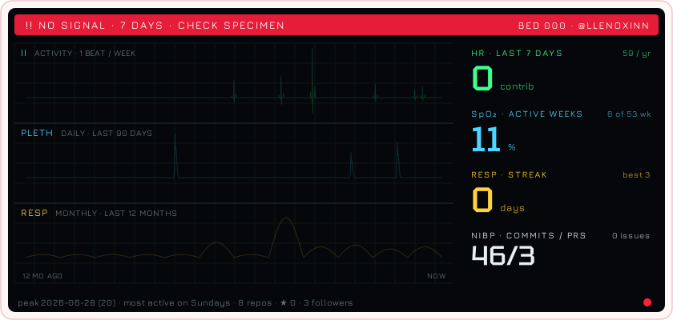</picture>

<sub>59 contributions this year · 46 commits · 3 pull requests</sub>

<picture><source media="(prefers-color-scheme: dark)" srcset="assets/plasmid-dark.webp?v=2026-10-20"></picture>

<sub><b>pLLX</b> · the year as a plasmid. One base pair a week; every glowing protein is a week with commits (6 so far).</sub>

<sub>Grab it and turn it:</sub>

```stl
solid plasmid_pLLX
facet normal -0.1 1 -0.2
outer loop
vertex 545 246 2
vertex 526 243 -5
vertex 496 262 79
endloop
endfacet
facet normal -0.1 1 -0.2
outer loop
vertex 545 246 2
vertex 496 262 79
vertex 513 265 88
endloop
endfacet
facet normal -0.8 -0.6 -0.1
outer loop
vertex 526 243 -5
vertex 537 228 3
vertex 506 247 86
endloop
endfacet
facet normal -0.8 -0.6 -0.1
outer loop
vertex 526 243 -5
vertex 506 247 86
vertex 496 262 79
endloop
endfacet
facet normal 0.8 -0.4 0.4
outer loop
vertex 537 228 3
vertex 545 246 2
vertex 513 265 88
endloop
endfacet
facet normal 0.9 -0.3 0.4
outer loop
vertex 537 228 3
vertex 513 265 88
vertex 506 247 86
endloop
endfacet
facet normal -0.2 1 -0.1
outer loop
vertex 513 265 88
vertex 496 262 79
vertex 440 257 143
endloop
endfacet
facet normal -0.2 1 -0.1
outer loop
vertex 513 265 88
vertex 440 257 143
vertex 452 260 158
endloop
endfacet
facet normal -0.6 -0.6 -0.5
outer loop
vertex 496 262 79
vertex 506 247 86
vertex 450 242 150
endloop
endfacet
facet normal -0.6 -0.6 -0.5
outer loop
vertex 496 262 79
vertex 450 242 150
vertex 440 257 143
endloop
endfacet
facet normal 0.7 -0.3 0.6
outer loop
vertex 506 247 86
vertex 513 265 88
vertex 452 260 158
endloop
endfacet
facet normal 0.7 -0.3 0.6
outer loop
vertex 506 247 86
vertex 452 260 158
vertex 450 242 150
endloop
endfacet
facet normal -0.3 0.9 0.1
outer loop
vertex 452 260 158
vertex 440 257 143
vertex 375 229 181
endloop
endfacet
facet normal -0.3 0.9 0.1
outer loop
vertex 452 260 158
vertex 375 229 181
vertex 383 230 199
endloop
endfacet
facet normal -0.2 -0.5 -0.8
outer loop
vertex 440 257 143
vertex 450 242 150
vertex 388 215 187
endloop
endfacet
facet normal -0.2 -0.5 -0.8
outer loop
vertex 440 257 143
vertex 388 215 187
vertex 375 229 181
endloop
endfacet
facet normal 0.6 -0.4 0.7
outer loop
vertex 450 242 150
vertex 452 260 158
vertex 383 230 199
endloop
endfacet
facet normal 0.6 -0.4 0.7
outer loop
vertex 450 242 150
vertex 383 230 199
vertex 388 215 187
endloop
endfacet
facet normal -0.6 0.8 0.2
outer loop
vertex 383 230 199
vertex 375 229 181
vertex 320 180 197
endloop
endfacet
facet normal -0.6 0.7 0.3
outer loop
vertex 383 230 199
vertex 320 180 197
vertex 327 178 216
endloop
endfacet
facet normal 0.1 -0.3 -0.9
outer loop
vertex 375 229 181
vertex 388 215 187
vertex 336 168 201
endloop
endfacet
facet normal 0 -0.3 -1
outer loop
vertex 375 229 181
vertex 336 168 201
vertex 320 180 197
endloop
endfacet
facet normal 0.6 -0.4 0.7
outer loop
vertex 388 215 187
vertex 383 230 199
vertex 327 178 216
endloop
endfacet
facet normal 0.6 -0.5 0.7
outer loop
vertex 388 215 187
vertex 327 178 216
vertex 336 168 201
endloop
endfacet
facet normal -0.8 0.5 0.3
outer loop
vertex 327 178 216
vertex 320 180 197
vertex 287 115 202
endloop
endfacet
facet normal -0.8 0.4 0.4
outer loop
vertex 327 178 216
vertex 287 115 202
vertex 295 115 220
endloop
endfacet
facet normal 0.1 -0.1 -1
outer loop
vertex 320 180 197
vertex 336 168 201
vertex 306 110 204
endloop
endfacet
facet normal 0.1 -0.1 -1
outer loop
vertex 320 180 197
vertex 306 110 204
vertex 287 115 202
endloop
endfacet
facet normal 0.7 -0.3 0.6
outer loop
vertex 336 168 201
vertex 327 178 216
vertex 295 115 220
endloop
endfacet
facet normal 0.7 -0.3 0.6
outer loop
vertex 336 168 201
vertex 295 115 220
vertex 306 110 204
endloop
endfacet
facet normal -0.9 0.2 0.4
outer loop
vertex 295 115 220
vertex 287 115 202
vertex 279 45 211
endloop
endfacet
facet normal -0.9 0.2 0.4
outer loop
vertex 295 115 220
vertex 279 45 211
vertex 287 49 228
endloop
endfacet
facet normal 0.1 -0.1 -1
outer loop
vertex 287 115 202
vertex 306 110 204
vertex 299 46 213
endloop
endfacet
facet normal 0.1 -0.1 -1
outer loop
vertex 287 115 202
vertex 299 46 213
vertex 279 45 211
endloop
endfacet
facet normal 0.8 0 0.6
outer loop
vertex 306 110 204
vertex 295 115 220
vertex 287 49 228
endloop
endfacet
facet normal 0.8 0 0.6
outer loop
vertex 306 110 204
vertex 287 49 228
vertex 299 46 213
endloop
endfacet
facet normal -0.9 0 0.4
outer loop
vertex 287 49 228
vertex 279 45 211
vertex 289 -20 236
endloop
endfacet
facet normal -0.9 0 0.4
outer loop
vertex 287 49 228
vertex 289 -20 236
vertex 296 -9 251
endloop
endfacet
facet normal 0.1 -0.4 -0.9
outer loop
vertex 279 45 211
vertex 299 46 213
vertex 309 -15 237
endloop
endfacet
facet normal 0.1 -0.3 -0.9
outer loop
vertex 279 45 211
vertex 309 -15 237
vertex 289 -20 236
endloop
endfacet
facet normal 0.8 0.3 0.5
outer loop
vertex 299 46 213
vertex 287 49 228
vertex 296 -9 251
endloop
endfacet
facet normal 0.8 0.3 0.5
outer loop
vertex 299 46 213
vertex 296 -9 251
vertex 309 -15 237
endloop
endfacet
facet normal -0.9 0.1 0.4
outer loop
vertex 296 -9 251
vertex 289 -20 236
vertex 303 -69 283
endloop
endfacet
facet normal -0.9 0.1 0.4
outer loop
vertex 296 -9 251
vertex 303 -69 283
vertex 309 -54 293
endloop
endfacet
facet normal 0.2 -0.6 -0.7
outer loop
vertex 289 -20 236
vertex 309 -15 237
vertex 322 -65 284
endloop
endfacet
facet normal 0.2 -0.6 -0.7
outer loop
vertex 289 -20 236
vertex 322 -65 284
vertex 303 -69 283
endloop
endfacet
facet normal 0.7 0.6 0.4
outer loop
vertex 309 -15 237
vertex 296 -9 251
vertex 309 -54 293
endloop
endfacet
facet normal 0.7 0.6 0.4
outer loop
vertex 309 -15 237
vertex 309 -54 293
vertex 322 -65 284
endloop
endfacet
facet normal -1 0.3 0.1
outer loop
vertex 309 -54 293
vertex 303 -69 283
vertex 301 -100 344
endloop
endfacet
facet normal -0.9 0.3 0.2
outer loop
vertex 309 -54 293
vertex 301 -100 344
vertex 308 -84 353
endloop
endfacet
facet normal 0.2 -0.9 -0.4
outer loop
vertex 303 -69 283
vertex 322 -65 284
vertex 320 -99 350
endloop
endfacet
facet normal 0.2 -0.9 -0.4
outer loop
vertex 303 -69 283
vertex 320 -99 350
vertex 301 -100 344
endloop
endfacet
facet normal 0.7 0.6 0.3
outer loop
vertex 322 -65 284
vertex 309 -54 293
vertex 308 -84 353
endloop
endfacet
facet normal 0.8 0.5 0.3
outer loop
vertex 322 -65 284
vertex 308 -84 353
vertex 320 -99 350
endloop
endfacet
facet normal -0.8 0.5 -0.3
outer loop
vertex 308 -84 353
vertex 301 -100 344
vertex 271 -119 407
endloop
endfacet
facet normal -0.8 0.5 -0.2
outer loop
vertex 308 -84 353
vertex 271 -119 407
vertex 277 -103 417
endloop
endfacet
facet normal 0.1 -1 -0.2
outer loop
vertex 301 -100 344
vertex 320 -99 350
vertex 286 -121 419
endloop
endfacet
facet normal 0.1 -1 -0.3
outer loop
vertex 301 -100 344
vertex 286 -121 419
vertex 271 -119 407
endloop
endfacet
facet normal 0.7 0.5 0.5
outer loop
vertex 320 -99 350
vertex 308 -84 353
vertex 277 -103 417
endloop
endfacet
facet normal 0.8 0.4 0.5
outer loop
vertex 320 -99 350
vertex 277 -103 417
vertex 286 -121 419
endloop
endfacet
facet normal -0.6 0.6 -0.6
outer loop
vertex 277 -103 417
vertex 271 -119 407
vertex 211 -133 451
endloop
endfacet
facet normal -0.6 0.6 -0.6
outer loop
vertex 277 -103 417
vertex 211 -133 451
vertex 213 -118 464
endloop
endfacet
facet normal 0.1 -1 -0.2
outer loop
vertex 271 -119 407
vertex 286 -121 419
vertex 219 -137 469
endloop
endfacet
facet normal 0.1 -1 -0.2
outer loop
vertex 271 -119 407
vertex 219 -137 469
vertex 211 -133 451
endloop
endfacet
facet normal 0.5 0.3 0.8
outer loop
vertex 286 -121 419
vertex 277 -103 417
vertex 213 -118 464
endloop
endfacet
facet normal 0.5 0.3 0.8
outer loop
vertex 286 -121 419
vertex 213 -118 464
vertex 219 -137 469
endloop
endfacet
facet normal -0.2 0.7 -0.7
outer loop
vertex 213 -118 464
vertex 211 -133 451
vertex 134 -148 462
endloop
endfacet
facet normal -0.2 0.7 -0.7
outer loop
vertex 213 -118 464
vertex 134 -148 462
vertex 130 -134 476
endloop
endfacet
facet normal 0.1 -1 -0.3
outer loop
vertex 211 -133 451
vertex 219 -137 469
vertex 134 -153 481
endloop
endfacet
facet normal 0.2 -1 -0.3
outer loop
vertex 211 -133 451
vertex 134 -153 481
vertex 134 -148 462
endloop
endfacet
facet normal 0.1 0.3 1
outer loop
vertex 219 -137 469
vertex 213 -118 464
vertex 130 -134 476
endloop
endfacet
facet normal 0.1 0.3 1
outer loop
vertex 219 -137 469
vertex 130 -134 476
vertex 134 -153 481
endloop
endfacet
facet normal 0 0.7 -0.7
outer loop
vertex 130 -134 476
vertex 134 -148 462
vertex 63 -167 437
endloop
endfacet
facet normal 0.1 0.7 -0.7
outer loop
vertex 130 -134 476
vertex 63 -167 437
vertex 51 -155 448
endloop
endfacet
facet normal 0.3 -0.9 -0.2
outer loop
vertex 134 -148 462
vertex 134 -153 481
vertex 54 -173 454
endloop
endfacet
facet normal 0.3 -0.9 -0.2
outer loop
vertex 134 -148 462
vertex 54 -173 454
vertex 63 -167 437
endloop
endfacet
facet normal -0.4 0.2 0.9
outer loop
vertex 134 -153 481
vertex 130 -134 476
vertex 51 -155 448
endloop
endfacet
facet normal -0.4 0.2 0.9
outer loop
vertex 134 -153 481
vertex 51 -155 448
vertex 54 -173 454
endloop
endfacet
facet normal 0.2 0.8 -0.6
outer loop
vertex 51 -155 448
vertex 63 -167 437
vertex 14 -193 386
endloop
endfacet
facet normal 0.3 0.7 -0.6
outer loop
vertex 51 -155 448
vertex 14 -193 386
vertex -3 -183 391
endloop
endfacet
facet normal 0.5 -0.9 -0.1
outer loop
vertex 63 -167 437
vertex 54 -173 454
vertex 1 -201 399
endloop
endfacet
facet normal 0.5 -0.9 0
outer loop
vertex 63 -167 437
vertex 1 -201 399
vertex 14 -193 386
endloop
endfacet
facet normal -0.7 0.1 0.7
outer loop
vertex 54 -173 454
vertex 51 -155 448
vertex -3 -183 391
endloop
endfacet
facet normal -0.7 0.1 0.7
outer loop
vertex 54 -173 454
vertex -3 -183 391
vertex 1 -201 399
endloop
endfacet
facet normal 0.3 0.8 -0.6
outer loop
vertex -3 -183 391
vertex 14 -193 386
vertex -7 -231 329
endloop
endfacet
facet normal 0.3 0.8 -0.6
outer loop
vertex -3 -183 391
vertex -7 -231 329
vertex -26 -225 329
endloop
endfacet
facet normal 0.7 -0.7 0.2
outer loop
vertex 14 -193 386
vertex 1 -201 399
vertex -20 -240 341
endloop
endfacet
facet normal 0.7 -0.7 0.2
outer loop
vertex 14 -193 386
vertex -20 -240 341
vertex -7 -231 329
endloop
endfacet
facet normal -0.9 0 0.4
outer loop
vertex 1 -201 399
vertex -3 -183 391
vertex -26 -225 329
endloop
endfacet
facet normal -0.9 0 0.4
outer loop
vertex 1 -201 399
vertex -26 -225 329
vertex -20 -240 341
endloop
endfacet
facet normal 0.2 0.6 -0.8
outer loop
vertex -26 -225 329
vertex -7 -231 329
vertex -11 -286 283
endloop
endfacet
facet normal 0.2 0.6 -0.8
outer loop
vertex -26 -225 329
vertex -11 -286 283
vertex -31 -282 281
endloop
endfacet
facet normal 0.7 -0.5 0.5
outer loop
vertex -7 -231 329
vertex -20 -240 341
vertex -24 -292 297
endloop
endfacet
facet normal 0.7 -0.5 0.5
outer loop
vertex -7 -231 329
vertex -24 -292 297
vertex -11 -286 283
endloop
endfacet
facet normal -1 -0.1 0.3
outer loop
vertex -20 -240 341
vertex -26 -225 329
vertex -31 -282 281
endloop
endfacet
facet normal -0.9 -0.2 0.3
outer loop
vertex -20 -240 341
vertex -31 -282 281
vertex -24 -292 297
endloop
endfacet
facet normal 0.2 0.3 -0.9
outer loop
vertex -31 -282 281
vertex -11 -286 283
vertex -24 -357 257
endloop
endfacet
facet normal 0.2 0.3 -0.9
outer loop
vertex -31 -282 281
vertex -24 -357 257
vertex -42 -350 256
endloop
endfacet
facet normal 0.8 -0.3 0.6
outer loop
vertex -11 -286 283
vertex -24 -292 297
vertex -35 -357 274
endloop
endfacet
facet normal 0.8 -0.3 0.5
outer loop
vertex -11 -286 283
vertex -35 -357 274
vertex -24 -357 257
endloop
endfacet
facet normal -0.9 0 0.4
outer loop
vertex -24 -292 297
vertex -31 -282 281
vertex -42 -350 256
endloop
endfacet
facet normal -0.9 0 0.4
outer loop
vertex -24 -292 297
vertex -42 -350 256
vertex -35 -357 274
endloop
endfacet
facet normal 0.1 0.1 -1
outer loop
vertex -42 -350 256
vertex -24 -357 257
vertex -66 -427 248
endloop
endfacet
facet normal 0.1 0.1 -1
outer loop
vertex -42 -350 256
vertex -66 -427 248
vertex -80 -412 248
endloop
endfacet
facet normal 0.7 -0.5 0.5
outer loop
vertex -24 -357 257
vertex -35 -357 274
vertex -74 -420 266
endloop
endfacet
facet normal 0.7 -0.5 0.5
outer loop
vertex -24 -357 257
vertex -74 -420 266
vertex -66 -427 248
endloop
endfacet
facet normal -0.8 0.4 0.5
outer loop
vertex -35 -357 274
vertex -42 -350 256
vertex -80 -412 248
endloop
endfacet
facet normal -0.8 0.4 0.5
outer loop
vertex -35 -357 274
vertex -80 -412 248
vertex -74 -420 266
endloop
endfacet
facet normal 0 0 -1
outer loop
vertex -80 -412 248
vertex -66 -427 248
vertex -144 -472 244
endloop
endfacet
facet normal 0.1 0 -1
outer loop
vertex -80 -412 248
vertex -144 -472 244
vertex -149 -452 244
endloop
endfacet
facet normal 0.4 -0.8 0.5
outer loop
vertex -66 -427 248
vertex -74 -420 266
vertex -148 -462 261
endloop
endfacet
facet normal 0.4 -0.7 0.5
outer loop
vertex -66 -427 248
vertex -148 -462 261
vertex -144 -472 244
endloop
endfacet
facet normal -0.5 0.7 0.5
outer loop
vertex -74 -420 266
vertex -80 -412 248
vertex -149 -452 244
endloop
endfacet
facet normal -0.5 0.8 0.4
outer loop
vertex -74 -420 266
vertex -149 -452 244
vertex -148 -462 261
endloop
endfacet
facet normal 0.1 0 -1
outer loop
vertex -149 -452 244
vertex -144 -472 244
vertex -239 -472 235
endloop
endfacet
facet normal 0.1 -0.1 -1
outer loop
vertex -149 -452 244
vertex -239 -472 235
vertex -234 -452 234
endloop
endfacet
facet normal -0.1 -0.9 0.5
outer loop
vertex -144 -472 244
vertex -148 -462 261
vertex -239 -461 251
endloop
endfacet
facet normal -0.1 -0.8 0.5
outer loop
vertex -144 -472 244
vertex -239 -461 251
vertex -239 -472 235
endloop
endfacet
facet normal -0.1 0.9 0.5
outer loop
vertex -148 -462 261
vertex -149 -452 244
vertex -234 -452 234
endloop
endfacet
facet normal 0 0.9 0.4
outer loop
vertex -148 -462 261
vertex -234 -452 234
vertex -239 -461 251
endloop
endfacet
facet normal 0.1 -0.1 -1
outer loop
vertex -234 -452 234
vertex -239 -472 235
vertex -321 -426 219
endloop
endfacet
facet normal 0.1 -0.1 -1
outer loop
vertex -234 -452 234
vertex -321 -426 219
vertex -308 -411 219
endloop
endfacet
facet normal -0.5 -0.7 0.5
outer loop
vertex -239 -472 235
vertex -239 -461 251
vertex -317 -416 236
endloop
endfacet
facet normal -0.5 -0.7 0.5
outer loop
vertex -239 -472 235
vertex -317 -416 236
vertex -321 -426 219
endloop
endfacet
facet normal 0.3 0.8 0.5
outer loop
vertex -239 -461 251
vertex -234 -452 234
vertex -308 -411 219
endloop
endfacet
facet normal 0.4 0.8 0.5
outer loop
vertex -239 -461 251
vertex -308 -411 219
vertex -317 -416 236
endloop
endfacet
facet normal 0.2 -0.1 -1
outer loop
vertex -308 -411 219
vertex -321 -426 219
vertex -368 -351 200
endloop
endfacet
facet normal 0.2 -0.2 -1
outer loop
vertex -308 -411 219
vertex -368 -351 200
vertex -349 -344 202
endloop
endfacet
facet normal -0.8 -0.4 0.4
outer loop
vertex -321 -426 219
vertex -317 -416 236
vertex -362 -344 217
endloop
endfacet
facet normal -0.8 -0.4 0.5
outer loop
vertex -321 -426 219
vertex -362 -344 217
vertex -368 -351 200
endloop
endfacet
facet normal 0.6 0.5 0.5
outer loop
vertex -317 -416 236
vertex -308 -411 219
vertex -349 -344 202
endloop
endfacet
facet normal 0.7 0.5 0.5
outer loop
vertex -317 -416 236
vertex -349 -344 202
vertex -362 -344 217
endloop
endfacet
facet normal 0.2 -0.3 -0.9
outer loop
vertex -349 -344 202
vertex -368 -351 200
vertex -374 -274 176
endloop
endfacet
facet normal 0.2 -0.3 -0.9
outer loop
vertex -349 -344 202
vertex -374 -274 176
vertex -354 -275 180
endloop
endfacet
facet normal -0.9 0 0.3
outer loop
vertex -368 -351 200
vertex -362 -344 217
vertex -367 -268 193
endloop
endfacet
facet normal -0.9 0 0.3
outer loop
vertex -368 -351 200
vertex -367 -268 193
vertex -374 -274 176
endloop
endfacet
facet normal 0.8 0.2 0.6
outer loop
vertex -362 -344 217
vertex -349 -344 202
vertex -354 -275 180
endloop
endfacet
facet normal 0.8 0.2 0.6
outer loop
vertex -362 -344 217
vertex -354 -275 180
vertex -367 -268 193
endloop
endfacet
facet normal 0.2 -0.5 -0.8
outer loop
vertex -354 -275 180
vertex -374 -274 176
vertex -354 -214 141
endloop
endfacet
facet normal 0.2 -0.5 -0.8
outer loop
vertex -354 -275 180
vertex -354 -214 141
vertex -335 -217 148
endloop
endfacet
facet normal -0.9 0.4 0.2
outer loop
vertex -374 -274 176
vertex -367 -268 193
vertex -347 -204 157
endloop
endfacet
facet normal -0.9 0.4 0.1
outer loop
vertex -374 -274 176
vertex -347 -204 157
vertex -354 -214 141
endloop
endfacet
facet normal 0.7 0.1 0.7
outer loop
vertex -367 -268 193
vertex -354 -275 180
vertex -335 -217 148
endloop
endfacet
facet normal 0.7 0.2 0.7
outer loop
vertex -367 -268 193
vertex -335 -217 148
vertex -347 -204 157
endloop
endfacet
facet normal 0.1 -0.8 -0.6
outer loop
vertex -335 -217 148
vertex -354 -214 141
vertex -328 -174 93
endloop
endfacet
facet normal 0.1 -0.8 -0.6
outer loop
vertex -335 -217 148
vertex -328 -174 93
vertex -309 -176 99
endloop
endfacet
facet normal -0.8 0.5 0
outer loop
vertex -354 -214 141
vertex -347 -204 157
vertex -320 -160 105
endloop
endfacet
facet normal -0.9 0.5 0
outer loop
vertex -354 -214 141
vertex -320 -160 105
vertex -328 -174 93
endloop
endfacet
facet normal 0.8 0.2 0.6
outer loop
vertex -347 -204 157
vertex -335 -217 148
vertex -309 -176 99
endloop
endfacet
facet normal 0.7 0.3 0.6
outer loop
vertex -347 -204 157
vertex -309 -176 99
vertex -320 -160 105
endloop
endfacet
facet normal 0 -0.9 -0.4
outer loop
vertex -309 -176 99
vertex -328 -174 93
vertex -314 -149 33
endloop
endfacet
facet normal 0 -0.9 -0.4
outer loop
vertex -309 -176 99
vertex -314 -149 33
vertex -294 -149 34
endloop
endfacet
facet normal -0.9 0.5 0
outer loop
vertex -328 -174 93
vertex -320 -160 105
vertex -304 -133 38
endloop
endfacet
facet normal -0.9 0.5 0
outer loop
vertex -328 -174 93
vertex -304 -133 38
vertex -314 -149 33
endloop
endfacet
facet normal 0.8 0.4 0.4
outer loop
vertex -320 -160 105
vertex -309 -176 99
vertex -294 -149 34
endloop
endfacet
facet normal 0.8 0.4 0.4
outer loop
vertex -320 -160 105
vertex -294 -149 34
vertex -304 -133 38
endloop
endfacet
facet normal 0 -1 -0.2
outer loop
vertex -294 -149 34
vertex -314 -149 33
vertex -320 -136 -33
endloop
endfacet
facet normal 0 -1 -0.2
outer loop
vertex -294 -149 34
vertex -320 -136 -33
vertex -301 -135 -38
endloop
endfacet
facet normal -0.9 0.5 0.2
outer loop
vertex -314 -149 33
vertex -304 -133 38
vertex -310 -119 -33
endloop
endfacet
facet normal -0.9 0.5 0.2
outer loop
vertex -314 -149 33
vertex -310 -119 -33
vertex -320 -136 -33
endloop
endfacet
facet normal 0.9 0.5 0
outer loop
vertex -304 -133 38
vertex -294 -149 34
vertex -301 -135 -38
endloop
endfacet
facet normal 0.9 0.5 0
outer loop
vertex -304 -133 38
vertex -301 -135 -38
vertex -310 -119 -33
endloop
endfacet
facet normal 0 -1 -0.1
outer loop
vertex -301 -135 -38
vertex -320 -136 -33
vertex -348 -130 -94
endloop
endfacet
facet normal 0 -1 -0.1
outer loop
vertex -301 -135 -38
vertex -348 -130 -94
vertex -331 -129 -105
endloop
endfacet
facet normal -0.8 0.5 0.4
outer loop
vertex -320 -136 -33
vertex -310 -119 -33
vertex -339 -112 -98
endloop
endfacet
facet normal -0.8 0.5 0.4
outer loop
vertex -320 -136 -33
vertex -339 -112 -98
vertex -348 -130 -94
endloop
endfacet
facet normal 0.8 0.5 -0.3
outer loop
vertex -310 -119 -33
vertex -301 -135 -38
vertex -331 -129 -105
endloop
endfacet
facet normal 0.8 0.5 -0.3
outer loop
vertex -310 -119 -33
vertex -331 -129 -105
vertex -339 -112 -98
endloop
endfacet
facet normal 0 -1 -0.1
outer loop
vertex -331 -129 -105
vertex -348 -130 -94
vertex -395 -121 -143
endloop
endfacet
facet normal 0 -1 -0.1
outer loop
vertex -331 -129 -105
vertex -395 -121 -143
vertex -383 -120 -158
endloop
endfacet
facet normal -0.6 0.4 0.7
outer loop
vertex -348 -130 -94
vertex -339 -112 -98
vertex -387 -104 -146
endloop
endfacet
facet normal -0.6 0.4 0.7
outer loop
vertex -348 -130 -94
vertex -387 -104 -146
vertex -395 -121 -143
endloop
endfacet
facet normal 0.6 0.5 -0.5
outer loop
vertex -339 -112 -98
vertex -331 -129 -105
vertex -383 -120 -158
endloop
endfacet
facet normal 0.6 0.6 -0.5
outer loop
vertex -339 -112 -98
vertex -383 -120 -158
vertex -387 -104 -146
endloop
endfacet
facet normal -0.2 -0.9 -0.3
outer loop
vertex -383 -120 -158
vertex -395 -121 -143
vertex -454 -96 -177
endloop
endfacet
facet normal -0.2 -0.9 -0.3
outer loop
vertex -383 -120 -158
vertex -454 -96 -177
vertex -443 -92 -194
endloop
endfacet
facet normal -0.3 0.4 0.9
outer loop
vertex -395 -121 -143
vertex -387 -104 -146
vertex -442 -80 -178
endloop
endfacet
facet normal -0.4 0.3 0.9
outer loop
vertex -395 -121 -143
vertex -442 -80 -178
vertex -454 -96 -177
endloop
endfacet
facet normal 0.6 0.6 -0.6
outer loop
vertex -387 -104 -146
vertex -383 -120 -158
vertex -443 -92 -194
endloop
endfacet
facet normal 0.6 0.6 -0.5
outer loop
vertex -387 -104 -146
vertex -443 -92 -194
vertex -442 -80 -178
endloop
endfacet
facet normal -0.5 -0.7 -0.5
outer loop
vertex -443 -92 -194
vertex -454 -96 -177
vertex -508 -40 -202
endloop
endfacet
facet normal -0.5 -0.7 -0.5
outer loop
vertex -443 -92 -194
vertex -508 -40 -202
vertex -495 -37 -217
endloop
endfacet
facet normal -0.2 0.2 1
outer loop
vertex -454 -96 -177
vertex -442 -80 -178
vertex -491 -29 -200
endloop
endfacet
facet normal -0.2 0.2 1
outer loop
vertex -454 -96 -177
vertex -491 -29 -200
vertex -508 -40 -202
endloop
endfacet
facet normal 0.7 0.5 -0.5
outer loop
vertex -442 -80 -178
vertex -443 -92 -194
vertex -495 -37 -217
endloop
endfacet
facet normal 0.7 0.5 -0.4
outer loop
vertex -442 -80 -178
vertex -495 -37 -217
vertex -491 -29 -200
endloop
endfacet
facet normal -0.7 -0.3 -0.6
outer loop
vertex -495 -37 -217
vertex -508 -40 -202
vertex -532 45 -222
endloop
endfacet
facet normal -0.7 -0.3 -0.6
outer loop
vertex -495 -37 -217
vertex -532 45 -222
vertex -519 43 -236
endloop
endfacet
facet normal -0.2 0.2 1
outer loop
vertex -508 -40 -202
vertex -491 -29 -200
vertex -513 47 -217
endloop
endfacet
facet normal -0.2 0.2 1
outer loop
vertex -508 -40 -202
vertex -513 47 -217
vertex -532 45 -222
endloop
endfacet
facet normal 0.9 0.2 -0.3
outer loop
vertex -491 -29 -200
vertex -495 -37 -217
vertex -519 43 -236
endloop
endfacet
facet normal 0.9 0.2 -0.3
outer loop
vertex -491 -29 -200
vertex -519 43 -236
vertex -513 47 -217
endloop
endfacet
facet normal -0.7 0 -0.7
outer loop
vertex -519 43 -236
vertex -532 45 -222
vertex -512 138 -238
endloop
endfacet
facet normal -0.7 0 -0.7
outer loop
vertex -519 43 -236
vertex -512 138 -238
vertex -499 130 -251
endloop
endfacet
facet normal -0.2 0.2 0.9
outer loop
vertex -532 45 -222
vertex -513 47 -217
vertex -494 130 -232
endloop
endfacet
facet normal -0.2 0.2 1
outer loop
vertex -532 45 -222
vertex -494 130 -232
vertex -512 138 -238
endloop
endfacet
facet normal 0.9 -0.2 -0.2
outer loop
vertex -513 47 -217
vertex -519 43 -236
vertex -499 130 -251
endloop
endfacet
facet normal 0.9 -0.3 -0.2
outer loop
vertex -513 47 -217
vertex -499 130 -251
vertex -494 130 -232
endloop
endfacet
facet normal -0.5 0.4 -0.7
outer loop
vertex -499 130 -251
vertex -512 138 -238
vertex -448 209 -247
endloop
endfacet
facet normal -0.6 0.4 -0.7
outer loop
vertex -499 130 -251
vertex -448 209 -247
vertex -440 196 -260
endloop
endfacet
facet normal -0.2 0.3 0.9
outer loop
vertex -512 138 -238
vertex -494 130 -232
vertex -437 194 -241
endloop
endfacet
facet normal -0.2 0.3 0.9
outer loop
vertex -512 138 -238
vertex -437 194 -241
vertex -448 209 -247
endloop
endfacet
facet normal 0.7 -0.7 -0.2
outer loop
vertex -494 130 -232
vertex -499 130 -251
vertex -440 196 -260
endloop
endfacet
facet normal 0.7 -0.7 -0.2
outer loop
vertex -494 130 -232
vertex -440 196 -260
vertex -437 194 -241
endloop
endfacet
facet normal -0.2 0.6 -0.8
outer loop
vertex -440 196 -260
vertex -448 209 -247
vertex -362 238 -252
endloop
endfacet
facet normal -0.3 0.6 -0.7
outer loop
vertex -440 196 -260
vertex -362 238 -252
vertex -362 223 -265
endloop
endfacet
facet normal -0.1 0.3 0.9
outer loop
vertex -448 209 -247
vertex -437 194 -241
vertex -360 219 -245
endloop
endfacet
facet normal -0.1 0.3 0.9
outer loop
vertex -448 209 -247
vertex -360 219 -245
vertex -362 238 -252
endloop
endfacet
facet normal 0.3 -0.9 -0.2
outer loop
vertex -437 194 -241
vertex -440 196 -260
vertex -362 223 -265
endloop
endfacet
facet normal 0.3 -0.9 -0.2
outer loop
vertex -437 194 -241
vertex -362 223 -265
vertex -360 219 -245
endloop
endfacet
facet normal 0 0.7 -0.8
outer loop
vertex -362 223 -265
vertex -362 238 -252
vertex -281 223 -260
endloop
endfacet
facet normal 0 0.7 -0.7
outer loop
vertex -362 223 -265
vertex -281 223 -260
vertex -289 209 -273
endloop
endfacet
facet normal 0.2 0.3 0.9
outer loop
vertex -362 238 -252
vertex -360 219 -245
vertex -287 205 -254
endloop
endfacet
facet normal 0.2 0.3 0.9
outer loop
vertex -362 238 -252
vertex -287 205 -254
vertex -281 223 -260
endloop
endfacet
facet normal -0.2 -1 -0.2
outer loop
vertex -360 219 -245
vertex -362 223 -265
vertex -289 209 -273
endloop
endfacet
facet normal -0.2 -1 -0.2
outer loop
vertex -360 219 -245
vertex -289 209 -273
vertex -287 205 -254
endloop
endfacet
facet normal 0.1 0.7 -0.8
outer loop
vertex -289 209 -273
vertex -281 223 -260
vertex -221 185 -286
endloop
endfacet
facet normal 0.1 0.6 -0.8
outer loop
vertex -289 209 -273
vertex -221 185 -286
vertex -235 175 -296
endloop
endfacet
facet normal 0.5 0.2 0.9
outer loop
vertex -281 223 -260
vertex -287 205 -254
vertex -228 167 -279
endloop
endfacet
facet normal 0.5 0.2 0.9
outer loop
vertex -281 223 -260
vertex -228 167 -279
vertex -221 185 -286
endloop
endfacet
facet normal -0.6 -0.8 -0.1
outer loop
vertex -287 205 -254
vertex -289 209 -273
vertex -235 175 -296
endloop
endfacet
facet normal -0.6 -0.8 -0.1
outer loop
vertex -287 205 -254
vertex -235 175 -296
vertex -228 167 -279
endloop
endfacet
facet normal -0.1 0.8 -0.6
outer loop
vertex -235 175 -296
vertex -221 185 -286
vertex -178 152 -331
endloop
endfacet
facet normal -0.1 0.8 -0.7
outer loop
vertex -235 175 -296
vertex -178 152 -331
vertex -193 142 -340
endloop
endfacet
facet normal 0.7 0 0.7
outer loop
vertex -221 185 -286
vertex -228 167 -279
vertex -182 133 -327
endloop
endfacet
facet normal 0.7 0 0.7
outer loop
vertex -221 185 -286
vertex -182 133 -327
vertex -178 152 -331
endloop
endfacet
facet normal -0.7 -0.8 -0.1
outer loop
vertex -228 167 -279
vertex -235 175 -296
vertex -193 142 -340
endloop
endfacet
facet normal -0.6 -0.8 0
outer loop
vertex -228 167 -279
vertex -193 142 -340
vertex -182 133 -327
endloop
endfacet
facet normal -0.3 0.9 -0.4
outer loop
vertex -193 142 -340
vertex -178 152 -331
vertex -136 142 -388
endloop
endfacet
facet normal -0.3 0.9 -0.4
outer loop
vertex -193 142 -340
vertex -136 142 -388
vertex -149 132 -400
endloop
endfacet
facet normal 0.8 0 0.6
outer loop
vertex -178 152 -331
vertex -182 133 -327
vertex -135 122 -389
endloop
endfacet
facet normal 0.8 0 0.6
outer loop
vertex -178 152 -331
vertex -135 122 -389
vertex -136 142 -388
endloop
endfacet
facet normal -0.5 -0.9 -0.2
outer loop
vertex -182 133 -327
vertex -193 142 -340
vertex -149 132 -400
endloop
endfacet
facet normal -0.5 -0.9 -0.2
outer loop
vertex -182 133 -327
vertex -149 132 -400
vertex -135 122 -389
endloop
endfacet
facet normal -0.5 0.8 -0.2
outer loop
vertex -149 132 -400
vertex -136 142 -388
vertex -85 161 -439
endloop
endfacet
facet normal -0.5 0.9 -0.2
outer loop
vertex -149 132 -400
vertex -85 161 -439
vertex -92 153 -455
endloop
endfacet
facet normal 0.7 0 0.7
outer loop
vertex -136 142 -388
vertex -135 122 -389
vertex -79 142 -445
endloop
endfacet
facet normal 0.7 0 0.7
outer loop
vertex -136 142 -388
vertex -79 142 -445
vertex -85 161 -439
endloop
endfacet
facet normal -0.2 -0.8 -0.5
outer loop
vertex -135 122 -389
vertex -149 132 -400
vertex -92 153 -455
endloop
endfacet
facet normal -0.2 -0.8 -0.5
outer loop
vertex -135 122 -389
vertex -92 153 -455
vertex -79 142 -445
endloop
endfacet
facet normal -0.6 0.8 -0.1
outer loop
vertex -92 153 -455
vertex -85 161 -439
vertex -22 201 -464
endloop
endfacet
facet normal -0.6 0.8 -0.1
outer loop
vertex -92 153 -455
vertex -22 201 -464
vertex -23 199 -483
endloop
endfacet
facet normal 0.5 -0.2 0.9
outer loop
vertex -85 161 -439
vertex -79 142 -445
vertex -12 186 -472
endloop
endfacet
facet normal 0.5 -0.2 0.9
outer loop
vertex -85 161 -439
vertex -12 186 -472
vertex -22 201 -464
endloop
endfacet
facet normal 0.1 -0.6 -0.8
outer loop
vertex -79 142 -445
vertex -92 153 -455
vertex -23 199 -483
endloop
endfacet
facet normal 0.1 -0.6 -0.8
outer loop
vertex -79 142 -445
vertex -23 199 -483
vertex -12 186 -472
endloop
endfacet
facet normal -0.6 0.8 -0.1
outer loop
vertex -23 199 -483
vertex -22 201 -464
vertex 41 248 -452
endloop
endfacet
facet normal -0.6 0.8 0
outer loop
vertex -23 199 -483
vertex 41 248 -452
vertex 47 252 -471
endloop
endfacet
facet normal 0.2 -0.4 0.9
outer loop
vertex -22 201 -464
vertex -12 186 -472
vertex 54 236 -461
endloop
endfacet
facet normal 0.2 -0.5 0.9
outer loop
vertex -22 201 -464
vertex 54 236 -461
vertex 41 248 -452
endloop
endfacet
facet normal 0.4 -0.4 -0.8
outer loop
vertex -12 186 -472
vertex -23 199 -483
vertex 47 252 -471
endloop
endfacet
facet normal 0.4 -0.3 -0.9
outer loop
vertex -12 186 -472
vertex 47 252 -471
vertex 54 236 -461
endloop
endfacet
facet normal -0.6 0.8 0
outer loop
vertex 47 252 -471
vertex 41 248 -452
vertex 92 284 -407
endloop
endfacet
facet normal -0.6 0.8 0
outer loop
vertex 47 252 -471
vertex 92 284 -407
vertex 104 292 -420
endloop
endfacet
facet normal -0.1 -0.7 0.7
outer loop
vertex 41 248 -452
vertex 54 236 -461
vertex 107 273 -415
endloop
endfacet
facet normal -0.1 -0.7 0.7
outer loop
vertex 41 248 -452
vertex 107 273 -415
vertex 92 284 -407
endloop
endfacet
facet normal 0.7 -0.1 -0.7
outer loop
vertex 54 236 -461
vertex 47 252 -471
vertex 104 292 -420
endloop
endfacet
facet normal 0.7 -0.1 -0.7
outer loop
vertex 54 236 -461
vertex 104 292 -420
vertex 107 273 -415
endloop
endfacet
facet normal -0.5 0.9 0.1
outer loop
vertex 104 292 -420
vertex 92 284 -407
vertex 127 294 -344
endloop
endfacet
facet normal -0.5 0.9 0.1
outer loop
vertex 104 292 -420
vertex 127 294 -344
vertex 143 303 -351
endloop
endfacet
facet normal -0.4 -0.9 0.3
outer loop
vertex 92 284 -407
vertex 107 273 -415
vertex 142 283 -352
endloop
endfacet
facet normal -0.4 -0.8 0.4
outer loop
vertex 92 284 -407
vertex 142 283 -352
vertex 127 294 -344
endloop
endfacet
facet normal 0.9 0 -0.5
outer loop
vertex 107 273 -415
vertex 104 292 -420
vertex 143 303 -351
endloop
endfacet
facet normal 0.9 0 -0.5
outer loop
vertex 107 273 -415
vertex 143 303 -351
vertex 142 283 -352
endloop
endfacet
facet normal -0.3 0.9 0.4
outer loop
vertex 143 303 -351
vertex 127 294 -344
vertex 152 274 -281
endloop
endfacet
facet normal -0.3 0.9 0.4
outer loop
vertex 143 303 -351
vertex 152 274 -281
vertex 169 282 -285
endloop
endfacet
facet normal -0.6 -0.8 0
outer loop
vertex 127 294 -344
vertex 142 283 -352
vertex 164 264 -293
endloop
endfacet
facet normal -0.6 -0.8 0
outer loop
vertex 127 294 -344
vertex 164 264 -293
vertex 152 274 -281
endloop
endfacet
facet normal 0.9 0 -0.4
outer loop
vertex 142 283 -352
vertex 143 303 -351
vertex 169 282 -285
endloop
endfacet
facet normal 0.9 -0.1 -0.4
outer loop
vertex 142 283 -352
vertex 169 282 -285
vertex 164 264 -293
endloop
endfacet
facet normal -0.1 0.7 0.7
outer loop
vertex 169 282 -285
vertex 152 274 -281
vertex 180 230 -234
endloop
endfacet
facet normal -0.1 0.7 0.7
outer loop
vertex 169 282 -285
vertex 180 230 -234
vertex 197 239 -239
endloop
endfacet
facet normal -0.7 -0.7 -0.2
outer loop
vertex 152 274 -281
vertex 164 264 -293
vertex 189 224 -251
endloop
endfacet
facet normal -0.7 -0.7 -0.2
outer loop
vertex 152 274 -281
vertex 189 224 -251
vertex 180 230 -234
endloop
endfacet
facet normal 0.9 0 -0.5
outer loop
vertex 164 264 -293
vertex 169 282 -285
vertex 197 239 -239
endloop
endfacet
facet normal 0.8 0 -0.5
outer loop
vertex 164 264 -293
vertex 197 239 -239
vertex 189 224 -251
endloop
endfacet
facet normal 0 0.5 0.9
outer loop
vertex 197 239 -239
vertex 180 230 -234
vertex 221 179 -208
endloop
endfacet
facet normal 0 0.5 0.9
outer loop
vertex 197 239 -239
vertex 221 179 -208
vertex 235 192 -215
endloop
endfacet
facet normal -0.7 -0.7 -0.2
outer loop
vertex 180 230 -234
vertex 189 224 -251
vertex 227 178 -227
endloop
endfacet
facet normal -0.7 -0.7 -0.2
outer loop
vertex 180 230 -234
vertex 227 178 -227
vertex 221 179 -208
endloop
endfacet
facet normal 0.7 0.2 -0.7
outer loop
vertex 189 224 -251
vertex 197 239 -239
vertex 235 192 -215
endloop
endfacet
facet normal 0.7 0.2 -0.7
outer loop
vertex 189 224 -251
vertex 235 192 -215
vertex 227 178 -227
endloop
endfacet
facet normal 0.1 0.4 0.9
outer loop
vertex 235 192 -215
vertex 221 179 -208
vertex 278 138 -199
endloop
endfacet
facet normal 0.1 0.4 0.9
outer loop
vertex 235 192 -215
vertex 278 138 -199
vertex 287 155 -207
endloop
endfacet
facet normal -0.6 -0.8 -0.1
outer loop
vertex 221 179 -208
vertex 227 178 -227
vertex 281 140 -219
endloop
endfacet
facet normal -0.6 -0.8 -0.1
outer loop
vertex 221 179 -208
vertex 281 140 -219
vertex 278 138 -199
endloop
endfacet
facet normal 0.4 0.4 -0.8
outer loop
vertex 227 178 -227
vertex 235 192 -215
vertex 287 155 -207
endloop
endfacet
facet normal 0.4 0.5 -0.8
outer loop
vertex 227 178 -227
vertex 287 155 -207
vertex 281 140 -219
endloop
endfacet
facet normal 0 0.4 0.9
outer loop
vertex 287 155 -207
vertex 278 138 -199
vertex 348 120 -195
endloop
endfacet
facet normal 0.1 0.4 0.9
outer loop
vertex 287 155 -207
vertex 348 120 -195
vertex 350 138 -203
endloop
endfacet
facet normal -0.2 -1 -0.1
outer loop
vertex 278 138 -199
vertex 281 140 -219
vertex 351 121 -215
endloop
endfacet
facet normal -0.2 -1 -0.1
outer loop
vertex 278 138 -199
vertex 351 121 -215
vertex 348 120 -195
endloop
endfacet
facet normal 0.2 0.6 -0.8
outer loop
vertex 281 140 -219
vertex 287 155 -207
vertex 350 138 -203
endloop
endfacet
facet normal 0.2 0.6 -0.8
outer loop
vertex 281 140 -219
vertex 350 138 -203
vertex 351 121 -215
endloop
endfacet
facet normal -0.2 0.4 0.9
outer loop
vertex 350 138 -203
vertex 348 120 -195
vertex 420 128 -180
endloop
endfacet
facet normal -0.2 0.5 0.8
outer loop
vertex 350 138 -203
vertex 420 128 -180
vertex 420 145 -190
endloop
endfacet
facet normal 0.1 -1 -0.1
outer loop
vertex 348 120 -195
vertex 351 121 -215
vertex 427 129 -198
endloop
endfacet
facet normal 0.1 -1 0
outer loop
vertex 348 120 -195
vertex 427 129 -198
vertex 420 128 -180
endloop
endfacet
facet normal 0.1 0.6 -0.8
outer loop
vertex 351 121 -215
vertex 350 138 -203
vertex 420 145 -190
endloop
endfacet
facet normal 0.1 0.5 -0.8
outer loop
vertex 351 121 -215
vertex 420 145 -190
vertex 427 129 -198
endloop
endfacet
facet normal -0.6 0.4 0.7
outer loop
vertex 420 145 -190
vertex 420 128 -180
vertex 484 156 -142
endloop
endfacet
facet normal -0.6 0.4 0.7
outer loop
vertex 420 145 -190
vertex 484 156 -142
vertex 483 173 -153
endloop
endfacet
facet normal 0.4 -0.9 0.1
outer loop
vertex 420 128 -180
vertex 427 129 -198
vertex 496 159 -157
endloop
endfacet
facet normal 0.3 -0.9 0.1
outer loop
vertex 420 128 -180
vertex 496 159 -157
vertex 484 156 -142
endloop
endfacet
facet normal 0.2 0.5 -0.8
outer loop
vertex 427 129 -198
vertex 420 145 -190
vertex 483 173 -153
endloop
endfacet
facet normal 0.3 0.5 -0.8
outer loop
vertex 427 129 -198
vertex 483 173 -153
vertex 496 159 -157
endloop
endfacet
facet normal -0.9 0.2 0.4
outer loop
vertex 483 173 -153
vertex 484 156 -142
vertex 524 195 -79
endloop
endfacet
facet normal -0.9 0.3 0.4
outer loop
vertex 483 173 -153
vertex 524 195 -79
vertex 525 213 -88
endloop
endfacet
facet normal 0.4 -0.9 0.2
outer loop
vertex 484 156 -142
vertex 496 159 -157
vertex 541 201 -87
endloop
endfacet
facet normal 0.4 -0.9 0.3
outer loop
vertex 484 156 -142
vertex 541 201 -87
vertex 524 195 -79
endloop
endfacet
facet normal 0.4 0.6 -0.7
outer loop
vertex 496 159 -157
vertex 483 173 -153
vertex 525 213 -88
endloop
endfacet
facet normal 0.5 0.6 -0.7
outer loop
vertex 496 159 -157
vertex 525 213 -88
vertex 541 201 -87
endloop
endfacet
facet normal -1 0.1 0
outer loop
vertex 525 213 -88
vertex 524 195 -79
vertex 530 230 4
endloop
endfacet
facet normal -1 0.1 0
outer loop
vertex 525 213 -88
vertex 530 230 4
vertex 531 248 -4
endloop
endfacet
facet normal 0.4 -0.8 0.3
outer loop
vertex 524 195 -79
vertex 541 201 -87
vertex 548 238 0
endloop
endfacet
facet normal 0.4 -0.8 0.3
outer loop
vertex 524 195 -79
vertex 548 238 0
vertex 530 230 4
endloop
endfacet
facet normal 0.6 0.7 -0.4
outer loop
vertex 541 201 -87
vertex 525 213 -88
vertex 531 248 -4
endloop
endfacet
facet normal 0.6 0.7 -0.4
outer loop
vertex 541 201 -87
vertex 531 248 -4
vertex 548 238 0
endloop
endfacet
facet normal -0.7 -0.4 -0.6
outer loop
vertex 354 211 12
vertex 368 205 0
vertex 376 147 34
endloop
endfacet
facet normal -0.7 -0.4 -0.6
outer loop
vertex 354 211 12
vertex 376 147 34
vertex 362 152 48
endloop
endfacet
facet normal 1 0 -0.3
outer loop
vertex 368 205 0
vertex 373 216 16
vertex 380 159 50
endloop
endfacet
facet normal 1 0 -0.3
outer loop
vertex 368 205 0
vertex 380 159 50
vertex 376 147 34
endloop
endfacet
facet normal -0.3 0.5 0.8
outer loop
vertex 373 216 16
vertex 354 211 12
vertex 362 152 48
endloop
endfacet
facet normal -0.3 0.5 0.8
outer loop
vertex 373 216 16
vertex 362 152 48
vertex 380 159 50
endloop
endfacet
facet normal -0.6 -0.6 -0.4
outer loop
vertex 362 152 48
vertex 376 147 34
vertex 401 95 73
endloop
endfacet
facet normal -0.6 -0.6 -0.4
outer loop
vertex 362 152 48
vertex 401 95 73
vertex 386 100 87
endloop
endfacet
facet normal 0.9 0.2 -0.4
outer loop
vertex 376 147 34
vertex 380 159 50
vertex 404 110 86
endloop
endfacet
facet normal 0.9 0.1 -0.4
outer loop
vertex 376 147 34
vertex 404 110 86
vertex 401 95 73
endloop
endfacet
facet normal -0.3 0.5 0.8
outer loop
vertex 380 159 50
vertex 362 152 48
vertex 386 100 87
endloop
endfacet
facet normal -0.3 0.5 0.8
outer loop
vertex 380 159 50
vertex 386 100 87
vertex 404 110 86
endloop
endfacet
facet normal -0.5 -0.8 -0.3
outer loop
vertex 386 100 87
vertex 401 95 73
vertex 431 57 128
endloop
endfacet
facet normal -0.5 -0.8 -0.3
outer loop
vertex 386 100 87
vertex 431 57 128
vertex 415 64 138
endloop
endfacet
facet normal 0.9 0.1 -0.4
outer loop
vertex 401 95 73
vertex 404 110 86
vertex 432 75 137
endloop
endfacet
facet normal 0.9 0.1 -0.4
outer loop
vertex 401 95 73
vertex 432 75 137
vertex 431 57 128
endloop
endfacet
facet normal -0.4 0.7 0.7
outer loop
vertex 404 110 86
vertex 386 100 87
vertex 415 64 138
endloop
endfacet
facet normal -0.4 0.7 0.7
outer loop
vertex 404 110 86
vertex 415 64 138
vertex 432 75 137
endloop
endfacet
facet normal -0.5 -0.9 -0.1
outer loop
vertex 415 64 138
vertex 431 57 128
vertex 450 37 200
endloop
endfacet
facet normal -0.5 -0.9 -0.1
outer loop
vertex 415 64 138
vertex 450 37 200
vertex 432 45 203
endloop
endfacet
facet normal 1 0.1 -0.2
outer loop
vertex 431 57 128
vertex 432 75 137
vertex 449 56 204
endloop
endfacet
facet normal 1 0.1 -0.2
outer loop
vertex 431 57 128
vertex 449 56 204
vertex 450 37 200
endloop
endfacet
facet normal -0.5 0.8 0.4
outer loop
vertex 432 75 137
vertex 415 64 138
vertex 432 45 203
endloop
endfacet
facet normal -0.5 0.8 0.4
outer loop
vertex 432 75 137
vertex 432 45 203
vertex 449 56 204
endloop
endfacet
facet normal -0.4 -0.9 -0.1
outer loop
vertex 432 45 203
vertex 450 37 200
vertex 444 32 280
endloop
endfacet
facet normal -0.4 -0.9 -0.1
outer loop
vertex 432 45 203
vertex 444 32 280
vertex 427 41 275
endloop
endfacet
facet normal 1 0 0.1
outer loop
vertex 450 37 200
vertex 449 56 204
vertex 443 52 279
endloop
endfacet
facet normal 1 0.1 0.1
outer loop
vertex 450 37 200
vertex 443 52 279
vertex 444 32 280
endloop
endfacet
facet normal -0.5 0.8 0
outer loop
vertex 449 56 204
vertex 432 45 203
vertex 427 41 275
endloop
endfacet
facet normal -0.6 0.8 0
outer loop
vertex 449 56 204
vertex 427 41 275
vertex 443 52 279
endloop
endfacet
facet normal -0.4 -0.9 -0.1
outer loop
vertex 427 41 275
vertex 444 32 280
vertex 408 37 352
endloop
endfacet
facet normal -0.4 -0.9 -0.1
outer loop
vertex 427 41 275
vertex 408 37 352
vertex 395 45 340
endloop
endfacet
facet normal 0.9 0.1 0.4
outer loop
vertex 444 32 280
vertex 443 52 279
vertex 408 57 350
endloop
endfacet
facet normal 0.9 0.1 0.4
outer loop
vertex 444 32 280
vertex 408 57 350
vertex 408 37 352
endloop
endfacet
facet normal -0.5 0.8 -0.3
outer loop
vertex 443 52 279
vertex 427 41 275
vertex 395 45 340
endloop
endfacet
facet normal -0.5 0.8 -0.3
outer loop
vertex 443 52 279
vertex 395 45 340
vertex 408 57 350
endloop
endfacet
facet normal -0.3 -0.9 -0.3
outer loop
vertex 395 45 340
vertex 408 37 352
vertex 346 42 402
endloop
endfacet
facet normal -0.3 -0.9 -0.3
outer loop
vertex 395 45 340
vertex 346 42 402
vertex 338 50 386
endloop
endfacet
facet normal 0.6 0.1 0.8
outer loop
vertex 408 37 352
vertex 408 57 350
vertex 345 61 400
endloop
endfacet
facet normal 0.6 0.1 0.8
outer loop
vertex 408 37 352
vertex 345 61 400
vertex 346 42 402
endloop
endfacet
facet normal -0.3 0.8 -0.5
outer loop
vertex 408 57 350
vertex 395 45 340
vertex 338 50 386
endloop
endfacet
facet normal -0.3 0.8 -0.5
outer loop
vertex 408 57 350
vertex 338 50 386
vertex 345 61 400
endloop
endfacet
facet normal 0 -0.9 -0.4
outer loop
vertex 338 50 386
vertex 346 42 402
vertex 268 35 421
endloop
endfacet
facet normal -0.1 -0.9 -0.5
outer loop
vertex 338 50 386
vertex 268 35 421
vertex 265 45 404
endloop
endfacet
facet normal 0.2 0.1 1
outer loop
vertex 346 42 402
vertex 345 61 400
vertex 264 55 421
endloop
endfacet
facet normal 0.2 0.1 1
outer loop
vertex 346 42 402
vertex 264 55 421
vertex 268 35 421
endloop
endfacet
facet normal -0.2 0.8 -0.6
outer loop
vertex 345 61 400
vertex 338 50 386
vertex 265 45 404
endloop
endfacet
facet normal -0.2 0.8 -0.5
outer loop
vertex 345 61 400
vertex 265 45 404
vertex 264 55 421
endloop
endfacet
facet normal 0.4 -0.8 -0.5
outer loop
vertex 265 45 404
vertex 268 35 421
vertex 194 11 408
endloop
endfacet
facet normal 0.3 -0.8 -0.5
outer loop
vertex 265 45 404
vertex 194 11 408
vertex 194 22 392
endloop
endfacet
facet normal -0.2 0 1
outer loop
vertex 268 35 421
vertex 264 55 421
vertex 184 28 408
endloop
endfacet
facet normal -0.2 -0.1 1
outer loop
vertex 268 35 421
vertex 184 28 408
vertex 194 11 408
endloop
endfacet
facet normal -0.2 0.8 -0.5
outer loop
vertex 264 55 421
vertex 265 45 404
vertex 194 22 392
endloop
endfacet
facet normal -0.2 0.9 -0.5
outer loop
vertex 264 55 421
vertex 194 22 392
vertex 184 28 408
endloop
endfacet
facet normal 0.7 -0.6 -0.4
outer loop
vertex 194 22 392
vertex 194 11 408
vertex 142 -33 372
endloop
endfacet
facet normal 0.7 -0.5 -0.4
outer loop
vertex 194 22 392
vertex 142 -33 372
vertex 142 -21 356
endloop
endfacet
facet normal -0.4 -0.2 0.9
outer loop
vertex 194 11 408
vertex 184 28 408
vertex 127 -20 369
endloop
endfacet
facet normal -0.4 -0.3 0.9
outer loop
vertex 194 11 408
vertex 127 -20 369
vertex 142 -33 372
endloop
endfacet
facet normal -0.3 0.8 -0.5
outer loop
vertex 184 28 408
vertex 194 22 392
vertex 142 -21 356
endloop
endfacet
facet normal -0.4 0.8 -0.5
outer loop
vertex 184 28 408
vertex 142 -21 356
vertex 127 -20 369
endloop
endfacet
facet normal 1 -0.2 -0.2
outer loop
vertex 142 -21 356
vertex 142 -33 372
vertex 122 -91 333
endloop
endfacet
facet normal 1 -0.2 -0.2
outer loop
vertex 142 -21 356
vertex 122 -91 333
vertex 121 -82 315
endloop
endfacet
facet normal -0.5 -0.4 0.8
outer loop
vertex 142 -33 372
vertex 127 -20 369
vertex 104 -86 326
endloop
endfacet
facet normal -0.4 -0.4 0.8
outer loop
vertex 142 -33 372
vertex 104 -86 326
vertex 122 -91 333
endloop
endfacet
facet normal -0.5 0.6 -0.6
outer loop
vertex 127 -20 369
vertex 142 -21 356
vertex 121 -82 315
endloop
endfacet
facet normal -0.5 0.6 -0.6
outer loop
vertex 127 -20 369
vertex 121 -82 315
vertex 104 -86 326
endloop
endfacet
facet normal 1 0.1 0
outer loop
vertex 121 -82 315
vertex 122 -91 333
vertex 128 -159 310
endloop
endfacet
facet normal 1 0.1 0
outer loop
vertex 121 -82 315
vertex 128 -159 310
vertex 127 -156 290
endloop
endfacet
facet normal -0.4 -0.3 0.8
outer loop
vertex 122 -91 333
vertex 104 -86 326
vertex 110 -159 300
endloop
endfacet
facet normal -0.4 -0.3 0.8
outer loop
vertex 122 -91 333
vertex 110 -159 300
vertex 128 -159 310
endloop
endfacet
facet normal -0.6 0.2 -0.8
outer loop
vertex 104 -86 326
vertex 121 -82 315
vertex 127 -156 290
endloop
endfacet
facet normal -0.5 0.2 -0.8
outer loop
vertex 104 -86 326
vertex 127 -156 290
vertex 110 -159 300
endloop
endfacet
facet normal 1 0.1 0
outer loop
vertex 127 -156 290
vertex 128 -159 310
vertex 139 -231 316
endloop
endfacet
facet normal 1 0.1 0
outer loop
vertex 127 -156 290
vertex 139 -231 316
vertex 139 -236 297
endloop
endfacet
facet normal -0.5 0 0.9
outer loop
vertex 128 -159 310
vertex 110 -159 300
vertex 121 -234 306
endloop
endfacet
facet normal -0.5 0 0.9
outer loop
vertex 128 -159 310
vertex 121 -234 306
vertex 139 -231 316
endloop
endfacet
facet normal -0.5 -0.1 -0.9
outer loop
vertex 110 -159 300
vertex 127 -156 290
vertex 139 -236 297
endloop
endfacet
facet normal -0.5 -0.1 -0.9
outer loop
vertex 110 -159 300
vertex 139 -236 297
vertex 121 -234 306
endloop
endfacet
facet normal 1 -0.1 0
outer loop
vertex 139 -236 297
vertex 139 -231 316
vertex 131 -304 349
endloop
endfacet
facet normal 1 -0.1 0
outer loop
vertex 139 -236 297
vertex 131 -304 349
vertex 129 -313 332
endloop
endfacet
facet normal -0.5 0.4 0.8
outer loop
vertex 139 -231 316
vertex 121 -234 306
vertex 114 -303 339
endloop
endfacet
facet normal -0.5 0.4 0.8
outer loop
vertex 139 -231 316
vertex 114 -303 339
vertex 131 -304 349
endloop
endfacet
facet normal -0.5 -0.3 -0.8
outer loop
vertex 121 -234 306
vertex 139 -236 297
vertex 129 -313 332
endloop
endfacet
facet normal -0.6 -0.3 -0.8
outer loop
vertex 121 -234 306
vertex 129 -313 332
vertex 114 -303 339
endloop
endfacet
facet normal 0.9 -0.5 0.2
outer loop
vertex 129 -313 332
vertex 131 -304 349
vertex 85 -366 394
endloop
endfacet
facet normal 0.8 -0.5 0.2
outer loop
vertex 129 -313 332
vertex 85 -366 394
vertex 82 -375 377
endloop
endfacet
facet normal -0.3 0.7 0.6
outer loop
vertex 131 -304 349
vertex 114 -303 339
vertex 72 -359 381
endloop
endfacet
facet normal -0.3 0.7 0.7
outer loop
vertex 131 -304 349
vertex 72 -359 381
vertex 85 -366 394
endloop
endfacet
facet normal -0.5 -0.2 -0.8
outer loop
vertex 114 -303 339
vertex 129 -313 332
vertex 82 -375 377
endloop
endfacet
facet normal -0.6 -0.2 -0.8
outer loop
vertex 114 -303 339
vertex 82 -375 377
vertex 72 -359 381
endloop
endfacet
facet normal 0.5 -0.8 0.4
outer loop
vertex 82 -375 377
vertex 85 -366 394
vertex 2 -402 427
endloop
endfacet
facet normal 0.5 -0.8 0.3
outer loop
vertex 82 -375 377
vertex 2 -402 427
vertex 1 -411 409
endloop
endfacet
facet normal -0.1 0.8 0.6
outer loop
vertex 85 -366 394
vertex 72 -359 381
vertex -3 -391 411
endloop
endfacet
facet normal -0.1 0.8 0.6
outer loop
vertex 85 -366 394
vertex -3 -391 411
vertex 2 -402 427
endloop
endfacet
facet normal -0.4 0 -0.9
outer loop
vertex 72 -359 381
vertex 82 -375 377
vertex 1 -411 409
endloop
endfacet
facet normal -0.4 0 -0.9
outer loop
vertex 72 -359 381
vertex 1 -411 409
vertex -3 -391 411
endloop
endfacet
facet normal 0 -0.9 0.4
outer loop
vertex 1 -411 409
vertex 2 -402 427
vertex -96 -404 429
endloop
endfacet
facet normal 0 -0.9 0.4
outer loop
vertex 1 -411 409
vertex -96 -404 429
vertex -95 -411 411
endloop
endfacet
facet normal 0 0.8 0.6
outer loop
vertex 2 -402 427
vertex -3 -391 411
vertex -92 -392 414
endloop
endfacet
facet normal 0 0.8 0.6
outer loop
vertex 2 -402 427
vertex -92 -392 414
vertex -96 -404 429
endloop
endfacet
facet normal 0 0.1 -1
outer loop
vertex -3 -391 411
vertex 1 -411 409
vertex -95 -411 411
endloop
endfacet
facet normal 0 0.1 -1
outer loop
vertex -3 -391 411
vertex -95 -411 411
vertex -92 -392 414
endloop
endfacet
facet normal -0.4 -0.8 0.3
outer loop
vertex -95 -411 411
vertex -96 -404 429
vertex -180 -372 397
endloop
endfacet
facet normal -0.4 -0.8 0.3
outer loop
vertex -95 -411 411
vertex -180 -372 397
vertex -175 -381 380
endloop
endfacet
facet normal 0.1 0.8 0.6
outer loop
vertex -96 -404 429
vertex -92 -392 414
vertex -167 -363 385
endloop
endfacet
facet normal 0.1 0.8 0.6
outer loop
vertex -96 -404 429
vertex -167 -363 385
vertex -180 -372 397
endloop
endfacet
facet normal 0.4 0.1 -0.9
outer loop
vertex -92 -392 414
vertex -95 -411 411
vertex -175 -381 380
endloop
endfacet
facet normal 0.4 0.1 -0.9
outer loop
vertex -92 -392 414
vertex -175 -381 380
vertex -167 -363 385
endloop
endfacet
facet normal -0.8 -0.6 0.1
outer loop
vertex -175 -381 380
vertex -180 -372 397
vertex -227 -324 340
endloop
endfacet
facet normal -0.8 -0.6 0.1
outer loop
vertex -175 -381 380
vertex -227 -324 340
vertex -218 -337 328
endloop
endfacet
facet normal 0.1 0.8 0.6
outer loop
vertex -180 -372 397
vertex -167 -363 385
vertex -208 -321 334
endloop
endfacet
facet normal 0.1 0.8 0.6
outer loop
vertex -180 -372 397
vertex -208 -321 334
vertex -227 -324 340
endloop
endfacet
facet normal 0.7 -0.1 -0.7
outer loop
vertex -167 -363 385
vertex -175 -381 380
vertex -218 -337 328
endloop
endfacet
facet normal 0.7 -0.1 -0.7
outer loop
vertex -167 -363 385
vertex -218 -337 328
vertex -208 -321 334
endloop
endfacet
facet normal -0.9 -0.4 -0.2
outer loop
vertex -218 -337 328
vertex -227 -324 340
vertex -234 -285 272
endloop
endfacet
facet normal -0.9 -0.4 -0.2
outer loop
vertex -218 -337 328
vertex -234 -285 272
vertex -224 -302 266
endloop
endfacet
facet normal 0 0.9 0.5
outer loop
vertex -227 -324 340
vertex -208 -321 334
vertex -214 -286 272
endloop
endfacet
facet normal 0 0.9 0.5
outer loop
vertex -227 -324 340
vertex -214 -286 272
vertex -234 -285 272
endloop
endfacet
facet normal 0.9 -0.4 -0.3
outer loop
vertex -208 -321 334
vertex -218 -337 328
vertex -224 -302 266
endloop
endfacet
facet normal 0.8 -0.4 -0.3
outer loop
vertex -208 -321 334
vertex -224 -302 266
vertex -214 -286 272
endloop
endfacet
facet normal -0.9 -0.4 -0.2
outer loop
vertex -224 -302 266
vertex -234 -285 272
vertex -223 -272 202
endloop
endfacet
facet normal -0.9 -0.4 -0.2
outer loop
vertex -224 -302 266
vertex -223 -272 202
vertex -214 -290 203
endloop
endfacet
facet normal 0 1 0.2
outer loop
vertex -234 -285 272
vertex -214 -286 272
vertex -203 -274 204
endloop
endfacet
facet normal 0.1 1 0.2
outer loop
vertex -234 -285 272
vertex -203 -274 204
vertex -223 -272 202
endloop
endfacet
facet normal 0.8 -0.6 0
outer loop
vertex -214 -286 272
vertex -224 -302 266
vertex -214 -290 203
endloop
endfacet
facet normal 0.8 -0.6 0
outer loop
vertex -214 -286 272
vertex -214 -290 203
vertex -203 -274 204
endloop
endfacet
facet normal -0.9 -0.4 0
outer loop
vertex -214 -290 203
vertex -223 -272 202
vertex -222 -282 136
endloop
endfacet
facet normal -0.9 -0.5 0
outer loop
vertex -214 -290 203
vertex -222 -282 136
vertex -213 -299 137
endloop
endfacet
facet normal 0.1 1 -0.1
outer loop
vertex -223 -272 202
vertex -203 -274 204
vertex -202 -283 132
endloop
endfacet
facet normal 0 1 -0.1
outer loop
vertex -223 -272 202
vertex -202 -283 132
vertex -222 -282 136
endloop
endfacet
facet normal 0.8 -0.6 0.1
outer loop
vertex -203 -274 204
vertex -214 -290 203
vertex -213 -299 137
endloop
endfacet
facet normal 0.8 -0.5 0.1
outer loop
vertex -203 -274 204
vertex -213 -299 137
vertex -202 -283 132
endloop
endfacet
facet normal -0.8 -0.4 0.4
outer loop
vertex -213 -299 137
vertex -222 -282 136
vertex -245 -296 74
endloop
endfacet
facet normal -0.8 -0.4 0.4
outer loop
vertex -213 -299 137
vertex -245 -296 74
vertex -238 -314 71
endloop
endfacet
facet normal 0 1 -0.2
outer loop
vertex -222 -282 136
vertex -202 -283 132
vertex -229 -298 63
endloop
endfacet
facet normal 0 1 -0.2
outer loop
vertex -222 -282 136
vertex -229 -298 63
vertex -245 -296 74
endloop
endfacet
facet normal 0.8 -0.6 -0.2
outer loop
vertex -202 -283 132
vertex -213 -299 137
vertex -238 -314 71
endloop
endfacet
facet normal 0.8 -0.6 -0.2
outer loop
vertex -202 -283 132
vertex -238 -314 71
vertex -229 -298 63
endloop
endfacet
facet normal -0.7 -0.4 0.6
outer loop
vertex -238 -314 71
vertex -245 -296 74
vertex -294 -298 22
endloop
endfacet
facet normal -0.7 -0.3 0.7
outer loop
vertex -238 -314 71
vertex -294 -298 22
vertex -291 -317 15
endloop
endfacet
facet normal 0.1 1 -0.1
outer loop
vertex -245 -296 74
vertex -229 -298 63
vertex -282 -302 6
endloop
endfacet
facet normal 0.1 1 -0.1
outer loop
vertex -245 -296 74
vertex -282 -302 6
vertex -294 -298 22
endloop
endfacet
facet normal 0.6 -0.6 -0.5
outer loop
vertex -229 -298 63
vertex -238 -314 71
vertex -291 -317 15
endloop
endfacet
facet normal 0.6 -0.6 -0.5
outer loop
vertex -229 -298 63
vertex -291 -317 15
vertex -282 -302 6
endloop
endfacet
facet normal -0.5 -0.4 0.8
outer loop
vertex -291 -317 15
vertex -294 -298 22
vertex -356 -282 -13
endloop
endfacet
facet normal -0.5 -0.3 0.8
outer loop
vertex -291 -317 15
vertex -356 -282 -13
vertex -359 -300 -22
endloop
endfacet
facet normal 0.2 1 0
outer loop
vertex -294 -298 22
vertex -282 -302 6
vertex -349 -285 -32
endloop
endfacet
facet normal 0.3 1 0
outer loop
vertex -294 -298 22
vertex -349 -285 -32
vertex -356 -282 -13
endloop
endfacet
facet normal 0.3 -0.6 -0.8
outer loop
vertex -282 -302 6
vertex -291 -317 15
vertex -359 -300 -22
endloop
endfacet
facet normal 0.3 -0.6 -0.7
outer loop
vertex -282 -302 6
vertex -359 -300 -22
vertex -349 -285 -32
endloop
endfacet
facet normal -0.4 -0.4 0.8
outer loop
vertex -359 -300 -22
vertex -356 -282 -13
vertex -417 -248 -26
endloop
endfacet
facet normal -0.4 -0.4 0.8
outer loop
vertex -359 -300 -22
vertex -417 -248 -26
vertex -427 -262 -37
endloop
endfacet
facet normal 0.5 0.9 0
outer loop
vertex -356 -282 -13
vertex -349 -285 -32
vertex -415 -248 -46
endloop
endfacet
facet normal 0.5 0.9 0
outer loop
vertex -356 -282 -13
vertex -415 -248 -46
vertex -417 -248 -26
endloop
endfacet
facet normal -0.1 -0.5 -0.9
outer loop
vertex -349 -285 -32
vertex -359 -300 -22
vertex -427 -262 -37
endloop
endfacet
facet normal -0.1 -0.5 -0.8
outer loop
vertex -349 -285 -32
vertex -427 -262 -37
vertex -415 -248 -46
endloop
endfacet
facet normal -0.4 -0.4 0.9
outer loop
vertex -427 -262 -37
vertex -417 -248 -26
vertex -465 -195 -24
endloop
endfacet
facet normal -0.4 -0.4 0.9
outer loop
vertex -427 -262 -37
vertex -465 -195 -24
vertex -480 -204 -35
endloop
endfacet
facet normal 0.7 0.7 0
outer loop
vertex -417 -248 -26
vertex -415 -248 -46
vertex -466 -194 -44
endloop
endfacet
facet normal 0.7 0.7 0
outer loop
vertex -417 -248 -26
vertex -466 -194 -44
vertex -465 -195 -24
endloop
endfacet
facet normal -0.4 -0.3 -0.9
outer loop
vertex -415 -248 -46
vertex -427 -262 -37
vertex -480 -204 -35
endloop
endfacet
facet normal -0.4 -0.3 -0.9
outer loop
vertex -415 -248 -46
vertex -480 -204 -35
vertex -466 -194 -44
endloop
endfacet
facet normal -0.4 -0.3 0.9
outer loop
vertex -480 -204 -35
vertex -465 -195 -24
vertex -493 -127 -19
endloop
endfacet
facet normal -0.5 -0.3 0.9
outer loop
vertex -480 -204 -35
vertex -493 -127 -19
vertex -510 -130 -29
endloop
endfacet
facet normal 0.9 0.4 0
outer loop
vertex -465 -195 -24
vertex -466 -194 -44
vertex -493 -127 -38
endloop
endfacet
facet normal 0.9 0.4 0
outer loop
vertex -465 -195 -24
vertex -493 -127 -38
vertex -493 -127 -19
endloop
endfacet
facet normal -0.5 -0.1 -0.9
outer loop
vertex -466 -194 -44
vertex -480 -204 -35
vertex -510 -130 -29
endloop
endfacet
facet normal -0.5 -0.1 -0.9
outer loop
vertex -466 -194 -44
vertex -510 -130 -29
vertex -493 -127 -38
endloop
endfacet
facet normal -0.5 0 0.9
outer loop
vertex -510 -130 -29
vertex -493 -127 -19
vertex -494 -48 -22
endloop
endfacet
facet normal -0.5 0 0.8
outer loop
vertex -510 -130 -29
vertex -494 -48 -22
vertex -510 -47 -33
endloop
endfacet
facet normal 1 0 0
outer loop
vertex -493 -127 -19
vertex -493 -127 -38
vertex -493 -52 -42
endloop
endfacet
facet normal 1 0 0
outer loop
vertex -493 -127 -19
vertex -493 -52 -42
vertex -494 -48 -22
endloop
endfacet
facet normal -0.5 -0.1 -0.9
outer loop
vertex -493 -127 -38
vertex -510 -130 -29
vertex -510 -47 -33
endloop
endfacet
facet normal -0.5 0 -0.9
outer loop
vertex -493 -127 -38
vertex -510 -47 -33
vertex -493 -52 -42
endloop
endfacet
facet normal -0.5 0.4 0.8
outer loop
vertex -510 -47 -33
vertex -494 -48 -22
vertex -467 26 -44
endloop
endfacet
facet normal -0.5 0.4 0.7
outer loop
vertex -510 -47 -33
vertex -467 26 -44
vertex -482 29 -56
endloop
endfacet
facet normal 0.9 -0.3 0.1
outer loop
vertex -494 -48 -22
vertex -493 -52 -42
vertex -467 18 -62
endloop
endfacet
facet normal 0.9 -0.3 0.1
outer loop
vertex -494 -48 -22
vertex -467 18 -62
vertex -467 26 -44
endloop
endfacet
facet normal -0.5 -0.1 -0.9
outer loop
vertex -493 -52 -42
vertex -510 -47 -33
vertex -482 29 -56
endloop
endfacet
facet normal -0.4 -0.1 -0.9
outer loop
vertex -493 -52 -42
vertex -482 29 -56
vertex -467 18 -62
endloop
endfacet
facet normal -0.3 0.7 0.6
outer loop
vertex -482 29 -56
vertex -467 26 -44
vertex -419 79 -85
endloop
endfacet
facet normal -0.3 0.8 0.5
outer loop
vertex -482 29 -56
vertex -419 79 -85
vertex -434 82 -98
endloop
endfacet
facet normal 0.8 -0.5 0.3
outer loop
vertex -467 26 -44
vertex -467 18 -62
vertex -423 65 -99
endloop
endfacet
facet normal 0.8 -0.5 0.3
outer loop
vertex -467 26 -44
vertex -423 65 -99
vertex -419 79 -85
endloop
endfacet
facet normal -0.5 -0.2 -0.8
outer loop
vertex -467 18 -62
vertex -482 29 -56
vertex -434 82 -98
endloop
endfacet
facet normal -0.4 -0.3 -0.9
outer loop
vertex -467 18 -62
vertex -434 82 -98
vertex -423 65 -99
endloop
endfacet
facet normal -0.1 1 0.3
outer loop
vertex -434 82 -98
vertex -419 79 -85
vertex -366 98 -139
endloop
endfacet
facet normal -0.1 1 0.2
outer loop
vertex -434 82 -98
vertex -366 98 -139
vertex -382 100 -151
endloop
endfacet
facet normal 0.7 -0.6 0.4
outer loop
vertex -419 79 -85
vertex -423 65 -99
vertex -375 82 -147
endloop
endfacet
facet normal 0.7 -0.6 0.5
outer loop
vertex -419 79 -85
vertex -375 82 -147
vertex -366 98 -139
endloop
endfacet
facet normal -0.6 -0.4 -0.7
outer loop
vertex -423 65 -99
vertex -434 82 -98
vertex -382 100 -151
endloop
endfacet
facet normal -0.6 -0.4 -0.7
outer loop
vertex -423 65 -99
vertex -382 100 -151
vertex -375 82 -147
endloop
endfacet
facet normal 0.2 1 -0.1
outer loop
vertex -382 100 -151
vertex -366 98 -139
vertex -328 89 -202
endloop
endfacet
facet normal 0.2 1 -0.1
outer loop
vertex -382 100 -151
vertex -328 89 -202
vertex -347 91 -209
endloop
endfacet
facet normal 0.7 -0.6 0.5
outer loop
vertex -366 98 -139
vertex -375 82 -147
vertex -341 73 -204
endloop
endfacet
facet normal 0.7 -0.6 0.5
outer loop
vertex -366 98 -139
vertex -341 73 -204
vertex -328 89 -202
endloop
endfacet
facet normal -0.8 -0.4 -0.4
outer loop
vertex -375 82 -147
vertex -382 100 -151
vertex -347 91 -209
endloop
endfacet
facet normal -0.8 -0.4 -0.4
outer loop
vertex -375 82 -147
vertex -347 91 -209
vertex -341 73 -204
endloop
endfacet
facet normal 0.2 1 -0.2
outer loop
vertex -347 91 -209
vertex -328 89 -202
vertex -316 75 -270
endloop
endfacet
facet normal 0.2 1 -0.2
outer loop
vertex -347 91 -209
vertex -316 75 -270
vertex -335 79 -272
endloop
endfacet
facet normal 0.7 -0.6 0.3
outer loop
vertex -328 89 -202
vertex -341 73 -204
vertex -328 60 -270
endloop
endfacet
facet normal 0.7 -0.6 0.3
outer loop
vertex -328 89 -202
vertex -328 60 -270
vertex -316 75 -270
endloop
endfacet
facet normal -0.9 -0.3 -0.1
outer loop
vertex -341 73 -204
vertex -347 91 -209
vertex -335 79 -272
endloop
endfacet
facet normal -0.9 -0.3 -0.1
outer loop
vertex -341 73 -204
vertex -335 79 -272
vertex -328 60 -270
endloop
endfacet
facet normal 0.2 1 0.1
outer loop
vertex -335 79 -272
vertex -316 75 -270
vertex -317 84 -339
endloop
endfacet
facet normal 0.1 1 0.1
outer loop
vertex -335 79 -272
vertex -317 84 -339
vertex -337 86 -339
endloop
endfacet
facet normal 0.8 -0.6 -0.1
outer loop
vertex -316 75 -270
vertex -328 60 -270
vertex -329 69 -345
endloop
endfacet
facet normal 0.8 -0.6 -0.1
outer loop
vertex -316 75 -270
vertex -329 69 -345
vertex -317 84 -339
endloop
endfacet
facet normal -0.9 -0.3 0
outer loop
vertex -328 60 -270
vertex -335 79 -272
vertex -337 86 -339
endloop
endfacet
facet normal -0.9 -0.4 0
outer loop
vertex -328 60 -270
vertex -337 86 -339
vertex -329 69 -345
endloop
endfacet
facet normal 0.1 0.8 0.5
outer loop
vertex -337 86 -339
vertex -317 84 -339
vertex -310 123 -400
endloop
endfacet
facet normal 0.1 0.8 0.5
outer loop
vertex -337 86 -339
vertex -310 123 -400
vertex -329 127 -404
endloop
endfacet
facet normal 0.8 -0.5 -0.2
outer loop
vertex -317 84 -339
vertex -329 69 -345
vertex -320 112 -414
endloop
endfacet
facet normal 0.8 -0.5 -0.2
outer loop
vertex -317 84 -339
vertex -320 112 -414
vertex -310 123 -400
endloop
endfacet
facet normal -0.9 -0.3 -0.3
outer loop
vertex -329 69 -345
vertex -337 86 -339
vertex -329 127 -404
endloop
endfacet
facet normal -0.9 -0.3 -0.3
outer loop
vertex -329 69 -345
vertex -329 127 -404
vertex -320 112 -414
endloop
endfacet
facet normal 0 0.6 0.8
outer loop
vertex -329 127 -404
vertex -310 123 -400
vertex -279 184 -442
endloop
endfacet
facet normal 0 0.6 0.8
outer loop
vertex -329 127 -404
vertex -279 184 -442
vertex -295 193 -448
endloop
endfacet
facet normal 0.8 -0.5 -0.2
outer loop
vertex -310 123 -400
vertex -320 112 -414
vertex -285 181 -461
endloop
endfacet
facet normal 0.8 -0.5 -0.2
outer loop
vertex -310 123 -400
vertex -285 181 -461
vertex -279 184 -442
endloop
endfacet
facet normal -0.8 0 -0.6
outer loop
vertex -320 112 -414
vertex -329 127 -404
vertex -295 193 -448
endloop
endfacet
facet normal -0.8 0 -0.6
outer loop
vertex -320 112 -414
vertex -295 193 -448
vertex -285 181 -461
endloop
endfacet
facet normal -0.2 0.3 0.9
outer loop
vertex -295 193 -448
vertex -279 184 -442
vertex -222 248 -450
endloop
endfacet
facet normal -0.2 0.3 0.9
outer loop
vertex -295 193 -448
vertex -222 248 -450
vertex -233 263 -456
endloop
endfacet
facet normal 0.7 -0.7 -0.2
outer loop
vertex -279 184 -442
vertex -285 181 -461
vertex -222 253 -470
endloop
endfacet
facet normal 0.7 -0.7 -0.2
outer loop
vertex -279 184 -442
vertex -222 253 -470
vertex -222 248 -450
endloop
endfacet
facet normal -0.5 0.4 -0.8
outer loop
vertex -285 181 -461
vertex -295 193 -448
vertex -233 263 -456
endloop
endfacet
facet normal -0.5 0.4 -0.7
outer loop
vertex -285 181 -461
vertex -233 263 -456
vertex -222 253 -470
endloop
endfacet
facet normal -0.4 0.1 0.9
outer loop
vertex -233 263 -456
vertex -222 248 -450
vertex -152 292 -423
endloop
endfacet
facet normal -0.4 0 0.9
outer loop
vertex -233 263 -456
vertex -152 292 -423
vertex -157 311 -426
endloop
endfacet
facet normal 0.6 -0.8 -0.2
outer loop
vertex -222 248 -450
vertex -222 253 -470
vertex -146 302 -440
endloop
endfacet
facet normal 0.6 -0.8 -0.3
outer loop
vertex -222 248 -450
vertex -146 302 -440
vertex -152 292 -423
endloop
endfacet
facet normal -0.2 0.7 -0.7
outer loop
vertex -222 253 -470
vertex -233 263 -456
vertex -157 311 -426
endloop
endfacet
facet normal -0.2 0.7 -0.7
outer loop
vertex -222 253 -470
vertex -157 311 -426
vertex -146 302 -440
endloop
endfacet
facet normal -0.6 -0.1 0.8
outer loop
vertex -157 311 -426
vertex -152 292 -423
vertex -86 301 -374
endloop
endfacet
facet normal -0.6 -0.1 0.8
outer loop
vertex -157 311 -426
vertex -86 301 -374
vertex -85 321 -371
endloop
endfacet
facet normal 0.4 -0.8 -0.4
outer loop
vertex -152 292 -423
vertex -146 302 -440
vertex -74 312 -385
endloop
endfacet
facet normal 0.4 -0.8 -0.4
outer loop
vertex -152 292 -423
vertex -74 312 -385
vertex -86 301 -374
endloop
endfacet
facet normal 0.2 0.9 -0.4
outer loop
vertex -146 302 -440
vertex -157 311 -426
vertex -85 321 -371
endloop
endfacet
facet normal 0.2 0.9 -0.4
outer loop
vertex -146 302 -440
vertex -85 321 -371
vertex -74 312 -385
endloop
endfacet
facet normal -0.7 -0.1 0.7
outer loop
vertex -85 321 -371
vertex -86 301 -374
vertex -34 274 -323
endloop
endfacet
facet normal -0.7 -0.1 0.7
outer loop
vertex -85 321 -371
vertex -34 274 -323
vertex -28 290 -314
endloop
endfacet
facet normal 0.2 -0.8 -0.6
outer loop
vertex -86 301 -374
vertex -74 312 -385
vertex -19 284 -331
endloop
endfacet
facet normal 0.2 -0.8 -0.6
outer loop
vertex -86 301 -374
vertex -19 284 -331
vertex -34 274 -323
endloop
endfacet
facet normal 0.5 0.8 -0.1
outer loop
vertex -74 312 -385
vertex -85 321 -371
vertex -28 290 -314
endloop
endfacet
facet normal 0.5 0.9 -0.1
outer loop
vertex -74 312 -385
vertex -28 290 -314
vertex -19 284 -331
endloop
endfacet
facet normal -0.7 -0.1 0.7
outer loop
vertex -28 290 -314
vertex -34 274 -323
vertex 8 220 -293
endloop
endfacet
facet normal -0.7 -0.1 0.7
outer loop
vertex -28 290 -314
vertex 8 220 -293
vertex 19 232 -281
endloop
endfacet
facet normal -0.1 -0.5 -0.8
outer loop
vertex -34 274 -323
vertex -19 284 -331
vertex 24 230 -300
endloop
endfacet
facet normal -0.1 -0.5 -0.8
outer loop
vertex -34 274 -323
vertex 24 230 -300
vertex 8 220 -293
endloop
endfacet
facet normal 0.7 0.7 0.1
outer loop
vertex -19 284 -331
vertex -28 290 -314
vertex 19 232 -281
endloop
endfacet
facet normal 0.7 0.7 0.1
outer loop
vertex -19 284 -331
vertex 19 232 -281
vertex 24 230 -300
endloop
endfacet
facet normal -0.5 -0.4 0.8
outer loop
vertex 19 232 -281
vertex 8 220 -293
vertex 52 159 -292
endloop
endfacet
facet normal -0.5 -0.3 0.8
outer loop
vertex 19 232 -281
vertex 52 159 -292
vertex 65 169 -281
endloop
endfacet
facet normal -0.3 -0.2 -0.9
outer loop
vertex 8 220 -293
vertex 24 230 -300
vertex 64 173 -300
endloop
endfacet
facet normal -0.3 -0.2 -0.9
outer loop
vertex 8 220 -293
vertex 64 173 -300
vertex 52 159 -292
endloop
endfacet
facet normal 0.8 0.6 0.2
outer loop
vertex 24 230 -300
vertex 19 232 -281
vertex 65 169 -281
endloop
endfacet
facet normal 0.8 0.6 0.1
outer loop
vertex 24 230 -300
vertex 65 169 -281
vertex 64 173 -300
endloop
endfacet
facet normal -0.2 -0.6 0.7
outer loop
vertex 65 169 -281
vertex 52 159 -292
vertex 111 114 -319
endloop
endfacet
facet normal -0.2 -0.6 0.7
outer loop
vertex 65 169 -281
vertex 111 114 -319
vertex 122 125 -307
endloop
endfacet
facet normal -0.5 -0.1 -0.9
outer loop
vertex 52 159 -292
vertex 64 173 -300
vertex 116 132 -325
endloop
endfacet
facet normal -0.5 -0.1 -0.9
outer loop
vertex 52 159 -292
vertex 116 132 -325
vertex 111 114 -319
endloop
endfacet
facet normal 0.6 0.8 0.1
outer loop
vertex 64 173 -300
vertex 65 169 -281
vertex 122 125 -307
endloop
endfacet
facet normal 0.6 0.8 0.1
outer loop
vertex 64 173 -300
vertex 122 125 -307
vertex 116 132 -325
endloop
endfacet
facet normal 0.2 -0.8 0.6
outer loop
vertex 122 125 -307
vertex 111 114 -319
vertex 184 102 -354
endloop
endfacet
facet normal 0.1 -0.8 0.6
outer loop
vertex 122 125 -307
vertex 184 102 -354
vertex 189 114 -338
endloop
endfacet
facet normal -0.4 -0.2 -0.9
outer loop
vertex 111 114 -319
vertex 116 132 -325
vertex 182 122 -356
endloop
endfacet
facet normal -0.4 -0.1 -0.9
outer loop
vertex 111 114 -319
vertex 182 122 -356
vertex 184 102 -354
endloop
endfacet
facet normal 0.3 0.9 0.3
outer loop
vertex 116 132 -325
vertex 122 125 -307
vertex 189 114 -338
endloop
endfacet
facet normal 0.3 0.9 0.3
outer loop
vertex 116 132 -325
vertex 189 114 -338
vertex 182 122 -356
endloop
endfacet
facet normal 0.4 -0.8 0.5
outer loop
vertex 189 114 -338
vertex 184 102 -354
vertex 261 126 -375
endloop
endfacet
facet normal 0.4 -0.8 0.5
outer loop
vertex 189 114 -338
vertex 261 126 -375
vertex 259 135 -358
endloop
endfacet
facet normal -0.2 -0.1 -1
outer loop
vertex 184 102 -354
vertex 182 122 -356
vertex 252 144 -374
endloop
endfacet
facet normal -0.2 -0.1 -1
outer loop
vertex 184 102 -354
vertex 252 144 -374
vertex 261 126 -375
endloop
endfacet
facet normal -0.1 0.9 0.5
outer loop
vertex 182 122 -356
vertex 189 114 -338
vertex 259 135 -358
endloop
endfacet
facet normal -0.1 0.9 0.5
outer loop
vertex 182 122 -356
vertex 259 135 -358
vertex 252 144 -374
endloop
endfacet
facet normal 0.5 -0.7 0.5
outer loop
vertex 259 135 -358
vertex 261 126 -375
vertex 330 176 -369
endloop
endfacet
facet normal 0.5 -0.8 0.4
outer loop
vertex 259 135 -358
vertex 330 176 -369
vertex 320 180 -352
endloop
endfacet
facet normal 0.1 0.1 -1
outer loop
vertex 261 126 -375
vertex 252 144 -374
vertex 317 191 -368
endloop
endfacet
facet normal 0 0.1 -1
outer loop
vertex 261 126 -375
vertex 317 191 -368
vertex 330 176 -369
endloop
endfacet
facet normal -0.5 0.7 0.5
outer loop
vertex 252 144 -374
vertex 259 135 -358
vertex 320 180 -352
endloop
endfacet
facet normal -0.5 0.6 0.6
outer loop
vertex 252 144 -374
vertex 320 180 -352
vertex 317 191 -368
endloop
endfacet
facet normal 0.5 -0.7 0.4
outer loop
vertex 320 180 -352
vertex 330 176 -369
vertex 381 234 -330
endloop
endfacet
facet normal 0.5 -0.7 0.4
outer loop
vertex 320 180 -352
vertex 381 234 -330
vertex 367 232 -317
endloop
endfacet
facet normal 0.3 0.3 -0.9
outer loop
vertex 330 176 -369
vertex 317 191 -368
vertex 365 246 -330
endloop
endfacet
facet normal 0.3 0.4 -0.9
outer loop
vertex 330 176 -369
vertex 365 246 -330
vertex 381 234 -330
endloop
endfacet
facet normal -0.8 0.4 0.5
outer loop
vertex 317 191 -368
vertex 320 180 -352
vertex 367 232 -317
endloop
endfacet
facet normal -0.8 0.4 0.5
outer loop
vertex 317 191 -368
vertex 367 232 -317
vertex 365 246 -330
endloop
endfacet
facet normal 0.5 -0.8 0.4
outer loop
vertex 367 232 -317
vertex 381 234 -330
vertex 409 282 -263
endloop
endfacet
facet normal 0.5 -0.8 0.3
outer loop
vertex 367 232 -317
vertex 409 282 -263
vertex 392 275 -256
endloop
endfacet
facet normal 0.5 0.6 -0.6
outer loop
vertex 381 234 -330
vertex 365 246 -330
vertex 392 293 -264
endloop
endfacet
facet normal 0.4 0.6 -0.6
outer loop
vertex 381 234 -330
vertex 392 293 -264
vertex 409 282 -263
endloop
endfacet
facet normal -0.9 0.2 0.3
outer loop
vertex 365 246 -330
vertex 367 232 -317
vertex 392 275 -256
endloop
endfacet
facet normal -0.9 0.1 0.3
outer loop
vertex 365 246 -330
vertex 392 275 -256
vertex 392 293 -264
endloop
endfacet
facet normal 0.5 -0.9 0.2
outer loop
vertex 392 275 -256
vertex 409 282 -263
vertex 415 306 -180
endloop
endfacet
facet normal 0.5 -0.9 0.2
outer loop
vertex 392 275 -256
vertex 415 306 -180
vertex 397 296 -180
endloop
endfacet
facet normal 0.5 0.8 -0.3
outer loop
vertex 409 282 -263
vertex 392 293 -264
vertex 398 316 -182
endloop
endfacet
facet normal 0.5 0.8 -0.3
outer loop
vertex 409 282 -263
vertex 398 316 -182
vertex 415 306 -180
endloop
endfacet
facet normal -1 0 0.1
outer loop
vertex 392 293 -264
vertex 392 275 -256
vertex 397 296 -180
endloop
endfacet
facet normal -1 0 0.1
outer loop
vertex 392 293 -264
vertex 397 296 -180
vertex 398 316 -182
endloop
endfacet
facet normal 0.5 -0.9 0
outer loop
vertex 397 296 -180
vertex 415 306 -180
vertex 403 298 -99
endloop
endfacet
facet normal 0.5 -0.9 0
outer loop
vertex 397 296 -180
vertex 403 298 -99
vertex 386 290 -105
endloop
endfacet
facet normal 0.5 0.9 0.1
outer loop
vertex 415 306 -180
vertex 398 316 -182
vertex 386 309 -99
endloop
endfacet
facet normal 0.5 0.8 0.2
outer loop
vertex 415 306 -180
vertex 386 309 -99
vertex 403 298 -99
endloop
endfacet
facet normal -1 0 -0.1
outer loop
vertex 398 316 -182
vertex 397 296 -180
vertex 386 290 -105
endloop
endfacet
facet normal -1 0 -0.1
outer loop
vertex 398 316 -182
vertex 386 290 -105
vertex 386 309 -99
endloop
endfacet
facet normal 0.5 -0.8 -0.3
outer loop
vertex 386 290 -105
vertex 403 298 -99
vertex 385 263 -34
endloop
endfacet
facet normal 0.5 -0.8 -0.3
outer loop
vertex 386 290 -105
vertex 385 263 -34
vertex 369 256 -44
endloop
endfacet
facet normal 0.4 0.7 0.5
outer loop
vertex 403 298 -99
vertex 386 309 -99
vertex 368 272 -31
endloop
endfacet
facet normal 0.5 0.7 0.5
outer loop
vertex 403 298 -99
vertex 368 272 -31
vertex 385 263 -34
endloop
endfacet
facet normal -1 0.1 -0.2
outer loop
vertex 386 309 -99
vertex 386 290 -105
vertex 369 256 -44
endloop
endfacet
facet normal -1 0.1 -0.2
outer loop
vertex 386 309 -99
vertex 369 256 -44
vertex 368 272 -31
endloop
endfacet
facet normal 0.6 -0.6 -0.6
outer loop
vertex 369 256 -44
vertex 385 263 -34
vertex 376 210 11
endloop
endfacet
facet normal 0.6 -0.6 -0.6
outer loop
vertex 369 256 -44
vertex 376 210 11
vertex 360 204 1
endloop
endfacet
facet normal 0.4 0.6 0.7
outer loop
vertex 385 263 -34
vertex 368 272 -31
vertex 358 217 16
endloop
endfacet
facet normal 0.4 0.5 0.7
outer loop
vertex 385 263 -34
vertex 358 217 16
vertex 376 210 11
endloop
endfacet
facet normal -1 0.1 -0.1
outer loop
vertex 368 272 -31
vertex 369 256 -44
vertex 360 204 1
endloop
endfacet
facet normal -1 0.1 -0.1
outer loop
vertex 368 272 -31
vertex 360 204 1
vertex 358 217 16
endloop
endfacet
facet normal 1 0.2 -0.1
outer loop
vertex 535 244 -5
vertex 536 242 7
vertex 537 233 5
endloop
endfacet
facet normal 1 0.2 -0.1
outer loop
vertex 535 244 -5
vertex 537 233 5
vertex 536 236 -7
endloop
endfacet
facet normal -1 -0.2 0.1
outer loop
vertex 364 216 4
vertex 366 205 15
vertex 365 214 17
endloop
endfacet
facet normal -1 -0.2 0.1
outer loop
vertex 364 216 4
vertex 365 207 2
vertex 366 205 15
endloop
endfacet
facet normal -0.1 1 0.2
outer loop
vertex 535 244 -5
vertex 365 214 17
vertex 536 242 7
endloop
endfacet
facet normal -0.1 1 0.2
outer loop
vertex 535 244 -5
vertex 364 216 4
vertex 365 214 17
endloop
endfacet
facet normal 0.1 -0.2 1
outer loop
vertex 536 242 7
vertex 366 205 15
vertex 537 233 5
endloop
endfacet
facet normal 0.1 -0.2 1
outer loop
vertex 536 242 7
vertex 365 214 17
vertex 366 205 15
endloop
endfacet
facet normal 0.1 -1 -0.2
outer loop
vertex 537 233 5
vertex 365 207 2
vertex 536 236 -7
endloop
endfacet
facet normal 0.1 -1 -0.2
outer loop
vertex 537 233 5
vertex 366 205 15
vertex 365 207 2
endloop
endfacet
facet normal -0.1 0.2 -1
outer loop
vertex 536 236 -7
vertex 364 216 4
vertex 535 244 -5
endloop
endfacet
facet normal -0.1 0.2 -1
outer loop
vertex 536 236 -7
vertex 365 207 2
vertex 364 216 4
endloop
endfacet
facet normal 0.8 0.6 0.2
outer loop
vertex 507 253 90
vertex 509 256 78
vertex 503 263 79
endloop
endfacet
facet normal 0.8 0.6 0.2
outer loop
vertex 507 253 90
vertex 503 263 79
vertex 502 260 91
endloop
endfacet
facet normal -0.8 -0.6 -0.2
outer loop
vertex 375 148 50
vertex 370 158 39
vertex 376 151 37
endloop
endfacet
facet normal -0.8 -0.6 -0.2
outer loop
vertex 375 148 50
vertex 369 154 51
vertex 370 158 39
endloop
endfacet
facet normal 0.6 -0.8 -0.2
outer loop
vertex 507 253 90
vertex 376 151 37
vertex 509 256 78
endloop
endfacet
facet normal 0.6 -0.8 -0.2
outer loop
vertex 507 253 90
vertex 375 148 50
vertex 376 151 37
endloop
endfacet
facet normal 0.1 0.3 -1
outer loop
vertex 509 256 78
vertex 370 158 39
vertex 503 263 79
endloop
endfacet
facet normal 0.1 0.3 -1
outer loop
vertex 509 256 78
vertex 376 151 37
vertex 370 158 39
endloop
endfacet
facet normal -0.6 0.8 0.2
outer loop
vertex 503 263 79
vertex 369 154 51
vertex 502 260 91
endloop
endfacet
facet normal -0.6 0.8 0.2
outer loop
vertex 503 263 79
vertex 370 158 39
vertex 369 154 51
endloop
endfacet
facet normal -0.1 -0.3 1
outer loop
vertex 502 260 91
vertex 375 148 50
vertex 507 253 90
endloop
endfacet
facet normal -0.1 -0.3 1
outer loop
vertex 502 260 91
vertex 369 154 51
vertex 375 148 50
endloop
endfacet
facet normal 0.3 0.9 0.4
outer loop
vertex 450 250 157
vertex 453 254 145
vertex 445 257 144
endloop
endfacet
facet normal 0.3 0.9 0.4
outer loop
vertex 450 250 157
vertex 445 257 144
vertex 442 253 156
endloop
endfacet
facet normal -0.3 -0.9 -0.4
outer loop
vertex 400 98 88
vertex 394 106 76
vertex 403 102 77
endloop
endfacet
facet normal -0.3 -0.9 -0.4
outer loop
vertex 400 98 88
vertex 391 101 87
vertex 394 106 76
endloop
endfacet
facet normal 0.9 -0.4 0.1
outer loop
vertex 450 250 157
vertex 403 102 77
vertex 453 254 145
endloop
endfacet
facet normal 0.9 -0.4 0.1
outer loop
vertex 450 250 157
vertex 400 98 88
vertex 403 102 77
endloop
endfacet
facet normal 0.2 0.3 -0.9
outer loop
vertex 453 254 145
vertex 394 106 76
vertex 445 257 144
endloop
endfacet
facet normal 0.2 0.3 -0.9
outer loop
vertex 453 254 145
vertex 403 102 77
vertex 394 106 76
endloop
endfacet
facet normal -0.9 0.4 -0.1
outer loop
vertex 445 257 144
vertex 391 101 87
vertex 442 253 156
endloop
endfacet
facet normal -0.9 0.4 -0.1
outer loop
vertex 445 257 144
vertex 394 106 76
vertex 391 101 87
endloop
endfacet
facet normal -0.2 -0.3 0.9
outer loop
vertex 442 253 156
vertex 400 98 88
vertex 450 250 157
endloop
endfacet
facet normal -0.2 -0.3 0.9
outer loop
vertex 442 253 156
vertex 391 101 87
vertex 400 98 88
endloop
endfacet
facet normal -0.3 0.9 0.3
outer loop
vertex 384 222 197
vertex 389 228 186
vertex 381 227 182
endloop
endfacet
facet normal -0.3 0.9 0.3
outer loop
vertex 384 222 197
vertex 381 227 182
vertex 376 222 193
endloop
endfacet
facet normal 0.3 -0.9 -0.3
outer loop
vertex 427 63 142
vertex 424 68 127
vertex 432 68 131
endloop
endfacet
facet normal 0.3 -0.9 -0.3
outer loop
vertex 427 63 142
vertex 419 63 138
vertex 424 68 127
endloop
endfacet
facet normal 0.9 0.1 0.4
outer loop
vertex 384 222 197
vertex 432 68 131
vertex 389 228 186
endloop
endfacet
facet normal 0.9 0.1 0.4
outer loop
vertex 384 222 197
vertex 427 63 142
vertex 432 68 131
endloop
endfacet
facet normal 0.4 0.4 -0.8
outer loop
vertex 389 228 186
vertex 424 68 127
vertex 381 227 182
endloop
endfacet
facet normal 0.4 0.4 -0.8
outer loop
vertex 389 228 186
vertex 432 68 131
vertex 424 68 127
endloop
endfacet
facet normal -0.9 -0.1 -0.4
outer loop
vertex 381 227 182
vertex 419 63 138
vertex 376 222 193
endloop
endfacet
facet normal -0.9 -0.1 -0.4
outer loop
vertex 381 227 182
vertex 424 68 127
vertex 419 63 138
endloop
endfacet
facet normal -0.4 -0.4 0.8
outer loop
vertex 376 222 193
vertex 427 63 142
vertex 384 222 197
endloop
endfacet
facet normal -0.4 -0.4 0.8
outer loop
vertex 376 222 193
vertex 419 63 138
vertex 427 63 142
endloop
endfacet
facet normal -0.7 0.7 0
outer loop
vertex 327 175 212
vertex 333 181 202
vertex 328 176 196
endloop
endfacet
facet normal -0.7 0.7 0
outer loop
vertex 327 175 212
vertex 328 176 196
vertex 322 170 206
endloop
endfacet
facet normal 0.7 -0.7 0
outer loop
vertex 443 45 210
vertex 445 47 195
vertex 450 51 201
endloop
endfacet
facet normal 0.7 -0.7 0
outer loop
vertex 443 45 210
vertex 438 41 204
vertex 445 47 195
endloop
endfacet
facet normal 0.6 0.5 0.7
outer loop
vertex 327 175 212
vertex 450 51 201
vertex 333 181 202
endloop
endfacet
facet normal 0.6 0.5 0.7
outer loop
vertex 327 175 212
vertex 443 45 210
vertex 450 51 201
endloop
endfacet
facet normal 0.5 0.5 -0.7
outer loop
vertex 333 181 202
vertex 445 47 195
vertex 328 176 196
endloop
endfacet
facet normal 0.5 0.5 -0.7
outer loop
vertex 333 181 202
vertex 450 51 201
vertex 445 47 195
endloop
endfacet
facet normal -0.6 -0.5 -0.7
outer loop
vertex 328 176 196
vertex 438 41 204
vertex 322 170 206
endloop
endfacet
facet normal -0.6 -0.5 -0.7
outer loop
vertex 328 176 196
vertex 445 47 195
vertex 438 41 204
endloop
endfacet
facet normal -0.5 -0.5 0.7
outer loop
vertex 322 170 206
vertex 443 45 210
vertex 327 175 212
endloop
endfacet
facet normal -0.5 -0.5 0.7
outer loop
vertex 322 170 206
vertex 438 41 204
vertex 443 45 210
endloop
endfacet
facet normal -0.8 0.4 -0.4
outer loop
vertex 292 113 216
vertex 300 120 207
vertex 299 113 201
endloop
endfacet
facet normal -0.8 0.4 -0.4
outer loop
vertex 292 113 216
vertex 299 113 201
vertex 292 106 210
endloop
endfacet
facet normal 0.8 -0.4 0.4
outer loop
vertex 435 42 285
vertex 442 41 271
vertex 442 48 277
endloop
endfacet
facet normal 0.8 -0.4 0.4
outer loop
vertex 435 42 285
vertex 434 35 279
vertex 442 41 271
endloop
endfacet
facet normal 0.1 0.8 0.7
outer loop
vertex 292 113 216
vertex 442 48 277
vertex 300 120 207
endloop
endfacet
facet normal 0.1 0.8 0.7
outer loop
vertex 292 113 216
vertex 435 42 285
vertex 442 48 277
endloop
endfacet
facet normal 0.6 0.5 -0.6
outer loop
vertex 300 120 207
vertex 442 41 271
vertex 299 113 201
endloop
endfacet
facet normal 0.6 0.5 -0.6
outer loop
vertex 300 120 207
vertex 442 48 277
vertex 442 41 271
endloop
endfacet
facet normal -0.1 -0.8 -0.7
outer loop
vertex 299 113 201
vertex 434 35 279
vertex 292 106 210
endloop
endfacet
facet normal -0.1 -0.8 -0.7
outer loop
vertex 299 113 201
vertex 442 41 271
vertex 434 35 279
endloop
endfacet
facet normal -0.6 -0.5 0.6
outer loop
vertex 292 106 210
vertex 435 42 285
vertex 292 113 216
endloop
endfacet
facet normal -0.6 -0.5 0.6
outer loop
vertex 292 106 210
vertex 434 35 279
vertex 435 42 285
endloop
endfacet
facet normal -0.7 0 -0.7
outer loop
vertex 294 47 212
vertex 286 39 219
vertex 282 47 222
endloop
endfacet
facet normal -0.7 0 -0.7
outer loop
vertex 294 47 212
vertex 282 47 222
vertex 290 54 215
endloop
endfacet
facet normal 0.7 0 0.7
outer loop
vertex 410 46 342
vertex 398 46 352
vertex 402 39 349
endloop
endfacet
facet normal 0.7 0 0.7
outer loop
vertex 410 46 342
vertex 406 53 345
vertex 398 46 352
endloop
endfacet
facet normal 0.4 -0.8 -0.4
outer loop
vertex 294 47 212
vertex 402 39 349
vertex 286 39 219
endloop
endfacet
facet normal 0.4 -0.8 -0.4
outer loop
vertex 294 47 212
vertex 410 46 342
vertex 402 39 349
endloop
endfacet
facet normal -0.6 -0.6 0.5
outer loop
vertex 286 39 219
vertex 398 46 352
vertex 282 47 222
endloop
endfacet
facet normal -0.6 -0.6 0.5
outer loop
vertex 286 39 219
vertex 402 39 349
vertex 398 46 352
endloop
endfacet
facet normal -0.4 0.8 0.4
outer loop
vertex 282 47 222
vertex 406 53 345
vertex 290 54 215
endloop
endfacet
facet normal -0.4 0.8 0.4
outer loop
vertex 282 47 222
vertex 398 46 352
vertex 406 53 345
endloop
endfacet
facet normal 0.6 0.6 -0.5
outer loop
vertex 290 54 215
vertex 410 46 342
vertex 294 47 212
endloop
endfacet
facet normal 0.6 0.6 -0.5
outer loop
vertex 290 54 215
vertex 406 53 345
vertex 410 46 342
endloop
endfacet
facet normal -0.3 -0.4 -0.9
outer loop
vertex 305 -13 239
vertex 297 -22 245
vertex 291 -16 244
endloop
endfacet
facet normal -0.3 -0.4 -0.9
outer loop
vertex 305 -13 239
vertex 291 -16 244
vertex 299 -7 238
endloop
endfacet
facet normal 0.3 0.4 0.9
outer loop
vertex 350 52 394
vertex 335 50 399
vertex 342 44 399
endloop
endfacet
facet normal 0.3 0.4 0.9
outer loop
vertex 350 52 394
vertex 343 58 393
vertex 335 50 399
endloop
endfacet
facet normal 0.7 -0.7 0.1
outer loop
vertex 305 -13 239
vertex 342 44 399
vertex 297 -22 245
endloop
endfacet
facet normal 0.7 -0.7 0.1
outer loop
vertex 305 -13 239
vertex 350 52 394
vertex 342 44 399
endloop
endfacet
facet normal -0.6 -0.6 0.4
outer loop
vertex 297 -22 245
vertex 335 50 399
vertex 291 -16 244
endloop
endfacet
facet normal -0.6 -0.6 0.4
outer loop
vertex 297 -22 245
vertex 342 44 399
vertex 335 50 399
endloop
endfacet
facet normal -0.7 0.7 -0.1
outer loop
vertex 291 -16 244
vertex 343 58 393
vertex 299 -7 238
endloop
endfacet
facet normal -0.7 0.7 -0.1
outer loop
vertex 291 -16 244
vertex 335 50 399
vertex 343 58 393
endloop
endfacet
facet normal 0.6 0.6 -0.4
outer loop
vertex 299 -7 238
vertex 350 52 394
vertex 305 -13 239
endloop
endfacet
facet normal 0.6 0.6 -0.4
outer loop
vertex 299 -7 238
vertex 343 58 393
vertex 350 52 394
endloop
endfacet
facet normal 0.3 -0.6 -0.7
outer loop
vertex 319 -60 287
vertex 311 -69 291
vertex 304 -65 286
endloop
endfacet
facet normal 0.3 -0.6 -0.7
outer loop
vertex 319 -60 287
vertex 304 -65 286
vertex 312 -56 282
endloop
endfacet
facet normal -0.3 0.6 0.7
outer loop
vertex 273 48 416
vertex 259 42 415
vertex 265 39 420
endloop
endfacet
facet normal -0.3 0.6 0.7
outer loop
vertex 273 48 416
vertex 267 51 411
vertex 259 42 415
endloop
endfacet
facet normal 0.7 -0.4 0.6
outer loop
vertex 319 -60 287
vertex 265 39 420
vertex 311 -69 291
endloop
endfacet
facet normal 0.7 -0.4 0.6
outer loop
vertex 319 -60 287
vertex 273 48 416
vertex 265 39 420
endloop
endfacet
facet normal -0.6 -0.7 0.4
outer loop
vertex 311 -69 291
vertex 259 42 415
vertex 304 -65 286
endloop
endfacet
facet normal -0.6 -0.7 0.4
outer loop
vertex 311 -69 291
vertex 265 39 420
vertex 259 42 415
endloop
endfacet
facet normal -0.7 0.4 -0.6
outer loop
vertex 304 -65 286
vertex 267 51 411
vertex 312 -56 282
endloop
endfacet
facet normal -0.7 0.4 -0.6
outer loop
vertex 304 -65 286
vertex 259 42 415
vertex 267 51 411
endloop
endfacet
facet normal 0.6 0.7 -0.4
outer loop
vertex 312 -56 282
vertex 273 48 416
vertex 319 -60 287
endloop
endfacet
facet normal 0.6 0.7 -0.4
outer loop
vertex 312 -56 282
vertex 267 51 411
vertex 273 48 416
endloop
endfacet
facet normal 0.7 -0.7 -0.3
outer loop
vertex 315 -89 351
vertex 308 -99 355
vertex 304 -99 347
endloop
endfacet
facet normal 0.7 -0.7 -0.3
outer loop
vertex 315 -89 351
vertex 304 -99 347
vertex 312 -90 343
endloop
endfacet
facet normal -0.7 0.7 0.3
outer loop
vertex 196 25 405
vertex 185 16 400
vertex 189 16 408
endloop
endfacet
facet normal -0.7 0.7 0.3
outer loop
vertex 196 25 405
vertex 193 25 397
vertex 185 16 400
endloop
endfacet
facet normal 0.4 0 0.9
outer loop
vertex 315 -89 351
vertex 189 16 408
vertex 308 -99 355
endloop
endfacet
facet normal 0.4 0 0.9
outer loop
vertex 315 -89 351
vertex 196 25 405
vertex 189 16 408
endloop
endfacet
facet normal -0.6 -0.8 0.3
outer loop
vertex 308 -99 355
vertex 185 16 400
vertex 304 -99 347
endloop
endfacet
facet normal -0.6 -0.8 0.3
outer loop
vertex 308 -99 355
vertex 189 16 408
vertex 185 16 400
endloop
endfacet
facet normal -0.4 0 -0.9
outer loop
vertex 304 -99 347
vertex 193 25 397
vertex 312 -90 343
endloop
endfacet
facet normal -0.4 0 -0.9
outer loop
vertex 304 -99 347
vertex 185 16 400
vertex 193 25 397
endloop
endfacet
facet normal 0.6 0.8 -0.3
outer loop
vertex 312 -90 343
vertex 196 25 405
vertex 315 -89 351
endloop
endfacet
facet normal 0.6 0.8 -0.3
outer loop
vertex 312 -90 343
vertex 193 25 397
vertex 196 25 405
endloop
endfacet
facet normal 0.8 -0.5 0.3
outer loop
vertex 281 -107 417
vertex 274 -118 420
vertex 275 -121 411
endloop
endfacet
facet normal 0.8 -0.5 0.3
outer loop
vertex 281 -107 417
vertex 275 -121 411
vertex 282 -111 408
endloop
endfacet
facet normal -0.8 0.5 -0.3
outer loop
vertex 140 -18 369
vertex 134 -31 363
vertex 133 -28 371
endloop
endfacet
facet normal -0.8 0.5 -0.3
outer loop
vertex 140 -18 369
vertex 141 -21 360
vertex 134 -31 363
endloop
endfacet
facet normal -0.1 0.3 0.9
outer loop
vertex 281 -107 417
vertex 133 -28 371
vertex 274 -118 420
endloop
endfacet
facet normal -0.1 0.3 0.9
outer loop
vertex 281 -107 417
vertex 140 -18 369
vertex 133 -28 371
endloop
endfacet
facet normal -0.6 -0.8 0.2
outer loop
vertex 274 -118 420
vertex 134 -31 363
vertex 275 -121 411
endloop
endfacet
facet normal -0.6 -0.8 0.2
outer loop
vertex 274 -118 420
vertex 133 -28 371
vertex 134 -31 363
endloop
endfacet
facet normal 0.1 -0.3 -0.9
outer loop
vertex 275 -121 411
vertex 141 -21 360
vertex 282 -111 408
endloop
endfacet
facet normal 0.1 -0.3 -0.9
outer loop
vertex 275 -121 411
vertex 134 -31 363
vertex 141 -21 360
endloop
endfacet
facet normal 0.6 0.8 -0.2
outer loop
vertex 282 -111 408
vertex 140 -18 369
vertex 281 -107 417
endloop
endfacet
facet normal 0.6 0.8 -0.2
outer loop
vertex 282 -111 408
vertex 141 -21 360
vertex 140 -18 369
endloop
endfacet
facet normal 0.6 -0.2 0.8
outer loop
vertex 215 -121 463
vertex 208 -132 465
vertex 213 -137 460
endloop
endfacet
facet normal 0.6 -0.2 0.8
outer loop
vertex 215 -121 463
vertex 213 -137 460
vertex 221 -126 457
endloop
endfacet
facet normal -0.6 0.2 -0.8
outer loop
vertex 117 -79 326
vertex 115 -94 323
vertex 109 -89 328
endloop
endfacet
facet normal -0.6 0.2 -0.8
outer loop
vertex 117 -79 326
vertex 122 -84 321
vertex 115 -94 323
endloop
endfacet
facet normal -0.6 0.5 0.6
outer loop
vertex 215 -121 463
vertex 109 -89 328
vertex 208 -132 465
endloop
endfacet
facet normal -0.6 0.5 0.6
outer loop
vertex 215 -121 463
vertex 117 -79 326
vertex 109 -89 328
endloop
endfacet
facet normal -0.6 -0.8 0.2
outer loop
vertex 208 -132 465
vertex 115 -94 323
vertex 213 -137 460
endloop
endfacet
facet normal -0.6 -0.8 0.2
outer loop
vertex 208 -132 465
vertex 109 -89 328
vertex 115 -94 323
endloop
endfacet
facet normal 0.6 -0.5 -0.6
outer loop
vertex 213 -137 460
vertex 122 -84 321
vertex 221 -126 457
endloop
endfacet
facet normal 0.6 -0.5 -0.6
outer loop
vertex 213 -137 460
vertex 115 -94 323
vertex 122 -84 321
endloop
endfacet
facet normal 0.6 0.8 -0.2
outer loop
vertex 221 -126 457
vertex 117 -79 326
vertex 215 -121 463
endloop
endfacet
facet normal 0.6 0.8 -0.2
outer loop
vertex 221 -126 457
vertex 122 -84 321
vertex 117 -79 326
endloop
endfacet
facet normal 0.1 0.1 1
outer loop
vertex 132 -153 474
vertex 140 -143 472
vertex 133 -137 472
endloop
endfacet
facet normal 0.1 0.1 1
outer loop
vertex 132 -153 474
vertex 133 -137 472
vertex 125 -147 474
endloop
endfacet
facet normal -0.1 -0.1 -1
outer loop
vertex 121 -166 301
vertex 122 -150 299
vertex 129 -156 299
endloop
endfacet
facet normal -0.1 -0.1 -1
outer loop
vertex 121 -166 301
vertex 114 -161 301
vertex 122 -150 299
endloop
endfacet
facet normal 0.8 -0.6 0
outer loop
vertex 132 -153 474
vertex 129 -156 299
vertex 140 -143 472
endloop
endfacet
facet normal 0.8 -0.6 0
outer loop
vertex 132 -153 474
vertex 121 -166 301
vertex 129 -156 299
endloop
endfacet
facet normal 0.6 0.8 -0.1
outer loop
vertex 140 -143 472
vertex 122 -150 299
vertex 133 -137 472
endloop
endfacet
facet normal 0.6 0.8 -0.1
outer loop
vertex 140 -143 472
vertex 129 -156 299
vertex 122 -150 299
endloop
endfacet
facet normal -0.8 0.6 0
outer loop
vertex 133 -137 472
vertex 114 -161 301
vertex 125 -147 474
endloop
endfacet
facet normal -0.8 0.6 0
outer loop
vertex 133 -137 472
vertex 122 -150 299
vertex 114 -161 301
endloop
endfacet
facet normal -0.6 -0.8 0.1
outer loop
vertex 125 -147 474
vertex 121 -166 301
vertex 132 -153 474
endloop
endfacet
facet normal -0.6 -0.8 0.1
outer loop
vertex 125 -147 474
vertex 114 -161 301
vertex 121 -166 301
endloop
endfacet
facet normal -0.4 0.4 0.8
outer loop
vertex 55 -172 449
vertex 63 -162 449
vertex 57 -158 443
endloop
endfacet
facet normal -0.4 0.4 0.8
outer loop
vertex 55 -172 449
vertex 57 -158 443
vertex 49 -168 444
endloop
endfacet
facet normal 0.4 -0.4 -0.8
outer loop
vertex 131 -241 309
vertex 134 -227 303
vertex 140 -231 309
endloop
endfacet
facet normal 0.4 -0.4 -0.8
outer loop
vertex 131 -241 309
vertex 126 -236 304
vertex 134 -227 303
endloop
endfacet
facet normal 0.6 -0.5 0.6
outer loop
vertex 55 -172 449
vertex 140 -231 309
vertex 63 -162 449
endloop
endfacet
facet normal 0.6 -0.5 0.6
outer loop
vertex 55 -172 449
vertex 131 -241 309
vertex 140 -231 309
endloop
endfacet
facet normal 0.6 0.8 0
outer loop
vertex 63 -162 449
vertex 134 -227 303
vertex 57 -158 443
endloop
endfacet
facet normal 0.6 0.8 0
outer loop
vertex 63 -162 449
vertex 140 -231 309
vertex 134 -227 303
endloop
endfacet
facet normal -0.6 0.5 -0.6
outer loop
vertex 57 -158 443
vertex 126 -236 304
vertex 49 -168 444
endloop
endfacet
facet normal -0.6 0.5 -0.6
outer loop
vertex 57 -158 443
vertex 134 -227 303
vertex 126 -236 304
endloop
endfacet
facet normal -0.6 -0.8 0
outer loop
vertex 49 -168 444
vertex 131 -241 309
vertex 55 -172 449
endloop
endfacet
facet normal -0.6 -0.8 0
outer loop
vertex 49 -168 444
vertex 126 -236 304
vertex 131 -241 309
endloop
endfacet
facet normal -0.7 0.7 0.3
outer loop
vertex 0 -198 396
vertex 10 -189 397
vertex 8 -187 389
endloop
endfacet
facet normal -0.7 0.7 0.3
outer loop
vertex 0 -198 396
vertex 8 -187 389
vertex -1 -196 388
endloop
endfacet
facet normal 0.7 -0.7 -0.3
outer loop
vertex 121 -312 344
vertex 128 -301 336
vertex 130 -303 345
endloop
endfacet
facet normal 0.7 -0.7 -0.3
outer loop
vertex 121 -312 344
vertex 119 -310 335
vertex 128 -301 336
endloop
endfacet
facet normal 0.2 -0.3 1
outer loop
vertex 0 -198 396
vertex 130 -303 345
vertex 10 -189 397
endloop
endfacet
facet normal 0.2 -0.3 1
outer loop
vertex 0 -198 396
vertex 121 -312 344
vertex 130 -303 345
endloop
endfacet
facet normal 0.7 0.7 0.1
outer loop
vertex 10 -189 397
vertex 128 -301 336
vertex 8 -187 389
endloop
endfacet
facet normal 0.7 0.7 0.1
outer loop
vertex 10 -189 397
vertex 130 -303 345
vertex 128 -301 336
endloop
endfacet
facet normal -0.2 0.3 -1
outer loop
vertex 8 -187 389
vertex 119 -310 335
vertex -1 -196 388
endloop
endfacet
facet normal -0.2 0.3 -1
outer loop
vertex 8 -187 389
vertex 128 -301 336
vertex 119 -310 335
endloop
endfacet
facet normal -0.7 -0.7 -0.1
outer loop
vertex -1 -196 388
vertex 121 -312 344
vertex 0 -198 396
endloop
endfacet
facet normal -0.7 -0.7 -0.1
outer loop
vertex -1 -196 388
vertex 119 -310 335
vertex 121 -312 344
endloop
endfacet
facet normal -0.6 0.8 -0.3
outer loop
vertex -24 -236 336
vertex -14 -227 338
vertex -11 -229 330
endloop
endfacet
facet normal -0.6 0.8 -0.3
outer loop
vertex -24 -236 336
vertex -11 -229 330
vertex -21 -237 327
endloop
endfacet
facet normal 0.6 -0.8 0.3
outer loop
vertex 73 -370 387
vertex 86 -363 381
vertex 83 -362 390
endloop
endfacet
facet normal 0.6 -0.8 0.3
outer loop
vertex 73 -370 387
vertex 76 -371 379
vertex 86 -363 381
endloop
endfacet
facet normal -0.3 0.1 0.9
outer loop
vertex -24 -236 336
vertex 83 -362 390
vertex -14 -227 338
endloop
endfacet
facet normal -0.3 0.1 0.9
outer loop
vertex -24 -236 336
vertex 73 -370 387
vertex 83 -362 390
endloop
endfacet
facet normal 0.8 0.6 0.2
outer loop
vertex -14 -227 338
vertex 86 -363 381
vertex -11 -229 330
endloop
endfacet
facet normal 0.8 0.6 0.2
outer loop
vertex -14 -227 338
vertex 83 -362 390
vertex 86 -363 381
endloop
endfacet
facet normal 0.3 -0.1 -0.9
outer loop
vertex -11 -229 330
vertex 76 -371 379
vertex -21 -237 327
endloop
endfacet
facet normal 0.3 -0.1 -0.9
outer loop
vertex -11 -229 330
vertex 86 -363 381
vertex 76 -371 379
endloop
endfacet
facet normal -0.8 -0.6 -0.2
outer loop
vertex -21 -237 327
vertex 73 -370 387
vertex -24 -236 336
endloop
endfacet
facet normal -0.8 -0.6 -0.2
outer loop
vertex -21 -237 327
vertex 76 -371 379
vertex 73 -370 387
endloop
endfacet
facet normal -0.1 0.7 -0.7
outer loop
vertex -30 -288 287
vertex -19 -281 291
vertex -14 -286 286
endloop
endfacet
facet normal -0.1 0.7 -0.7
outer loop
vertex -30 -288 287
vertex -14 -286 286
vertex -25 -293 282
endloop
endfacet
facet normal 0.1 -0.7 0.7
outer loop
vertex -8 -402 416
vertex 8 -401 415
vertex 3 -396 421
endloop
endfacet
facet normal 0.1 -0.7 0.7
outer loop
vertex -8 -402 416
vertex -3 -407 411
vertex 8 -401 415
endloop
endfacet
facet normal -0.6 0.6 0.6
outer loop
vertex -30 -288 287
vertex 3 -396 421
vertex -19 -281 291
endloop
endfacet
facet normal -0.6 0.6 0.6
outer loop
vertex -30 -288 287
vertex -8 -402 416
vertex 3 -396 421
endloop
endfacet
facet normal 0.8 0.5 0.3
outer loop
vertex -19 -281 291
vertex 8 -401 415
vertex -14 -286 286
endloop
endfacet
facet normal 0.8 0.5 0.3
outer loop
vertex -19 -281 291
vertex 3 -396 421
vertex 8 -401 415
endloop
endfacet
facet normal 0.6 -0.6 -0.6
outer loop
vertex -14 -286 286
vertex -3 -407 411
vertex -25 -293 282
endloop
endfacet
facet normal 0.6 -0.6 -0.6
outer loop
vertex -14 -286 286
vertex 8 -401 415
vertex -3 -407 411
endloop
endfacet
facet normal -0.8 -0.5 -0.3
outer loop
vertex -25 -293 282
vertex -8 -402 416
vertex -30 -288 287
endloop
endfacet
facet normal -0.8 -0.5 -0.3
outer loop
vertex -25 -293 282
vertex -3 -407 411
vertex -8 -402 416
endloop
endfacet
facet normal 0.4 0.3 -0.9
outer loop
vertex -26 -356 265
vertex -37 -361 259
vertex -41 -353 260
endloop
endfacet
facet normal 0.4 0.3 -0.9
outer loop
vertex -26 -356 265
vertex -41 -353 260
vertex -30 -348 266
endloop
endfacet
facet normal -0.4 -0.3 0.9
outer loop
vertex -87 -404 420
vertex -102 -401 416
vertex -98 -409 415
endloop
endfacet
facet normal -0.4 -0.3 0.9
outer loop
vertex -87 -404 420
vertex -91 -396 421
vertex -102 -401 416
endloop
endfacet
facet normal 0.4 -0.9 -0.1
outer loop
vertex -26 -356 265
vertex -98 -409 415
vertex -37 -361 259
endloop
endfacet
facet normal 0.4 -0.9 -0.1
outer loop
vertex -26 -356 265
vertex -87 -404 420
vertex -98 -409 415
endloop
endfacet
facet normal -0.8 -0.4 -0.4
outer loop
vertex -37 -361 259
vertex -102 -401 416
vertex -41 -353 260
endloop
endfacet
facet normal -0.8 -0.4 -0.4
outer loop
vertex -37 -361 259
vertex -98 -409 415
vertex -102 -401 416
endloop
endfacet
facet normal -0.4 0.9 0.1
outer loop
vertex -41 -353 260
vertex -91 -396 421
vertex -30 -348 266
endloop
endfacet
facet normal -0.4 0.9 0.1
outer loop
vertex -41 -353 260
vertex -102 -401 416
vertex -91 -396 421
endloop
endfacet
facet normal 0.8 0.4 0.4
outer loop
vertex -30 -348 266
vertex -87 -404 420
vertex -26 -356 265
endloop
endfacet
facet normal 0.8 0.4 0.4
outer loop
vertex -30 -348 266
vertex -91 -396 421
vertex -87 -404 420
endloop
endfacet
facet normal 0.6 -0.3 -0.8
outer loop
vertex -68 -423 259
vertex -79 -425 252
vertex -79 -417 249
endloop
endfacet
facet normal 0.6 -0.3 -0.8
outer loop
vertex -68 -423 259
vertex -79 -417 249
vertex -68 -414 256
endloop
endfacet
facet normal -0.6 0.3 0.8
outer loop
vertex -169 -375 393
vertex -179 -369 382
vertex -179 -377 385
endloop
endfacet
facet normal -0.6 0.3 0.8
outer loop
vertex -169 -375 393
vertex -169 -367 390
vertex -179 -369 382
endloop
endfacet
facet normal 0 -0.9 0.3
outer loop
vertex -68 -423 259
vertex -179 -377 385
vertex -79 -425 252
endloop
endfacet
facet normal 0 -0.9 0.3
outer loop
vertex -68 -423 259
vertex -169 -375 393
vertex -179 -377 385
endloop
endfacet
facet normal -0.8 -0.2 -0.5
outer loop
vertex -79 -425 252
vertex -179 -369 382
vertex -79 -417 249
endloop
endfacet
facet normal -0.8 -0.2 -0.5
outer loop
vertex -79 -425 252
vertex -179 -377 385
vertex -179 -369 382
endloop
endfacet
facet normal 0 0.9 -0.3
outer loop
vertex -79 -417 249
vertex -169 -367 390
vertex -68 -414 256
endloop
endfacet
facet normal 0 0.9 -0.3
outer loop
vertex -79 -417 249
vertex -179 -369 382
vertex -169 -367 390
endloop
endfacet
facet normal 0.8 0.2 0.5
outer loop
vertex -68 -414 256
vertex -169 -375 393
vertex -68 -423 259
endloop
endfacet
facet normal 0.8 0.2 0.5
outer loop
vertex -68 -414 256
vertex -169 -367 390
vertex -169 -375 393
endloop
endfacet
facet normal 0.4 -0.8 -0.5
outer loop
vertex -144 -465 256
vertex -154 -465 248
vertex -150 -459 243
endloop
endfacet
facet normal 0.4 -0.8 -0.5
outer loop
vertex -144 -465 256
vertex -150 -459 243
vertex -140 -459 251
endloop
endfacet
facet normal -0.4 0.8 0.5
outer loop
vertex -215 -330 341
vertex -220 -324 327
vertex -225 -330 333
endloop
endfacet
facet normal -0.4 0.8 0.5
outer loop
vertex -215 -330 341
vertex -210 -324 335
vertex -220 -324 327
endloop
endfacet
facet normal -0.5 -0.6 0.6
outer loop
vertex -144 -465 256
vertex -225 -330 333
vertex -154 -465 248
endloop
endfacet
facet normal -0.5 -0.6 0.6
outer loop
vertex -144 -465 256
vertex -215 -330 341
vertex -225 -330 333
endloop
endfacet
facet normal -0.8 0 -0.6
outer loop
vertex -154 -465 248
vertex -220 -324 327
vertex -150 -459 243
endloop
endfacet
facet normal -0.8 0 -0.6
outer loop
vertex -154 -465 248
vertex -225 -330 333
vertex -220 -324 327
endloop
endfacet
facet normal 0.5 0.6 -0.6
outer loop
vertex -150 -459 243
vertex -210 -324 335
vertex -140 -459 251
endloop
endfacet
facet normal 0.5 0.6 -0.6
outer loop
vertex -150 -459 243
vertex -220 -324 327
vertex -210 -324 335
endloop
endfacet
facet normal 0.8 0 0.6
outer loop
vertex -140 -459 251
vertex -215 -330 341
vertex -144 -465 256
endloop
endfacet
facet normal 0.8 0 0.6
outer loop
vertex -140 -459 251
vertex -210 -324 335
vertex -215 -330 341
endloop
endfacet
facet normal -0.1 -1 -0.2
outer loop
vertex -236 -463 248
vertex -245 -461 239
vertex -239 -460 232
endloop
endfacet
facet normal -0.1 -1 -0.2
outer loop
vertex -236 -463 248
vertex -239 -460 232
vertex -229 -462 241
endloop
endfacet
facet normal 0.1 1 0.2
outer loop
vertex -223 -292 278
vertex -225 -289 262
vertex -232 -290 269
endloop
endfacet
facet normal 0.1 1 0.2
outer loop
vertex -223 -292 278
vertex -216 -292 271
vertex -225 -289 262
endloop
endfacet
facet normal -0.7 -0.1 0.7
outer loop
vertex -236 -463 248
vertex -232 -290 269
vertex -245 -461 239
endloop
endfacet
facet normal -0.7 -0.1 0.7
outer loop
vertex -236 -463 248
vertex -223 -292 278
vertex -232 -290 269
endloop
endfacet
facet normal -0.7 0.2 -0.7
outer loop
vertex -245 -461 239
vertex -225 -289 262
vertex -239 -460 232
endloop
endfacet
facet normal -0.7 0.2 -0.7
outer loop
vertex -245 -461 239
vertex -232 -290 269
vertex -225 -289 262
endloop
endfacet
facet normal 0.7 0.1 -0.7
outer loop
vertex -239 -460 232
vertex -216 -292 271
vertex -229 -462 241
endloop
endfacet
facet normal 0.7 0.1 -0.7
outer loop
vertex -239 -460 232
vertex -225 -289 262
vertex -216 -292 271
endloop
endfacet
facet normal 0.7 -0.2 0.7
outer loop
vertex -229 -462 241
vertex -223 -292 278
vertex -236 -463 248
endloop
endfacet
facet normal 0.7 -0.2 0.7
outer loop
vertex -229 -462 241
vertex -216 -292 271
vertex -223 -292 278
endloop
endfacet
facet normal -0.6 -0.8 0.1
outer loop
vertex -314 -418 233
vertex -322 -413 223
vertex -317 -418 217
endloop
endfacet
facet normal -0.6 -0.8 0.1
outer loop
vertex -314 -418 233
vertex -317 -418 217
vertex -309 -422 226
endloop
endfacet
facet normal 0.6 0.8 -0.1
outer loop
vertex -212 -279 211
vertex -215 -279 195
vertex -220 -274 201
endloop
endfacet
facet normal 0.6 0.8 -0.1
outer loop
vertex -212 -279 211
vertex -207 -283 204
vertex -215 -279 195
endloop
endfacet
facet normal -0.5 0.5 0.7
outer loop
vertex -314 -418 233
vertex -220 -274 201
vertex -322 -413 223
endloop
endfacet
facet normal -0.5 0.5 0.7
outer loop
vertex -314 -418 233
vertex -212 -279 211
vertex -220 -274 201
endloop
endfacet
facet normal -0.6 0.3 -0.7
outer loop
vertex -322 -413 223
vertex -215 -279 195
vertex -317 -418 217
endloop
endfacet
facet normal -0.6 0.3 -0.7
outer loop
vertex -322 -413 223
vertex -220 -274 201
vertex -215 -279 195
endloop
endfacet
facet normal 0.5 -0.5 -0.7
outer loop
vertex -317 -418 217
vertex -207 -283 204
vertex -309 -422 226
endloop
endfacet
facet normal 0.5 -0.5 -0.7
outer loop
vertex -317 -418 217
vertex -215 -279 195
vertex -207 -283 204
endloop
endfacet
facet normal 0.6 -0.3 0.7
outer loop
vertex -309 -422 226
vertex -212 -279 211
vertex -314 -418 233
endloop
endfacet
facet normal 0.6 -0.3 0.7
outer loop
vertex -309 -422 226
vertex -207 -283 204
vertex -212 -279 211
endloop
endfacet
facet normal -0.8 -0.3 0.4
outer loop
vertex -363 -347 199
vertex -356 -353 208
vertex -356 -346 213
endloop
endfacet
facet normal -0.8 -0.3 0.4
outer loop
vertex -363 -347 199
vertex -356 -346 213
vertex -363 -340 204
endloop
endfacet
facet normal 0.8 0.3 -0.4
outer loop
vertex -215 -288 128
vertex -209 -287 142
vertex -209 -295 137
endloop
endfacet
facet normal 0.8 0.3 -0.4
outer loop
vertex -215 -288 128
vertex -216 -281 133
vertex -209 -287 142
endloop
endfacet
facet normal 0 -0.8 -0.6
outer loop
vertex -363 -347 199
vertex -209 -295 137
vertex -356 -353 208
endloop
endfacet
facet normal 0 -0.8 -0.6
outer loop
vertex -363 -347 199
vertex -215 -288 128
vertex -209 -295 137
endloop
endfacet
facet normal 0.5 -0.5 0.7
outer loop
vertex -356 -353 208
vertex -209 -287 142
vertex -356 -346 213
endloop
endfacet
facet normal 0.5 -0.5 0.7
outer loop
vertex -356 -353 208
vertex -209 -295 137
vertex -209 -287 142
endloop
endfacet
facet normal 0 0.8 0.6
outer loop
vertex -356 -346 213
vertex -216 -281 133
vertex -363 -340 204
endloop
endfacet
facet normal 0 0.8 0.6
outer loop
vertex -356 -346 213
vertex -209 -287 142
vertex -216 -281 133
endloop
endfacet
facet normal -0.5 0.5 -0.7
outer loop
vertex -363 -340 204
vertex -215 -288 128
vertex -363 -347 199
endloop
endfacet
facet normal -0.5 0.5 -0.7
outer loop
vertex -363 -340 204
vertex -216 -281 133
vertex -215 -288 128
endloop
endfacet
facet normal -0.7 0.2 0.7
outer loop
vertex -370 -272 177
vertex -365 -279 186
vertex -360 -272 189
endloop
endfacet
facet normal -0.7 0.2 0.7
outer loop
vertex -370 -272 177
vertex -360 -272 189
vertex -366 -265 180
endloop
endfacet
facet normal 0.7 -0.2 -0.7
outer loop
vertex -242 -302 63
vertex -232 -303 75
vertex -236 -310 72
endloop
endfacet
facet normal 0.7 -0.2 -0.7
outer loop
vertex -242 -302 63
vertex -238 -295 67
vertex -232 -303 75
endloop
endfacet
facet normal -0.5 -0.8 -0.4
outer loop
vertex -370 -272 177
vertex -236 -310 72
vertex -365 -279 186
endloop
endfacet
facet normal -0.5 -0.8 -0.4
outer loop
vertex -370 -272 177
vertex -242 -302 63
vertex -236 -310 72
endloop
endfacet
facet normal 0.5 -0.6 0.7
outer loop
vertex -365 -279 186
vertex -232 -303 75
vertex -360 -272 189
endloop
endfacet
facet normal 0.5 -0.6 0.7
outer loop
vertex -365 -279 186
vertex -236 -310 72
vertex -232 -303 75
endloop
endfacet
facet normal 0.5 0.8 0.4
outer loop
vertex -360 -272 189
vertex -238 -295 67
vertex -366 -265 180
endloop
endfacet
facet normal 0.5 0.8 0.4
outer loop
vertex -360 -272 189
vertex -232 -303 75
vertex -238 -295 67
endloop
endfacet
facet normal -0.5 0.6 -0.7
outer loop
vertex -366 -265 180
vertex -242 -302 63
vertex -370 -272 177
endloop
endfacet
facet normal -0.5 0.6 -0.7
outer loop
vertex -366 -265 180
vertex -238 -295 67
vertex -242 -302 63
endloop
endfacet
facet normal -0.3 0.5 0.8
outer loop
vertex -352 -210 145
vertex -346 -218 153
vertex -339 -214 153
endloop
endfacet
facet normal -0.3 0.5 0.8
outer loop
vertex -352 -210 145
vertex -339 -214 153
vertex -344 -205 145
endloop
endfacet
facet normal 0.3 -0.5 -0.8
outer loop
vertex -295 -304 10
vertex -282 -308 18
vertex -290 -312 18
endloop
endfacet
facet normal 0.3 -0.5 -0.8
outer loop
vertex -295 -304 10
vertex -287 -299 10
vertex -282 -308 18
endloop
endfacet
facet normal -0.9 -0.5 0
outer loop
vertex -352 -210 145
vertex -290 -312 18
vertex -346 -218 153
endloop
endfacet
facet normal -0.9 -0.5 0
outer loop
vertex -352 -210 145
vertex -295 -304 10
vertex -290 -312 18
endloop
endfacet
facet normal 0.4 -0.7 0.6
outer loop
vertex -346 -218 153
vertex -282 -308 18
vertex -339 -214 153
endloop
endfacet
facet normal 0.4 -0.7 0.6
outer loop
vertex -346 -218 153
vertex -290 -312 18
vertex -282 -308 18
endloop
endfacet
facet normal 0.9 0.5 0
outer loop
vertex -339 -214 153
vertex -287 -299 10
vertex -344 -205 145
endloop
endfacet
facet normal 0.9 0.5 0
outer loop
vertex -339 -214 153
vertex -282 -308 18
vertex -287 -299 10
endloop
endfacet
facet normal -0.4 0.7 -0.6
outer loop
vertex -344 -205 145
vertex -295 -304 10
vertex -352 -210 145
endloop
endfacet
facet normal -0.4 0.7 -0.6
outer loop
vertex -344 -205 145
vertex -287 -299 10
vertex -295 -304 10
endloop
endfacet
facet normal 0.2 0.7 0.7
outer loop
vertex -326 -166 97
vertex -321 -175 105
vertex -313 -174 101
endloop
endfacet
facet normal 0.2 0.7 0.7
outer loop
vertex -326 -166 97
vertex -313 -174 101
vertex -317 -164 93
endloop
endfacet
facet normal -0.2 -0.7 -0.7
outer loop
vertex -361 -285 -24
vertex -348 -293 -20
vertex -356 -294 -17
endloop
endfacet
facet normal -0.2 -0.7 -0.7
outer loop
vertex -361 -285 -24
vertex -353 -284 -28
vertex -348 -293 -20
endloop
endfacet
facet normal -0.9 -0.1 0.4
outer loop
vertex -326 -166 97
vertex -356 -294 -17
vertex -321 -175 105
endloop
endfacet
facet normal -0.9 -0.1 0.4
outer loop
vertex -326 -166 97
vertex -361 -285 -24
vertex -356 -294 -17
endloop
endfacet
facet normal 0.4 -0.7 0.6
outer loop
vertex -321 -175 105
vertex -348 -293 -20
vertex -313 -174 101
endloop
endfacet
facet normal 0.4 -0.7 0.6
outer loop
vertex -321 -175 105
vertex -356 -294 -17
vertex -348 -293 -20
endloop
endfacet
facet normal 0.9 0.1 -0.4
outer loop
vertex -313 -174 101
vertex -353 -284 -28
vertex -317 -164 93
endloop
endfacet
facet normal 0.9 0.1 -0.4
outer loop
vertex -313 -174 101
vertex -348 -293 -20
vertex -353 -284 -28
endloop
endfacet
facet normal -0.4 0.7 -0.6
outer loop
vertex -317 -164 93
vertex -361 -285 -24
vertex -326 -166 97
endloop
endfacet
facet normal -0.4 0.7 -0.6
outer loop
vertex -317 -164 93
vertex -353 -284 -28
vertex -361 -285 -24
endloop
endfacet
facet normal 0.7 0.6 0.4
outer loop
vertex -309 -138 34
vertex -305 -147 42
vertex -299 -150 35
endloop
endfacet
facet normal 0.7 0.6 0.4
outer loop
vertex -309 -138 34
vertex -299 -150 35
vertex -304 -140 28
endloop
endfacet
facet normal -0.7 -0.6 -0.4
outer loop
vertex -425 -247 -37
vertex -414 -258 -36
vertex -420 -256 -30
endloop
endfacet
facet normal -0.7 -0.6 -0.4
outer loop
vertex -425 -247 -37
vertex -419 -249 -43
vertex -414 -258 -36
endloop
endfacet
facet normal -0.7 0.2 0.7
outer loop
vertex -309 -138 34
vertex -420 -256 -30
vertex -305 -147 42
endloop
endfacet
facet normal -0.7 0.2 0.7
outer loop
vertex -309 -138 34
vertex -425 -247 -37
vertex -420 -256 -30
endloop
endfacet
facet normal 0.3 -0.7 0.6
outer loop
vertex -305 -147 42
vertex -414 -258 -36
vertex -299 -150 35
endloop
endfacet
facet normal 0.3 -0.7 0.6
outer loop
vertex -305 -147 42
vertex -420 -256 -30
vertex -414 -258 -36
endloop
endfacet
facet normal 0.7 -0.2 -0.7
outer loop
vertex -299 -150 35
vertex -419 -249 -43
vertex -304 -140 28
endloop
endfacet
facet normal 0.7 -0.2 -0.7
outer loop
vertex -299 -150 35
vertex -414 -258 -36
vertex -419 -249 -43
endloop
endfacet
facet normal -0.3 0.7 -0.6
outer loop
vertex -304 -140 28
vertex -425 -247 -37
vertex -309 -138 34
endloop
endfacet
facet normal -0.3 0.7 -0.6
outer loop
vertex -304 -140 28
vertex -419 -249 -43
vertex -425 -247 -37
endloop
endfacet
facet normal 0.5 0.4 0.8
outer loop
vertex -441 -233 2
vertex -486 -220 21
vertex -466 -264 32
endloop
endfacet
facet normal 0.2 1 -0.2
outer loop
vertex -441 -233 2
vertex -481 -230 -28
vertex -486 -220 21
endloop
endfacet
facet normal 0.9 -0.5 0.2
outer loop
vertex -441 -233 2
vertex -466 -264 32
vertex -461 -275 -16
endloop
endfacet
facet normal 0.6 0.1 -0.8
outer loop
vertex -441 -233 2
vertex -461 -275 -16
vertex -481 -230 -28
endloop
endfacet
facet normal -0.6 -0.1 0.8
outer loop
vertex -506 -262 2
vertex -466 -264 32
vertex -486 -220 21
endloop
endfacet
facet normal -0.9 0.5 -0.2
outer loop
vertex -506 -262 2
vertex -486 -220 21
vertex -481 -230 -28
endloop
endfacet
facet normal -0.2 -1 0.2
outer loop
vertex -506 -262 2
vertex -461 -275 -16
vertex -466 -264 32
endloop
endfacet
facet normal -0.5 -0.4 -0.8
outer loop
vertex -506 -262 2
vertex -481 -230 -28
vertex -461 -275 -16
endloop
endfacet
facet normal 0.9 0.4 0
outer loop
vertex -307 -137 -35
vertex -311 -127 -42
vertex -313 -123 -35
endloop
endfacet
facet normal 0.9 0.4 0
outer loop
vertex -307 -137 -35
vertex -313 -123 -35
vertex -309 -132 -27
endloop
endfacet
facet normal -0.9 -0.4 0
outer loop
vertex -467 -205 -34
vertex -473 -191 -35
vertex -471 -196 -42
endloop
endfacet
facet normal -0.9 -0.4 0
outer loop
vertex -467 -205 -34
vertex -469 -201 -27
vertex -473 -191 -35
endloop
endfacet
facet normal 0.2 -0.5 -0.8
outer loop
vertex -307 -137 -35
vertex -471 -196 -42
vertex -311 -127 -42
endloop
endfacet
facet normal 0.2 -0.5 -0.8
outer loop
vertex -307 -137 -35
vertex -467 -205 -34
vertex -471 -196 -42
endloop
endfacet
facet normal -0.3 0.8 -0.6
outer loop
vertex -311 -127 -42
vertex -473 -191 -35
vertex -313 -123 -35
endloop
endfacet
facet normal -0.3 0.8 -0.6
outer loop
vertex -311 -127 -42
vertex -471 -196 -42
vertex -473 -191 -35
endloop
endfacet
facet normal -0.2 0.5 0.8
outer loop
vertex -313 -123 -35
vertex -469 -201 -27
vertex -309 -132 -27
endloop
endfacet
facet normal -0.2 0.5 0.8
outer loop
vertex -313 -123 -35
vertex -473 -191 -35
vertex -469 -201 -27
endloop
endfacet
facet normal 0.3 -0.8 0.6
outer loop
vertex -309 -132 -27
vertex -467 -205 -34
vertex -307 -137 -35
endloop
endfacet
facet normal 0.3 -0.8 0.6
outer loop
vertex -309 -132 -27
vertex -469 -201 -27
vertex -467 -205 -34
endloop
endfacet
facet normal 0.9 0 -0.4
outer loop
vertex -339 -132 -98
vertex -343 -122 -106
vertex -340 -116 -100
endloop
endfacet
facet normal 0.9 0 -0.4
outer loop
vertex -339 -132 -98
vertex -340 -116 -100
vertex -336 -126 -92
endloop
endfacet
facet normal -0.9 0 0.4
outer loop
vertex -498 -136 -28
vertex -499 -120 -29
vertex -502 -126 -36
endloop
endfacet
facet normal -0.9 0 0.4
outer loop
vertex -498 -136 -28
vertex -495 -130 -22
vertex -499 -120 -29
endloop
endfacet
facet normal -0.3 -0.7 -0.7
outer loop
vertex -339 -132 -98
vertex -502 -126 -36
vertex -343 -122 -106
endloop
endfacet
facet normal -0.3 -0.7 -0.7
outer loop
vertex -339 -132 -98
vertex -498 -136 -28
vertex -502 -126 -36
endloop
endfacet
facet normal -0.3 0.8 -0.6
outer loop
vertex -343 -122 -106
vertex -499 -120 -29
vertex -340 -116 -100
endloop
endfacet
facet normal -0.3 0.8 -0.6
outer loop
vertex -343 -122 -106
vertex -502 -126 -36
vertex -499 -120 -29
endloop
endfacet
facet normal 0.3 0.7 0.7
outer loop
vertex -340 -116 -100
vertex -495 -130 -22
vertex -336 -126 -92
endloop
endfacet
facet normal 0.3 0.7 0.7
outer loop
vertex -340 -116 -100
vertex -499 -120 -29
vertex -495 -130 -22
endloop
endfacet
facet normal 0.3 -0.8 0.6
outer loop
vertex -336 -126 -92
vertex -498 -136 -28
vertex -339 -132 -98
endloop
endfacet
facet normal 0.3 -0.8 0.6
outer loop
vertex -336 -126 -92
vertex -495 -130 -22
vertex -498 -136 -28
endloop
endfacet
facet normal 0.6 -0.4 -0.7
outer loop
vertex -390 -122 -147
vertex -393 -113 -155
vertex -386 -108 -151
endloop
endfacet
facet normal 0.6 -0.4 -0.7
outer loop
vertex -390 -122 -147
vertex -386 -108 -151
vertex -383 -117 -143
endloop
endfacet
facet normal -0.6 0.4 0.7
outer loop
vertex -501 -57 -30
vertex -497 -42 -35
vertex -504 -47 -38
endloop
endfacet
facet normal -0.6 0.4 0.7
outer loop
vertex -501 -57 -30
vertex -494 -52 -26
vertex -497 -42 -35
endloop
endfacet
facet normal -0.7 -0.6 -0.4
outer loop
vertex -390 -122 -147
vertex -504 -47 -38
vertex -393 -113 -155
endloop
endfacet
facet normal -0.7 -0.6 -0.4
outer loop
vertex -390 -122 -147
vertex -501 -57 -30
vertex -504 -47 -38
endloop
endfacet
facet normal -0.2 0.7 -0.6
outer loop
vertex -393 -113 -155
vertex -497 -42 -35
vertex -386 -108 -151
endloop
endfacet
facet normal -0.2 0.7 -0.6
outer loop
vertex -393 -113 -155
vertex -504 -47 -38
vertex -497 -42 -35
endloop
endfacet
facet normal 0.7 0.6 0.4
outer loop
vertex -386 -108 -151
vertex -494 -52 -26
vertex -383 -117 -143
endloop
endfacet
facet normal 0.7 0.6 0.4
outer loop
vertex -386 -108 -151
vertex -497 -42 -35
vertex -494 -52 -26
endloop
endfacet
facet normal 0.2 -0.7 0.6
outer loop
vertex -383 -117 -143
vertex -501 -57 -30
vertex -390 -122 -147
endloop
endfacet
facet normal 0.2 -0.7 0.6
outer loop
vertex -383 -117 -143
vertex -494 -52 -26
vertex -501 -57 -30
endloop
endfacet
facet normal 0.1 -0.7 -0.7
outer loop
vertex -450 -95 -179
vertex -452 -85 -187
vertex -443 -84 -187
endloop
endfacet
facet normal 0.1 -0.7 -0.7
outer loop
vertex -450 -95 -179
vertex -443 -84 -187
vertex -441 -93 -179
endloop
endfacet
facet normal -0.1 0.7 0.7
outer loop
vertex -476 19 -50
vertex -469 30 -58
vertex -477 28 -59
endloop
endfacet
facet normal -0.1 0.7 0.7
outer loop
vertex -476 19 -50
vertex -467 21 -50
vertex -469 30 -58
endloop
endfacet
facet normal -1 -0.2 0
outer loop
vertex -450 -95 -179
vertex -477 28 -59
vertex -452 -85 -187
endloop
endfacet
facet normal -1 -0.2 0
outer loop
vertex -450 -95 -179
vertex -476 19 -50
vertex -477 28 -59
endloop
endfacet
facet normal -0.1 0.7 -0.7
outer loop
vertex -452 -85 -187
vertex -469 30 -58
vertex -443 -84 -187
endloop
endfacet
facet normal -0.1 0.7 -0.7
outer loop
vertex -452 -85 -187
vertex -477 28 -59
vertex -469 30 -58
endloop
endfacet
facet normal 1 0.2 0
outer loop
vertex -443 -84 -187
vertex -467 21 -50
vertex -441 -93 -179
endloop
endfacet
facet normal 1 0.2 0
outer loop
vertex -443 -84 -187
vertex -469 30 -58
vertex -467 21 -50
endloop
endfacet
facet normal 0.1 -0.7 0.7
outer loop
vertex -441 -93 -179
vertex -476 19 -50
vertex -450 -95 -179
endloop
endfacet
facet normal 0.1 -0.7 0.7
outer loop
vertex -441 -93 -179
vertex -467 21 -50
vertex -476 19 -50
endloop
endfacet
facet normal -0.4 -0.6 -0.6
outer loop
vertex -502 -39 -200
vertex -502 -29 -210
vertex -494 -32 -212
endloop
endfacet
facet normal -0.4 -0.6 -0.6
outer loop
vertex -502 -39 -200
vertex -494 -32 -212
vertex -494 -41 -203
endloop
endfacet
facet normal 0.4 0.6 0.6
outer loop
vertex -429 72 -88
vertex -421 79 -100
vertex -429 81 -97
endloop
endfacet
facet normal 0.4 0.6 0.6
outer loop
vertex -429 72 -88
vertex -421 69 -91
vertex -421 79 -100
endloop
endfacet
facet normal -0.9 0.3 0.3
outer loop
vertex -502 -39 -200
vertex -429 81 -97
vertex -502 -29 -210
endloop
endfacet
facet normal -0.9 0.3 0.3
outer loop
vertex -502 -39 -200
vertex -429 72 -88
vertex -429 81 -97
endloop
endfacet
facet normal 0 0.7 -0.7
outer loop
vertex -502 -29 -210
vertex -421 79 -100
vertex -494 -32 -212
endloop
endfacet
facet normal 0 0.7 -0.7
outer loop
vertex -502 -29 -210
vertex -429 81 -97
vertex -421 79 -100
endloop
endfacet
facet normal 0.9 -0.3 -0.3
outer loop
vertex -494 -32 -212
vertex -421 69 -91
vertex -494 -41 -203
endloop
endfacet
facet normal 0.9 -0.3 -0.3
outer loop
vertex -494 -32 -212
vertex -421 79 -100
vertex -421 69 -91
endloop
endfacet
facet normal 0 -0.7 0.7
outer loop
vertex -494 -41 -203
vertex -429 72 -88
vertex -502 -39 -200
endloop
endfacet
facet normal 0 -0.7 0.7
outer loop
vertex -494 -41 -203
vertex -421 69 -91
vertex -429 72 -88
endloop
endfacet
facet normal -0.8 -0.3 -0.5
outer loop
vertex -525 44 -218
vertex -523 52 -227
vertex -518 46 -232
endloop
endfacet
facet normal -0.8 -0.3 -0.5
outer loop
vertex -525 44 -218
vertex -518 46 -232
vertex -520 37 -223
endloop
endfacet
facet normal 0.8 0.3 0.5
outer loop
vertex -377 92 -139
vertex -371 94 -153
vertex -375 101 -148
endloop
endfacet
facet normal 0.8 0.3 0.5
outer loop
vertex -377 92 -139
vertex -373 86 -144
vertex -371 94 -153
endloop
endfacet
facet normal -0.5 0.7 0.5
outer loop
vertex -525 44 -218
vertex -375 101 -148
vertex -523 52 -227
endloop
endfacet
facet normal -0.5 0.7 0.5
outer loop
vertex -525 44 -218
vertex -377 92 -139
vertex -375 101 -148
endloop
endfacet
facet normal 0.2 0.7 -0.7
outer loop
vertex -523 52 -227
vertex -371 94 -153
vertex -518 46 -232
endloop
endfacet
facet normal 0.2 0.7 -0.7
outer loop
vertex -523 52 -227
vertex -375 101 -148
vertex -371 94 -153
endloop
endfacet
facet normal 0.5 -0.7 -0.5
outer loop
vertex -518 46 -232
vertex -373 86 -144
vertex -520 37 -223
endloop
endfacet
facet normal 0.5 -0.7 -0.5
outer loop
vertex -518 46 -232
vertex -371 94 -153
vertex -373 86 -144
endloop
endfacet
facet normal -0.2 -0.7 0.7
outer loop
vertex -520 37 -223
vertex -377 92 -139
vertex -525 44 -218
endloop
endfacet
facet normal -0.2 -0.7 0.7
outer loop
vertex -520 37 -223
vertex -373 86 -144
vertex -377 92 -139
endloop
endfacet
facet normal 0.5 0.4 0.8
outer loop
vertex -526 63 -232
vertex -575 77 -211
vertex -553 28 -199
endloop
endfacet
facet normal 0.2 1 -0.2
outer loop
vertex -526 63 -232
vertex -570 66 -265
vertex -575 77 -211
endloop
endfacet
facet normal 0.9 -0.5 0.2
outer loop
vertex -526 63 -232
vertex -553 28 -199
vertex -548 17 -253
endloop
endfacet
facet normal 0.6 0.1 -0.8
outer loop
vertex -526 63 -232
vertex -548 17 -253
vertex -570 66 -265
endloop
endfacet
facet normal -0.6 -0.1 0.8
outer loop
vertex -597 31 -232
vertex -553 28 -199
vertex -575 77 -211
endloop
endfacet
facet normal -0.9 0.5 -0.2
outer loop
vertex -597 31 -232
vertex -575 77 -211
vertex -570 66 -265
endloop
endfacet
facet normal -0.2 -1 0.2
outer loop
vertex -597 31 -232
vertex -548 17 -253
vertex -553 28 -199
endloop
endfacet
facet normal -0.5 -0.4 -0.8
outer loop
vertex -597 31 -232
vertex -570 66 -265
vertex -548 17 -253
endloop
endfacet
facet normal -0.9 0.3 -0.2
outer loop
vertex -500 134 -248
vertex -504 125 -239
vertex -504 132 -232
endloop
endfacet
facet normal -0.9 0.3 -0.2
outer loop
vertex -500 134 -248
vertex -504 132 -232
vertex -499 140 -241
endloop
endfacet
facet normal 0.9 -0.3 0.2
outer loop
vertex -337 85 -213
vertex -340 83 -197
vertex -341 77 -204
endloop
endfacet
facet normal 0.9 -0.3 0.2
outer loop
vertex -337 85 -213
vertex -336 92 -206
vertex -340 83 -197
endloop
endfacet
facet normal -0.1 -0.7 -0.7
outer loop
vertex -500 134 -248
vertex -341 77 -204
vertex -504 125 -239
endloop
endfacet
facet normal -0.1 -0.7 -0.7
outer loop
vertex -500 134 -248
vertex -337 85 -213
vertex -341 77 -204
endloop
endfacet
facet normal -0.3 -0.6 0.7
outer loop
vertex -504 125 -239
vertex -340 83 -197
vertex -504 132 -232
endloop
endfacet
facet normal -0.3 -0.6 0.7
outer loop
vertex -504 125 -239
vertex -341 77 -204
vertex -340 83 -197
endloop
endfacet
facet normal 0.1 0.7 0.7
outer loop
vertex -504 132 -232
vertex -336 92 -206
vertex -499 140 -241
endloop
endfacet
facet normal 0.1 0.7 0.7
outer loop
vertex -504 132 -232
vertex -340 83 -197
vertex -336 92 -206
endloop
endfacet
facet normal 0.3 0.6 -0.7
outer loop
vertex -499 140 -241
vertex -337 85 -213
vertex -500 134 -248
endloop
endfacet
facet normal 0.3 0.6 -0.7
outer loop
vertex -499 140 -241
vertex -336 92 -206
vertex -337 85 -213
endloop
endfacet
facet normal -0.7 0.7 0.1
outer loop
vertex -441 202 -257
vertex -447 194 -249
vertex -443 198 -242
endloop
endfacet
facet normal -0.7 0.7 0.1
outer loop
vertex -441 202 -257
vertex -443 198 -242
vertex -436 205 -250
endloop
endfacet
facet normal 0.7 -0.7 -0.1
outer loop
vertex -325 73 -278
vertex -327 69 -263
vertex -332 66 -270
endloop
endfacet
facet normal 0.7 -0.7 -0.1
outer loop
vertex -325 73 -278
vertex -320 77 -271
vertex -327 69 -263
endloop
endfacet
facet normal -0.5 -0.4 -0.8
outer loop
vertex -441 202 -257
vertex -332 66 -270
vertex -447 194 -249
endloop
endfacet
facet normal -0.5 -0.4 -0.8
outer loop
vertex -441 202 -257
vertex -325 73 -278
vertex -332 66 -270
endloop
endfacet
facet normal -0.5 -0.6 0.6
outer loop
vertex -447 194 -249
vertex -327 69 -263
vertex -443 198 -242
endloop
endfacet
facet normal -0.5 -0.6 0.6
outer loop
vertex -447 194 -249
vertex -332 66 -270
vertex -327 69 -263
endloop
endfacet
facet normal 0.5 0.4 0.8
outer loop
vertex -443 198 -242
vertex -320 77 -271
vertex -436 205 -250
endloop
endfacet
facet normal 0.5 0.4 0.8
outer loop
vertex -443 198 -242
vertex -327 69 -263
vertex -320 77 -271
endloop
endfacet
facet normal 0.5 0.6 -0.6
outer loop
vertex -436 205 -250
vertex -325 73 -278
vertex -441 202 -257
endloop
endfacet
facet normal 0.5 0.6 -0.6
outer loop
vertex -436 205 -250
vertex -320 77 -271
vertex -325 73 -278
endloop
endfacet
facet normal -0.2 0.8 0.5
outer loop
vertex -360 231 -261
vertex -369 224 -254
vertex -363 222 -247
endloop
endfacet
facet normal -0.2 0.8 0.5
outer loop
vertex -360 231 -261
vertex -363 222 -247
vertex -354 228 -255
endloop
endfacet
facet normal 0.2 -0.8 -0.5
outer loop
vertex -326 84 -347
vertex -329 75 -334
vertex -335 77 -340
endloop
endfacet
facet normal 0.2 -0.8 -0.5
outer loop
vertex -326 84 -347
vertex -320 82 -341
vertex -329 75 -334
endloop
endfacet
facet normal -0.7 0.2 -0.7
outer loop
vertex -360 231 -261
vertex -335 77 -340
vertex -369 224 -254
endloop
endfacet
facet normal -0.7 0.2 -0.7
outer loop
vertex -360 231 -261
vertex -326 84 -347
vertex -335 77 -340
endloop
endfacet
facet normal -0.7 -0.5 0.5
outer loop
vertex -369 224 -254
vertex -329 75 -334
vertex -363 222 -247
endloop
endfacet
facet normal -0.7 -0.5 0.5
outer loop
vertex -369 224 -254
vertex -335 77 -340
vertex -329 75 -334
endloop
endfacet
facet normal 0.7 -0.2 0.7
outer loop
vertex -363 222 -247
vertex -320 82 -341
vertex -354 228 -255
endloop
endfacet
facet normal 0.7 -0.2 0.7
outer loop
vertex -363 222 -247
vertex -329 75 -334
vertex -320 82 -341
endloop
endfacet
facet normal 0.7 0.5 -0.5
outer loop
vertex -354 228 -255
vertex -326 84 -347
vertex -360 231 -261
endloop
endfacet
facet normal 0.7 0.5 -0.5
outer loop
vertex -354 228 -255
vertex -320 82 -341
vertex -326 84 -347
endloop
endfacet
facet normal 0.2 0.5 0.8
outer loop
vertex -283 218 -267
vertex -293 213 -261
vertex -289 206 -258
endloop
endfacet
facet normal 0.2 0.5 0.8
outer loop
vertex -283 218 -267
vertex -289 206 -258
vertex -278 211 -264
endloop
endfacet
facet normal -0.2 -0.5 -0.8
outer loop
vertex -317 126 -410
vertex -323 115 -402
vertex -328 121 -405
endloop
endfacet
facet normal -0.2 -0.5 -0.8
outer loop
vertex -317 126 -410
vertex -312 119 -407
vertex -323 115 -402
endloop
endfacet
facet normal -0.5 0.8 -0.4
outer loop
vertex -283 218 -267
vertex -328 121 -405
vertex -293 213 -261
endloop
endfacet
facet normal -0.5 0.8 -0.4
outer loop
vertex -283 218 -267
vertex -317 126 -410
vertex -328 121 -405
endloop
endfacet
facet normal -0.8 -0.4 0.4
outer loop
vertex -293 213 -261
vertex -323 115 -402
vertex -289 206 -258
endloop
endfacet
facet normal -0.8 -0.4 0.4
outer loop
vertex -293 213 -261
vertex -328 121 -405
vertex -323 115 -402
endloop
endfacet
facet normal 0.5 -0.8 0.4
outer loop
vertex -289 206 -258
vertex -312 119 -407
vertex -278 211 -264
endloop
endfacet
facet normal 0.5 -0.8 0.4
outer loop
vertex -289 206 -258
vertex -323 115 -402
vertex -312 119 -407
endloop
endfacet
facet normal 0.8 0.4 -0.4
outer loop
vertex -278 211 -264
vertex -317 126 -410
vertex -283 218 -267
endloop
endfacet
facet normal 0.8 0.4 -0.4
outer loop
vertex -278 211 -264
vertex -312 119 -407
vertex -317 126 -410
endloop
endfacet
facet normal 0.5 0.4 0.8
outer loop
vertex -327 231 -448
vertex -402 253 -416
vertex -369 178 -397
endloop
endfacet
facet normal 0.2 1 -0.2
outer loop
vertex -327 231 -448
vertex -394 236 -499
vertex -402 253 -416
endloop
endfacet
facet normal 0.9 -0.5 0.2
outer loop
vertex -327 231 -448
vertex -369 178 -397
vertex -361 160 -480
endloop
endfacet
facet normal 0.6 0.1 -0.8
outer loop
vertex -327 231 -448
vertex -361 160 -480
vertex -394 236 -499
endloop
endfacet
facet normal -0.6 -0.1 0.8
outer loop
vertex -436 182 -448
vertex -369 178 -397
vertex -402 253 -416
endloop
endfacet
facet normal -0.9 0.5 -0.2
outer loop
vertex -436 182 -448
vertex -402 253 -416
vertex -394 236 -499
endloop
endfacet
facet normal -0.2 -1 0.2
outer loop
vertex -436 182 -448
vertex -361 160 -480
vertex -369 178 -397
endloop
endfacet
facet normal -0.5 -0.4 -0.8
outer loop
vertex -436 182 -448
vertex -394 236 -499
vertex -361 160 -480
endloop
endfacet
facet normal 0.5 0.4 0.8
outer loop
vertex -359 221 -467
vertex -404 235 -448
vertex -384 189 -436
endloop
endfacet
facet normal 0.2 1 -0.2
outer loop
vertex -359 221 -467
vertex -399 224 -497
vertex -404 235 -448
endloop
endfacet
facet normal 0.9 -0.5 0.2
outer loop
vertex -359 221 -467
vertex -384 189 -436
vertex -379 179 -486
endloop
endfacet
facet normal 0.6 0.1 -0.8
outer loop
vertex -359 221 -467
vertex -379 179 -486
vertex -399 224 -497
endloop
endfacet
facet normal -0.6 -0.1 0.8
outer loop
vertex -424 192 -467
vertex -384 189 -436
vertex -404 235 -448
endloop
endfacet
facet normal -0.9 0.5 -0.2
outer loop
vertex -424 192 -467
vertex -404 235 -448
vertex -399 224 -497
endloop
endfacet
facet normal -0.2 -1 0.2
outer loop
vertex -424 192 -467
vertex -379 179 -486
vertex -384 189 -436
endloop
endfacet
facet normal -0.5 -0.4 -0.8
outer loop
vertex -424 192 -467
vertex -399 224 -497
vertex -379 179 -486
endloop
endfacet
facet normal 0.3 -0.1 0.9
outer loop
vertex -223 182 -288
vertex -235 178 -284
vertex -233 170 -285
endloop
endfacet
facet normal 0.3 -0.1 0.9
outer loop
vertex -223 182 -288
vertex -233 170 -285
vertex -221 173 -289
endloop
endfacet
facet normal -0.3 0.1 -0.9
outer loop
vertex -282 192 -452
vertex -291 180 -449
vertex -293 189 -448
endloop
endfacet
facet normal -0.3 0.1 -0.9
outer loop
vertex -282 192 -452
vertex -279 184 -453
vertex -291 180 -449
endloop
endfacet
facet normal -0.2 1 0.1
outer loop
vertex -223 182 -288
vertex -293 189 -448
vertex -235 178 -284
endloop
endfacet
facet normal -0.2 1 0.1
outer loop
vertex -223 182 -288
vertex -282 192 -452
vertex -293 189 -448
endloop
endfacet
facet normal -0.9 -0.3 0.3
outer loop
vertex -235 178 -284
vertex -291 180 -449
vertex -233 170 -285
endloop
endfacet
facet normal -0.9 -0.3 0.3
outer loop
vertex -235 178 -284
vertex -293 189 -448
vertex -291 180 -449
endloop
endfacet
facet normal 0.2 -1 -0.1
outer loop
vertex -233 170 -285
vertex -279 184 -453
vertex -221 173 -289
endloop
endfacet
facet normal 0.2 -1 -0.1
outer loop
vertex -233 170 -285
vertex -291 180 -449
vertex -279 184 -453
endloop
endfacet
facet normal 0.9 0.3 -0.3
outer loop
vertex -221 173 -289
vertex -282 192 -452
vertex -223 182 -288
endloop
endfacet
facet normal 0.9 0.3 -0.3
outer loop
vertex -221 173 -289
vertex -279 184 -453
vertex -282 192 -452
endloop
endfacet
facet normal 0.2 -0.6 0.7
outer loop
vertex -191 138 -335
vertex -178 140 -337
vertex -178 147 -331
endloop
endfacet
facet normal 0.2 -0.6 0.7
outer loop
vertex -191 138 -335
vertex -178 147 -331
vertex -190 145 -329
endloop
endfacet
facet normal -0.2 0.6 -0.7
outer loop
vertex -232 250 -460
vertex -219 259 -457
vertex -220 252 -463
endloop
endfacet
facet normal -0.2 0.6 -0.7
outer loop
vertex -232 250 -460
vertex -232 257 -455
vertex -219 259 -457
endloop
endfacet
facet normal 0 -0.7 -0.7
outer loop
vertex -191 138 -335
vertex -220 252 -463
vertex -178 140 -337
endloop
endfacet
facet normal 0 -0.7 -0.7
outer loop
vertex -191 138 -335
vertex -232 250 -460
vertex -220 252 -463
endloop
endfacet
facet normal 1 0.1 -0.2
outer loop
vertex -178 140 -337
vertex -219 259 -457
vertex -178 147 -331
endloop
endfacet
facet normal 1 0.1 -0.2
outer loop
vertex -178 140 -337
vertex -220 252 -463
vertex -219 259 -457
endloop
endfacet
facet normal 0 0.7 0.7
outer loop
vertex -178 147 -331
vertex -232 257 -455
vertex -190 145 -329
endloop
endfacet
facet normal 0 0.7 0.7
outer loop
vertex -178 147 -331
vertex -219 259 -457
vertex -232 257 -455
endloop
endfacet
facet normal -1 -0.1 0.2
outer loop
vertex -190 145 -329
vertex -232 250 -460
vertex -191 138 -335
endloop
endfacet
facet normal -1 -0.1 0.2
outer loop
vertex -190 145 -329
vertex -232 257 -455
vertex -232 250 -460
endloop
endfacet
facet normal 0.1 -1 0.2
outer loop
vertex -147 131 -396
vertex -134 131 -397
vertex -133 133 -389
endloop
endfacet
facet normal 0.1 -1 0.2
outer loop
vertex -147 131 -396
vertex -133 133 -389
vertex -146 133 -388
endloop
endfacet
facet normal -0.1 1 -0.2
outer loop
vertex -158 300 -433
vertex -145 303 -426
vertex -145 301 -434
endloop
endfacet
facet normal -0.1 1 -0.2
outer loop
vertex -158 300 -433
vertex -158 302 -425
vertex -145 303 -426
endloop
endfacet
facet normal -0.1 -0.2 -1
outer loop
vertex -147 131 -396
vertex -145 301 -434
vertex -134 131 -397
endloop
endfacet
facet normal -0.1 -0.2 -1
outer loop
vertex -147 131 -396
vertex -158 300 -433
vertex -145 301 -434
endloop
endfacet
facet normal 1 0.1 -0.1
outer loop
vertex -134 131 -397
vertex -145 303 -426
vertex -133 133 -389
endloop
endfacet
facet normal 1 0.1 -0.1
outer loop
vertex -134 131 -397
vertex -145 301 -434
vertex -145 303 -426
endloop
endfacet
facet normal 0.1 0.2 1
outer loop
vertex -133 133 -389
vertex -158 302 -425
vertex -146 133 -388
endloop
endfacet
facet normal 0.1 0.2 1
outer loop
vertex -133 133 -389
vertex -145 303 -426
vertex -158 302 -425
endloop
endfacet
facet normal -1 -0.1 0.1
outer loop
vertex -146 133 -388
vertex -158 300 -433
vertex -147 131 -396
endloop
endfacet
facet normal -1 -0.1 0.1
outer loop
vertex -146 133 -388
vertex -158 302 -425
vertex -158 300 -433
endloop
endfacet
facet normal 0 -0.9 -0.4
outer loop
vertex -92 154 -450
vertex -79 154 -450
vertex -79 150 -442
endloop
endfacet
facet normal 0 -0.9 -0.4
outer loop
vertex -92 154 -450
vertex -79 150 -442
vertex -92 150 -442
endloop
endfacet
facet normal 0 0.9 0.4
outer loop
vertex -88 313 -381
vertex -76 309 -372
vertex -75 313 -380
endloop
endfacet
facet normal 0 0.9 0.4
outer loop
vertex -88 313 -381
vertex -88 310 -372
vertex -76 309 -372
endloop
endfacet
facet normal 0 0.4 -0.9
outer loop
vertex -92 154 -450
vertex -75 313 -380
vertex -79 154 -450
endloop
endfacet
facet normal 0 0.4 -0.9
outer loop
vertex -92 154 -450
vertex -88 313 -381
vertex -75 313 -380
endloop
endfacet
facet normal 1 0 0
outer loop
vertex -79 154 -450
vertex -76 309 -372
vertex -79 150 -442
endloop
endfacet
facet normal 1 0 0
outer loop
vertex -79 154 -450
vertex -75 313 -380
vertex -76 309 -372
endloop
endfacet
facet normal 0 -0.4 0.9
outer loop
vertex -79 150 -442
vertex -88 310 -372
vertex -92 150 -442
endloop
endfacet
facet normal 0 -0.4 0.9
outer loop
vertex -79 150 -442
vertex -76 309 -372
vertex -88 310 -372
endloop
endfacet
facet normal -1 0 0
outer loop
vertex -92 150 -442
vertex -88 313 -381
vertex -92 154 -450
endloop
endfacet
facet normal -1 0 0
outer loop
vertex -92 150 -442
vertex -88 310 -372
vertex -88 313 -381
endloop
endfacet
facet normal 0 -0.5 -0.9
outer loop
vertex -25 200 -476
vertex -12 199 -475
vertex -13 191 -470
endloop
endfacet
facet normal 0 -0.5 -0.9
outer loop
vertex -25 200 -476
vertex -13 191 -470
vertex -26 192 -472
endloop
endfacet
facet normal 0 0.5 0.9
outer loop
vertex -33 287 -326
vertex -21 278 -320
vertex -20 286 -324
endloop
endfacet
facet normal 0 0.5 0.9
outer loop
vertex -33 287 -326
vertex -34 279 -321
vertex -21 278 -320
endloop
endfacet
facet normal 0.1 0.9 -0.5
outer loop
vertex -25 200 -476
vertex -20 286 -324
vertex -12 199 -475
endloop
endfacet
facet normal 0.1 0.9 -0.5
outer loop
vertex -25 200 -476
vertex -33 287 -326
vertex -20 286 -324
endloop
endfacet
facet normal 1 -0.1 0.1
outer loop
vertex -12 199 -475
vertex -21 278 -320
vertex -13 191 -470
endloop
endfacet
facet normal 1 -0.1 0.1
outer loop
vertex -12 199 -475
vertex -20 286 -324
vertex -21 278 -320
endloop
endfacet
facet normal -0.1 -0.9 0.5
outer loop
vertex -13 191 -470
vertex -34 279 -321
vertex -26 192 -472
endloop
endfacet
facet normal -0.1 -0.9 0.5
outer loop
vertex -13 191 -470
vertex -21 278 -320
vertex -34 279 -321
endloop
endfacet
facet normal -1 0.1 -0.1
outer loop
vertex -26 192 -472
vertex -33 287 -326
vertex -25 200 -476
endloop
endfacet
facet normal -1 0.1 -0.1
outer loop
vertex -26 192 -472
vertex -34 279 -321
vertex -33 287 -326
endloop
endfacet
facet normal 0.2 0.1 -1
outer loop
vertex 41 251 -462
vertex 54 249 -460
vertex 53 240 -461
endloop
endfacet
facet normal 0.2 0.1 -1
outer loop
vertex 41 251 -462
vertex 53 240 -461
vertex 41 242 -463
endloop
endfacet
facet normal -0.2 -0.1 1
outer loop
vertex 11 233 -292
vertex 23 222 -291
vertex 23 231 -289
endloop
endfacet
facet normal -0.2 -0.1 1
outer loop
vertex 11 233 -292
vertex 10 224 -293
vertex 23 222 -291
endloop
endfacet
facet normal 0.1 1 0.1
outer loop
vertex 41 251 -462
vertex 23 231 -289
vertex 54 249 -460
endloop
endfacet
facet normal 0.1 1 0.1
outer loop
vertex 41 251 -462
vertex 11 233 -292
vertex 23 231 -289
endloop
endfacet
facet normal 1 -0.1 0.2
outer loop
vertex 54 249 -460
vertex 23 222 -291
vertex 53 240 -461
endloop
endfacet
facet normal 1 -0.1 0.2
outer loop
vertex 54 249 -460
vertex 23 231 -289
vertex 23 222 -291
endloop
endfacet
facet normal -0.1 -1 -0.1
outer loop
vertex 53 240 -461
vertex 10 224 -293
vertex 41 242 -463
endloop
endfacet
facet normal -0.1 -1 -0.1
outer loop
vertex 53 240 -461
vertex 23 222 -291
vertex 10 224 -293
endloop
endfacet
facet normal -1 0.1 -0.2
outer loop
vertex 41 242 -463
vertex 11 233 -292
vertex 41 251 -462
endloop
endfacet
facet normal -1 0.1 -0.2
outer loop
vertex 41 242 -463
vertex 10 224 -293
vertex 11 233 -292
endloop
endfacet
facet normal 0.2 0.7 -0.7
outer loop
vertex 108 279 -416
vertex 95 280 -419
vertex 95 287 -413
endloop
endfacet
facet normal 0.2 0.7 -0.7
outer loop
vertex 108 279 -416
vertex 95 287 -413
vertex 107 286 -410
endloop
endfacet
facet normal -0.2 -0.7 0.7
outer loop
vertex 67 163 -293
vertex 54 171 -290
vertex 55 164 -296
endloop
endfacet
facet normal -0.2 -0.7 0.7
outer loop
vertex 67 163 -293
vertex 66 170 -287
vertex 54 171 -290
endloop
endfacet
facet normal 0.1 -0.7 -0.7
outer loop
vertex 108 279 -416
vertex 55 164 -296
vertex 95 280 -419
endloop
endfacet
facet normal 0.1 -0.7 -0.7
outer loop
vertex 108 279 -416
vertex 67 163 -293
vertex 55 164 -296
endloop
endfacet
facet normal -1 0.1 -0.2
outer loop
vertex 95 280 -419
vertex 54 171 -290
vertex 95 287 -413
endloop
endfacet
facet normal -1 0.1 -0.2
outer loop
vertex 95 280 -419
vertex 55 164 -296
vertex 54 171 -290
endloop
endfacet
facet normal -0.1 0.7 0.7
outer loop
vertex 95 287 -413
vertex 66 170 -287
vertex 107 286 -410
endloop
endfacet
facet normal -0.1 0.7 0.7
outer loop
vertex 95 287 -413
vertex 54 171 -290
vertex 66 170 -287
endloop
endfacet
facet normal 1 -0.1 0.2
outer loop
vertex 107 286 -410
vertex 67 163 -293
vertex 108 279 -416
endloop
endfacet
facet normal 1 -0.1 0.2
outer loop
vertex 107 286 -410
vertex 66 170 -287
vertex 67 163 -293
endloop
endfacet
facet normal 0.1 1 -0.2
outer loop
vertex 145 292 -351
vertex 132 293 -355
vertex 130 295 -347
endloop
endfacet
facet normal 0.1 1 -0.2
outer loop
vertex 145 292 -351
vertex 130 295 -347
vertex 142 294 -343
endloop
endfacet
facet normal -0.1 -1 0.2
outer loop
vertex 124 122 -319
vertex 109 125 -314
vertex 111 123 -323
endloop
endfacet
facet normal -0.1 -1 0.2
outer loop
vertex 124 122 -319
vertex 121 124 -311
vertex 109 125 -314
endloop
endfacet
facet normal 0.3 -0.2 -0.9
outer loop
vertex 145 292 -351
vertex 111 123 -323
vertex 132 293 -355
endloop
endfacet
facet normal 0.3 -0.2 -0.9
outer loop
vertex 145 292 -351
vertex 124 122 -319
vertex 111 123 -323
endloop
endfacet
facet normal -1 0.1 -0.3
outer loop
vertex 132 293 -355
vertex 109 125 -314
vertex 130 295 -347
endloop
endfacet
facet normal -1 0.1 -0.3
outer loop
vertex 132 293 -355
vertex 111 123 -323
vertex 109 125 -314
endloop
endfacet
facet normal -0.3 0.2 0.9
outer loop
vertex 130 295 -347
vertex 121 124 -311
vertex 142 294 -343
endloop
endfacet
facet normal -0.3 0.2 0.9
outer loop
vertex 130 295 -347
vertex 109 125 -314
vertex 121 124 -311
endloop
endfacet
facet normal 1 -0.1 0.3
outer loop
vertex 142 294 -343
vertex 124 122 -319
vertex 145 292 -351
endloop
endfacet
facet normal 1 -0.1 0.3
outer loop
vertex 142 294 -343
vertex 121 124 -311
vertex 124 122 -319
endloop
endfacet
facet normal 0.5 0.4 0.8
outer loop
vertex 188 296 -421
vertex 147 307 -404
vertex 165 267 -393
endloop
endfacet
facet normal 0.2 1 -0.2
outer loop
vertex 188 296 -421
vertex 151 298 -448
vertex 147 307 -404
endloop
endfacet
facet normal 0.9 -0.5 0.2
outer loop
vertex 188 296 -421
vertex 165 267 -393
vertex 170 257 -438
endloop
endfacet
facet normal 0.6 0.1 -0.8
outer loop
vertex 188 296 -421
vertex 170 257 -438
vertex 151 298 -448
endloop
endfacet
facet normal -0.6 -0.1 0.8
outer loop
vertex 129 269 -421
vertex 165 267 -393
vertex 147 307 -404
endloop
endfacet
facet normal -0.9 0.5 -0.2
outer loop
vertex 129 269 -421
vertex 147 307 -404
vertex 151 298 -448
endloop
endfacet
facet normal -0.2 -1 0.2
outer loop
vertex 129 269 -421
vertex 170 257 -438
vertex 165 267 -393
endloop
endfacet
facet normal -0.5 -0.4 -0.8
outer loop
vertex 129 269 -421
vertex 151 298 -448
vertex 170 257 -438
endloop
endfacet
facet normal -0.1 0.9 0.4
outer loop
vertex 169 275 -288
vertex 157 275 -293
vertex 154 271 -285
endloop
endfacet
facet normal -0.1 0.9 0.4
outer loop
vertex 169 275 -288
vertex 154 271 -285
vertex 166 271 -280
endloop
endfacet
facet normal 0.1 -0.9 -0.4
outer loop
vertex 192 114 -351
vertex 177 111 -348
vertex 180 114 -355
endloop
endfacet
facet normal 0.1 -0.9 -0.4
outer loop
vertex 192 114 -351
vertex 189 111 -343
vertex 177 111 -348
endloop
endfacet
facet normal 0.3 0.4 -0.9
outer loop
vertex 169 275 -288
vertex 180 114 -355
vertex 157 275 -293
endloop
endfacet
facet normal 0.3 0.4 -0.9
outer loop
vertex 169 275 -288
vertex 192 114 -351
vertex 180 114 -355
endloop
endfacet
facet normal -0.9 0 -0.4
outer loop
vertex 157 275 -293
vertex 177 111 -348
vertex 154 271 -285
endloop
endfacet
facet normal -0.9 0 -0.4
outer loop
vertex 157 275 -293
vertex 180 114 -355
vertex 177 111 -348
endloop
endfacet
facet normal -0.3 -0.4 0.9
outer loop
vertex 154 271 -285
vertex 189 111 -343
vertex 166 271 -280
endloop
endfacet
facet normal -0.3 -0.4 0.9
outer loop
vertex 154 271 -285
vertex 177 111 -348
vertex 189 111 -343
endloop
endfacet
facet normal 0.9 0 0.4
outer loop
vertex 166 271 -280
vertex 192 114 -351
vertex 169 275 -288
endloop
endfacet
facet normal 0.9 0 0.4
outer loop
vertex 166 271 -280
vertex 189 111 -343
vertex 192 114 -351
endloop
endfacet
facet normal -0.4 0.6 0.7
outer loop
vertex 195 235 -241
vertex 184 235 -247
vertex 182 227 -242
endloop
endfacet
facet normal -0.4 0.6 0.7
outer loop
vertex 195 235 -241
vertex 182 227 -242
vertex 193 228 -236
endloop
endfacet
facet normal 0.4 -0.6 -0.7
outer loop
vertex 264 139 -368
vertex 251 131 -370
vertex 253 139 -374
endloop
endfacet
facet normal 0.4 -0.6 -0.7
outer loop
vertex 264 139 -368
vertex 262 132 -364
vertex 251 131 -370
endloop
endfacet
facet normal 0.2 0.8 -0.5
outer loop
vertex 195 235 -241
vertex 253 139 -374
vertex 184 235 -247
endloop
endfacet
facet normal 0.2 0.8 -0.5
outer loop
vertex 195 235 -241
vertex 264 139 -368
vertex 253 139 -374
endloop
endfacet
facet normal -0.9 0 -0.4
outer loop
vertex 184 235 -247
vertex 251 131 -370
vertex 182 227 -242
endloop
endfacet
facet normal -0.9 0 -0.4
outer loop
vertex 184 235 -247
vertex 253 139 -374
vertex 251 131 -370
endloop
endfacet
facet normal -0.2 -0.8 0.5
outer loop
vertex 182 227 -242
vertex 262 132 -364
vertex 193 228 -236
endloop
endfacet
facet normal -0.2 -0.8 0.5
outer loop
vertex 182 227 -242
vertex 251 131 -370
vertex 262 132 -364
endloop
endfacet
facet normal 0.9 0 0.4
outer loop
vertex 193 228 -236
vertex 264 139 -368
vertex 195 235 -241
endloop
endfacet
facet normal 0.9 0 0.4
outer loop
vertex 193 228 -236
vertex 262 132 -364
vertex 264 139 -368
endloop
endfacet
facet normal -0.5 0 0.8
outer loop
vertex 233 188 -214
vertex 222 187 -221
vertex 222 178 -220
endloop
endfacet
facet normal -0.5 0 0.8
outer loop
vertex 233 188 -214
vertex 222 178 -220
vertex 233 179 -213
endloop
endfacet
facet normal 0.5 0 -0.8
outer loop
vertex 328 187 -359
vertex 317 177 -366
vertex 317 186 -367
endloop
endfacet
facet normal 0.5 0 -0.8
outer loop
vertex 328 187 -359
vertex 328 178 -359
vertex 317 177 -366
endloop
endfacet
facet normal -0.1 1 0
outer loop
vertex 233 188 -214
vertex 317 186 -367
vertex 222 187 -221
endloop
endfacet
facet normal -0.1 1 0
outer loop
vertex 233 188 -214
vertex 328 187 -359
vertex 317 186 -367
endloop
endfacet
facet normal -0.8 -0.1 -0.5
outer loop
vertex 222 187 -221
vertex 317 177 -366
vertex 222 178 -220
endloop
endfacet
facet normal -0.8 -0.1 -0.5
outer loop
vertex 222 187 -221
vertex 317 186 -367
vertex 317 177 -366
endloop
endfacet
facet normal 0.1 -1 0
outer loop
vertex 222 178 -220
vertex 328 178 -359
vertex 233 179 -213
endloop
endfacet
facet normal 0.1 -1 0
outer loop
vertex 222 178 -220
vertex 317 177 -366
vertex 328 178 -359
endloop
endfacet
facet normal 0.8 0.1 0.5
outer loop
vertex 233 179 -213
vertex 328 187 -359
vertex 233 188 -214
endloop
endfacet
facet normal 0.8 0.1 0.5
outer loop
vertex 233 179 -213
vertex 328 178 -359
vertex 328 187 -359
endloop
endfacet
facet normal -0.5 -0.5 0.7
outer loop
vertex 285 149 -203
vertex 275 147 -211
vertex 279 140 -214
endloop
endfacet
facet normal -0.5 -0.5 0.7
outer loop
vertex 285 149 -203
vertex 279 140 -214
vertex 289 141 -206
endloop
endfacet
facet normal 0.5 0.5 -0.7
outer loop
vertex 374 242 -320
vertex 368 233 -331
vertex 364 241 -328
endloop
endfacet
facet normal 0.5 0.5 -0.7
outer loop
vertex 374 242 -320
vertex 378 234 -323
vertex 368 233 -331
endloop
endfacet
facet normal -0.4 0.8 0.4
outer loop
vertex 285 149 -203
vertex 364 241 -328
vertex 275 147 -211
endloop
endfacet
facet normal -0.4 0.8 0.4
outer loop
vertex 285 149 -203
vertex 374 242 -320
vertex 364 241 -328
endloop
endfacet
facet normal -0.8 -0.1 -0.6
outer loop
vertex 275 147 -211
vertex 368 233 -331
vertex 279 140 -214
endloop
endfacet
facet normal -0.8 -0.1 -0.6
outer loop
vertex 275 147 -211
vertex 364 241 -328
vertex 368 233 -331
endloop
endfacet
facet normal 0.4 -0.8 -0.4
outer loop
vertex 279 140 -214
vertex 378 234 -323
vertex 289 141 -206
endloop
endfacet
facet normal 0.4 -0.8 -0.4
outer loop
vertex 279 140 -214
vertex 368 233 -331
vertex 378 234 -323
endloop
endfacet
facet normal 0.8 0.1 0.6
outer loop
vertex 289 141 -206
vertex 374 242 -320
vertex 285 149 -203
endloop
endfacet
facet normal 0.8 0.1 0.6
outer loop
vertex 289 141 -206
vertex 378 234 -323
vertex 374 242 -320
endloop
endfacet
facet normal -0.3 -0.9 0.3
outer loop
vertex 348 124 -212
vertex 357 125 -202
vertex 351 129 -197
endloop
endfacet
facet normal -0.3 -0.9 0.3
outer loop
vertex 348 124 -212
vertex 351 129 -197
vertex 342 128 -207
endloop
endfacet
facet normal 0.3 0.9 -0.3
outer loop
vertex 397 281 -268
vertex 399 286 -253
vertex 405 282 -259
endloop
endfacet
facet normal 0.3 0.9 -0.3
outer loop
vertex 397 281 -268
vertex 391 285 -263
vertex 399 286 -253
endloop
endfacet
facet normal 0.7 -0.4 -0.6
outer loop
vertex 348 124 -212
vertex 405 282 -259
vertex 357 125 -202
endloop
endfacet
facet normal 0.7 -0.4 -0.6
outer loop
vertex 348 124 -212
vertex 397 281 -268
vertex 405 282 -259
endloop
endfacet
facet normal 0.7 0.1 0.7
outer loop
vertex 357 125 -202
vertex 399 286 -253
vertex 351 129 -197
endloop
endfacet
facet normal 0.7 0.1 0.7
outer loop
vertex 357 125 -202
vertex 405 282 -259
vertex 399 286 -253
endloop
endfacet
facet normal -0.7 0.4 0.6
outer loop
vertex 351 129 -197
vertex 391 285 -263
vertex 342 128 -207
endloop
endfacet
facet normal -0.7 0.4 0.6
outer loop
vertex 351 129 -197
vertex 399 286 -253
vertex 391 285 -263
endloop
endfacet
facet normal -0.7 -0.1 -0.7
outer loop
vertex 342 128 -207
vertex 397 281 -268
vertex 348 124 -212
endloop
endfacet
facet normal -0.7 -0.1 -0.7
outer loop
vertex 342 128 -207
vertex 391 285 -263
vertex 397 281 -268
endloop
endfacet
facet normal 0.5 0.4 0.8
outer loop
vertex 466 283 -298
vertex 431 294 -283
vertex 447 258 -274
endloop
endfacet
facet normal 0.2 1 -0.2
outer loop
vertex 466 283 -298
vertex 435 286 -322
vertex 431 294 -283
endloop
endfacet
facet normal 0.9 -0.5 0.2
outer loop
vertex 466 283 -298
vertex 447 258 -274
vertex 450 250 -313
endloop
endfacet
facet normal 0.6 0.1 -0.8
outer loop
vertex 466 283 -298
vertex 450 250 -313
vertex 435 286 -322
endloop
endfacet
facet normal -0.6 -0.1 0.8
outer loop
vertex 415 261 -298
vertex 447 258 -274
vertex 431 294 -283
endloop
endfacet
facet normal -0.9 0.5 -0.2
outer loop
vertex 415 261 -298
vertex 431 294 -283
vertex 435 286 -322
endloop
endfacet
facet normal -0.2 -1 0.2
outer loop
vertex 415 261 -298
vertex 450 250 -313
vertex 447 258 -274
endloop
endfacet
facet normal -0.5 -0.4 -0.8
outer loop
vertex 415 261 -298
vertex 435 286 -322
vertex 450 250 -313
endloop
endfacet
facet normal 0.1 -1 -0.1
outer loop
vertex 423 134 -197
vertex 430 134 -186
vertex 422 133 -181
endloop
endfacet
facet normal 0.1 -1 -0.1
outer loop
vertex 423 134 -197
vertex 422 133 -181
vertex 415 133 -192
endloop
endfacet
facet normal -0.1 1 0.1
outer loop
vertex 403 307 -188
vertex 403 306 -173
vertex 410 307 -178
endloop
endfacet
facet normal -0.1 1 0.1
outer loop
vertex 403 307 -188
vertex 396 306 -184
vertex 403 306 -173
endloop
endfacet
facet normal 0.8 0.1 -0.5
outer loop
vertex 423 134 -197
vertex 410 307 -178
vertex 430 134 -186
endloop
endfacet
facet normal 0.8 0.1 -0.5
outer loop
vertex 423 134 -197
vertex 403 307 -188
vertex 410 307 -178
endloop
endfacet
facet normal 0.5 0 0.8
outer loop
vertex 430 134 -186
vertex 403 306 -173
vertex 422 133 -181
endloop
endfacet
facet normal 0.5 0 0.8
outer loop
vertex 430 134 -186
vertex 410 307 -178
vertex 403 306 -173
endloop
endfacet
facet normal -0.8 -0.1 0.5
outer loop
vertex 422 133 -181
vertex 396 306 -184
vertex 415 133 -192
endloop
endfacet
facet normal -0.8 -0.1 0.5
outer loop
vertex 422 133 -181
vertex 403 306 -173
vertex 396 306 -184
endloop
endfacet
facet normal -0.5 0 -0.8
outer loop
vertex 415 133 -192
vertex 403 307 -188
vertex 423 134 -197
endloop
endfacet
facet normal -0.5 0 -0.8
outer loop
vertex 415 133 -192
vertex 396 306 -184
vertex 403 307 -188
endloop
endfacet
facet normal 0.5 0.4 0.8
outer loop
vertex 522 298 -239
vertex 483 309 -223
vertex 500 271 -214
endloop
endfacet
facet normal 0.2 1 -0.2
outer loop
vertex 522 298 -239
vertex 487 300 -265
vertex 483 309 -223
endloop
endfacet
facet normal 0.9 -0.5 0.2
outer loop
vertex 522 298 -239
vertex 500 271 -214
vertex 504 262 -256
endloop
endfacet
facet normal 0.6 0.1 -0.8
outer loop
vertex 522 298 -239
vertex 504 262 -256
vertex 487 300 -265
endloop
endfacet
facet normal -0.6 -0.1 0.8
outer loop
vertex 466 273 -239
vertex 500 271 -214
vertex 483 309 -223
endloop
endfacet
facet normal -0.9 0.5 -0.2
outer loop
vertex 466 273 -239
vertex 483 309 -223
vertex 487 300 -265
endloop
endfacet
facet normal -0.2 -1 0.2
outer loop
vertex 466 273 -239
vertex 504 262 -256
vertex 500 271 -214
endloop
endfacet
facet normal -0.5 -0.4 -0.8
outer loop
vertex 466 273 -239
vertex 487 300 -265
vertex 504 262 -256
endloop
endfacet
facet normal 0.6 -0.8 -0.3
outer loop
vertex 488 166 -158
vertex 494 165 -146
vertex 487 160 -143
endloop
endfacet
facet normal 0.6 -0.8 -0.3
outer loop
vertex 488 166 -158
vertex 487 160 -143
vertex 482 160 -155
endloop
endfacet
facet normal -0.6 0.8 0.3
outer loop
vertex 392 302 -108
vertex 391 296 -94
vertex 397 302 -96
endloop
endfacet
facet normal -0.6 0.8 0.3
outer loop
vertex 392 302 -108
vertex 386 297 -106
vertex 391 296 -94
endloop
endfacet
facet normal 0.7 0.6 -0.3
outer loop
vertex 488 166 -158
vertex 397 302 -96
vertex 494 165 -146
endloop
endfacet
facet normal 0.7 0.6 -0.3
outer loop
vertex 488 166 -158
vertex 392 302 -108
vertex 397 302 -96
endloop
endfacet
facet normal 0.4 0 0.9
outer loop
vertex 494 165 -146
vertex 391 296 -94
vertex 487 160 -143
endloop
endfacet
facet normal 0.4 0 0.9
outer loop
vertex 494 165 -146
vertex 397 302 -96
vertex 391 296 -94
endloop
endfacet
facet normal -0.7 -0.6 0.3
outer loop
vertex 487 160 -143
vertex 386 297 -106
vertex 482 160 -155
endloop
endfacet
facet normal -0.7 -0.6 0.3
outer loop
vertex 487 160 -143
vertex 391 296 -94
vertex 386 297 -106
endloop
endfacet
facet normal -0.4 0 -0.9
outer loop
vertex 482 160 -155
vertex 392 302 -108
vertex 488 166 -158
endloop
endfacet
facet normal -0.4 0 -0.9
outer loop
vertex 482 160 -155
vertex 386 297 -106
vertex 392 302 -108
endloop
endfacet
facet normal 0.9 -0.4 -0.3
outer loop
vertex 530 208 -91
vertex 533 206 -78
vertex 530 198 -78
endloop
endfacet
facet normal 0.9 -0.4 -0.3
outer loop
vertex 530 208 -91
vertex 530 198 -78
vertex 526 199 -91
endloop
endfacet
facet normal -0.9 0.4 0.3
outer loop
vertex 374 269 -43
vertex 374 259 -30
vertex 377 267 -30
endloop
endfacet
facet normal -0.9 0.4 0.3
outer loop
vertex 374 269 -43
vertex 371 260 -43
vertex 374 259 -30
endloop
endfacet
facet normal 0.4 0.9 0
outer loop
vertex 530 208 -91
vertex 377 267 -30
vertex 533 206 -78
endloop
endfacet
facet normal 0.4 0.9 0
outer loop
vertex 530 208 -91
vertex 374 269 -43
vertex 377 267 -30
endloop
endfacet
facet normal 0.3 -0.1 1
outer loop
vertex 533 206 -78
vertex 374 259 -30
vertex 530 198 -78
endloop
endfacet
facet normal 0.3 -0.1 1
outer loop
vertex 533 206 -78
vertex 377 267 -30
vertex 374 259 -30
endloop
endfacet
facet normal -0.4 -0.9 0
outer loop
vertex 530 198 -78
vertex 371 260 -43
vertex 526 199 -91
endloop
endfacet
facet normal -0.4 -0.9 0
outer loop
vertex 530 198 -78
vertex 374 259 -30
vertex 371 260 -43
endloop
endfacet
facet normal -0.3 0.1 -1
outer loop
vertex 526 199 -91
vertex 374 269 -43
vertex 530 208 -91
endloop
endfacet
facet normal -0.3 0.1 -1
outer loop
vertex 526 199 -91
vertex 371 260 -43
vertex 374 269 -43
endloop
endfacet
endsolid plasmid_pLLX
```

<picture><source media="(prefers-color-scheme: dark)" srcset="assets/karyotype-dark.svg"></picture>

<sub>One chromosome per language · height by bytes · bands by repo</sub>

<picture><source media="(prefers-color-scheme: dark)" srcset="assets/spindle-dark.webp?v=2026-10-20"></picture>

<sub><b>Metaphase</b> · the same chromosomes lined up on the spindle.</sub>

<sub>Grab it and turn it:</sub>

```stl
solid metaphase_spindle
facet normal -0.2 -0.1 -1
outer loop
vertex 119 57 -10
vertex 117 61 -10
vertex 137 80 -15
endloop
endfacet
facet normal -0.2 -0.1 -1
outer loop
vertex 119 57 -10
vertex 137 80 -15
vertex 147 59 -16
endloop
endfacet
facet normal -0.5 0.7 0.5
outer loop
vertex 117 61 -10
vertex 118 58 -6
vertex 142 69 5
endloop
endfacet
facet normal -0.5 0.7 0.5
outer loop
vertex 117 61 -10
vertex 142 69 5
vertex 137 80 -15
endloop
endfacet
facet normal 0.2 -0.9 0.5
outer loop
vertex 118 58 -6
vertex 119 57 -10
vertex 147 59 -16
endloop
endfacet
facet normal 0.2 -0.9 0.5
outer loop
vertex 118 58 -6
vertex 147 59 -16
vertex 142 69 5
endloop
endfacet
facet normal 0 0 -1
outer loop
vertex 147 59 -16
vertex 137 80 -15
vertex 160 92 -16
endloop
endfacet
facet normal 0 0 -1
outer loop
vertex 147 59 -16
vertex 160 92 -16
vertex 171 68 -17
endloop
endfacet
facet normal -0.4 0.8 0.5
outer loop
vertex 137 80 -15
vertex 142 69 5
vertex 166 79 7
endloop
endfacet
facet normal -0.4 0.8 0.5
outer loop
vertex 137 80 -15
vertex 166 79 7
vertex 160 92 -16
endloop
endfacet
facet normal 0.3 -0.8 0.5
outer loop
vertex 142 69 5
vertex 147 59 -16
vertex 171 68 -17
endloop
endfacet
facet normal 0.3 -0.8 0.5
outer loop
vertex 142 69 5
vertex 171 68 -17
vertex 166 79 7
endloop
endfacet
facet normal 0 0 -1
outer loop
vertex 171 68 -17
vertex 160 92 -16
vertex 184 103 -16
endloop
endfacet
facet normal 0 0 -1
outer loop
vertex 171 68 -17
vertex 184 103 -16
vertex 195 78 -17
endloop
endfacet
facet normal -0.4 0.8 0.5
outer loop
vertex 160 92 -16
vertex 166 79 7
vertex 190 90 7
endloop
endfacet
facet normal -0.4 0.8 0.5
outer loop
vertex 160 92 -16
vertex 190 90 7
vertex 184 103 -16
endloop
endfacet
facet normal 0.4 -0.8 0.5
outer loop
vertex 166 79 7
vertex 171 68 -17
vertex 195 78 -17
endloop
endfacet
facet normal 0.4 -0.8 0.5
outer loop
vertex 166 79 7
vertex 195 78 -17
vertex 190 90 7
endloop
endfacet
facet normal 0 0 -1
outer loop
vertex 195 78 -17
vertex 184 103 -16
vertex 208 113 -15
endloop
endfacet
facet normal 0 0 -1
outer loop
vertex 195 78 -17
vertex 208 113 -15
vertex 218 89 -16
endloop
endfacet
facet normal -0.3 0.8 0.5
outer loop
vertex 184 103 -16
vertex 190 90 7
vertex 213 100 6
endloop
endfacet
facet normal -0.3 0.8 0.5
outer loop
vertex 184 103 -16
vertex 213 100 6
vertex 208 113 -15
endloop
endfacet
facet normal 0.4 -0.8 0.5
outer loop
vertex 190 90 7
vertex 195 78 -17
vertex 218 89 -16
endloop
endfacet
facet normal 0.4 -0.8 0.5
outer loop
vertex 190 90 7
vertex 218 89 -16
vertex 213 100 6
endloop
endfacet
facet normal 0.1 0.1 -1
outer loop
vertex 218 89 -16
vertex 208 113 -15
vertex 233 117 -12
endloop
endfacet
facet normal 0.1 0.1 -1
outer loop
vertex 218 89 -16
vertex 233 117 -12
vertex 239 105 -13
endloop
endfacet
facet normal -0.2 0.8 0.5
outer loop
vertex 208 113 -15
vertex 213 100 6
vertex 237 111 -1
endloop
endfacet
facet normal -0.2 0.8 0.5
outer loop
vertex 208 113 -15
vertex 237 111 -1
vertex 233 117 -12
endloop
endfacet
facet normal 0.5 -0.7 0.5
outer loop
vertex 213 100 6
vertex 218 89 -16
vertex 239 105 -13
endloop
endfacet
facet normal 0.5 -0.7 0.5
outer loop
vertex 213 100 6
vertex 239 105 -13
vertex 237 111 -1
endloop
endfacet
facet normal -0.3 -0.1 -1
outer loop
vertex 239 105 -13
vertex 233 117 -12
vertex 252 135 -20
endloop
endfacet
facet normal -0.3 -0.1 -1
outer loop
vertex 239 105 -13
vertex 252 135 -20
vertex 265 113 -21
endloop
endfacet
facet normal -0.5 0.7 0.5
outer loop
vertex 233 117 -12
vertex 237 111 -1
vertex 262 125 2
endloop
endfacet
facet normal -0.5 0.7 0.5
outer loop
vertex 233 117 -12
vertex 262 125 2
vertex 252 135 -20
endloop
endfacet
facet normal 0.4 -0.8 0.5
outer loop
vertex 237 111 -1
vertex 239 105 -13
vertex 265 113 -21
endloop
endfacet
facet normal 0.4 -0.8 0.5
outer loop
vertex 237 111 -1
vertex 265 113 -21
vertex 262 125 2
endloop
endfacet
facet normal -0.2 0 -1
outer loop
vertex 265 113 -21
vertex 252 135 -20
vertex 274 149 -25
endloop
endfacet
facet normal -0.2 0 -1
outer loop
vertex 265 113 -21
vertex 274 149 -25
vertex 287 126 -26
endloop
endfacet
facet normal -0.4 0.8 0.5
outer loop
vertex 252 135 -20
vertex 262 125 2
vertex 284 138 -2
endloop
endfacet
facet normal -0.4 0.8 0.5
outer loop
vertex 252 135 -20
vertex 284 138 -2
vertex 274 149 -25
endloop
endfacet
facet normal 0.5 -0.7 0.5
outer loop
vertex 262 125 2
vertex 265 113 -21
vertex 287 126 -26
endloop
endfacet
facet normal 0.5 -0.7 0.5
outer loop
vertex 262 125 2
vertex 287 126 -26
vertex 284 138 -2
endloop
endfacet
facet normal -0.2 0 -1
outer loop
vertex 287 126 -26
vertex 274 149 -25
vertex 297 162 -29
endloop
endfacet
facet normal -0.2 0 -1
outer loop
vertex 287 126 -26
vertex 297 162 -29
vertex 310 139 -30
endloop
endfacet
facet normal -0.3 0.8 0.5
outer loop
vertex 274 149 -25
vertex 284 138 -2
vertex 307 151 -7
endloop
endfacet
facet normal -0.3 0.8 0.5
outer loop
vertex 274 149 -25
vertex 307 151 -7
vertex 297 162 -29
endloop
endfacet
facet normal 0.5 -0.7 0.5
outer loop
vertex 284 138 -2
vertex 287 126 -26
vertex 310 139 -30
endloop
endfacet
facet normal 0.5 -0.7 0.5
outer loop
vertex 284 138 -2
vertex 310 139 -30
vertex 307 151 -7
endloop
endfacet
facet normal -0.2 0 -1
outer loop
vertex 310 139 -30
vertex 297 162 -29
vertex 319 175 -33
endloop
endfacet
facet normal -0.2 0 -1
outer loop
vertex 310 139 -30
vertex 319 175 -33
vertex 332 152 -35
endloop
endfacet
facet normal -0.3 0.8 0.5
outer loop
vertex 297 162 -29
vertex 307 151 -7
vertex 330 164 -11
endloop
endfacet
facet normal -0.3 0.8 0.5
outer loop
vertex 297 162 -29
vertex 330 164 -11
vertex 319 175 -33
endloop
endfacet
facet normal 0.5 -0.7 0.5
outer loop
vertex 307 151 -7
vertex 310 139 -30
vertex 332 152 -35
endloop
endfacet
facet normal 0.5 -0.7 0.5
outer loop
vertex 307 151 -7
vertex 332 152 -35
vertex 330 164 -11
endloop
endfacet
facet normal -0.2 0 -1
outer loop
vertex 332 152 -35
vertex 319 175 -33
vertex 342 188 -38
endloop
endfacet
facet normal -0.2 0 -1
outer loop
vertex 332 152 -35
vertex 342 188 -38
vertex 355 165 -39
endloop
endfacet
facet normal -0.3 0.8 0.5
outer loop
vertex 319 175 -33
vertex 330 164 -11
vertex 352 177 -16
endloop
endfacet
facet normal -0.3 0.8 0.5
outer loop
vertex 319 175 -33
vertex 352 177 -16
vertex 342 188 -38
endloop
endfacet
facet normal 0.5 -0.7 0.5
outer loop
vertex 330 164 -11
vertex 332 152 -35
vertex 355 165 -39
endloop
endfacet
facet normal 0.5 -0.7 0.5
outer loop
vertex 330 164 -11
vertex 355 165 -39
vertex 352 177 -16
endloop
endfacet
facet normal -0.2 0 -1
outer loop
vertex 355 165 -39
vertex 342 188 -38
vertex 365 200 -42
endloop
endfacet
facet normal -0.2 0 -1
outer loop
vertex 355 165 -39
vertex 365 200 -42
vertex 377 179 -43
endloop
endfacet
facet normal -0.3 0.8 0.5
outer loop
vertex 342 188 -38
vertex 352 177 -16
vertex 375 190 -21
endloop
endfacet
facet normal -0.3 0.8 0.5
outer loop
vertex 342 188 -38
vertex 375 190 -21
vertex 365 200 -42
endloop
endfacet
facet normal 0.5 -0.7 0.5
outer loop
vertex 352 177 -16
vertex 355 165 -39
vertex 377 179 -43
endloop
endfacet
facet normal 0.5 -0.7 0.5
outer loop
vertex 352 177 -16
vertex 377 179 -43
vertex 375 190 -21
endloop
endfacet
facet normal -0.1 0 -1
outer loop
vertex 377 179 -43
vertex 365 200 -42
vertex 389 211 -45
endloop
endfacet
facet normal -0.1 0 -1
outer loop
vertex 377 179 -43
vertex 389 211 -45
vertex 399 194 -46
endloop
endfacet
facet normal -0.3 0.8 0.5
outer loop
vertex 365 200 -42
vertex 375 190 -21
vertex 397 203 -28
endloop
endfacet
facet normal -0.3 0.8 0.5
outer loop
vertex 365 200 -42
vertex 397 203 -28
vertex 389 211 -45
endloop
endfacet
facet normal 0.6 -0.7 0.4
outer loop
vertex 375 190 -21
vertex 377 179 -43
vertex 399 194 -46
endloop
endfacet
facet normal 0.6 -0.7 0.4
outer loop
vertex 375 190 -21
vertex 399 194 -46
vertex 397 203 -28
endloop
endfacet
facet normal 0 0 -1
outer loop
vertex 399 194 -46
vertex 389 211 -45
vertex 416 218 -45
endloop
endfacet
facet normal 0 0 -1
outer loop
vertex 399 194 -46
vertex 416 218 -45
vertex 418 214 -45
endloop
endfacet
facet normal -0.2 0.8 0.5
outer loop
vertex 389 211 -45
vertex 397 203 -28
vertex 418 216 -42
endloop
endfacet
facet normal -0.2 0.8 0.5
outer loop
vertex 389 211 -45
vertex 418 216 -42
vertex 416 218 -45
endloop
endfacet
facet normal 0.6 -0.6 0.4
outer loop
vertex 397 203 -28
vertex 399 194 -46
vertex 418 214 -45
endloop
endfacet
facet normal 0.6 -0.6 0.4
outer loop
vertex 397 203 -28
vertex 418 214 -45
vertex 418 216 -42
endloop
endfacet
facet normal -0.9 -0.4 0
outer loop
vertex 119 57 -10
vertex 118 58 -6
vertex 117 61 -10
endloop
endfacet
facet normal 0.9 0.5 -0.2
outer loop
vertex 418 214 -45
vertex 416 218 -45
vertex 418 216 -42
endloop
endfacet
facet normal 0.8 0.1 -0.6
outer loop
vertex -98 221 -391
vertex -98 225 -390
vertex 236 113 -9
endloop
endfacet
facet normal 0.8 0.1 -0.6
outer loop
vertex -98 221 -391
vertex 236 113 -9
vertex 236 109 -10
endloop
endfacet
facet normal -0.3 0.8 0.5
outer loop
vertex -98 225 -390
vertex -101 222 -389
vertex 234 110 -7
endloop
endfacet
facet normal -0.3 0.8 0.5
outer loop
vertex -98 225 -390
vertex 234 110 -7
vertex 236 113 -9
endloop
endfacet
facet normal -0.4 -0.9 0.1
outer loop
vertex -101 222 -389
vertex -98 221 -391
vertex 236 109 -10
endloop
endfacet
facet normal -0.4 -0.9 0.1
outer loop
vertex -101 222 -389
vertex 236 109 -10
vertex 234 110 -7
endloop
endfacet
facet normal -0.4 -0.2 -0.9
outer loop
vertex 130 31 34
vertex 128 35 34
vertex 144 56 24
endloop
endfacet
facet normal -0.4 -0.2 -0.9
outer loop
vertex 130 31 34
vertex 144 56 24
vertex 156 37 23
endloop
endfacet
facet normal -0.5 0.7 0.6
outer loop
vertex 128 35 34
vertex 130 33 38
vertex 154 48 43
endloop
endfacet
facet normal -0.5 0.7 0.6
outer loop
vertex 128 35 34
vertex 154 48 43
vertex 144 56 24
endloop
endfacet
facet normal 0.4 -0.8 0.5
outer loop
vertex 130 33 38
vertex 130 31 34
vertex 156 37 23
endloop
endfacet
facet normal 0.4 -0.8 0.5
outer loop
vertex 130 33 38
vertex 156 37 23
vertex 154 48 43
endloop
endfacet
facet normal -0.2 -0.1 -1
outer loop
vertex 156 37 23
vertex 144 56 24
vertex 166 71 18
endloop
endfacet
facet normal -0.2 -0.1 -1
outer loop
vertex 156 37 23
vertex 166 71 18
vertex 179 49 17
endloop
endfacet
facet normal -0.4 0.8 0.5
outer loop
vertex 144 56 24
vertex 154 48 43
vertex 177 62 39
endloop
endfacet
facet normal -0.4 0.8 0.5
outer loop
vertex 144 56 24
vertex 177 62 39
vertex 166 71 18
endloop
endfacet
facet normal 0.5 -0.7 0.5
outer loop
vertex 154 48 43
vertex 156 37 23
vertex 179 49 17
endloop
endfacet
facet normal 0.5 -0.7 0.5
outer loop
vertex 154 48 43
vertex 179 49 17
vertex 177 62 39
endloop
endfacet
facet normal -0.2 -0.1 -1
outer loop
vertex 179 49 17
vertex 166 71 18
vertex 188 85 12
endloop
endfacet
facet normal -0.2 -0.1 -1
outer loop
vertex 179 49 17
vertex 188 85 12
vertex 202 62 11
endloop
endfacet
facet normal -0.3 0.8 0.5
outer loop
vertex 166 71 18
vertex 177 62 39
vertex 199 75 34
endloop
endfacet
facet normal -0.3 0.8 0.5
outer loop
vertex 166 71 18
vertex 199 75 34
vertex 188 85 12
endloop
endfacet
facet normal 0.5 -0.7 0.4
outer loop
vertex 177 62 39
vertex 179 49 17
vertex 202 62 11
endloop
endfacet
facet normal 0.5 -0.7 0.4
outer loop
vertex 177 62 39
vertex 202 62 11
vertex 199 75 34
endloop
endfacet
facet normal -0.2 -0.1 -1
outer loop
vertex 202 62 11
vertex 188 85 12
vertex 211 99 7
endloop
endfacet
facet normal -0.2 -0.1 -1
outer loop
vertex 202 62 11
vertex 211 99 7
vertex 224 77 6
endloop
endfacet
facet normal -0.3 0.8 0.5
outer loop
vertex 188 85 12
vertex 199 75 34
vertex 222 89 28
endloop
endfacet
facet normal -0.3 0.8 0.5
outer loop
vertex 188 85 12
vertex 222 89 28
vertex 211 99 7
endloop
endfacet
facet normal 0.6 -0.7 0.4
outer loop
vertex 199 75 34
vertex 202 62 11
vertex 224 77 6
endloop
endfacet
facet normal 0.6 -0.7 0.4
outer loop
vertex 199 75 34
vertex 224 77 6
vertex 222 89 28
endloop
endfacet
facet normal -0.1 0 -1
outer loop
vertex 224 77 6
vertex 211 99 7
vertex 237 107 5
endloop
endfacet
facet normal -0.1 0 -1
outer loop
vertex 224 77 6
vertex 237 107 5
vertex 244 96 4
endloop
endfacet
facet normal -0.2 0.8 0.5
outer loop
vertex 211 99 7
vertex 222 89 28
vertex 242 102 16
endloop
endfacet
facet normal -0.2 0.8 0.5
outer loop
vertex 211 99 7
vertex 242 102 16
vertex 237 107 5
endloop
endfacet
facet normal 0.6 -0.6 0.4
outer loop
vertex 222 89 28
vertex 224 77 6
vertex 244 96 4
endloop
endfacet
facet normal 0.6 -0.6 0.4
outer loop
vertex 222 89 28
vertex 244 96 4
vertex 242 102 16
endloop
endfacet
facet normal -0.2 0 -1
outer loop
vertex 244 96 4
vertex 237 107 5
vertex 259 125 0
endloop
endfacet
facet normal -0.2 0 -1
outer loop
vertex 244 96 4
vertex 259 125 0
vertex 270 101 -1
endloop
endfacet
facet normal -0.5 0.7 0.5
outer loop
vertex 237 107 5
vertex 242 102 16
vertex 265 113 22
endloop
endfacet
facet normal -0.5 0.7 0.5
outer loop
vertex 237 107 5
vertex 265 113 22
vertex 259 125 0
endloop
endfacet
facet normal 0.3 -0.8 0.5
outer loop
vertex 242 102 16
vertex 244 96 4
vertex 270 101 -1
endloop
endfacet
facet normal 0.3 -0.8 0.5
outer loop
vertex 242 102 16
vertex 270 101 -1
vertex 265 113 22
endloop
endfacet
facet normal -0.1 0 -1
outer loop
vertex 270 101 -1
vertex 259 125 0
vertex 282 136 -1
endloop
endfacet
facet normal -0.1 0 -1
outer loop
vertex 270 101 -1
vertex 282 136 -1
vertex 293 112 -2
endloop
endfacet
facet normal -0.4 0.8 0.5
outer loop
vertex 259 125 0
vertex 265 113 22
vertex 289 124 22
endloop
endfacet
facet normal -0.4 0.8 0.5
outer loop
vertex 259 125 0
vertex 289 124 22
vertex 282 136 -1
endloop
endfacet
facet normal 0.4 -0.8 0.5
outer loop
vertex 265 113 22
vertex 270 101 -1
vertex 293 112 -2
endloop
endfacet
facet normal 0.4 -0.8 0.5
outer loop
vertex 265 113 22
vertex 293 112 -2
vertex 289 124 22
endloop
endfacet
facet normal -0.1 0 -1
outer loop
vertex 293 112 -2
vertex 282 136 -1
vertex 305 147 -2
endloop
endfacet
facet normal -0.1 0 -1
outer loop
vertex 293 112 -2
vertex 305 147 -2
vertex 317 123 -3
endloop
endfacet
facet normal -0.3 0.8 0.5
outer loop
vertex 282 136 -1
vertex 289 124 22
vertex 312 135 21
endloop
endfacet
facet normal -0.3 0.8 0.5
outer loop
vertex 282 136 -1
vertex 312 135 21
vertex 305 147 -2
endloop
endfacet
facet normal 0.4 -0.8 0.5
outer loop
vertex 289 124 22
vertex 293 112 -2
vertex 317 123 -3
endloop
endfacet
facet normal 0.4 -0.8 0.5
outer loop
vertex 289 124 22
vertex 317 123 -3
vertex 312 135 21
endloop
endfacet
facet normal 0 0 -1
outer loop
vertex 317 123 -3
vertex 305 147 -2
vertex 329 158 -3
endloop
endfacet
facet normal 0 0 -1
outer loop
vertex 317 123 -3
vertex 329 158 -3
vertex 340 134 -4
endloop
endfacet
facet normal -0.3 0.8 0.5
outer loop
vertex 305 147 -2
vertex 312 135 21
vertex 336 146 20
endloop
endfacet
facet normal -0.3 0.8 0.5
outer loop
vertex 305 147 -2
vertex 336 146 20
vertex 329 158 -3
endloop
endfacet
facet normal 0.4 -0.8 0.5
outer loop
vertex 312 135 21
vertex 317 123 -3
vertex 340 134 -4
endloop
endfacet
facet normal 0.4 -0.8 0.5
outer loop
vertex 312 135 21
vertex 340 134 -4
vertex 336 146 20
endloop
endfacet
facet normal 0 0 -1
outer loop
vertex 340 134 -4
vertex 329 158 -3
vertex 352 169 -4
endloop
endfacet
facet normal 0 0 -1
outer loop
vertex 340 134 -4
vertex 352 169 -4
vertex 363 146 -5
endloop
endfacet
facet normal -0.3 0.8 0.5
outer loop
vertex 329 158 -3
vertex 336 146 20
vertex 359 157 18
endloop
endfacet
facet normal -0.3 0.8 0.5
outer loop
vertex 329 158 -3
vertex 359 157 18
vertex 352 169 -4
endloop
endfacet
facet normal 0.4 -0.8 0.5
outer loop
vertex 336 146 20
vertex 340 134 -4
vertex 363 146 -5
endloop
endfacet
facet normal 0.4 -0.8 0.5
outer loop
vertex 336 146 20
vertex 363 146 -5
vertex 359 157 18
endloop
endfacet
facet normal 0 0 -1
outer loop
vertex 363 146 -5
vertex 352 169 -4
vertex 376 180 -4
endloop
endfacet
facet normal 0 0 -1
outer loop
vertex 363 146 -5
vertex 376 180 -4
vertex 387 158 -5
endloop
endfacet
facet normal -0.3 0.8 0.5
outer loop
vertex 352 169 -4
vertex 359 157 18
vertex 382 168 16
endloop
endfacet
facet normal -0.3 0.8 0.5
outer loop
vertex 352 169 -4
vertex 382 168 16
vertex 376 180 -4
endloop
endfacet
facet normal 0.4 -0.8 0.5
outer loop
vertex 359 157 18
vertex 363 146 -5
vertex 387 158 -5
endloop
endfacet
facet normal 0.4 -0.8 0.5
outer loop
vertex 359 157 18
vertex 387 158 -5
vertex 382 168 16
endloop
endfacet
facet normal 0 0 -1
outer loop
vertex 387 158 -5
vertex 376 180 -4
vertex 401 189 -4
endloop
endfacet
facet normal 0 0 -1
outer loop
vertex 387 158 -5
vertex 401 189 -4
vertex 409 171 -5
endloop
endfacet
facet normal -0.3 0.8 0.5
outer loop
vertex 376 180 -4
vertex 382 168 16
vertex 406 179 13
endloop
endfacet
facet normal -0.3 0.8 0.5
outer loop
vertex 376 180 -4
vertex 406 179 13
vertex 401 189 -4
endloop
endfacet
facet normal 0.4 -0.8 0.5
outer loop
vertex 382 168 16
vertex 387 158 -5
vertex 409 171 -5
endloop
endfacet
facet normal 0.4 -0.8 0.5
outer loop
vertex 382 168 16
vertex 409 171 -5
vertex 406 179 13
endloop
endfacet
facet normal 0.1 0.1 -1
outer loop
vertex 409 171 -5
vertex 401 189 -4
vertex 428 193 -1
endloop
endfacet
facet normal 0.1 0.1 -1
outer loop
vertex 409 171 -5
vertex 428 193 -1
vertex 430 189 -1
endloop
endfacet
facet normal -0.2 0.8 0.5
outer loop
vertex 401 189 -4
vertex 406 179 13
vertex 429 191 3
endloop
endfacet
facet normal -0.2 0.8 0.5
outer loop
vertex 401 189 -4
vertex 429 191 3
vertex 428 193 -1
endloop
endfacet
facet normal 0.5 -0.7 0.5
outer loop
vertex 406 179 13
vertex 409 171 -5
vertex 430 189 -1
endloop
endfacet
facet normal 0.5 -0.7 0.5
outer loop
vertex 406 179 13
vertex 430 189 -1
vertex 429 191 3
endloop
endfacet
facet normal -0.8 -0.5 0.2
outer loop
vertex 130 31 34
vertex 130 33 38
vertex 128 35 34
endloop
endfacet
facet normal 0.9 0.4 0
outer loop
vertex 430 189 -1
vertex 428 193 -1
vertex 429 191 3
endloop
endfacet
facet normal -0.6 -0.5 -0.6
outer loop
vertex 100 -224 389
vertex 97 -222 390
vertex 238 102 8
endloop
endfacet
facet normal -0.6 -0.5 -0.6
outer loop
vertex 100 -224 389
vertex 238 102 8
vertex 240 99 7
endloop
endfacet
facet normal -0.3 0.8 0.5
outer loop
vertex 97 -222 390
vertex 100 -222 391
vertex 241 102 10
endloop
endfacet
facet normal -0.3 0.8 0.5
outer loop
vertex 97 -222 390
vertex 241 102 10
vertex 238 102 8
endloop
endfacet
facet normal 1 -0.3 0.1
outer loop
vertex 100 -222 391
vertex 100 -224 389
vertex 240 99 7
endloop
endfacet
facet normal 1 -0.3 0.1
outer loop
vertex 100 -222 391
vertex 240 99 7
vertex 241 102 10
endloop
endfacet
facet normal 0.2 0.1 -1
outer loop
vertex 25 120 67
vertex 21 121 66
vertex 17 149 68
endloop
endfacet
facet normal 0.2 0.1 -1
outer loop
vertex 25 120 67
vertex 17 149 68
vertex 40 144 73
endloop
endfacet
facet normal -1 -0.2 0.2
outer loop
vertex 21 121 66
vertex 22 119 70
vertex 23 140 89
endloop
endfacet
facet normal -1 -0.2 0.2
outer loop
vertex 21 121 66
vertex 23 140 89
vertex 17 149 68
endloop
endfacet
facet normal 0.6 -0.5 0.6
outer loop
vertex 22 119 70
vertex 25 120 67
vertex 40 144 73
endloop
endfacet
facet normal 0.6 -0.5 0.6
outer loop
vertex 22 119 70
vertex 40 144 73
vertex 23 140 89
endloop
endfacet
facet normal 0.3 0.3 -0.9
outer loop
vertex 40 144 73
vertex 17 149 68
vertex 20 175 77
endloop
endfacet
facet normal 0.3 0.3 -0.9
outer loop
vertex 40 144 73
vertex 20 175 77
vertex 45 169 82
endloop
endfacet
facet normal -1 0 0.3
outer loop
vertex 17 149 68
vertex 23 140 89
vertex 26 165 100
endloop
endfacet
facet normal -1 0 0.3
outer loop
vertex 17 149 68
vertex 26 165 100
vertex 20 175 77
endloop
endfacet
facet normal 0.7 -0.4 0.6
outer loop
vertex 23 140 89
vertex 40 144 73
vertex 45 169 82
endloop
endfacet
facet normal 0.7 -0.4 0.6
outer loop
vertex 23 140 89
vertex 45 169 82
vertex 26 165 100
endloop
endfacet
facet normal 0.3 0.3 -0.9
outer loop
vertex 45 169 82
vertex 20 175 77
vertex 23 199 86
endloop
endfacet
facet normal 0.3 0.3 -0.9
outer loop
vertex 45 169 82
vertex 23 199 86
vertex 48 193 92
endloop
endfacet
facet normal -1 0 0.3
outer loop
vertex 20 175 77
vertex 26 165 100
vertex 29 189 110
endloop
endfacet
facet normal -1 0 0.3
outer loop
vertex 20 175 77
vertex 29 189 110
vertex 23 199 86
endloop
endfacet
facet normal 0.7 -0.4 0.6
outer loop
vertex 26 165 100
vertex 45 169 82
vertex 48 193 92
endloop
endfacet
facet normal 0.7 -0.4 0.6
outer loop
vertex 26 165 100
vertex 48 193 92
vertex 29 189 110
endloop
endfacet
facet normal 0.3 0.4 -0.9
outer loop
vertex 48 193 92
vertex 23 199 86
vertex 28 222 97
endloop
endfacet
facet normal 0.3 0.4 -0.9
outer loop
vertex 48 193 92
vertex 28 222 97
vertex 49 218 102
endloop
endfacet
facet normal -1 0.1 0.3
outer loop
vertex 23 199 86
vertex 29 189 110
vertex 34 215 117
endloop
endfacet
facet normal -1 0.1 0.3
outer loop
vertex 23 199 86
vertex 34 215 117
vertex 28 222 97
endloop
endfacet
facet normal 0.7 -0.3 0.7
outer loop
vertex 29 189 110
vertex 48 193 92
vertex 49 218 102
endloop
endfacet
facet normal 0.7 -0.3 0.7
outer loop
vertex 29 189 110
vertex 49 218 102
vertex 34 215 117
endloop
endfacet
facet normal 0.3 0.3 -0.9
outer loop
vertex 49 218 102
vertex 28 222 97
vertex 34 246 107
endloop
endfacet
facet normal 0.3 0.3 -0.9
outer loop
vertex 49 218 102
vertex 34 246 107
vertex 48 244 111
endloop
endfacet
facet normal -1 0.1 0.3
outer loop
vertex 28 222 97
vertex 34 215 117
vertex 38 243 120
endloop
endfacet
facet normal -1 0.1 0.3
outer loop
vertex 28 222 97
vertex 38 243 120
vertex 34 246 107
endloop
endfacet
facet normal 0.7 -0.2 0.7
outer loop
vertex 34 215 117
vertex 49 218 102
vertex 48 244 111
endloop
endfacet
facet normal 0.7 -0.2 0.7
outer loop
vertex 34 215 117
vertex 48 244 111
vertex 38 243 120
endloop
endfacet
facet normal 0.2 0 -1
outer loop
vertex 48 244 111
vertex 34 246 107
vertex 31 274 107
endloop
endfacet
facet normal 0.2 0 -1
outer loop
vertex 48 244 111
vertex 31 274 107
vertex 57 271 114
endloop
endfacet
facet normal -1 -0.1 0.2
outer loop
vertex 34 246 107
vertex 38 243 120
vertex 38 269 132
endloop
endfacet
facet normal -1 -0.1 0.2
outer loop
vertex 34 246 107
vertex 38 269 132
vertex 31 274 107
endloop
endfacet
facet normal 0.7 -0.3 0.7
outer loop
vertex 38 243 120
vertex 48 244 111
vertex 57 271 114
endloop
endfacet
facet normal 0.7 -0.3 0.7
outer loop
vertex 38 243 120
vertex 57 271 114
vertex 38 269 132
endloop
endfacet
facet normal 0.3 0.1 -1
outer loop
vertex 57 271 114
vertex 31 274 107
vertex 34 302 112
endloop
endfacet
facet normal 0.3 0.1 -1
outer loop
vertex 57 271 114
vertex 34 302 112
vertex 59 298 118
endloop
endfacet
facet normal -1 0 0.3
outer loop
vertex 31 274 107
vertex 38 269 132
vertex 40 297 137
endloop
endfacet
facet normal -1 0 0.3
outer loop
vertex 31 274 107
vertex 40 297 137
vertex 34 302 112
endloop
endfacet
facet normal 0.7 -0.2 0.7
outer loop
vertex 38 269 132
vertex 57 271 114
vertex 59 298 118
endloop
endfacet
facet normal 0.7 -0.2 0.7
outer loop
vertex 38 269 132
vertex 59 298 118
vertex 40 297 137
endloop
endfacet
facet normal 0.3 0.2 -0.9
outer loop
vertex 59 298 118
vertex 34 302 112
vertex 39 328 119
endloop
endfacet
facet normal 0.3 0.2 -0.9
outer loop
vertex 59 298 118
vertex 39 328 119
vertex 58 326 124
endloop
endfacet
facet normal -1 0.1 0.3
outer loop
vertex 34 302 112
vertex 40 297 137
vertex 44 324 138
endloop
endfacet
facet normal -1 0.1 0.3
outer loop
vertex 34 302 112
vertex 44 324 138
vertex 39 328 119
endloop
endfacet
facet normal 0.7 -0.1 0.7
outer loop
vertex 40 297 137
vertex 59 298 118
vertex 58 326 124
endloop
endfacet
facet normal 0.7 -0.1 0.7
outer loop
vertex 40 297 137
vertex 58 326 124
vertex 44 324 138
endloop
endfacet
facet normal 0.3 0.1 -1
outer loop
vertex 58 326 124
vertex 39 328 119
vertex 41 355 124
endloop
endfacet
facet normal 0.3 0.1 -1
outer loop
vertex 58 326 124
vertex 41 355 124
vertex 60 353 129
endloop
endfacet
facet normal -1 0 0.3
outer loop
vertex 39 328 119
vertex 44 324 138
vertex 46 352 142
endloop
endfacet
facet normal -1 0 0.3
outer loop
vertex 39 328 119
vertex 46 352 142
vertex 41 355 124
endloop
endfacet
facet normal 0.7 -0.2 0.7
outer loop
vertex 44 324 138
vertex 58 326 124
vertex 60 353 129
endloop
endfacet
facet normal 0.7 -0.2 0.7
outer loop
vertex 44 324 138
vertex 60 353 129
vertex 46 352 142
endloop
endfacet
facet normal 0.3 0.1 -1
outer loop
vertex 60 353 129
vertex 41 355 124
vertex 41 383 127
endloop
endfacet
facet normal 0.3 0.1 -1
outer loop
vertex 60 353 129
vertex 41 383 127
vertex 65 380 133
endloop
endfacet
facet normal -1 0 0.3
outer loop
vertex 41 355 124
vertex 46 352 142
vertex 48 379 150
endloop
endfacet
facet normal -1 0 0.3
outer loop
vertex 41 355 124
vertex 48 379 150
vertex 41 383 127
endloop
endfacet
facet normal 0.7 -0.2 0.7
outer loop
vertex 46 352 142
vertex 60 353 129
vertex 65 380 133
endloop
endfacet
facet normal 0.7 -0.2 0.7
outer loop
vertex 46 352 142
vertex 65 380 133
vertex 48 379 150
endloop
endfacet
facet normal 0.3 0.2 -0.9
outer loop
vertex 65 380 133
vertex 41 383 127
vertex 48 409 135
endloop
endfacet
facet normal 0.3 0.2 -0.9
outer loop
vertex 65 380 133
vertex 48 409 135
vertex 62 408 139
endloop
endfacet
facet normal -0.9 0.1 0.3
outer loop
vertex 41 383 127
vertex 48 379 150
vertex 51 407 149
endloop
endfacet
facet normal -0.9 0.1 0.3
outer loop
vertex 41 383 127
vertex 51 407 149
vertex 48 409 135
endloop
endfacet
facet normal 0.7 -0.1 0.7
outer loop
vertex 48 379 150
vertex 65 380 133
vertex 62 408 139
endloop
endfacet
facet normal 0.7 -0.1 0.7
outer loop
vertex 48 379 150
vertex 62 408 139
vertex 51 407 149
endloop
endfacet
facet normal 0.3 0.2 -0.9
outer loop
vertex 62 408 139
vertex 48 409 135
vertex 54 436 144
endloop
endfacet
facet normal 0.3 0.2 -0.9
outer loop
vertex 62 408 139
vertex 54 436 144
vertex 58 435 145
endloop
endfacet
facet normal -0.9 0.1 0.3
outer loop
vertex 48 409 135
vertex 51 407 149
vertex 55 435 148
endloop
endfacet
facet normal -0.9 0.1 0.3
outer loop
vertex 48 409 135
vertex 55 435 148
vertex 54 436 144
endloop
endfacet
facet normal 0.7 -0.1 0.7
outer loop
vertex 51 407 149
vertex 62 408 139
vertex 58 435 145
endloop
endfacet
facet normal 0.7 -0.1 0.7
outer loop
vertex 51 407 149
vertex 58 435 145
vertex 55 435 148
endloop
endfacet
facet normal -0.1 -0.9 -0.4
outer loop
vertex 25 120 67
vertex 22 119 70
vertex 21 121 66
endloop
endfacet
facet normal 0.1 1 0.2
outer loop
vertex 58 435 145
vertex 54 436 144
vertex 55 435 148
endloop
endfacet
facet normal 0.5 0.8 -0.2
outer loop
vertex -97 223 -391
vertex -100 225 -390
vertex 38 234 111
endloop
endfacet
facet normal 0.5 0.8 -0.2
outer loop
vertex -97 223 -391
vertex 38 234 111
vertex 41 232 110
endloop
endfacet
facet normal -1 0 0.3
outer loop
vertex -100 225 -390
vertex -100 221 -390
vertex 38 230 111
endloop
endfacet
facet normal -1 0 0.3
outer loop
vertex -100 225 -390
vertex 38 230 111
vertex 38 234 111
endloop
endfacet
facet normal 0.5 -0.9 -0.1
outer loop
vertex -100 221 -390
vertex -97 223 -391
vertex 41 232 110
endloop
endfacet
facet normal 0.5 -0.9 -0.1
outer loop
vertex -100 221 -390
vertex 41 232 110
vertex 38 230 111
endloop
endfacet
facet normal 0.2 -0.1 -1
outer loop
vertex 37 95 111
vertex 32 95 110
vertex 27 125 106
endloop
endfacet
facet normal 0.2 -0.1 -1
outer loop
vertex 37 95 111
vertex 27 125 106
vertex 49 122 112
endloop
endfacet
facet normal -1 -0.2 0.2
outer loop
vertex 32 95 110
vertex 34 95 114
vertex 33 122 128
endloop
endfacet
facet normal -1 -0.2 0.2
outer loop
vertex 32 95 110
vertex 33 122 128
vertex 27 125 106
endloop
endfacet
facet normal 0.7 -0.3 0.7
outer loop
vertex 34 95 114
vertex 37 95 111
vertex 49 122 112
endloop
endfacet
facet normal 0.7 -0.3 0.7
outer loop
vertex 34 95 114
vertex 49 122 112
vertex 33 122 128
endloop
endfacet
facet normal 0.3 0.1 -1
outer loop
vertex 49 122 112
vertex 27 125 106
vertex 27 153 108
endloop
endfacet
facet normal 0.3 0.1 -1
outer loop
vertex 49 122 112
vertex 27 153 108
vertex 53 150 115
endloop
endfacet
facet normal -1 0 0.3
outer loop
vertex 27 125 106
vertex 33 122 128
vertex 34 149 133
endloop
endfacet
facet normal -1 0 0.3
outer loop
vertex 27 125 106
vertex 34 149 133
vertex 27 153 108
endloop
endfacet
facet normal 0.7 -0.2 0.7
outer loop
vertex 33 122 128
vertex 49 122 112
vertex 53 150 115
endloop
endfacet
facet normal 0.7 -0.2 0.7
outer loop
vertex 33 122 128
vertex 53 150 115
vertex 34 149 133
endloop
endfacet
facet normal 0.3 0.1 -1
outer loop
vertex 53 150 115
vertex 27 153 108
vertex 29 181 111
endloop
endfacet
facet normal 0.3 0.1 -1
outer loop
vertex 53 150 115
vertex 29 181 111
vertex 55 178 118
endloop
endfacet
facet normal -1 0 0.3
outer loop
vertex 27 153 108
vertex 34 149 133
vertex 36 177 137
endloop
endfacet
facet normal -1 0 0.3
outer loop
vertex 27 153 108
vertex 36 177 137
vertex 29 181 111
endloop
endfacet
facet normal 0.7 -0.1 0.7
outer loop
vertex 34 149 133
vertex 53 150 115
vertex 55 178 118
endloop
endfacet
facet normal 0.7 -0.1 0.7
outer loop
vertex 34 149 133
vertex 55 178 118
vertex 36 177 137
endloop
endfacet
facet normal 0.3 0.2 -1
outer loop
vertex 55 178 118
vertex 29 181 111
vertex 33 209 117
endloop
endfacet
facet normal 0.3 0.2 -1
outer loop
vertex 55 178 118
vertex 33 209 117
vertex 54 206 123
endloop
endfacet
facet normal -1 0.1 0.3
outer loop
vertex 29 181 111
vertex 36 177 137
vertex 39 205 138
endloop
endfacet
facet normal -1 0.1 0.3
outer loop
vertex 29 181 111
vertex 39 205 138
vertex 33 209 117
endloop
endfacet
facet normal 0.7 -0.1 0.7
outer loop
vertex 36 177 137
vertex 55 178 118
vertex 54 206 123
endloop
endfacet
facet normal 0.7 -0.1 0.7
outer loop
vertex 36 177 137
vertex 54 206 123
vertex 39 205 138
endloop
endfacet
facet normal 0.3 0.3 -0.9
outer loop
vertex 54 206 123
vertex 33 209 117
vertex 39 236 126
endloop
endfacet
facet normal 0.3 0.3 -0.9
outer loop
vertex 54 206 123
vertex 39 236 126
vertex 52 233 129
endloop
endfacet
facet normal -1 0.1 0.3
outer loop
vertex 33 209 117
vertex 39 205 138
vertex 43 232 139
endloop
endfacet
facet normal -1 0.1 0.3
outer loop
vertex 33 209 117
vertex 43 232 139
vertex 39 236 126
endloop
endfacet
facet normal 0.7 -0.1 0.7
outer loop
vertex 39 205 138
vertex 54 206 123
vertex 52 233 129
endloop
endfacet
facet normal 0.7 -0.1 0.7
outer loop
vertex 39 205 138
vertex 52 233 129
vertex 43 232 139
endloop
endfacet
facet normal 0.3 0.1 -1
outer loop
vertex 52 233 129
vertex 39 236 126
vertex 37 264 130
endloop
endfacet
facet normal 0.3 0.1 -1
outer loop
vertex 52 233 129
vertex 37 264 130
vertex 63 258 136
endloop
endfacet
facet normal -1 -0.1 0.2
outer loop
vertex 39 236 126
vertex 43 232 139
vertex 44 255 154
endloop
endfacet
facet normal -1 -0.1 0.2
outer loop
vertex 39 236 126
vertex 44 255 154
vertex 37 264 130
endloop
endfacet
facet normal 0.7 -0.4 0.6
outer loop
vertex 43 232 139
vertex 52 233 129
vertex 63 258 136
endloop
endfacet
facet normal 0.7 -0.4 0.6
outer loop
vertex 43 232 139
vertex 63 258 136
vertex 44 255 154
endloop
endfacet
facet normal 0.3 0.3 -0.9
outer loop
vertex 63 258 136
vertex 37 264 130
vertex 40 289 138
endloop
endfacet
facet normal 0.3 0.3 -0.9
outer loop
vertex 63 258 136
vertex 40 289 138
vertex 66 283 144
endloop
endfacet
facet normal -1 0 0.3
outer loop
vertex 37 264 130
vertex 44 255 154
vertex 47 280 162
endloop
endfacet
facet normal -1 0 0.3
outer loop
vertex 37 264 130
vertex 47 280 162
vertex 40 289 138
endloop
endfacet
facet normal 0.7 -0.3 0.7
outer loop
vertex 44 255 154
vertex 63 258 136
vertex 66 283 144
endloop
endfacet
facet normal 0.7 -0.3 0.7
outer loop
vertex 44 255 154
vertex 66 283 144
vertex 47 280 162
endloop
endfacet
facet normal 0.3 0.3 -0.9
outer loop
vertex 66 283 144
vertex 40 289 138
vertex 47 313 149
endloop
endfacet
facet normal 0.3 0.3 -0.9
outer loop
vertex 66 283 144
vertex 47 313 149
vertex 65 309 154
endloop
endfacet
facet normal -1 0.1 0.3
outer loop
vertex 40 289 138
vertex 47 280 162
vertex 51 306 167
endloop
endfacet
facet normal -1 0.1 0.3
outer loop
vertex 40 289 138
vertex 51 306 167
vertex 47 313 149
endloop
endfacet
facet normal 0.7 -0.2 0.7
outer loop
vertex 47 280 162
vertex 66 283 144
vertex 65 309 154
endloop
endfacet
facet normal 0.7 -0.2 0.7
outer loop
vertex 47 280 162
vertex 65 309 154
vertex 51 306 167
endloop
endfacet
facet normal 0.3 0.3 -0.9
outer loop
vertex 65 309 154
vertex 47 313 149
vertex 50 338 158
endloop
endfacet
facet normal 0.3 0.3 -0.9
outer loop
vertex 65 309 154
vertex 50 338 158
vertex 68 334 162
endloop
endfacet
facet normal -1 0 0.3
outer loop
vertex 47 313 149
vertex 51 306 167
vertex 55 331 175
endloop
endfacet
facet normal -1 0 0.3
outer loop
vertex 47 313 149
vertex 55 331 175
vertex 50 338 158
endloop
endfacet
facet normal 0.7 -0.3 0.7
outer loop
vertex 51 306 167
vertex 65 309 154
vertex 68 334 162
endloop
endfacet
facet normal 0.7 -0.3 0.7
outer loop
vertex 51 306 167
vertex 68 334 162
vertex 55 331 175
endloop
endfacet
facet normal 0.3 0.2 -0.9
outer loop
vertex 68 334 162
vertex 50 338 158
vertex 51 364 164
endloop
endfacet
facet normal 0.3 0.2 -0.9
outer loop
vertex 68 334 162
vertex 51 364 164
vertex 74 359 169
endloop
endfacet
facet normal -1 0 0.2
outer loop
vertex 50 338 158
vertex 55 331 175
vertex 57 356 186
endloop
endfacet
facet normal -1 0 0.2
outer loop
vertex 50 338 158
vertex 57 356 186
vertex 51 364 164
endloop
endfacet
facet normal 0.7 -0.4 0.6
outer loop
vertex 55 331 175
vertex 68 334 162
vertex 74 359 169
endloop
endfacet
facet normal 0.7 -0.4 0.6
outer loop
vertex 55 331 175
vertex 74 359 169
vertex 57 356 186
endloop
endfacet
facet normal 0.3 0.4 -0.9
outer loop
vertex 74 359 169
vertex 51 364 164
vertex 58 387 176
endloop
endfacet
facet normal 0.3 0.4 -0.9
outer loop
vertex 74 359 169
vertex 58 387 176
vertex 72 385 179
endloop
endfacet
facet normal -0.9 0.1 0.3
outer loop
vertex 51 364 164
vertex 57 356 186
vertex 62 383 189
endloop
endfacet
facet normal -0.9 0.1 0.3
outer loop
vertex 51 364 164
vertex 62 383 189
vertex 58 387 176
endloop
endfacet
facet normal 0.7 -0.2 0.7
outer loop
vertex 57 356 186
vertex 74 359 169
vertex 72 385 179
endloop
endfacet
facet normal 0.7 -0.2 0.7
outer loop
vertex 57 356 186
vertex 72 385 179
vertex 62 383 189
endloop
endfacet
facet normal 0.3 0.4 -0.9
outer loop
vertex 72 385 179
vertex 58 387 176
vertex 65 411 188
endloop
endfacet
facet normal 0.3 0.4 -0.9
outer loop
vertex 72 385 179
vertex 65 411 188
vertex 70 410 189
endloop
endfacet
facet normal -0.9 0.1 0.3
outer loop
vertex 58 387 176
vertex 62 383 189
vertex 66 409 192
endloop
endfacet
facet normal -0.9 0.1 0.3
outer loop
vertex 58 387 176
vertex 66 409 192
vertex 65 411 188
endloop
endfacet
facet normal 0.7 -0.2 0.7
outer loop
vertex 62 383 189
vertex 72 385 179
vertex 70 410 189
endloop
endfacet
facet normal 0.7 -0.2 0.7
outer loop
vertex 62 383 189
vertex 70 410 189
vertex 66 409 192
endloop
endfacet
facet normal -0.1 -1 -0.1
outer loop
vertex 37 95 111
vertex 34 95 114
vertex 32 95 110
endloop
endfacet
facet normal 0.1 0.9 0.3
outer loop
vertex 70 410 189
vertex 65 411 188
vertex 66 409 192
endloop
endfacet
facet normal 0.3 -0.5 -0.8
outer loop
vertex 101 -223 390
vertex 98 -224 389
vertex 42 222 127
endloop
endfacet
facet normal 0.3 -0.5 -0.8
outer loop
vertex 101 -223 390
vertex 42 222 127
vertex 45 222 127
endloop
endfacet
facet normal -1 0 0.3
outer loop
vertex 98 -224 389
vertex 99 -222 392
vertex 43 223 130
endloop
endfacet
facet normal -1 0 0.3
outer loop
vertex 98 -224 389
vertex 43 223 130
vertex 42 222 127
endloop
endfacet
facet normal 0.7 0.4 0.6
outer loop
vertex 99 -222 392
vertex 101 -223 390
vertex 45 222 127
endloop
endfacet
facet normal 0.7 0.4 0.6
outer loop
vertex 99 -222 392
vertex 45 222 127
vertex 43 223 130
endloop
endfacet
facet normal 0.1 0.8 -0.6
outer loop
vertex -146 105 57
vertex -150 104 55
vertex -173 112 62
endloop
endfacet
facet normal 0.1 0.8 -0.6
outer loop
vertex -146 105 57
vertex -173 112 62
vertex -154 121 76
endloop
endfacet
facet normal -0.4 -0.8 -0.4
outer loop
vertex -150 104 55
vertex -148 101 58
vertex -162 97 79
endloop
endfacet
facet normal -0.4 -0.8 -0.4
outer loop
vertex -150 104 55
vertex -162 97 79
vertex -173 112 62
endloop
endfacet
facet normal 0.8 -0.2 0.5
outer loop
vertex -148 101 58
vertex -146 105 57
vertex -154 121 76
endloop
endfacet
facet normal 0.8 -0.2 0.5
outer loop
vertex -148 101 58
vertex -154 121 76
vertex -162 97 79
endloop
endfacet
facet normal -0.1 0.9 -0.5
outer loop
vertex -154 121 76
vertex -173 112 62
vertex -188 119 78
endloop
endfacet
facet normal -0.1 0.9 -0.5
outer loop
vertex -154 121 76
vertex -188 119 78
vertex -168 128 92
endloop
endfacet
facet normal -0.6 -0.7 -0.3
outer loop
vertex -173 112 62
vertex -162 97 79
vertex -176 103 95
endloop
endfacet
facet normal -0.6 -0.7 -0.3
outer loop
vertex -173 112 62
vertex -176 103 95
vertex -188 119 78
endloop
endfacet
facet normal 0.7 -0.2 0.7
outer loop
vertex -162 97 79
vertex -154 121 76
vertex -168 128 92
endloop
endfacet
facet normal 0.7 -0.2 0.7
outer loop
vertex -162 97 79
vertex -168 128 92
vertex -176 103 95
endloop
endfacet
facet normal -0.1 0.9 -0.4
outer loop
vertex -168 128 92
vertex -188 119 78
vertex -199 125 97
endloop
endfacet
facet normal -0.2 0.9 -0.4
outer loop
vertex -168 128 92
vertex -199 125 97
vertex -186 131 107
endloop
endfacet
facet normal -0.7 -0.7 -0.2
outer loop
vertex -188 119 78
vertex -176 103 95
vertex -192 115 109
endloop
endfacet
facet normal -0.7 -0.7 -0.2
outer loop
vertex -188 119 78
vertex -192 115 109
vertex -199 125 97
endloop
endfacet
facet normal 0.6 -0.1 0.8
outer loop
vertex -176 103 95
vertex -168 128 92
vertex -186 131 107
endloop
endfacet
facet normal 0.6 -0.1 0.8
outer loop
vertex -176 103 95
vertex -186 131 107
vertex -192 115 109
endloop
endfacet
facet normal 0.1 0.8 -0.6
outer loop
vertex -186 131 107
vertex -199 125 97
vertex -214 133 107
endloop
endfacet
facet normal 0.1 0.8 -0.6
outer loop
vertex -186 131 107
vertex -214 133 107
vertex -201 141 119
endloop
endfacet
facet normal -0.6 -0.8 -0.3
outer loop
vertex -199 125 97
vertex -192 115 109
vertex -209 123 123
endloop
endfacet
facet normal -0.6 -0.8 -0.3
outer loop
vertex -199 125 97
vertex -209 123 123
vertex -214 133 107
endloop
endfacet
facet normal 0.6 -0.1 0.8
outer loop
vertex -192 115 109
vertex -186 131 107
vertex -201 141 119
endloop
endfacet
facet normal 0.6 -0.1 0.8
outer loop
vertex -192 115 109
vertex -201 141 119
vertex -209 123 123
endloop
endfacet
facet normal 0.1 0.8 -0.6
outer loop
vertex -201 141 119
vertex -214 133 107
vertex -230 143 116
endloop
endfacet
facet normal 0.1 0.8 -0.6
outer loop
vertex -201 141 119
vertex -230 143 116
vertex -218 151 129
endloop
endfacet
facet normal -0.6 -0.7 -0.3
outer loop
vertex -214 133 107
vertex -209 123 123
vertex -226 134 133
endloop
endfacet
facet normal -0.6 -0.7 -0.3
outer loop
vertex -214 133 107
vertex -226 134 133
vertex -230 143 116
endloop
endfacet
facet normal 0.5 0 0.9
outer loop
vertex -209 123 123
vertex -201 141 119
vertex -218 151 129
endloop
endfacet
facet normal 0.5 0 0.9
outer loop
vertex -209 123 123
vertex -218 151 129
vertex -226 134 133
endloop
endfacet
facet normal 0.2 0.7 -0.7
outer loop
vertex -218 151 129
vertex -230 143 116
vertex -248 154 122
endloop
endfacet
facet normal 0.2 0.7 -0.7
outer loop
vertex -218 151 129
vertex -248 154 122
vertex -231 165 139
endloop
endfacet
facet normal -0.5 -0.8 -0.3
outer loop
vertex -230 143 116
vertex -226 134 133
vertex -243 141 145
endloop
endfacet
facet normal -0.5 -0.8 -0.3
outer loop
vertex -230 143 116
vertex -243 141 145
vertex -248 154 122
endloop
endfacet
facet normal 0.6 -0.1 0.8
outer loop
vertex -226 134 133
vertex -218 151 129
vertex -231 165 139
endloop
endfacet
facet normal 0.6 -0.1 0.8
outer loop
vertex -226 134 133
vertex -231 165 139
vertex -243 141 145
endloop
endfacet
facet normal 0.1 0.8 -0.6
outer loop
vertex -231 165 139
vertex -248 154 122
vertex -265 164 131
endloop
endfacet
facet normal 0.1 0.8 -0.6
outer loop
vertex -231 165 139
vertex -265 164 131
vertex -248 175 149
endloop
endfacet
facet normal -0.6 -0.7 -0.3
outer loop
vertex -248 154 122
vertex -243 141 145
vertex -260 152 154
endloop
endfacet
facet normal -0.6 -0.7 -0.3
outer loop
vertex -248 154 122
vertex -260 152 154
vertex -265 164 131
endloop
endfacet
facet normal 0.5 0 0.9
outer loop
vertex -243 141 145
vertex -231 165 139
vertex -248 175 149
endloop
endfacet
facet normal 0.5 0 0.9
outer loop
vertex -243 141 145
vertex -248 175 149
vertex -260 152 154
endloop
endfacet
facet normal 0 0.8 -0.6
outer loop
vertex -248 175 149
vertex -265 164 131
vertex -278 174 146
endloop
endfacet
facet normal 0 0.8 -0.6
outer loop
vertex -248 175 149
vertex -278 174 146
vertex -268 181 156
endloop
endfacet
facet normal -0.7 -0.7 -0.2
outer loop
vertex -265 164 131
vertex -260 152 154
vertex -275 167 160
endloop
endfacet
facet normal -0.7 -0.7 -0.2
outer loop
vertex -265 164 131
vertex -275 167 160
vertex -278 174 146
endloop
endfacet
facet normal 0.4 0 0.9
outer loop
vertex -260 152 154
vertex -248 175 149
vertex -268 181 156
endloop
endfacet
facet normal 0.4 0 0.9
outer loop
vertex -260 152 154
vertex -268 181 156
vertex -275 167 160
endloop
endfacet
facet normal 0 0.8 -0.5
outer loop
vertex -268 181 156
vertex -278 174 146
vertex -291 184 161
endloop
endfacet
facet normal 0 0.8 -0.5
outer loop
vertex -268 181 156
vertex -291 184 161
vertex -289 186 164
endloop
endfacet
facet normal -0.7 -0.7 -0.2
outer loop
vertex -278 174 146
vertex -275 167 160
vertex -291 182 165
endloop
endfacet
facet normal -0.7 -0.7 -0.2
outer loop
vertex -278 174 146
vertex -291 182 165
vertex -291 184 161
endloop
endfacet
facet normal 0.4 0 0.9
outer loop
vertex -275 167 160
vertex -268 181 156
vertex -289 186 164
endloop
endfacet
facet normal 0.4 0 0.9
outer loop
vertex -275 167 160
vertex -289 186 164
vertex -291 182 165
endloop
endfacet
facet normal 0.7 -0.3 -0.7
outer loop
vertex -146 105 57
vertex -148 101 58
vertex -150 104 55
endloop
endfacet
facet normal -0.8 0.5 0.4
outer loop
vertex -289 186 164
vertex -291 184 161
vertex -291 182 165
endloop
endfacet
facet normal -0.4 0.9 0.1
outer loop
vertex -98 224 -390
vertex -101 223 -390
vertex -201 127 110
endloop
endfacet
facet normal -0.4 0.9 0.1
outer loop
vertex -98 224 -390
vertex -201 127 110
vertex -197 128 111
endloop
endfacet
facet normal -0.6 -0.7 -0.3
outer loop
vertex -101 223 -390
vertex -98 221 -390
vertex -198 124 111
endloop
endfacet
facet normal -0.6 -0.7 -0.3
outer loop
vertex -101 223 -390
vertex -198 124 111
vertex -201 127 110
endloop
endfacet
facet normal 1 -0.2 0.2
outer loop
vertex -98 221 -390
vertex -98 224 -390
vertex -197 128 111
endloop
endfacet
facet normal 1 -0.2 0.2
outer loop
vertex -98 221 -390
vertex -197 128 111
vertex -198 124 111
endloop
endfacet
facet normal 0.4 0.6 -0.7
outer loop
vertex -135 80 102
vertex -138 78 99
vertex -160 90 96
endloop
endfacet
facet normal 0.4 0.6 -0.7
outer loop
vertex -135 80 102
vertex -160 90 96
vertex -145 100 113
endloop
endfacet
facet normal -0.4 -0.9 -0.4
outer loop
vertex -138 78 99
vertex -137 76 102
vertex -156 79 118
endloop
endfacet
facet normal -0.4 -0.9 -0.4
outer loop
vertex -138 78 99
vertex -156 79 118
vertex -160 90 96
endloop
endfacet
facet normal 0.6 -0.1 0.8
outer loop
vertex -137 76 102
vertex -135 80 102
vertex -145 100 113
endloop
endfacet
facet normal 0.6 -0.1 0.8
outer loop
vertex -137 76 102
vertex -145 100 113
vertex -156 79 118
endloop
endfacet
facet normal 0.2 0.7 -0.6
outer loop
vertex -145 100 113
vertex -160 90 96
vertex -177 101 103
endloop
endfacet
facet normal 0.2 0.7 -0.6
outer loop
vertex -145 100 113
vertex -177 101 103
vertex -161 112 121
endloop
endfacet
facet normal -0.6 -0.7 -0.3
outer loop
vertex -160 90 96
vertex -156 79 118
vertex -173 89 126
endloop
endfacet
facet normal -0.6 -0.7 -0.3
outer loop
vertex -160 90 96
vertex -173 89 126
vertex -177 101 103
endloop
endfacet
facet normal 0.4 0 0.9
outer loop
vertex -156 79 118
vertex -145 100 113
vertex -161 112 121
endloop
endfacet
facet normal 0.4 0 0.9
outer loop
vertex -156 79 118
vertex -161 112 121
vertex -173 89 126
endloop
endfacet
facet normal 0.1 0.8 -0.6
outer loop
vertex -161 112 121
vertex -177 101 103
vertex -192 112 116
endloop
endfacet
facet normal 0.1 0.8 -0.6
outer loop
vertex -161 112 121
vertex -192 112 116
vertex -181 119 127
endloop
endfacet
facet normal -0.7 -0.7 -0.2
outer loop
vertex -177 101 103
vertex -173 89 126
vertex -188 104 130
endloop
endfacet
facet normal -0.7 -0.7 -0.2
outer loop
vertex -177 101 103
vertex -188 104 130
vertex -192 112 116
endloop
endfacet
facet normal 0.3 0.1 0.9
outer loop
vertex -173 89 126
vertex -161 112 121
vertex -181 119 127
endloop
endfacet
facet normal 0.3 0.1 0.9
outer loop
vertex -173 89 126
vertex -181 119 127
vertex -188 104 130
endloop
endfacet
facet normal 0.1 0.8 -0.6
outer loop
vertex -181 119 127
vertex -192 112 116
vertex -210 122 127
endloop
endfacet
facet normal 0.1 0.8 -0.6
outer loop
vertex -181 119 127
vertex -210 122 127
vertex -196 130 139
endloop
endfacet
facet normal -0.6 -0.8 -0.3
outer loop
vertex -192 112 116
vertex -188 104 130
vertex -203 112 142
endloop
endfacet
facet normal -0.6 -0.8 -0.3
outer loop
vertex -192 112 116
vertex -203 112 142
vertex -210 122 127
endloop
endfacet
facet normal 0.6 -0.1 0.8
outer loop
vertex -188 104 130
vertex -181 119 127
vertex -196 130 139
endloop
endfacet
facet normal 0.6 -0.1 0.8
outer loop
vertex -188 104 130
vertex -196 130 139
vertex -203 112 142
endloop
endfacet
facet normal 0 0.9 -0.5
outer loop
vertex -196 130 139
vertex -210 122 127
vertex -225 130 142
endloop
endfacet
facet normal 0 0.9 -0.5
outer loop
vertex -196 130 139
vertex -225 130 142
vertex -211 137 153
endloop
endfacet
facet normal -0.6 -0.7 -0.3
outer loop
vertex -210 122 127
vertex -203 112 142
vertex -218 119 156
endloop
endfacet
facet normal -0.6 -0.7 -0.3
outer loop
vertex -210 122 127
vertex -218 119 156
vertex -225 130 142
endloop
endfacet
facet normal 0.6 -0.1 0.8
outer loop
vertex -203 112 142
vertex -196 130 139
vertex -211 137 153
endloop
endfacet
facet normal 0.6 -0.1 0.8
outer loop
vertex -203 112 142
vertex -211 137 153
vertex -218 119 156
endloop
endfacet
facet normal 0 0.8 -0.5
outer loop
vertex -211 137 153
vertex -225 130 142
vertex -243 138 153
endloop
endfacet
facet normal 0 0.8 -0.5
outer loop
vertex -211 137 153
vertex -243 138 153
vertex -224 148 169
endloop
endfacet
facet normal -0.5 -0.8 -0.3
outer loop
vertex -225 130 142
vertex -218 119 156
vertex -233 123 172
endloop
endfacet
facet normal -0.5 -0.8 -0.3
outer loop
vertex -225 130 142
vertex -233 123 172
vertex -243 138 153
endloop
endfacet
facet normal 0.7 -0.2 0.7
outer loop
vertex -218 119 156
vertex -211 137 153
vertex -224 148 169
endloop
endfacet
facet normal 0.7 -0.2 0.7
outer loop
vertex -218 119 156
vertex -224 148 169
vertex -233 123 172
endloop
endfacet
facet normal 0 0.9 -0.5
outer loop
vertex -224 148 169
vertex -243 138 153
vertex -258 146 168
endloop
endfacet
facet normal 0 0.9 -0.5
outer loop
vertex -224 148 169
vertex -258 146 168
vertex -239 155 183
endloop
endfacet
facet normal -0.6 -0.7 -0.3
outer loop
vertex -243 138 153
vertex -233 123 172
vertex -248 131 186
endloop
endfacet
facet normal -0.6 -0.7 -0.3
outer loop
vertex -243 138 153
vertex -248 131 186
vertex -258 146 168
endloop
endfacet
facet normal 0.6 -0.1 0.8
outer loop
vertex -233 123 172
vertex -224 148 169
vertex -239 155 183
endloop
endfacet
facet normal 0.6 -0.1 0.8
outer loop
vertex -233 123 172
vertex -239 155 183
vertex -248 131 186
endloop
endfacet
facet normal -0.1 0.9 -0.4
outer loop
vertex -239 155 183
vertex -258 146 168
vertex -270 153 186
endloop
endfacet
facet normal -0.1 0.9 -0.4
outer loop
vertex -239 155 183
vertex -270 153 186
vertex -258 158 196
endloop
endfacet
facet normal -0.7 -0.7 -0.2
outer loop
vertex -258 146 168
vertex -248 131 186
vertex -264 143 198
endloop
endfacet
facet normal -0.7 -0.7 -0.2
outer loop
vertex -258 146 168
vertex -264 143 198
vertex -270 153 186
endloop
endfacet
facet normal 0.6 -0.1 0.8
outer loop
vertex -248 131 186
vertex -239 155 183
vertex -258 158 196
endloop
endfacet
facet normal 0.6 -0.1 0.8
outer loop
vertex -248 131 186
vertex -258 158 196
vertex -264 143 198
endloop
endfacet
facet normal -0.1 0.9 -0.4
outer loop
vertex -258 158 196
vertex -270 153 186
vertex -281 159 206
endloop
endfacet
facet normal -0.1 0.9 -0.4
outer loop
vertex -258 158 196
vertex -281 159 206
vertex -278 161 208
endloop
endfacet
facet normal -0.7 -0.7 -0.2
outer loop
vertex -270 153 186
vertex -264 143 198
vertex -279 157 209
endloop
endfacet
facet normal -0.7 -0.7 -0.2
outer loop
vertex -270 153 186
vertex -279 157 209
vertex -281 159 206
endloop
endfacet
facet normal 0.5 -0.1 0.8
outer loop
vertex -264 143 198
vertex -258 158 196
vertex -278 161 208
endloop
endfacet
facet normal 0.5 -0.1 0.8
outer loop
vertex -264 143 198
vertex -278 161 208
vertex -279 157 209
endloop
endfacet
facet normal 0.8 -0.5 -0.4
outer loop
vertex -135 80 102
vertex -137 76 102
vertex -138 78 99
endloop
endfacet
facet normal -0.7 0.3 0.6
outer loop
vertex -278 161 208
vertex -281 159 206
vertex -279 157 209
endloop
endfacet
facet normal 0.8 0.2 -0.6
outer loop
vertex 101 -221 391
vertex 100 -224 388
vertex -194 116 126
endloop
endfacet
facet normal 0.8 0.2 -0.6
outer loop
vertex 101 -221 391
vertex -194 116 126
vertex -193 118 128
endloop
endfacet
facet normal -0.6 -0.7 -0.3
outer loop
vertex 100 -224 388
vertex 97 -223 391
vertex -196 116 129
endloop
endfacet
facet normal -0.6 -0.7 -0.3
outer loop
vertex 100 -224 388
vertex -196 116 129
vertex -194 116 126
endloop
endfacet
facet normal -0.2 0.5 0.8
outer loop
vertex 97 -223 391
vertex 101 -221 391
vertex -193 118 128
endloop
endfacet
facet normal -0.2 0.5 0.8
outer loop
vertex 97 -223 391
vertex -193 118 128
vertex -196 116 129
endloop
endfacet
facet normal 0 0.9 -0.4
outer loop
vertex -177 -74 -3
vertex -176 -75 -7
vertex -194 -82 -20
endloop
endfacet
facet normal 0 0.9 -0.4
outer loop
vertex -177 -74 -3
vertex -194 -82 -20
vertex -200 -72 2
endloop
endfacet
facet normal 0.6 -0.6 -0.5
outer loop
vertex -176 -75 -7
vertex -175 -78 -3
vertex -190 -95 1
endloop
endfacet
facet normal 0.6 -0.6 -0.5
outer loop
vertex -176 -75 -7
vertex -190 -95 1
vertex -194 -82 -20
endloop
endfacet
facet normal 0.2 0.1 1
outer loop
vertex -175 -78 -3
vertex -177 -74 -3
vertex -200 -72 2
endloop
endfacet
facet normal 0.2 0.1 1
outer loop
vertex -175 -78 -3
vertex -200 -72 2
vertex -190 -95 1
endloop
endfacet
facet normal -0.3 0.8 -0.5
outer loop
vertex -200 -72 2
vertex -194 -82 -20
vertex -213 -90 -22
endloop
endfacet
facet normal -0.3 0.8 -0.5
outer loop
vertex -200 -72 2
vertex -213 -90 -22
vertex -219 -79 1
endloop
endfacet
facet normal 0.4 -0.8 -0.5
outer loop
vertex -194 -82 -20
vertex -190 -95 1
vertex -209 -103 0
endloop
endfacet
facet normal 0.4 -0.8 -0.5
outer loop
vertex -194 -82 -20
vertex -209 -103 0
vertex -213 -90 -22
endloop
endfacet
facet normal 0 -0.1 1
outer loop
vertex -190 -95 1
vertex -200 -72 2
vertex -219 -79 1
endloop
endfacet
facet normal 0 -0.1 1
outer loop
vertex -190 -95 1
vertex -219 -79 1
vertex -209 -103 0
endloop
endfacet
facet normal -0.4 0.8 -0.5
outer loop
vertex -219 -79 1
vertex -213 -90 -22
vertex -231 -97 -18
endloop
endfacet
facet normal -0.4 0.8 -0.5
outer loop
vertex -219 -79 1
vertex -231 -97 -18
vertex -235 -90 -3
endloop
endfacet
facet normal 0.2 -0.8 -0.5
outer loop
vertex -213 -90 -22
vertex -209 -103 0
vertex -230 -106 -3
endloop
endfacet
facet normal 0.2 -0.8 -0.5
outer loop
vertex -213 -90 -22
vertex -230 -106 -3
vertex -231 -97 -18
endloop
endfacet
facet normal -0.2 -0.1 1
outer loop
vertex -209 -103 0
vertex -219 -79 1
vertex -235 -90 -3
endloop
endfacet
facet normal -0.2 -0.1 1
outer loop
vertex -209 -103 0
vertex -235 -90 -3
vertex -230 -106 -3
endloop
endfacet
facet normal -0.1 0.9 -0.4
outer loop
vertex -235 -90 -3
vertex -231 -97 -18
vertex -248 -102 -24
endloop
endfacet
facet normal -0.1 0.9 -0.4
outer loop
vertex -235 -90 -3
vertex -248 -102 -24
vertex -255 -94 -7
endloop
endfacet
facet normal 0.4 -0.8 -0.5
outer loop
vertex -231 -97 -18
vertex -230 -106 -3
vertex -251 -113 -8
endloop
endfacet
facet normal 0.4 -0.8 -0.5
outer loop
vertex -231 -97 -18
vertex -251 -113 -8
vertex -248 -102 -24
endloop
endfacet
facet normal -0.2 -0.1 1
outer loop
vertex -230 -106 -3
vertex -235 -90 -3
vertex -255 -94 -7
endloop
endfacet
facet normal -0.2 -0.1 1
outer loop
vertex -230 -106 -3
vertex -255 -94 -7
vertex -251 -113 -8
endloop
endfacet
facet normal 0.1 0.9 -0.4
outer loop
vertex -255 -94 -7
vertex -248 -102 -24
vertex -267 -105 -35
endloop
endfacet
facet normal 0.1 0.9 -0.4
outer loop
vertex -255 -94 -7
vertex -267 -105 -35
vertex -277 -95 -12
endloop
endfacet
facet normal 0.4 -0.8 -0.5
outer loop
vertex -248 -102 -24
vertex -251 -113 -8
vertex -271 -121 -14
endloop
endfacet
facet normal 0.4 -0.8 -0.5
outer loop
vertex -248 -102 -24
vertex -271 -121 -14
vertex -267 -105 -35
endloop
endfacet
facet normal -0.2 -0.1 1
outer loop
vertex -251 -113 -8
vertex -255 -94 -7
vertex -277 -95 -12
endloop
endfacet
facet normal -0.2 -0.1 1
outer loop
vertex -251 -113 -8
vertex -277 -95 -12
vertex -271 -121 -14
endloop
endfacet
facet normal 0 0.9 -0.4
outer loop
vertex -277 -95 -12
vertex -267 -105 -35
vertex -287 -108 -43
endloop
endfacet
facet normal 0 0.9 -0.4
outer loop
vertex -277 -95 -12
vertex -287 -108 -43
vertex -297 -99 -20
endloop
endfacet
facet normal 0.3 -0.8 -0.5
outer loop
vertex -267 -105 -35
vertex -271 -121 -14
vertex -292 -125 -22
endloop
endfacet
facet normal 0.3 -0.8 -0.5
outer loop
vertex -267 -105 -35
vertex -292 -125 -22
vertex -287 -108 -43
endloop
endfacet
facet normal -0.3 -0.1 0.9
outer loop
vertex -271 -121 -14
vertex -277 -95 -12
vertex -297 -99 -20
endloop
endfacet
facet normal -0.3 -0.1 0.9
outer loop
vertex -271 -121 -14
vertex -297 -99 -20
vertex -292 -125 -22
endloop
endfacet
facet normal 0 0.9 -0.4
outer loop
vertex -297 -99 -20
vertex -287 -108 -43
vertex -307 -112 -50
endloop
endfacet
facet normal 0 0.9 -0.4
outer loop
vertex -297 -99 -20
vertex -307 -112 -50
vertex -317 -103 -28
endloop
endfacet
facet normal 0.3 -0.8 -0.5
outer loop
vertex -287 -108 -43
vertex -292 -125 -22
vertex -312 -128 -30
endloop
endfacet
facet normal 0.3 -0.8 -0.5
outer loop
vertex -287 -108 -43
vertex -312 -128 -30
vertex -307 -112 -50
endloop
endfacet
facet normal -0.3 -0.1 0.9
outer loop
vertex -292 -125 -22
vertex -297 -99 -20
vertex -317 -103 -28
endloop
endfacet
facet normal -0.3 -0.1 0.9
outer loop
vertex -292 -125 -22
vertex -317 -103 -28
vertex -312 -128 -30
endloop
endfacet
facet normal -0.1 0.9 -0.4
outer loop
vertex -317 -103 -28
vertex -307 -112 -50
vertex -328 -116 -56
endloop
endfacet
facet normal -0.1 0.9 -0.4
outer loop
vertex -317 -103 -28
vertex -328 -116 -56
vertex -337 -108 -37
endloop
endfacet
facet normal 0.3 -0.8 -0.5
outer loop
vertex -307 -112 -50
vertex -312 -128 -30
vertex -332 -130 -38
endloop
endfacet
facet normal 0.3 -0.8 -0.5
outer loop
vertex -307 -112 -50
vertex -332 -130 -38
vertex -328 -116 -56
endloop
endfacet
facet normal -0.4 -0.1 0.9
outer loop
vertex -312 -128 -30
vertex -317 -103 -28
vertex -337 -108 -37
endloop
endfacet
facet normal -0.4 -0.1 0.9
outer loop
vertex -312 -128 -30
vertex -337 -108 -37
vertex -332 -130 -38
endloop
endfacet
facet normal -0.2 0.9 -0.5
outer loop
vertex -337 -108 -37
vertex -328 -116 -56
vertex -352 -122 -54
endloop
endfacet
facet normal -0.2 0.9 -0.5
outer loop
vertex -337 -108 -37
vertex -352 -122 -54
vertex -353 -120 -50
endloop
endfacet
facet normal 0.1 -0.8 -0.6
outer loop
vertex -328 -116 -56
vertex -332 -130 -38
vertex -352 -124 -50
endloop
endfacet
facet normal 0.1 -0.8 -0.6
outer loop
vertex -328 -116 -56
vertex -352 -124 -50
vertex -352 -122 -54
endloop
endfacet
facet normal -0.5 -0.2 0.8
outer loop
vertex -332 -130 -38
vertex -337 -108 -37
vertex -353 -120 -50
endloop
endfacet
facet normal -0.5 -0.2 0.8
outer loop
vertex -332 -130 -38
vertex -353 -120 -50
vertex -352 -124 -50
endloop
endfacet
facet normal 0.9 0.4 0.1
outer loop
vertex -177 -74 -3
vertex -175 -78 -3
vertex -176 -75 -7
endloop
endfacet
facet normal -0.9 -0.2 -0.3
outer loop
vertex -353 -120 -50
vertex -352 -122 -54
vertex -352 -124 -50
endloop
endfacet
facet normal -1 0.3 -0.1
outer loop
vertex -100 224 -389
vertex -100 222 -391
vertex -241 -102 -10
endloop
endfacet
facet normal -1 0.3 -0.1
outer loop
vertex -100 224 -389
vertex -241 -102 -10
vertex -240 -99 -7
endloop
endfacet
facet normal 0.3 -0.8 -0.5
outer loop
vertex -100 222 -391
vertex -97 222 -390
vertex -238 -102 -8
endloop
endfacet
facet normal 0.3 -0.8 -0.5
outer loop
vertex -100 222 -391
vertex -238 -102 -8
vertex -241 -102 -10
endloop
endfacet
facet normal 0.6 0.5 0.6
outer loop
vertex -97 222 -390
vertex -100 224 -389
vertex -240 -99 -7
endloop
endfacet
facet normal 0.6 0.5 0.6
outer loop
vertex -97 222 -390
vertex -240 -99 -7
vertex -238 -102 -8
endloop
endfacet
facet normal 0.3 0.9 -0.3
outer loop
vertex -166 -99 41
vertex -164 -100 38
vertex -180 -101 18
endloop
endfacet
facet normal 0.3 0.9 -0.3
outer loop
vertex -166 -99 41
vertex -180 -101 18
vertex -191 -92 38
endloop
endfacet
facet normal 0.6 -0.7 -0.4
outer loop
vertex -164 -100 38
vertex -165 -103 41
vertex -186 -117 36
endloop
endfacet
facet normal 0.6 -0.7 -0.4
outer loop
vertex -164 -100 38
vertex -186 -117 36
vertex -180 -101 18
endloop
endfacet
facet normal -0.1 -0.1 1
outer loop
vertex -165 -103 41
vertex -166 -99 41
vertex -191 -92 38
endloop
endfacet
facet normal -0.1 -0.1 1
outer loop
vertex -165 -103 41
vertex -191 -92 38
vertex -186 -117 36
endloop
endfacet
facet normal 0.1 0.9 -0.4
outer loop
vertex -191 -92 38
vertex -180 -101 18
vertex -200 -104 8
endloop
endfacet
facet normal 0.1 0.9 -0.4
outer loop
vertex -191 -92 38
vertex -200 -104 8
vertex -211 -95 30
endloop
endfacet
facet normal 0.4 -0.8 -0.5
outer loop
vertex -180 -101 18
vertex -186 -117 36
vertex -207 -121 27
endloop
endfacet
facet normal 0.4 -0.8 -0.5
outer loop
vertex -180 -101 18
vertex -207 -121 27
vertex -200 -104 8
endloop
endfacet
facet normal -0.4 -0.1 0.9
outer loop
vertex -186 -117 36
vertex -191 -92 38
vertex -211 -95 30
endloop
endfacet
facet normal -0.4 -0.1 0.9
outer loop
vertex -186 -117 36
vertex -211 -95 30
vertex -207 -121 27
endloop
endfacet
facet normal -0.1 0.9 -0.4
outer loop
vertex -211 -95 30
vertex -200 -104 8
vertex -224 -108 3
endloop
endfacet
facet normal -0.1 0.9 -0.4
outer loop
vertex -211 -95 30
vertex -224 -108 3
vertex -230 -102 18
endloop
endfacet
facet normal 0.2 -0.8 -0.6
outer loop
vertex -200 -104 8
vertex -207 -121 27
vertex -226 -118 16
endloop
endfacet
facet normal 0.2 -0.8 -0.6
outer loop
vertex -200 -104 8
vertex -226 -118 16
vertex -224 -108 3
endloop
endfacet
facet normal -0.5 -0.2 0.9
outer loop
vertex -207 -121 27
vertex -211 -95 30
vertex -230 -102 18
endloop
endfacet
facet normal -0.5 -0.2 0.9
outer loop
vertex -207 -121 27
vertex -230 -102 18
vertex -226 -118 16
endloop
endfacet
facet normal -0.1 0.9 -0.4
outer loop
vertex -230 -102 18
vertex -224 -108 3
vertex -244 -113 -4
endloop
endfacet
facet normal -0.1 0.9 -0.4
outer loop
vertex -230 -102 18
vertex -244 -113 -4
vertex -250 -106 13
endloop
endfacet
facet normal 0.4 -0.8 -0.5
outer loop
vertex -224 -108 3
vertex -226 -118 16
vertex -245 -124 12
endloop
endfacet
facet normal 0.4 -0.8 -0.5
outer loop
vertex -224 -108 3
vertex -245 -124 12
vertex -244 -113 -4
endloop
endfacet
facet normal -0.2 -0.1 1
outer loop
vertex -226 -118 16
vertex -230 -102 18
vertex -250 -106 13
endloop
endfacet
facet normal -0.2 -0.1 1
outer loop
vertex -226 -118 16
vertex -250 -106 13
vertex -245 -124 12
endloop
endfacet
facet normal -0.1 0.9 -0.4
outer loop
vertex -250 -106 13
vertex -244 -113 -4
vertex -264 -120 -11
endloop
endfacet
facet normal -0.1 0.9 -0.4
outer loop
vertex -250 -106 13
vertex -264 -120 -11
vertex -271 -109 12
endloop
endfacet
facet normal 0.4 -0.7 -0.5
outer loop
vertex -244 -113 -4
vertex -245 -124 12
vertex -262 -134 11
endloop
endfacet
facet normal 0.4 -0.7 -0.5
outer loop
vertex -244 -113 -4
vertex -262 -134 11
vertex -264 -120 -11
endloop
endfacet
facet normal 0 -0.1 1
outer loop
vertex -245 -124 12
vertex -250 -106 13
vertex -271 -109 12
endloop
endfacet
facet normal 0 0 1
outer loop
vertex -245 -124 12
vertex -271 -109 12
vertex -262 -134 11
endloop
endfacet
facet normal -0.2 0.9 -0.5
outer loop
vertex -271 -109 12
vertex -264 -120 -11
vertex -282 -126 -14
endloop
endfacet
facet normal -0.2 0.9 -0.5
outer loop
vertex -271 -109 12
vertex -282 -126 -14
vertex -290 -115 9
endloop
endfacet
facet normal 0.3 -0.8 -0.5
outer loop
vertex -264 -120 -11
vertex -262 -134 11
vertex -281 -141 8
endloop
endfacet
facet normal 0.3 -0.8 -0.5
outer loop
vertex -264 -120 -11
vertex -281 -141 8
vertex -282 -126 -14
endloop
endfacet
facet normal -0.1 -0.1 1
outer loop
vertex -262 -134 11
vertex -271 -109 12
vertex -290 -115 9
endloop
endfacet
facet normal -0.1 -0.1 1
outer loop
vertex -262 -134 11
vertex -290 -115 9
vertex -281 -141 8
endloop
endfacet
facet normal -0.2 0.9 -0.5
outer loop
vertex -290 -115 9
vertex -282 -126 -14
vertex -301 -133 -16
endloop
endfacet
facet normal -0.2 0.9 -0.5
outer loop
vertex -290 -115 9
vertex -301 -133 -16
vertex -308 -122 6
endloop
endfacet
facet normal 0.3 -0.8 -0.5
outer loop
vertex -282 -126 -14
vertex -281 -141 8
vertex -300 -147 5
endloop
endfacet
facet normal 0.3 -0.8 -0.5
outer loop
vertex -282 -126 -14
vertex -300 -147 5
vertex -301 -133 -16
endloop
endfacet
facet normal -0.1 -0.1 1
outer loop
vertex -281 -141 8
vertex -290 -115 9
vertex -308 -122 6
endloop
endfacet
facet normal -0.1 -0.1 1
outer loop
vertex -281 -141 8
vertex -308 -122 6
vertex -300 -147 5
endloop
endfacet
facet normal -0.3 0.8 -0.5
outer loop
vertex -308 -122 6
vertex -301 -133 -16
vertex -321 -139 -17
endloop
endfacet
facet normal -0.3 0.8 -0.5
outer loop
vertex -308 -122 6
vertex -321 -139 -17
vertex -327 -130 3
endloop
endfacet
facet normal 0.3 -0.8 -0.5
outer loop
vertex -301 -133 -16
vertex -300 -147 5
vertex -319 -152 2
endloop
endfacet
facet normal 0.3 -0.8 -0.5
outer loop
vertex -301 -133 -16
vertex -319 -152 2
vertex -321 -139 -17
endloop
endfacet
facet normal -0.2 -0.1 1
outer loop
vertex -300 -147 5
vertex -308 -122 6
vertex -327 -130 3
endloop
endfacet
facet normal -0.2 -0.1 1
outer loop
vertex -300 -147 5
vertex -327 -130 3
vertex -319 -152 2
endloop
endfacet
facet normal -0.5 0.8 -0.5
outer loop
vertex -327 -130 3
vertex -321 -139 -17
vertex -341 -147 -10
endloop
endfacet
facet normal -0.5 0.8 -0.5
outer loop
vertex -327 -130 3
vertex -341 -147 -10
vertex -342 -145 -6
endloop
endfacet
facet normal 0.1 -0.8 -0.5
outer loop
vertex -321 -139 -17
vertex -319 -152 2
vertex -341 -149 -6
endloop
endfacet
facet normal 0.1 -0.8 -0.5
outer loop
vertex -321 -139 -17
vertex -341 -149 -6
vertex -341 -147 -10
endloop
endfacet
facet normal -0.3 -0.2 0.9
outer loop
vertex -319 -152 2
vertex -327 -130 3
vertex -342 -145 -6
endloop
endfacet
facet normal -0.3 -0.2 0.9
outer loop
vertex -319 -152 2
vertex -342 -145 -6
vertex -341 -149 -6
endloop
endfacet
facet normal 0.9 0.1 0.4
outer loop
vertex -166 -99 41
vertex -165 -103 41
vertex -164 -100 38
endloop
endfacet
facet normal -0.9 -0.3 -0.1
outer loop
vertex -342 -145 -6
vertex -341 -147 -10
vertex -341 -149 -6
endloop
endfacet
facet normal 0.4 0.9 -0.1
outer loop
vertex 98 -221 391
vertex 101 -222 389
vertex -234 -110 7
endloop
endfacet
facet normal 0.4 0.9 -0.1
outer loop
vertex 98 -221 391
vertex -234 -110 7
vertex -236 -109 10
endloop
endfacet
facet normal 0.3 -0.8 -0.5
outer loop
vertex 101 -222 389
vertex 98 -225 390
vertex -236 -113 9
endloop
endfacet
facet normal 0.3 -0.8 -0.5
outer loop
vertex 101 -222 389
vertex -236 -113 9
vertex -234 -110 7
endloop
endfacet
facet normal -0.8 -0.1 0.6
outer loop
vertex 98 -225 390
vertex 98 -221 391
vertex -236 -109 10
endloop
endfacet
facet normal -0.8 -0.1 0.6
outer loop
vertex 98 -225 390
vertex -236 -109 10
vertex -236 -113 9
endloop
endfacet
facet normal -0.6 0.5 -0.6
outer loop
vertex -39 -158 -113
vertex -36 -158 -116
vertex -35 -177 -132
endloop
endfacet
facet normal -0.6 0.5 -0.6
outer loop
vertex -39 -158 -113
vertex -35 -177 -132
vertex -53 -179 -114
endloop
endfacet
facet normal 1 0.2 -0.2
outer loop
vertex -36 -158 -116
vertex -35 -159 -112
vertex -29 -183 -108
endloop
endfacet
facet normal 1 0.2 -0.2
outer loop
vertex -36 -158 -116
vertex -29 -183 -108
vertex -35 -177 -132
endloop
endfacet
facet normal -0.2 0.1 1
outer loop
vertex -35 -159 -112
vertex -39 -158 -113
vertex -53 -179 -114
endloop
endfacet
facet normal -0.2 0.1 1
outer loop
vertex -35 -159 -112
vertex -53 -179 -114
vertex -29 -183 -108
endloop
endfacet
facet normal -0.7 0.2 -0.7
outer loop
vertex -53 -179 -114
vertex -35 -177 -132
vertex -37 -198 -136
endloop
endfacet
facet normal -0.7 0.2 -0.7
outer loop
vertex -53 -179 -114
vertex -37 -198 -136
vertex -55 -200 -119
endloop
endfacet
facet normal 1 0 -0.3
outer loop
vertex -35 -177 -132
vertex -29 -183 -108
vertex -31 -204 -113
endloop
endfacet
facet normal 1 0 -0.3
outer loop
vertex -35 -177 -132
vertex -31 -204 -113
vertex -37 -198 -136
endloop
endfacet
facet normal -0.3 -0.2 0.9
outer loop
vertex -29 -183 -108
vertex -53 -179 -114
vertex -55 -200 -119
endloop
endfacet
facet normal -0.3 -0.2 0.9
outer loop
vertex -29 -183 -108
vertex -55 -200 -119
vertex -31 -204 -113
endloop
endfacet
facet normal -0.7 0 -0.7
outer loop
vertex -55 -200 -119
vertex -37 -198 -136
vertex -42 -220 -133
endloop
endfacet
facet normal -0.7 0 -0.7
outer loop
vertex -55 -200 -119
vertex -42 -220 -133
vertex -49 -221 -126
endloop
endfacet
facet normal 0.9 -0.2 -0.3
outer loop
vertex -37 -198 -136
vertex -31 -204 -113
vertex -39 -224 -124
endloop
endfacet
facet normal 0.9 -0.2 -0.3
outer loop
vertex -37 -198 -136
vertex -39 -224 -124
vertex -42 -220 -133
endloop
endfacet
facet normal -0.3 -0.4 0.9
outer loop
vertex -31 -204 -113
vertex -55 -200 -119
vertex -49 -221 -126
endloop
endfacet
facet normal -0.3 -0.4 0.9
outer loop
vertex -31 -204 -113
vertex -49 -221 -126
vertex -39 -224 -124
endloop
endfacet
facet normal -0.6 0.7 -0.4
outer loop
vertex -49 -221 -126
vertex -42 -220 -133
vertex -43 -232 -151
endloop
endfacet
facet normal -0.6 0.7 -0.4
outer loop
vertex -49 -221 -126
vertex -43 -232 -151
vertex -60 -238 -136
endloop
endfacet
facet normal 1 0.1 -0.2
outer loop
vertex -42 -220 -133
vertex -39 -224 -124
vertex -38 -246 -132
endloop
endfacet
facet normal 1 0.1 -0.1
outer loop
vertex -42 -220 -133
vertex -38 -246 -132
vertex -43 -232 -151
endloop
endfacet
facet normal -0.3 -0.3 0.9
outer loop
vertex -39 -224 -124
vertex -49 -221 -126
vertex -60 -238 -136
endloop
endfacet
facet normal -0.3 -0.3 0.9
outer loop
vertex -39 -224 -124
vertex -60 -238 -136
vertex -38 -246 -132
endloop
endfacet
facet normal -0.7 0.5 -0.6
outer loop
vertex -60 -238 -136
vertex -43 -232 -151
vertex -47 -250 -160
endloop
endfacet
facet normal -0.7 0.5 -0.6
outer loop
vertex -60 -238 -136
vertex -47 -250 -160
vertex -62 -255 -148
endloop
endfacet
facet normal 0.9 -0.1 -0.3
outer loop
vertex -43 -232 -151
vertex -38 -246 -132
vertex -44 -262 -145
endloop
endfacet
facet normal 0.9 -0.1 -0.3
outer loop
vertex -43 -232 -151
vertex -44 -262 -145
vertex -47 -250 -160
endloop
endfacet
facet normal -0.3 -0.5 0.8
outer loop
vertex -38 -246 -132
vertex -60 -238 -136
vertex -62 -255 -148
endloop
endfacet
facet normal -0.3 -0.5 0.8
outer loop
vertex -38 -246 -132
vertex -62 -255 -148
vertex -44 -262 -145
endloop
endfacet
facet normal -0.6 0.6 -0.5
outer loop
vertex -62 -255 -148
vertex -47 -250 -160
vertex -50 -265 -175
endloop
endfacet
facet normal -0.6 0.6 -0.5
outer loop
vertex -62 -255 -148
vertex -50 -265 -175
vertex -69 -272 -159
endloop
endfacet
facet normal 1 0 -0.2
outer loop
vertex -47 -250 -160
vertex -44 -262 -145
vertex -45 -281 -155
endloop
endfacet
facet normal 1 0 -0.2
outer loop
vertex -47 -250 -160
vertex -45 -281 -155
vertex -50 -265 -175
endloop
endfacet
facet normal -0.3 -0.4 0.9
outer loop
vertex -44 -262 -145
vertex -62 -255 -148
vertex -69 -272 -159
endloop
endfacet
facet normal -0.3 -0.4 0.9
outer loop
vertex -44 -262 -145
vertex -69 -272 -159
vertex -45 -281 -155
endloop
endfacet
facet normal -0.7 0.4 -0.6
outer loop
vertex -69 -272 -159
vertex -50 -265 -175
vertex -56 -285 -183
endloop
endfacet
facet normal -0.7 0.4 -0.6
outer loop
vertex -69 -272 -159
vertex -56 -285 -183
vertex -68 -289 -172
endloop
endfacet
facet normal 0.9 -0.1 -0.3
outer loop
vertex -50 -265 -175
vertex -45 -281 -155
vertex -52 -295 -170
endloop
endfacet
facet normal 0.9 -0.1 -0.3
outer loop
vertex -50 -265 -175
vertex -52 -295 -170
vertex -56 -285 -183
endloop
endfacet
facet normal -0.3 -0.6 0.7
outer loop
vertex -45 -281 -155
vertex -69 -272 -159
vertex -68 -289 -172
endloop
endfacet
facet normal -0.3 -0.6 0.7
outer loop
vertex -45 -281 -155
vertex -68 -289 -172
vertex -52 -295 -170
endloop
endfacet
facet normal -0.7 0.4 -0.6
outer loop
vertex -68 -289 -172
vertex -56 -285 -183
vertex -62 -306 -189
endloop
endfacet
facet normal -0.7 0.4 -0.6
outer loop
vertex -68 -289 -172
vertex -62 -306 -189
vertex -65 -307 -186
endloop
endfacet
facet normal 0.9 -0.2 -0.4
outer loop
vertex -56 -285 -183
vertex -52 -295 -170
vertex -61 -308 -185
endloop
endfacet
facet normal 0.9 -0.2 -0.4
outer loop
vertex -56 -285 -183
vertex -61 -308 -185
vertex -62 -306 -189
endloop
endfacet
facet normal -0.3 -0.6 0.7
outer loop
vertex -52 -295 -170
vertex -68 -289 -172
vertex -65 -307 -186
endloop
endfacet
facet normal -0.3 -0.6 0.7
outer loop
vertex -52 -295 -170
vertex -65 -307 -186
vertex -61 -308 -185
endloop
endfacet
facet normal 0.1 1 0.2
outer loop
vertex -39 -158 -113
vertex -35 -159 -112
vertex -36 -158 -116
endloop
endfacet
facet normal -0.2 -0.8 -0.6
outer loop
vertex -65 -307 -186
vertex -62 -306 -189
vertex -61 -308 -185
endloop
endfacet
facet normal -0.7 -0.4 -0.6
outer loop
vertex -101 223 -390
vertex -99 222 -392
vertex -43 -223 -130
endloop
endfacet
facet normal -0.7 -0.4 -0.6
outer loop
vertex -101 223 -390
vertex -43 -223 -130
vertex -45 -222 -127
endloop
endfacet
facet normal 1 0 -0.3
outer loop
vertex -99 222 -392
vertex -98 224 -389
vertex -42 -222 -127
endloop
endfacet
facet normal 1 0 -0.3
outer loop
vertex -99 222 -392
vertex -42 -222 -127
vertex -43 -223 -130
endloop
endfacet
facet normal -0.3 0.5 0.8
outer loop
vertex -98 224 -389
vertex -101 223 -390
vertex -45 -222 -127
endloop
endfacet
facet normal -0.3 0.5 0.8
outer loop
vertex -98 224 -389
vertex -45 -222 -127
vertex -42 -222 -127
endloop
endfacet
facet normal -0.6 0.8 -0.3
outer loop
vertex -28 -183 -69
vertex -25 -182 -71
vertex -25 -191 -94
endloop
endfacet
facet normal -0.6 0.8 -0.3
outer loop
vertex -28 -183 -69
vertex -25 -191 -94
vertex -44 -199 -79
endloop
endfacet
facet normal 1 0.2 -0.1
outer loop
vertex -25 -182 -71
vertex -24 -185 -68
vertex -21 -208 -76
endloop
endfacet
facet normal 1 0.2 -0.1
outer loop
vertex -25 -182 -71
vertex -21 -208 -76
vertex -25 -191 -94
endloop
endfacet
facet normal -0.3 -0.3 0.9
outer loop
vertex -24 -185 -68
vertex -28 -183 -69
vertex -44 -199 -79
endloop
endfacet
facet normal -0.3 -0.3 0.9
outer loop
vertex -24 -185 -68
vertex -44 -199 -79
vertex -21 -208 -76
endloop
endfacet
facet normal -0.6 0.6 -0.5
outer loop
vertex -44 -199 -79
vertex -25 -191 -94
vertex -30 -208 -108
endloop
endfacet
facet normal -0.6 0.6 -0.5
outer loop
vertex -44 -199 -79
vertex -30 -208 -108
vertex -48 -215 -93
endloop
endfacet
facet normal 1 0 -0.3
outer loop
vertex -25 -191 -94
vertex -21 -208 -76
vertex -25 -224 -90
endloop
endfacet
facet normal 1 0 -0.3
outer loop
vertex -25 -191 -94
vertex -25 -224 -90
vertex -30 -208 -108
endloop
endfacet
facet normal -0.3 -0.6 0.8
outer loop
vertex -21 -208 -76
vertex -44 -199 -79
vertex -48 -215 -93
endloop
endfacet
facet normal -0.3 -0.6 0.8
outer loop
vertex -21 -208 -76
vertex -48 -215 -93
vertex -25 -224 -90
endloop
endfacet
facet normal -0.7 0.4 -0.6
outer loop
vertex -48 -215 -93
vertex -30 -208 -108
vertex -37 -229 -115
endloop
endfacet
facet normal -0.7 0.4 -0.6
outer loop
vertex -48 -215 -93
vertex -37 -229 -115
vertex -44 -231 -109
endloop
endfacet
facet normal 0.9 -0.2 -0.4
outer loop
vertex -30 -208 -108
vertex -25 -224 -90
vertex -35 -234 -107
endloop
endfacet
facet normal 0.9 -0.2 -0.3
outer loop
vertex -30 -208 -108
vertex -35 -234 -107
vertex -37 -229 -115
endloop
endfacet
facet normal -0.4 -0.7 0.6
outer loop
vertex -25 -224 -90
vertex -48 -215 -93
vertex -44 -231 -109
endloop
endfacet
facet normal -0.3 -0.7 0.6
outer loop
vertex -25 -224 -90
vertex -44 -231 -109
vertex -35 -234 -107
endloop
endfacet
facet normal -0.7 0.5 -0.6
outer loop
vertex -44 -231 -109
vertex -37 -229 -115
vertex -38 -248 -130
endloop
endfacet
facet normal -0.7 0.5 -0.6
outer loop
vertex -44 -231 -109
vertex -38 -248 -130
vertex -55 -251 -113
endloop
endfacet
facet normal 1 0.2 -0.2
outer loop
vertex -37 -229 -115
vertex -35 -234 -107
vertex -32 -256 -108
endloop
endfacet
facet normal 1 0.1 -0.2
outer loop
vertex -37 -229 -115
vertex -32 -256 -108
vertex -38 -248 -130
endloop
endfacet
facet normal -0.2 -0.1 1
outer loop
vertex -35 -234 -107
vertex -44 -231 -109
vertex -55 -251 -113
endloop
endfacet
facet normal -0.2 -0.1 1
outer loop
vertex -35 -234 -107
vertex -55 -251 -113
vertex -32 -256 -108
endloop
endfacet
facet normal -0.7 0.2 -0.7
outer loop
vertex -55 -251 -113
vertex -38 -248 -130
vertex -41 -269 -134
endloop
endfacet
facet normal -0.7 0.2 -0.7
outer loop
vertex -55 -251 -113
vertex -41 -269 -134
vertex -55 -271 -120
endloop
endfacet
facet normal 1 -0.1 -0.3
outer loop
vertex -38 -248 -130
vertex -32 -256 -108
vertex -36 -275 -116
endloop
endfacet
facet normal 1 -0.1 -0.3
outer loop
vertex -38 -248 -130
vertex -36 -275 -116
vertex -41 -269 -134
endloop
endfacet
facet normal -0.3 -0.3 0.9
outer loop
vertex -32 -256 -108
vertex -55 -251 -113
vertex -55 -271 -120
endloop
endfacet
facet normal -0.3 -0.3 0.9
outer loop
vertex -32 -256 -108
vertex -55 -271 -120
vertex -36 -275 -116
endloop
endfacet
facet normal -0.7 0.4 -0.6
outer loop
vertex -55 -271 -120
vertex -41 -269 -134
vertex -42 -288 -144
endloop
endfacet
facet normal -0.7 0.4 -0.6
outer loop
vertex -55 -271 -120
vertex -42 -288 -144
vertex -61 -291 -126
endloop
endfacet
facet normal 1 0.1 -0.2
outer loop
vertex -41 -269 -134
vertex -36 -275 -116
vertex -36 -296 -120
endloop
endfacet
facet normal 1 0.1 -0.2
outer loop
vertex -41 -269 -134
vertex -36 -296 -120
vertex -42 -288 -144
endloop
endfacet
facet normal -0.3 -0.2 0.9
outer loop
vertex -36 -275 -116
vertex -55 -271 -120
vertex -61 -291 -126
endloop
endfacet
facet normal -0.3 -0.2 0.9
outer loop
vertex -36 -275 -116
vertex -61 -291 -126
vertex -36 -296 -120
endloop
endfacet
facet normal -0.7 0.2 -0.7
outer loop
vertex -61 -291 -126
vertex -42 -288 -144
vertex -46 -309 -145
endloop
endfacet
facet normal -0.7 0.2 -0.7
outer loop
vertex -61 -291 -126
vertex -46 -309 -145
vertex -58 -311 -134
endloop
endfacet
facet normal 0.9 -0.2 -0.3
outer loop
vertex -42 -288 -144
vertex -36 -296 -120
vertex -42 -315 -130
endloop
endfacet
facet normal 0.9 -0.2 -0.3
outer loop
vertex -42 -288 -144
vertex -42 -315 -130
vertex -46 -309 -145
endloop
endfacet
facet normal -0.3 -0.4 0.9
outer loop
vertex -36 -296 -120
vertex -61 -291 -126
vertex -58 -311 -134
endloop
endfacet
facet normal -0.3 -0.4 0.9
outer loop
vertex -36 -296 -120
vertex -58 -311 -134
vertex -42 -315 -130
endloop
endfacet
facet normal -0.7 0.1 -0.7
outer loop
vertex -58 -311 -134
vertex -46 -309 -145
vertex -51 -331 -145
endloop
endfacet
facet normal -0.7 0.1 -0.7
outer loop
vertex -58 -311 -134
vertex -51 -331 -145
vertex -54 -332 -142
endloop
endfacet
facet normal 0.9 -0.2 -0.3
outer loop
vertex -46 -309 -145
vertex -42 -315 -130
vertex -50 -333 -141
endloop
endfacet
facet normal 0.9 -0.2 -0.3
outer loop
vertex -46 -309 -145
vertex -50 -333 -141
vertex -51 -331 -145
endloop
endfacet
facet normal -0.3 -0.4 0.9
outer loop
vertex -42 -315 -130
vertex -58 -311 -134
vertex -54 -332 -142
endloop
endfacet
facet normal -0.3 -0.4 0.9
outer loop
vertex -42 -315 -130
vertex -54 -332 -142
vertex -50 -333 -141
endloop
endfacet
facet normal 0.2 0.7 0.6
outer loop
vertex -28 -183 -69
vertex -24 -185 -68
vertex -25 -182 -71
endloop
endfacet
facet normal -0.1 -0.9 -0.3
outer loop
vertex -54 -332 -142
vertex -51 -331 -145
vertex -50 -333 -141
endloop
endfacet
facet normal -0.5 0.9 0.1
outer loop
vertex 97 -223 391
vertex 100 -221 390
vertex -38 -230 -111
endloop
endfacet
facet normal -0.5 0.9 0.1
outer loop
vertex 97 -223 391
vertex -38 -230 -111
vertex -41 -232 -110
endloop
endfacet
facet normal 1 0 -0.3
outer loop
vertex 100 -221 390
vertex 100 -225 390
vertex -38 -234 -111
endloop
endfacet
facet normal 1 0 -0.3
outer loop
vertex 100 -221 390
vertex -38 -234 -111
vertex -38 -230 -111
endloop
endfacet
facet normal -0.5 -0.8 0.2
outer loop
vertex 100 -225 390
vertex 97 -223 391
vertex -41 -232 -110
endloop
endfacet
facet normal -0.5 -0.8 0.2
outer loop
vertex 100 -225 390
vertex -41 -232 -110
vertex -38 -234 -111
endloop
endfacet
facet normal -0.6 0.1 -0.8
outer loop
vertex 148 -87 -112
vertex 150 -83 -112
vertex 168 -85 -126
endloop
endfacet
facet normal -0.6 0.1 -0.8
outer loop
vertex 148 -87 -112
vertex 168 -85 -126
vertex 155 -106 -120
endloop
endfacet
facet normal 0.3 0.9 0.3
outer loop
vertex 150 -83 -112
vertex 150 -85 -109
vertex 169 -95 -103
endloop
endfacet
facet normal 0.3 0.9 0.3
outer loop
vertex 150 -83 -112
vertex 169 -95 -103
vertex 168 -85 -126
endloop
endfacet
facet normal -0.5 -0.5 0.7
outer loop
vertex 150 -85 -109
vertex 148 -87 -112
vertex 155 -106 -120
endloop
endfacet
facet normal -0.5 -0.5 0.7
outer loop
vertex 150 -85 -109
vertex 155 -106 -120
vertex 169 -95 -103
endloop
endfacet
facet normal -0.3 -0.1 -1
outer loop
vertex 155 -106 -120
vertex 168 -85 -126
vertex 181 -99 -129
endloop
endfacet
facet normal -0.3 -0.1 -1
outer loop
vertex 155 -106 -120
vertex 181 -99 -129
vertex 173 -113 -125
endloop
endfacet
facet normal 0.7 0.7 0.2
outer loop
vertex 168 -85 -126
vertex 169 -95 -103
vertex 183 -106 -113
endloop
endfacet
facet normal 0.7 0.7 0.2
outer loop
vertex 168 -85 -126
vertex 183 -106 -113
vertex 181 -99 -129
endloop
endfacet
facet normal -0.1 -0.8 0.6
outer loop
vertex 169 -95 -103
vertex 155 -106 -120
vertex 173 -113 -125
endloop
endfacet
facet normal -0.1 -0.8 0.6
outer loop
vertex 169 -95 -103
vertex 173 -113 -125
vertex 183 -106 -113
endloop
endfacet
facet normal -0.3 -0.1 -1
outer loop
vertex 173 -113 -125
vertex 181 -99 -129
vertex 194 -112 -131
endloop
endfacet
facet normal -0.3 -0.1 -1
outer loop
vertex 173 -113 -125
vertex 194 -112 -131
vertex 190 -120 -129
endloop
endfacet
facet normal 0.7 0.7 0.2
outer loop
vertex 181 -99 -129
vertex 183 -106 -113
vertex 197 -117 -123
endloop
endfacet
facet normal 0.7 0.7 0.2
outer loop
vertex 181 -99 -129
vertex 197 -117 -123
vertex 194 -112 -131
endloop
endfacet
facet normal -0.2 -0.8 0.6
outer loop
vertex 183 -106 -113
vertex 173 -113 -125
vertex 190 -120 -129
endloop
endfacet
facet normal -0.2 -0.8 0.6
outer loop
vertex 183 -106 -113
vertex 190 -120 -129
vertex 197 -117 -123
endloop
endfacet
facet normal -0.7 0.2 -0.7
outer loop
vertex 190 -120 -129
vertex 194 -112 -131
vertex 206 -114 -145
endloop
endfacet
facet normal -0.7 0.2 -0.7
outer loop
vertex 190 -120 -129
vertex 206 -114 -145
vertex 201 -130 -143
endloop
endfacet
facet normal 0.5 0.8 0.3
outer loop
vertex 194 -112 -131
vertex 197 -117 -123
vertex 213 -124 -133
endloop
endfacet
facet normal 0.5 0.8 0.3
outer loop
vertex 194 -112 -131
vertex 213 -124 -133
vertex 206 -114 -145
endloop
endfacet
facet normal 0 -0.8 0.5
outer loop
vertex 197 -117 -123
vertex 190 -120 -129
vertex 201 -130 -143
endloop
endfacet
facet normal 0 -0.8 0.5
outer loop
vertex 197 -117 -123
vertex 201 -130 -143
vertex 213 -124 -133
endloop
endfacet
facet normal -0.8 0.2 -0.6
outer loop
vertex 201 -130 -143
vertex 206 -114 -145
vertex 219 -116 -160
endloop
endfacet
facet normal -0.8 0.2 -0.6
outer loop
vertex 201 -130 -143
vertex 219 -116 -160
vertex 210 -140 -157
endloop
endfacet
facet normal 0.5 0.8 0.4
outer loop
vertex 206 -114 -145
vertex 213 -124 -133
vertex 230 -131 -141
endloop
endfacet
facet normal 0.5 0.8 0.4
outer loop
vertex 206 -114 -145
vertex 230 -131 -141
vertex 219 -116 -160
endloop
endfacet
facet normal -0.1 -0.8 0.6
outer loop
vertex 213 -124 -133
vertex 201 -130 -143
vertex 210 -140 -157
endloop
endfacet
facet normal -0.1 -0.8 0.6
outer loop
vertex 213 -124 -133
vertex 210 -140 -157
vertex 230 -131 -141
endloop
endfacet
facet normal -0.6 0.1 -0.8
outer loop
vertex 210 -140 -157
vertex 219 -116 -160
vertex 232 -126 -171
endloop
endfacet
facet normal -0.6 0.1 -0.8
outer loop
vertex 210 -140 -157
vertex 232 -126 -171
vertex 226 -143 -169
endloop
endfacet
facet normal 0.7 0.7 0.2
outer loop
vertex 219 -116 -160
vertex 230 -131 -141
vertex 240 -137 -158
endloop
endfacet
facet normal 0.7 0.7 0.2
outer loop
vertex 219 -116 -160
vertex 240 -137 -158
vertex 232 -126 -171
endloop
endfacet
facet normal 0.1 -0.9 0.4
outer loop
vertex 230 -131 -141
vertex 210 -140 -157
vertex 226 -143 -169
endloop
endfacet
facet normal 0.1 -0.9 0.4
outer loop
vertex 230 -131 -141
vertex 226 -143 -169
vertex 240 -137 -158
endloop
endfacet
facet normal -0.6 0.1 -0.8
outer loop
vertex 226 -143 -169
vertex 232 -126 -171
vertex 245 -133 -183
endloop
endfacet
facet normal -0.6 0.1 -0.8
outer loop
vertex 226 -143 -169
vertex 245 -133 -183
vertex 240 -149 -181
endloop
endfacet
facet normal 0.6 0.7 0.2
outer loop
vertex 232 -126 -171
vertex 240 -137 -158
vertex 252 -143 -171
endloop
endfacet
facet normal 0.6 0.7 0.2
outer loop
vertex 232 -126 -171
vertex 252 -143 -171
vertex 245 -133 -183
endloop
endfacet
facet normal 0.1 -0.9 0.5
outer loop
vertex 240 -137 -158
vertex 226 -143 -169
vertex 240 -149 -181
endloop
endfacet
facet normal 0.1 -0.9 0.5
outer loop
vertex 240 -137 -158
vertex 240 -149 -181
vertex 252 -143 -171
endloop
endfacet
facet normal -0.5 0.1 -0.8
outer loop
vertex 240 -149 -181
vertex 245 -133 -183
vertex 259 -146 -192
endloop
endfacet
facet normal -0.5 0.1 -0.8
outer loop
vertex 240 -149 -181
vertex 259 -146 -192
vertex 257 -150 -192
endloop
endfacet
facet normal 0.7 0.7 0.1
outer loop
vertex 245 -133 -183
vertex 252 -143 -171
vertex 260 -148 -189
endloop
endfacet
facet normal 0.7 0.7 0.1
outer loop
vertex 245 -133 -183
vertex 260 -148 -189
vertex 259 -146 -192
endloop
endfacet
facet normal 0.2 -0.9 0.3
outer loop
vertex 252 -143 -171
vertex 240 -149 -181
vertex 257 -150 -192
endloop
endfacet
facet normal 0.2 -0.9 0.3
outer loop
vertex 252 -143 -171
vertex 257 -150 -192
vertex 260 -148 -189
endloop
endfacet
facet normal -0.8 0.5 0.3
outer loop
vertex 148 -87 -112
vertex 150 -85 -109
vertex 150 -83 -112
endloop
endfacet
facet normal 0.7 -0.3 -0.7
outer loop
vertex 257 -150 -192
vertex 259 -146 -192
vertex 260 -148 -189
endloop
endfacet
facet normal 0.2 -0.5 -0.8
outer loop
vertex -101 221 -391
vertex -97 223 -391
vertex 196 -116 -129
endloop
endfacet
facet normal 0.2 -0.5 -0.8
outer loop
vertex -101 221 -391
vertex 196 -116 -129
vertex 193 -118 -128
endloop
endfacet
facet normal 0.6 0.7 0.3
outer loop
vertex -97 223 -391
vertex -100 224 -388
vertex 194 -116 -126
endloop
endfacet
facet normal 0.6 0.7 0.3
outer loop
vertex -97 223 -391
vertex 194 -116 -126
vertex 196 -116 -129
endloop
endfacet
facet normal -0.8 -0.2 0.6
outer loop
vertex -100 224 -388
vertex -101 221 -391
vertex 193 -118 -128
endloop
endfacet
facet normal -0.8 -0.2 0.6
outer loop
vertex -100 224 -388
vertex 193 -118 -128
vertex 194 -116 -126
endloop
endfacet
facet normal -0.9 0.2 -0.4
outer loop
vertex 159 -112 -67
vertex 160 -108 -68
vertex 172 -102 -87
endloop
endfacet
facet normal -0.9 0.2 -0.4
outer loop
vertex 159 -112 -67
vertex 172 -102 -87
vertex 164 -126 -85
endloop
endfacet
facet normal 0.4 0.8 0.5
outer loop
vertex 160 -108 -68
vertex 162 -111 -65
vertex 183 -118 -71
endloop
endfacet
facet normal 0.4 0.8 0.5
outer loop
vertex 160 -108 -68
vertex 183 -118 -71
vertex 172 -102 -87
endloop
endfacet
facet normal -0.1 -0.8 0.6
outer loop
vertex 162 -111 -65
vertex 159 -112 -67
vertex 164 -126 -85
endloop
endfacet
facet normal -0.1 -0.8 0.6
outer loop
vertex 162 -111 -65
vertex 164 -126 -85
vertex 183 -118 -71
endloop
endfacet
facet normal -0.6 0.1 -0.8
outer loop
vertex 164 -126 -85
vertex 172 -102 -87
vertex 185 -112 -100
endloop
endfacet
facet normal -0.6 0.1 -0.8
outer loop
vertex 164 -126 -85
vertex 185 -112 -100
vertex 179 -128 -98
endloop
endfacet
facet normal 0.7 0.7 0.2
outer loop
vertex 172 -102 -87
vertex 183 -118 -71
vertex 193 -123 -89
endloop
endfacet
facet normal 0.7 0.7 0.2
outer loop
vertex 172 -102 -87
vertex 193 -123 -89
vertex 185 -112 -100
endloop
endfacet
facet normal 0.2 -0.9 0.3
outer loop
vertex 183 -118 -71
vertex 164 -126 -85
vertex 179 -128 -98
endloop
endfacet
facet normal 0.2 -0.9 0.3
outer loop
vertex 183 -118 -71
vertex 179 -128 -98
vertex 193 -123 -89
endloop
endfacet
facet normal -0.6 0.1 -0.8
outer loop
vertex 179 -128 -98
vertex 185 -112 -100
vertex 198 -121 -113
endloop
endfacet
facet normal -0.6 0.1 -0.8
outer loop
vertex 179 -128 -98
vertex 198 -121 -113
vertex 195 -130 -112
endloop
endfacet
facet normal 0.7 0.7 0.2
outer loop
vertex 185 -112 -100
vertex 193 -123 -89
vertex 201 -127 -106
endloop
endfacet
facet normal 0.7 0.7 0.2
outer loop
vertex 185 -112 -100
vertex 201 -127 -106
vertex 198 -121 -113
endloop
endfacet
facet normal 0.2 -0.9 0.3
outer loop
vertex 193 -123 -89
vertex 179 -128 -98
vertex 195 -130 -112
endloop
endfacet
facet normal 0.2 -0.9 0.3
outer loop
vertex 193 -123 -89
vertex 195 -130 -112
vertex 201 -127 -106
endloop
endfacet
facet normal -0.5 0.1 -0.8
outer loop
vertex 195 -130 -112
vertex 198 -121 -113
vertex 214 -128 -124
endloop
endfacet
facet normal -0.5 0.1 -0.8
outer loop
vertex 195 -130 -112
vertex 214 -128 -124
vertex 206 -143 -120
endloop
endfacet
facet normal 0.5 0.8 0.3
outer loop
vertex 198 -121 -113
vertex 201 -127 -106
vertex 217 -136 -109
endloop
endfacet
facet normal 0.5 0.8 0.3
outer loop
vertex 198 -121 -113
vertex 217 -136 -109
vertex 214 -128 -124
endloop
endfacet
facet normal -0.2 -0.7 0.7
outer loop
vertex 201 -127 -106
vertex 195 -130 -112
vertex 206 -143 -120
endloop
endfacet
facet normal -0.3 -0.7 0.7
outer loop
vertex 201 -127 -106
vertex 206 -143 -120
vertex 217 -136 -109
endloop
endfacet
facet normal -0.6 0.1 -0.8
outer loop
vertex 206 -143 -120
vertex 214 -128 -124
vertex 229 -133 -135
endloop
endfacet
facet normal -0.6 0.1 -0.8
outer loop
vertex 206 -143 -120
vertex 229 -133 -135
vertex 217 -156 -129
endloop
endfacet
facet normal 0.5 0.8 0.3
outer loop
vertex 214 -128 -124
vertex 217 -136 -109
vertex 234 -145 -111
endloop
endfacet
facet normal 0.5 0.8 0.3
outer loop
vertex 214 -128 -124
vertex 234 -145 -111
vertex 229 -133 -135
endloop
endfacet
facet normal -0.3 -0.7 0.7
outer loop
vertex 217 -136 -109
vertex 206 -143 -120
vertex 217 -156 -129
endloop
endfacet
facet normal -0.3 -0.7 0.7
outer loop
vertex 217 -136 -109
vertex 217 -156 -129
vertex 234 -145 -111
endloop
endfacet
facet normal -0.3 0 -0.9
outer loop
vertex 217 -156 -129
vertex 229 -133 -135
vertex 243 -146 -139
endloop
endfacet
facet normal -0.3 0 -0.9
outer loop
vertex 217 -156 -129
vertex 243 -146 -139
vertex 234 -162 -135
endloop
endfacet
facet normal 0.7 0.7 0.2
outer loop
vertex 229 -133 -135
vertex 234 -145 -111
vertex 246 -154 -123
endloop
endfacet
facet normal 0.7 0.7 0.2
outer loop
vertex 229 -133 -135
vertex 246 -154 -123
vertex 243 -146 -139
endloop
endfacet
facet normal -0.1 -0.8 0.6
outer loop
vertex 234 -145 -111
vertex 217 -156 -129
vertex 234 -162 -135
endloop
endfacet
facet normal -0.1 -0.8 0.6
outer loop
vertex 234 -145 -111
vertex 234 -162 -135
vertex 246 -154 -123
endloop
endfacet
facet normal -0.4 0 -0.9
outer loop
vertex 234 -162 -135
vertex 243 -146 -139
vertex 257 -156 -146
endloop
endfacet
facet normal -0.4 0 -0.9
outer loop
vertex 234 -162 -135
vertex 257 -156 -146
vertex 250 -171 -142
endloop
endfacet
facet normal 0.6 0.7 0.3
outer loop
vertex 243 -146 -139
vertex 246 -154 -123
vertex 260 -164 -131
endloop
endfacet
facet normal 0.6 0.7 0.3
outer loop
vertex 243 -146 -139
vertex 260 -164 -131
vertex 257 -156 -146
endloop
endfacet
facet normal -0.1 -0.8 0.6
outer loop
vertex 246 -154 -123
vertex 234 -162 -135
vertex 250 -171 -142
endloop
endfacet
facet normal -0.1 -0.8 0.6
outer loop
vertex 246 -154 -123
vertex 250 -171 -142
vertex 260 -164 -131
endloop
endfacet
facet normal -0.3 -0.1 -1
outer loop
vertex 250 -171 -142
vertex 257 -156 -146
vertex 270 -171 -149
endloop
endfacet
facet normal -0.3 -0.1 -1
outer loop
vertex 250 -171 -142
vertex 270 -171 -149
vertex 268 -175 -148
endloop
endfacet
facet normal 0.8 0.6 0.2
outer loop
vertex 257 -156 -146
vertex 260 -164 -131
vertex 271 -173 -145
endloop
endfacet
facet normal 0.8 0.6 0.2
outer loop
vertex 257 -156 -146
vertex 271 -173 -145
vertex 270 -171 -149
endloop
endfacet
facet normal 0 -0.8 0.5
outer loop
vertex 260 -164 -131
vertex 250 -171 -142
vertex 268 -175 -148
endloop
endfacet
facet normal 0 -0.8 0.5
outer loop
vertex 260 -164 -131
vertex 268 -175 -148
vertex 271 -173 -145
endloop
endfacet
facet normal -0.6 0.3 0.7
outer loop
vertex 159 -112 -67
vertex 162 -111 -65
vertex 160 -108 -68
endloop
endfacet
facet normal 0.8 -0.5 -0.4
outer loop
vertex 268 -175 -148
vertex 270 -171 -149
vertex 271 -173 -145
endloop
endfacet
facet normal -1 0.2 -0.2
outer loop
vertex 98 -224 390
vertex 98 -221 390
vertex 198 -124 -111
endloop
endfacet
facet normal -1 0.2 -0.2
outer loop
vertex 98 -224 390
vertex 198 -124 -111
vertex 197 -128 -111
endloop
endfacet
facet normal 0.6 0.7 0.3
outer loop
vertex 98 -221 390
vertex 101 -223 390
vertex 201 -127 -110
endloop
endfacet
facet normal 0.6 0.7 0.3
outer loop
vertex 98 -221 390
vertex 201 -127 -110
vertex 198 -124 -111
endloop
endfacet
facet normal 0.4 -0.9 -0.1
outer loop
vertex 101 -223 390
vertex 98 -224 390
vertex 197 -128 -111
endloop
endfacet
facet normal 0.4 -0.9 -0.1
outer loop
vertex 101 -223 390
vertex 197 -128 -111
vertex 201 -127 -110
endloop
endfacet
facet normal 0.5 0.4 0.8
outer loop
vertex -75 233 -390
vertex -108 243 -376
vertex -94 210 -368
endloop
endfacet
facet normal 0.2 1 -0.2
outer loop
vertex -75 233 -390
vertex -105 235 -412
vertex -108 243 -376
endloop
endfacet
facet normal 0.9 -0.5 0.2
outer loop
vertex -75 233 -390
vertex -94 210 -368
vertex -90 203 -404
endloop
endfacet
facet normal 0.6 0.1 -0.8
outer loop
vertex -75 233 -390
vertex -90 203 -404
vertex -105 235 -412
endloop
endfacet
facet normal -0.6 -0.1 0.8
outer loop
vertex -123 212 -390
vertex -94 210 -368
vertex -108 243 -376
endloop
endfacet
facet normal -0.9 0.5 -0.2
outer loop
vertex -123 212 -390
vertex -108 243 -376
vertex -105 235 -412
endloop
endfacet
facet normal -0.2 -1 0.2
outer loop
vertex -123 212 -390
vertex -90 203 -404
vertex -94 210 -368
endloop
endfacet
facet normal -0.5 -0.4 -0.8
outer loop
vertex -123 212 -390
vertex -105 235 -412
vertex -90 203 -404
endloop
endfacet
facet normal -0.3 -0.3 -0.9
outer loop
vertex -98 221 -391
vertex -101 223 -391
vertex -35 335 -450
endloop
endfacet
facet normal -0.3 -0.3 -0.9
outer loop
vertex -98 221 -391
vertex -35 335 -450
vertex -33 333 -450
endloop
endfacet
facet normal -0.6 0.6 0.5
outer loop
vertex -101 223 -391
vertex -99 223 -388
vertex -33 335 -447
endloop
endfacet
facet normal -0.6 0.6 0.5
outer loop
vertex -101 223 -391
vertex -33 335 -447
vertex -35 335 -450
endloop
endfacet
facet normal 0.9 -0.3 0.4
outer loop
vertex -99 223 -388
vertex -98 221 -391
vertex -33 333 -450
endloop
endfacet
facet normal 0.9 -0.3 0.4
outer loop
vertex -99 223 -388
vertex -33 333 -450
vertex -33 335 -447
endloop
endfacet
facet normal 0.4 0 -0.9
outer loop
vertex -97 223 -390
vertex -100 222 -392
vertex -134 359 -411
endloop
endfacet
facet normal 0.4 0 -0.9
outer loop
vertex -97 223 -390
vertex -134 359 -411
vertex -131 360 -410
endloop
endfacet
facet normal -1 -0.2 0.1
outer loop
vertex -100 222 -392
vertex -100 223 -388
vertex -134 359 -408
endloop
endfacet
facet normal -1 -0.2 0.1
outer loop
vertex -100 222 -392
vertex -134 359 -408
vertex -134 359 -411
endloop
endfacet
facet normal 0.6 0.3 0.8
outer loop
vertex -100 223 -388
vertex -97 223 -390
vertex -131 360 -410
endloop
endfacet
facet normal 0.6 0.3 0.8
outer loop
vertex -100 223 -388
vertex -131 360 -410
vertex -134 359 -408
endloop
endfacet
facet normal 0.5 0.6 -0.6
outer loop
vertex -98 224 -389
vertex -99 222 -392
vertex -218 291 -429
endloop
endfacet
facet normal 0.5 0.6 -0.6
outer loop
vertex -98 224 -389
vertex -218 291 -429
vertex -217 293 -426
endloop
endfacet
facet normal -0.4 -0.8 -0.4
outer loop
vertex -99 222 -392
vertex -100 221 -389
vertex -219 290 -426
endloop
endfacet
facet normal -0.4 -0.8 -0.4
outer loop
vertex -99 222 -392
vertex -219 290 -426
vertex -218 291 -429
endloop
endfacet
facet normal -0.2 0.2 1
outer loop
vertex -100 221 -389
vertex -98 224 -389
vertex -217 293 -426
endloop
endfacet
facet normal -0.2 0.2 1
outer loop
vertex -100 221 -389
vertex -217 293 -426
vertex -219 290 -426
endloop
endfacet
facet normal 0 1 -0.2
outer loop
vertex -100 224 -389
vertex -98 223 -392
vertex -202 199 -485
endloop
endfacet
facet normal 0 1 -0.2
outer loop
vertex -100 224 -389
vertex -202 199 -485
vertex -205 200 -483
endloop
endfacet
facet normal 0.6 -0.6 -0.5
outer loop
vertex -98 223 -392
vertex -99 221 -390
vertex -203 196 -483
endloop
endfacet
facet normal 0.6 -0.6 -0.5
outer loop
vertex -98 223 -392
vertex -203 196 -483
vertex -202 199 -485
endloop
endfacet
facet normal -0.6 -0.4 0.7
outer loop
vertex -99 221 -390
vertex -100 224 -389
vertex -205 200 -483
endloop
endfacet
facet normal -0.6 -0.4 0.7
outer loop
vertex -99 221 -390
vertex -205 200 -483
vertex -203 196 -483
endloop
endfacet
facet normal -0.7 0.7 -0.2
outer loop
vertex -101 222 -390
vertex -99 224 -391
vertex -103 175 -524
endloop
endfacet
facet normal -0.7 0.7 -0.2
outer loop
vertex -101 222 -390
vertex -103 175 -524
vertex -106 173 -523
endloop
endfacet
facet normal 1 0.2 -0.1
outer loop
vertex -99 224 -391
vertex -98 221 -390
vertex -102 172 -523
endloop
endfacet
facet normal 1 0.2 -0.1
outer loop
vertex -99 224 -391
vertex -102 172 -523
vertex -103 175 -524
endloop
endfacet
facet normal -0.3 -0.9 0.3
outer loop
vertex -98 221 -390
vertex -101 222 -390
vertex -106 173 -523
endloop
endfacet
facet normal -0.3 -0.9 0.3
outer loop
vertex -98 221 -390
vertex -106 173 -523
vertex -102 172 -523
endloop
endfacet
facet normal -0.8 0 -0.6
outer loop
vertex -100 221 -391
vertex -100 224 -390
vertex -20 243 -506
endloop
endfacet
facet normal -0.8 0 -0.6
outer loop
vertex -100 221 -391
vertex -20 243 -506
vertex -20 239 -507
endloop
endfacet
facet normal 0.4 0.8 0.4
outer loop
vertex -100 224 -390
vertex -97 223 -389
vertex -17 241 -505
endloop
endfacet
facet normal 0.4 0.8 0.4
outer loop
vertex -100 224 -390
vertex -17 241 -505
vertex -20 243 -506
endloop
endfacet
facet normal 0.5 -0.9 0.2
outer loop
vertex -97 223 -389
vertex -100 221 -391
vertex -20 239 -507
endloop
endfacet
facet normal 0.5 -0.9 0.2
outer loop
vertex -97 223 -389
vertex -20 239 -507
vertex -17 241 -505
endloop
endfacet
facet normal 0.5 0.4 0.8
outer loop
vertex 123 -212 390
vertex 90 -203 404
vertex 105 -235 412
endloop
endfacet
facet normal 0.2 1 -0.2
outer loop
vertex 123 -212 390
vertex 94 -210 368
vertex 90 -203 404
endloop
endfacet
facet normal 0.9 -0.5 0.2
outer loop
vertex 123 -212 390
vertex 105 -235 412
vertex 108 -243 376
endloop
endfacet
facet normal 0.6 0.1 -0.8
outer loop
vertex 123 -212 390
vertex 108 -243 376
vertex 94 -210 368
endloop
endfacet
facet normal -0.6 -0.1 0.8
outer loop
vertex 75 -233 390
vertex 105 -235 412
vertex 90 -203 404
endloop
endfacet
facet normal -0.9 0.5 -0.2
outer loop
vertex 75 -233 390
vertex 90 -203 404
vertex 94 -210 368
endloop
endfacet
facet normal -0.2 -1 0.2
outer loop
vertex 75 -233 390
vertex 108 -243 376
vertex 105 -235 412
endloop
endfacet
facet normal -0.5 -0.4 -0.8
outer loop
vertex 75 -233 390
vertex 94 -210 368
vertex 108 -243 376
endloop
endfacet
facet normal 0.6 0.4 -0.7
outer loop
vertex 100 -224 389
vertex 99 -221 390
vertex 203 -196 483
endloop
endfacet
facet normal 0.6 0.4 -0.7
outer loop
vertex 100 -224 389
vertex 203 -196 483
vertex 205 -200 483
endloop
endfacet
facet normal -0.6 0.6 0.5
outer loop
vertex 99 -221 390
vertex 98 -223 392
vertex 202 -199 485
endloop
endfacet
facet normal -0.6 0.6 0.5
outer loop
vertex 99 -221 390
vertex 202 -199 485
vertex 203 -196 483
endloop
endfacet
facet normal 0 -1 0.2
outer loop
vertex 98 -223 392
vertex 100 -224 389
vertex 205 -200 483
endloop
endfacet
facet normal 0 -1 0.2
outer loop
vertex 98 -223 392
vertex 205 -200 483
vertex 202 -199 485
endloop
endfacet
facet normal 0.3 0.9 -0.3
outer loop
vertex 101 -222 390
vertex 98 -221 390
vertex 102 -172 523
endloop
endfacet
facet normal 0.3 0.9 -0.3
outer loop
vertex 101 -222 390
vertex 102 -172 523
vertex 106 -173 523
endloop
endfacet
facet normal -1 -0.2 0.1
outer loop
vertex 98 -221 390
vertex 99 -224 391
vertex 103 -175 524
endloop
endfacet
facet normal -1 -0.2 0.1
outer loop
vertex 98 -221 390
vertex 103 -175 524
vertex 102 -172 523
endloop
endfacet
facet normal 0.7 -0.7 0.2
outer loop
vertex 99 -224 391
vertex 101 -222 390
vertex 106 -173 523
endloop
endfacet
facet normal 0.7 -0.7 0.2
outer loop
vertex 99 -224 391
vertex 106 -173 523
vertex 103 -175 524
endloop
endfacet
facet normal -0.5 0.9 -0.2
outer loop
vertex 100 -221 391
vertex 97 -223 389
vertex 17 -241 505
endloop
endfacet
facet normal -0.5 0.9 -0.2
outer loop
vertex 100 -221 391
vertex 17 -241 505
vertex 20 -239 507
endloop
endfacet
facet normal -0.4 -0.8 -0.4
outer loop
vertex 97 -223 389
vertex 100 -224 390
vertex 20 -243 506
endloop
endfacet
facet normal -0.4 -0.8 -0.4
outer loop
vertex 97 -223 389
vertex 20 -243 506
vertex 17 -241 505
endloop
endfacet
facet normal 0.8 0 0.6
outer loop
vertex 100 -224 390
vertex 100 -221 391
vertex 20 -239 507
endloop
endfacet
facet normal 0.8 0 0.6
outer loop
vertex 100 -224 390
vertex 20 -239 507
vertex 20 -243 506
endloop
endfacet
facet normal -0.9 0.3 -0.4
outer loop
vertex 98 -221 391
vertex 99 -223 388
vertex 33 -335 447
endloop
endfacet
facet normal -0.9 0.3 -0.4
outer loop
vertex 98 -221 391
vertex 33 -335 447
vertex 33 -333 450
endloop
endfacet
facet normal 0.6 -0.6 -0.5
outer loop
vertex 99 -223 388
vertex 101 -223 391
vertex 35 -335 450
endloop
endfacet
facet normal 0.6 -0.6 -0.5
outer loop
vertex 99 -223 388
vertex 35 -335 450
vertex 33 -335 447
endloop
endfacet
facet normal 0.3 0.3 0.9
outer loop
vertex 101 -223 391
vertex 98 -221 391
vertex 33 -333 450
endloop
endfacet
facet normal 0.3 0.3 0.9
outer loop
vertex 101 -223 391
vertex 33 -333 450
vertex 35 -335 450
endloop
endfacet
facet normal -0.6 -0.3 -0.8
outer loop
vertex 97 -223 390
vertex 100 -223 388
vertex 134 -359 408
endloop
endfacet
facet normal -0.6 -0.3 -0.8
outer loop
vertex 97 -223 390
vertex 134 -359 408
vertex 131 -360 410
endloop
endfacet
facet normal 1 0.2 -0.1
outer loop
vertex 100 -223 388
vertex 100 -222 392
vertex 134 -359 411
endloop
endfacet
facet normal 1 0.2 -0.1
outer loop
vertex 100 -223 388
vertex 134 -359 411
vertex 134 -359 408
endloop
endfacet
facet normal -0.4 0 0.9
outer loop
vertex 100 -222 392
vertex 97 -223 390
vertex 131 -360 410
endloop
endfacet
facet normal -0.4 0 0.9
outer loop
vertex 100 -222 392
vertex 131 -360 410
vertex 134 -359 411
endloop
endfacet
facet normal 0.2 -0.2 -1
outer loop
vertex 98 -224 389
vertex 100 -221 389
vertex 219 -290 426
endloop
endfacet
facet normal 0.2 -0.2 -1
outer loop
vertex 98 -224 389
vertex 219 -290 426
vertex 217 -293 426
endloop
endfacet
facet normal 0.4 0.8 0.4
outer loop
vertex 100 -221 389
vertex 99 -222 392
vertex 218 -291 429
endloop
endfacet
facet normal 0.4 0.8 0.4
outer loop
vertex 100 -221 389
vertex 218 -291 429
vertex 219 -290 426
endloop
endfacet
facet normal -0.5 -0.6 0.6
outer loop
vertex 99 -222 392
vertex 98 -224 389
vertex 217 -293 426
endloop
endfacet
facet normal -0.5 -0.6 0.6
outer loop
vertex 99 -222 392
vertex 217 -293 426
vertex 218 -291 429
endloop
endfacet
endsolid metaphase_spindle
```
<!-- VITALS:END -->

<picture><source media="(prefers-color-scheme: dark)" srcset="assets/stream-2-dark.svg"></picture>


<!-- ASSAY:START -->
<a href="https://play.picoctf.org/practice"><picture><source media="(prefers-color-scheme: dark)" srcset="assets/assay-dark.svg?v=78"></picture></a>

<sub>One well per flag · 78 captured as <code>@sphaericus</code> on picoGym</sub>
<!-- ASSAY:END -->


<!-- PHYLOGENY:START -->
<picture><source media="(prefers-color-scheme: dark)" srcset="assets/phylogeny-dark.svg"></picture>

<sub>Re-grown every night from each repo's language mix.</sub>
<!-- PHYLOGENY:END -->

<picture><source media="(prefers-color-scheme: dark)" srcset="assets/stream-3-dark.svg"></picture>


<picture><source media="(prefers-color-scheme: dark)" srcset="assets/shelf-dark.svg">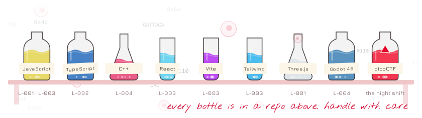</picture>

<picture><source media="(prefers-color-scheme: dark)" srcset="assets/stream-4-dark.svg"></picture>


<!-- CULTURE:START -->
<picture><source media="(prefers-color-scheme: dark)" srcset="assets/culture-dark.gif?v=2026-W43"></picture>

<sub><b>Fig. 2</b> This week's culture · Gray-Scott, <i>fingerprint</i> regime · re-plated every Monday</sub>
<!-- CULTURE:END -->

<details>
<summary><b>L-003 · Why the culture grows spots, stripes and mazes</b></summary>
<br>

Two chemicals, *u* and *v*, diffuse at different rates and react with each other. This is the Gray-Scott model, and the same equations run inside <a href="https://github.com/Llenoxinn/viscal">viscal</a>:

<p align="center">
<picture><source media="(prefers-color-scheme: dark)" srcset="assets/eq-gray-scott-u-dark.svg">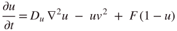</picture><br><br>
<picture><source media="(prefers-color-scheme: dark)" srcset="assets/eq-gray-scott-v-dark.svg">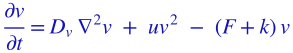</picture>
</p>

*F* feeds fresh *u* into the dish and *k* kills off *v*. Nudge (*F*, *k*) a little and the culture switches between spots, stripes, mazes and dividing "cells". Fig. 2 runs a different regime every week.

</details>

<details>
<summary><b>L-002 · How two sequences get compared</b></summary>
<br>

Pairwise alignment by dynamic programming. Each cell of the score matrix takes the best of a match or mismatch, or a gap in either sequence (global alignment, Needleman–Wunsch):

<p align="center">
<picture><source media="(prefers-color-scheme: dark)" srcset="assets/eq-needleman-wunsch-dark.svg"></picture>
</p>
<!-- If PHY-TREE uses local alignment (Smith–Waterman), add 0 to the max in lab/build_notes.py and say so here. -->

</details>

<details>
<summary><b>Lab rounds · how this notebook keeps itself</b></summary>
<br>

| When (Manila) | What happens | Script |
|---|---|---|
| Every night, 00:07 | A random structure is pulled from the Protein Data Bank, ray-traced in colour, typed onto a card and modelled in 3D | `specimen_of_the_day.py` + `render3d` (Rust) |
| Every night, 00:07 | Vitals, plasmid, karyotype, spindle and the tree of life are recomputed from the GitHub API and re-rendered | `vitals.py` + `render3d` (Rust) |
| Every night, and on every edit to `picoctf.json` | The CTF assay plate is redrawn | `build_assay.py` |
| Mondays | A new culture is grown and filmed | `grow_culture.py` |

Commits from the lab bot don't count toward the contribution graph, so the vitals stay honest.

</details>

<p align="center"><sub>Specimen requests: <a href="mailto:dsjuevesano@up.edu.ph">dsjuevesano@up.edu.ph</a> · Every figure here is generated by code in <a href="https://github.com/Llenoxinn/Llenoxinn/tree/HEAD/lab">lab/</a></sub></p>
