<!--
  dexterslab · the GitHub lab notebook of Dexter Juevesano (@Llenoxinn)
  Every picture is drawn by lab/. Blocks bounded by NAME:START/END are owned
  by their generators and refreshed by .github/workflows/lab-rounds.yml.
-->

<a href="https://dexterslab-dev.vercel.app">
<picture>
  <source media="(max-width: 600px) and (prefers-reduced-motion: reduce) and (prefers-color-scheme: dark)" srcset="assets/banner-narrow-still-dark.svg">
  <source media="(max-width: 600px) and (prefers-reduced-motion: reduce)" srcset="assets/banner-narrow-still-light.svg">
  <source media="(max-width: 600px) and (prefers-color-scheme: dark)" srcset="assets/banner-narrow-dark.svg">
  <source media="(max-width: 600px)" srcset="assets/banner-narrow-light.svg">
  <source media="(prefers-reduced-motion: reduce) and (prefers-color-scheme: dark)" srcset="assets/banner-still-dark.svg">
  <source media="(prefers-reduced-motion: reduce)" srcset="assets/banner-still-light.svg">
  <source media="(prefers-color-scheme: dark)" srcset="assets/banner-dark.svg">
  
</picture>
</a>

<h3 align="center"><picture><source media="(max-width: 600px) and (prefers-reduced-motion: reduce) and (prefers-color-scheme: dark)" srcset="assets/headers/projects-narrow-still-dark.svg"><source media="(max-width: 600px) and (prefers-reduced-motion: reduce)" srcset="assets/headers/projects-narrow-still-light.svg"><source media="(max-width: 600px) and (prefers-color-scheme: dark)" srcset="assets/headers/projects-narrow-dark.svg"><source media="(max-width: 600px)" srcset="assets/headers/projects-narrow-light.svg"><source media="(prefers-reduced-motion: reduce) and (prefers-color-scheme: dark)" srcset="assets/headers/projects-still-dark.svg"><source media="(prefers-reduced-motion: reduce)" srcset="assets/headers/projects-still-light.svg"><source media="(prefers-color-scheme: dark)" srcset="assets/headers/projects-dark.svg"></picture></h3>

<!-- PROJECTS:START -->

<a href="https://placebeat-studio.vercel.app"><picture><source media="(max-width: 600px) and (prefers-reduced-motion: reduce) and (prefers-color-scheme: dark)" srcset="assets/projects/placebaistudio-feature-narrow-still-dark.svg"><source media="(max-width: 600px) and (prefers-reduced-motion: reduce)" srcset="assets/projects/placebaistudio-feature-narrow-still-light.svg"><source media="(max-width: 600px) and (prefers-color-scheme: dark)" srcset="assets/projects/placebaistudio-feature-narrow-dark.svg"><source media="(max-width: 600px)" srcset="assets/projects/placebaistudio-feature-narrow-light.svg"><source media="(prefers-reduced-motion: reduce) and (prefers-color-scheme: dark)" srcset="assets/projects/placebaistudio-feature-still-dark.svg"><source media="(prefers-reduced-motion: reduce)" srcset="assets/projects/placebaistudio-feature-still-light.svg"><source media="(prefers-color-scheme: dark)" srcset="assets/projects/placebaistudio-feature-dark.svg"></picture></a>

<a href="https://github.com/Llenoxinn/dfCTF"><picture><source media="(prefers-reduced-motion: reduce) and (prefers-color-scheme: dark)" srcset="assets/projects/dfctf-still-dark.svg"><source media="(prefers-reduced-motion: reduce)" srcset="assets/projects/dfctf-still-light.svg"><source media="(prefers-color-scheme: dark)" srcset="assets/projects/dfctf-dark.svg"></picture></a>
<a href="https://github.com/Llenoxinn/BELaude"><picture><source media="(prefers-reduced-motion: reduce) and (prefers-color-scheme: dark)" srcset="assets/projects/belaude-still-dark.svg"><source media="(prefers-reduced-motion: reduce)" srcset="assets/projects/belaude-still-light.svg"><source media="(prefers-color-scheme: dark)" srcset="assets/projects/belaude-dark.svg">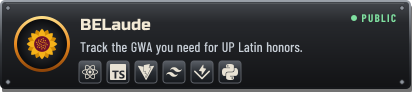</picture></a>
<a href="https://github.com/Llenoxinn/Sylvi"><picture><source media="(prefers-reduced-motion: reduce) and (prefers-color-scheme: dark)" srcset="assets/projects/sylvi-still-dark.svg"><source media="(prefers-reduced-motion: reduce)" srcset="assets/projects/sylvi-still-light.svg"><source media="(prefers-color-scheme: dark)" srcset="assets/projects/sylvi-dark.svg">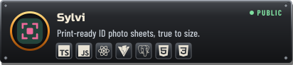</picture></a>
<a href="https://github.com/Llenoxinn/Olatz-tol"><picture><source media="(prefers-reduced-motion: reduce) and (prefers-color-scheme: dark)" srcset="assets/projects/olatz-tol-still-dark.svg"><source media="(prefers-reduced-motion: reduce)" srcset="assets/projects/olatz-tol-still-light.svg"><source media="(prefers-color-scheme: dark)" srcset="assets/projects/olatz-tol-dark.svg"></picture></a>
<a href="https://github.com/Llenoxinn/Protein-Structure-Viewer-Lite-"><picture><source media="(prefers-reduced-motion: reduce) and (prefers-color-scheme: dark)" srcset="assets/projects/protein-structure-viewer-lite-still-dark.svg"><source media="(prefers-reduced-motion: reduce)" srcset="assets/projects/protein-structure-viewer-lite-still-light.svg"><source media="(prefers-color-scheme: dark)" srcset="assets/projects/protein-structure-viewer-lite-dark.svg"></picture></a>
<a href="https://github.com/Llenoxinn/Viscal"><picture><source media="(prefers-reduced-motion: reduce) and (prefers-color-scheme: dark)" srcset="assets/projects/viscal-still-dark.svg"><source media="(prefers-reduced-motion: reduce)" srcset="assets/projects/viscal-still-light.svg"><source media="(prefers-color-scheme: dark)" srcset="assets/projects/viscal-dark.svg">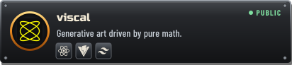</picture></a>
<a href="https://github.com/GeoCeff/perk-the-star"><picture><source media="(prefers-reduced-motion: reduce) and (prefers-color-scheme: dark)" srcset="assets/projects/perk-the-star-still-dark.svg"><source media="(prefers-reduced-motion: reduce)" srcset="assets/projects/perk-the-star-still-light.svg"><source media="(prefers-color-scheme: dark)" srcset="assets/projects/perk-the-star-dark.svg"></picture></a>
<picture><source media="(prefers-reduced-motion: reduce) and (prefers-color-scheme: dark)" srcset="assets/projects/phytree-still-dark.svg"><source media="(prefers-reduced-motion: reduce)" srcset="assets/projects/phytree-still-light.svg"><source media="(prefers-color-scheme: dark)" srcset="assets/projects/phytree-dark.svg"></picture>

<!-- PROJECTS:END -->

<h3 align="center"><picture><source media="(max-width: 600px) and (prefers-reduced-motion: reduce) and (prefers-color-scheme: dark)" srcset="assets/headers/wins-narrow-still-dark.svg"><source media="(max-width: 600px) and (prefers-reduced-motion: reduce)" srcset="assets/headers/wins-narrow-still-light.svg"><source media="(max-width: 600px) and (prefers-color-scheme: dark)" srcset="assets/headers/wins-narrow-dark.svg"><source media="(max-width: 600px)" srcset="assets/headers/wins-narrow-light.svg"><source media="(prefers-reduced-motion: reduce) and (prefers-color-scheme: dark)" srcset="assets/headers/wins-still-dark.svg"><source media="(prefers-reduced-motion: reduce)" srcset="assets/headers/wins-still-light.svg"><source media="(prefers-color-scheme: dark)" srcset="assets/headers/wins-dark.svg"></picture></h3>

<picture><source media="(max-width: 600px) and (prefers-reduced-motion: reduce) and (prefers-color-scheme: dark)" srcset="assets/headers/shelf-narrow-still-dark.svg"><source media="(max-width: 600px) and (prefers-reduced-motion: reduce)" srcset="assets/headers/shelf-narrow-still-light.svg"><source media="(max-width: 600px) and (prefers-color-scheme: dark)" srcset="assets/headers/shelf-narrow-dark.svg"><source media="(max-width: 600px)" srcset="assets/headers/shelf-narrow-light.svg"><source media="(prefers-reduced-motion: reduce) and (prefers-color-scheme: dark)" srcset="assets/headers/shelf-still-dark.svg"><source media="(prefers-reduced-motion: reduce)" srcset="assets/headers/shelf-still-light.svg"><source media="(prefers-color-scheme: dark)" srcset="assets/headers/shelf-dark.svg"></picture>

<h3 align="center"><picture><source media="(max-width: 600px) and (prefers-reduced-motion: reduce) and (prefers-color-scheme: dark)" srcset="assets/headers/stack-narrow-still-dark.svg"><source media="(max-width: 600px) and (prefers-reduced-motion: reduce)" srcset="assets/headers/stack-narrow-still-light.svg"><source media="(max-width: 600px) and (prefers-color-scheme: dark)" srcset="assets/headers/stack-narrow-dark.svg"><source media="(max-width: 600px)" srcset="assets/headers/stack-narrow-light.svg"><source media="(prefers-reduced-motion: reduce) and (prefers-color-scheme: dark)" srcset="assets/headers/stack-still-dark.svg"><source media="(prefers-reduced-motion: reduce)" srcset="assets/headers/stack-still-light.svg"><source media="(prefers-color-scheme: dark)" srcset="assets/headers/stack-dark.svg"></picture></h3>

<!-- STACK:START -->

<picture><source media="(prefers-color-scheme: dark)" srcset="assets/stack/group-lang-dark.svg"></picture>
<picture><source media="(prefers-color-scheme: dark)" srcset="assets/stack/c-dark.svg"></picture>
<picture><source media="(prefers-color-scheme: dark)" srcset="assets/stack/cpp-dark.svg"></picture>
<picture><source media="(prefers-color-scheme: dark)" srcset="assets/stack/csharp-dark.svg"></picture>
<picture><source media="(prefers-color-scheme: dark)" srcset="assets/stack/haskell-dark.svg"></picture>
<picture><source media="(prefers-color-scheme: dark)" srcset="assets/stack/kotlin-dark.svg"></picture>
<picture><source media="(prefers-color-scheme: dark)" srcset="assets/stack/prolog-dark.svg"></picture>
<picture><source media="(prefers-color-scheme: dark)" srcset="assets/stack/python-dark.svg"></picture>
<picture><source media="(prefers-color-scheme: dark)" srcset="assets/stack/javascript-dark.svg"></picture>
<picture><source media="(prefers-color-scheme: dark)" srcset="assets/stack/typescript-dark.svg"></picture>
<picture><source media="(prefers-color-scheme: dark)" srcset="assets/stack/html-dark.svg"></picture>
<picture><source media="(prefers-color-scheme: dark)" srcset="assets/stack/css-dark.svg"></picture>
<picture><source media="(prefers-color-scheme: dark)" srcset="assets/stack/latex-dark.svg"></picture>
 
<picture><source media="(prefers-color-scheme: dark)" srcset="assets/stack/group-web-dark.svg"></picture>
<picture><source media="(prefers-color-scheme: dark)" srcset="assets/stack/react-dark.svg"></picture>
<picture><source media="(prefers-color-scheme: dark)" srcset="assets/stack/next-js-dark.svg"></picture>
<picture><source media="(prefers-color-scheme: dark)" srcset="assets/stack/svelte-dark.svg"></picture>
<picture><source media="(prefers-color-scheme: dark)" srcset="assets/stack/vite-dark.svg"></picture>
<picture><source media="(prefers-color-scheme: dark)" srcset="assets/stack/tailwind-css-dark.svg"></picture>
<picture><source media="(prefers-color-scheme: dark)" srcset="assets/stack/zustand-dark.svg"></picture>
<picture><source media="(prefers-color-scheme: dark)" srcset="assets/stack/d3-js-dark.svg"></picture>
<picture><source media="(prefers-color-scheme: dark)" srcset="assets/stack/three-js-dark.svg"></picture>
<picture><source media="(prefers-color-scheme: dark)" srcset="assets/stack/electron-dark.svg"></picture>
 
<picture><source media="(prefers-color-scheme: dark)" srcset="assets/stack/group-backend-dark.svg"></picture>
<picture><source media="(prefers-color-scheme: dark)" srcset="assets/stack/node-js-dark.svg"></picture>
<picture><source media="(prefers-color-scheme: dark)" srcset="assets/stack/supabase-dark.svg"></picture>
<picture><source media="(prefers-color-scheme: dark)" srcset="assets/stack/postgresql-dark.svg"></picture>
<picture><source media="(prefers-color-scheme: dark)" srcset="assets/stack/drizzle-dark.svg"></picture>
<picture><source media="(prefers-color-scheme: dark)" srcset="assets/stack/group-ship-dark.svg"></picture>
<picture><source media="(prefers-color-scheme: dark)" srcset="assets/stack/docker-dark.svg"></picture>
<picture><source media="(prefers-color-scheme: dark)" srcset="assets/stack/vercel-dark.svg"></picture>
<picture><source media="(prefers-color-scheme: dark)" srcset="assets/stack/github-actions-dark.svg"></picture>
<picture><source media="(prefers-color-scheme: dark)" srcset="assets/stack/vitest-dark.svg"></picture>
<picture><source media="(prefers-color-scheme: dark)" srcset="assets/stack/playwright-dark.svg"></picture>
 
<picture><source media="(prefers-color-scheme: dark)" srcset="assets/stack/group-tools-dark.svg"></picture>
<picture><source media="(prefers-color-scheme: dark)" srcset="assets/stack/godot-dark.svg"></picture>
<picture><source media="(prefers-color-scheme: dark)" srcset="assets/stack/wsl-dark.svg"></picture>
<picture><source media="(prefers-color-scheme: dark)" srcset="assets/stack/ucsf-chimerax-dark.svg"></picture>
<picture><source media="(prefers-color-scheme: dark)" srcset="assets/stack/audacity-dark.svg"></picture>
<picture><source media="(prefers-color-scheme: dark)" srcset="assets/stack/group-design-dark.svg"></picture>
<picture><source media="(prefers-color-scheme: dark)" srcset="assets/stack/figma-dark.svg"></picture>
<picture><source media="(prefers-color-scheme: dark)" srcset="assets/stack/adobe-photoshop-dark.svg"></picture>
<picture><source media="(prefers-color-scheme: dark)" srcset="assets/stack/adobe-indesign-dark.svg"></picture>
<picture><source media="(prefers-color-scheme: dark)" srcset="assets/stack/adobe-illustrator-dark.svg"></picture>
<picture><source media="(prefers-color-scheme: dark)" srcset="assets/stack/canva-dark.svg"></picture>

<!-- STACK:END -->

<h3 align="center"><picture><source media="(max-width: 600px) and (prefers-reduced-motion: reduce) and (prefers-color-scheme: dark)" srcset="assets/headers/live-narrow-still-dark.svg"><source media="(max-width: 600px) and (prefers-reduced-motion: reduce)" srcset="assets/headers/live-narrow-still-light.svg"><source media="(max-width: 600px) and (prefers-color-scheme: dark)" srcset="assets/headers/live-narrow-dark.svg"><source media="(max-width: 600px)" srcset="assets/headers/live-narrow-light.svg"><source media="(prefers-reduced-motion: reduce) and (prefers-color-scheme: dark)" srcset="assets/headers/live-still-dark.svg"><source media="(prefers-reduced-motion: reduce)" srcset="assets/headers/live-still-light.svg"><source media="(prefers-color-scheme: dark)" srcset="assets/headers/live-dark.svg"></picture></h3>

<!-- CONTRIBUTIONS:START -->
<a href="https://github.com/Llenoxinn"><picture><source media="(prefers-reduced-motion: reduce) and (prefers-color-scheme: dark)" srcset="assets/contributions-still-dark.svg?v=06280dc4"><source media="(prefers-reduced-motion: reduce)" srcset="assets/contributions-still-light.svg?v=06280dc4"><source media="(prefers-color-scheme: dark)" srcset="assets/contributions-dark.svg?v=06280dc4"></picture></a>
<!-- CONTRIBUTIONS:END -->
<!-- LEETCODE:START -->
<a href="https://leetcode.com/u/Acetylsphae/"><picture><source media="(prefers-reduced-motion: reduce) and (prefers-color-scheme: dark)" srcset="assets/leetcode-still-dark.svg?v=f4ab2ffb"><source media="(prefers-reduced-motion: reduce)" srcset="assets/leetcode-still-light.svg?v=f4ab2ffb"><source media="(prefers-color-scheme: dark)" srcset="assets/leetcode-dark.svg?v=f4ab2ffb"></picture></a>
<!-- LEETCODE:END -->
<!-- ASSAY:START -->
<a href="https://play.picoctf.org/practice"><picture><source media="(prefers-reduced-motion: reduce) and (prefers-color-scheme: dark)" srcset="assets/assay-still-dark.svg?v=3e9f95b0"><source media="(prefers-reduced-motion: reduce)" srcset="assets/assay-still-light.svg?v=3e9f95b0"><source media="(prefers-color-scheme: dark)" srcset="assets/assay-dark.svg?v=3e9f95b0"></picture></a>
<!-- ASSAY:END -->

<h3 align="center"><picture><source media="(max-width: 600px) and (prefers-reduced-motion: reduce) and (prefers-color-scheme: dark)" srcset="assets/headers/contact-narrow-still-dark.svg"><source media="(max-width: 600px) and (prefers-reduced-motion: reduce)" srcset="assets/headers/contact-narrow-still-light.svg"><source media="(max-width: 600px) and (prefers-color-scheme: dark)" srcset="assets/headers/contact-narrow-dark.svg"><source media="(max-width: 600px)" srcset="assets/headers/contact-narrow-light.svg"><source media="(prefers-reduced-motion: reduce) and (prefers-color-scheme: dark)" srcset="assets/headers/contact-still-dark.svg"><source media="(prefers-reduced-motion: reduce)" srcset="assets/headers/contact-still-light.svg"><source media="(prefers-color-scheme: dark)" srcset="assets/headers/contact-dark.svg">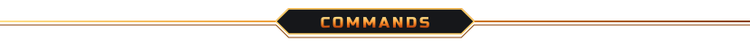</picture></h3>

<a href="https://www.linkedin.com/in/dsjuevesano/"><picture><source media="(prefers-reduced-motion: reduce) and (prefers-color-scheme: dark)" srcset="assets/contact-linkedin-still-dark.svg"><source media="(prefers-reduced-motion: reduce)" srcset="assets/contact-linkedin-still-light.svg"><source media="(prefers-color-scheme: dark)" srcset="assets/contact-linkedin-dark.svg"></picture></a>
<a href="https://github.com/Llenoxinn"><picture><source media="(prefers-reduced-motion: reduce) and (prefers-color-scheme: dark)" srcset="assets/contact-github-still-dark.svg"><source media="(prefers-reduced-motion: reduce)" srcset="assets/contact-github-still-light.svg"><source media="(prefers-color-scheme: dark)" srcset="assets/contact-github-dark.svg"></picture></a>

